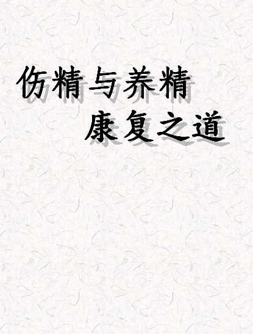
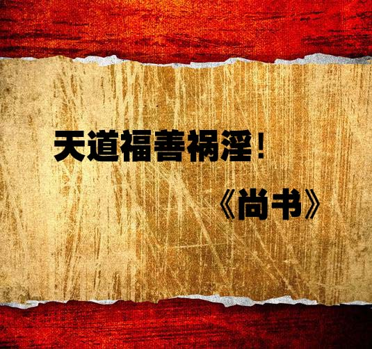

# 开篇

## 彭鑫

**简介**

本书的作者及编辑，都是七十年代末出生的人，恭逢改革开放，温饱问题得以解决，在长辈的眼里，属于很有福气的一代人。八九十年代出生的人，饮食愈发营养，衣服愈发讲究，住所愈发舒适，交通愈发快捷，看上去一代比一代幸福。但是，有哪些不好的地方吗？难道没有祸患吗？有谁能够理解当今青少年最大的痛苦所在？

古圣先贤曾经指出：“饱暖思淫欲。”人性本来如此，需要伦理道德的约束才能规范。但是中国自改革开放以来，西方学说盛行，从社会学、人类学、生理学、心理学等诸多方面，直接或者间接地鼓励青少年纵欲，性解放思潮甚嚣尘上，男女关系混乱如脱缰野马。

实践是检验一切真理的标准，时间更是检验一切真理的标准！等这些纵欲青少年在学习成绩、生活习惯、身体成长、心灵建设等诸多方面痛苦不堪时，往往木已成舟，一切都悔之晚矣！这可真是最悲痛、最可惜的祸患！

广大父母亲都很关心孩子的成长，甚至严加看护。但造成孩子身心伤害的邪淫，不仅仅是父母们看得到的外在行为，更包括背后的行为，甚至是孩子的起心动念。

由此来说，本书的作者真是慈悲到了极处！不仅教导正当的男女相处观念，帮助孩子养护健康的身心，也奉献有效的疗治手段，帮助深受危害者重获幸福。作者可称得上是青少年最真诚的朋友。

祝愿凡是读到此书的有缘人都能获得身心健康！

祝愿华夏儿女心清志朗，祝愿神州大地清净安宁！

序

社会对中医学知识的需求日益增多，但这门学科属于整体论科学类型，与人们熟悉的西医还原论模式不通约，加上中国文化近百年来，相对于西方文化，渐渐被人们淡忘，因而向公众有效地介绍中医学实际上是十分不易的，对传播者提出了很高的要求。首先自身必须透彻认识中医学内涵，还要有丰富的实践经验，真正了解公众需求，此外还得找到恰当的表达方式，让读者能够准确理解，本书作者彭鑫博士便是难得的兼具这四个条件的青年才俊。我年长彭博士近二十岁，与他长期学术交往，经常得到清新的启发与热忱的激励，获益匪浅。他旺盛的求知欲、深厚的学养以及善解人意的个性给我留下深刻、美好的印象，我们成为忘年交和事业知音。

在中医学的理论框架中，精、气、神是三个最基本、最核心的概念，它们贯穿哲学与科学，融合理论与实践，是进入中医之门的钥匙，许多中医学概念都可以从中衍生，大量养生保健问题也都能由此作出最为根本的解答。尤其值得一提的是，这三个概念既有中医学术属性，也有常识色彩，不那么学究气，而易于被公众接受。彭博士正是从这里出发，探索并形成了他独具特色的中医学养生理念与方法。本书从“精”入手，结合普遍存在的对医理、养生、疗病、用药等各方面的疑问，深入浅出、生动实用、针对性很强地进行了解说，以期帮助读者更好地了解自己的需要，很有指导意义。更为可贵的是，彭博士无保留地将经过自己亲身检验的多种养生保健方法和盘托出，奉献给大家。

这是一本写给公众的普及著作，但对中医专业人士也有助益。它贯穿了一条从理论到实践、从传统到现代、从科学到生活的主线，既准确把握读者的实际需求，又恰当对接中医经典的理论范畴，将普通人生活中遇到的问题与困扰，引申到有深度的科学探讨，同时也在轻松的漫谈中，实现了古代圣贤与当代人的近距离对话。这种功夫对中医从业者是不可缺少的，不论从事理论研究、临床诊疗，还是养生保健与产业开发，都必须做到将古奥的传统知识与现代生活密切融合，否则便会出现一种十分尴尬的场景：或者端出一杯没有味道的淡茶，或者拿来一壶倒不出来的浓茶。这都不是我们这个时代需要的东西。只有将浓郁的香茶倒进茶杯，方便品尝，才能满足人们的需求。这就是生活对中医界的要求，一点儿也不过分。

马晓彤

中国中医科学院中医基础理论研究所科教处长，中医学博士

伤身、败德、折寿的根源

——在山东青岛企业家交流会的演讲（2009年5月2日）

各位领导，各位来宾，各位长辈，各位老师：

大家上午好！

我先自我介绍一下：我的名字叫彭鑫，“彭”就是彭德怀的彭，“鑫”就是三个金的鑫。我是北京中医药大学博士毕业。博士毕业之后，我任职于中国中医科学院，从事中医理论和中医临床的研究工作。到现在，我学习中国传统文化五年了，感觉中国传统文化以及古圣先贤的教诲，无论对于我们的内心还是我们的身体，都是非常有价值的。下面我就跟大家汇报，讲座的题目是“伤身、败德、折寿的根源”。

现在社会上非常流行一个话题，那就是“养生”。所谓养生是指让自己的身心保持一种健康状态。反过来看我们现今社会，随着国力的增强，人们物质生活日渐丰富，与之相反的，却是人们的健康素质下降，中风、糖尿病、癌症等诸多疑难杂症的罹患率逐年上升。

古人有句话叫作“行有不得，反求诸己”，作为一名中医师，我们身上担负的责任就是两个：第一个是治疗疾病，第二个是养生保健。那么人民的健康出了问题，我们责无旁贷。作为一名中医师，在这里我向大家道歉，是我们做得不好。

刚才我讲到，现在人们身体呈现一种衰败的状态，表现出来的种种疾病，很多医院都无法解决，病痛伴随人们的一生。在这里面有个很重要的原因，这个原因也是自古以来历朝历代的医学家所重视的一点，那就是男女关系混乱对人体的伤害是极为严重的。

现在的中国社会，随着西方价值观的泛滥，我们看到，在这个有着五千年文明的中华大地上，却出现了一种非常混乱的现象，什么现象？——那就是性的开放和泛滥。

我们走在大街上，看到很多广告牌上的图片都是非常露骨，引起人们的欲望。走到报刊亭，看到50%以上的报刊、杂志封面上的女主角穿着都是非常暴露，引起人们的邪思邪念。我们打开计算机，连上网络，我们就会发现，计算机和网络里面的不良链接层出不穷，很多国际、国内知名的网站，在它的主页上都有这种信息的链接。我们打开电视机就会发现，电视剧里面所演的情节，包养情妇、婚外情这种情节非常普遍。

一方面，这些性欲泛滥的思想，对人们的思想造成了污染；另一方面，它对人们的身体、心灵造成了双重重创。

性欲的泛滥，古代医生称为“相火妄动”，“相”是宰相的相，“火”是水火的火。按照中医学理论，身体里面的火有两种：一种是“君火”，一种是“相火”。“君”是指君主的君。即人体的火气，君主应该当位，宰相应该起到辅佐作用，本来安于本位的宰相职责没有做好，这样一“相火妄动”，就会耗伤人们的阴精，导致疾病重重，然后很多疾病由此而发。

我在从事中医临床研究工作中，总结了以下诸种对身体的损伤。下面跟大家一一汇报。

首先是现在社会上流行的一种疾病，每年这种疾病的发病率都在增加，而且呈现一种低龄化趋势。这种病是什么？――就是糖尿病，现在很多人称之为“富贵病”。在我国20世纪六七十年代以前，这种病的发病率不高，随着改革开放，随着人们物质生活提高，这种病的发病率愈来愈高。下面我就跟大家汇报，为什么男女关系混乱会导致糖尿病的发生。

我们大家都有一种概念，就是饮食过度、饮食不节会导致糖尿病。这种理念按照中医理论来讲，叫作“中消”。糖尿病在古代叫作“消渴”，“消”就是消失的消，“渴”就是口渴的渴。古人把“消渴”分为三种：“上消”、“中消”和“下消”。

“上消”是因肺阴虚、肺气不足所致，表现为口渴多饮。“中消”是指饮食不节，致使中焦脾胃功能失调，导致糖尿病。“下消”是指房事不节、纵欲、熬夜、心神不宁、思虑过重等，导致下焦肝肾不足，进而引起糖尿病。“下消”这种糖尿病，现代临床尤其多见。大家要注意――不仅仅是饮食不节导致的糖尿病发病率很高，现在有很多纵欲过度导致的糖尿病也层出不穷。这种类型的糖尿病有典型的特点，我给大家描述一下。

第一点是下肢发凉。人老从哪开始的？是从腿。清朝有个医家叫叶天士，曾经说过一句名言：“男子向老，下元先亏。”什么意思？就是一个人开始老，是从他的下焦，也就是说从肝肾、腰腿这块先开始的。有一类糖尿病患者的表现就是下肢无力、脚凉，其伴随的症状是什么？就是小便频、面色灰黄，这都是肾气不足的表现。这种表现叫作“肾阳虚”。我在临床中就遇到好多这样的案例，患者控制饮食，也进行调理，但是不节制房事，血糖指数还是降不下来，这样下去，所导致的结果是非常严重的。

我举一个在临床中遇到的案例。这个人做旅游产业的，是企业家。他从30岁开始得糖尿病，典型的表现就是两只脚无力，走路脚下虚浮，用老百姓话讲就是脚底下没根。外在表现是脸色灰黄，小便次数特别频繁，而且有“淋漓不尽”的现象。“淋漓不尽”实际上是前列腺炎或者前列腺肥大的一种表现，这在70岁以上的老人多见，为什么在这个才30岁的年轻人身上就有？一句话，伤肾，也就是纵欲引起的。我把完他的脉之后发现，这个人两个尺脉是非常沉的。

中医的脉诊叫作“浮中沉，寸关尺”。寸关尺，尺脉候的是肾，“尺”就是在手腕部内侧桡动脉之后的位置。如果这个人尺脉很沉、很细、无力，那么说明这个人肾气不足。我把这个企业家的脉时，就发现他的肾气非常不足，而且外在表现也是肾阳亏虚、脾阳不足这种现象。按照中医理论来讲，这叫（肾）火不暖（脾）土。这种情况下的糖尿病，仅仅靠控制饮食、降血糖的药、胰岛素等是没法控制的。继续往下发展的话，很有可能导致一种现象，叫作“坏疽”。

“坏疽”是什么意思？就是两只脚血液流通不通畅，时间长了，就会导致局部坏死，最终的结局就是截肢。这个患者从30岁得糖尿病，找我看病时是40岁，已经得了10年。临床统计，糖尿病10年以上的患者，有30%的危险引发“坏疽”。我跟他讲，这个病要想治好控制住的话，必须节制房事。按照古代医家的教诲，至少有一到两年的时间禁欲，把肾气保存好，否则的话，身体就会出现很大的麻烦。但是这个人丝毫不听我的建议，他看病主要是为了两点：一是治疗糖尿病，另外是治疗阳痿。

阳痿，实际上就是人肾气不足的一种身体自我保护。中医倡导人们要随顺自然，也就是自然保健的养生方法。就像我们进入一个寒冷的环境当中，皮肤出现鸡皮疙瘩，实际上就是身体的一种自我保护功能启动了。鸡皮疙瘩一出现，就说明全身的汗毛孔收缩，抵御外在的寒气。这个人糖尿病10年，又有纵欲历史，然后出现了阳痿，实际上就是身体所发出的信号，就是请他节制房事，要自我保护。结果他却让我给他治疗这个疾病，然后鼓舞他的阳气。

大家试想，我们一个人进入寒冷的环境当中，本来汗毛孔收缩，结果这个人还要求医生给他开一种让他的汗毛孔舒张的药。这叫什么？这叫“逆天者亡”。所谓的天就是自然，也是自然规律。顺应自然规律，身体就会健康；违背自然规律，身体就会急剧衰败，最终导致死亡。这个人找我看病，实际上就想做“逆天而亡”的这种工作，我跟他说，这个病要想治好，必须节禁房事，否则不可能好的。

他不听我的规劝，还引用了一句名言：“人生在世须尽欢，莫使金樽空对月。”在这里，因为有很多企业家，我就把这个问题着重给大家点出来。老百姓有一句话，叫作“男人有钱就变坏，女人变坏就有钱”。这里面的“坏”，很重要的一点就是男女关系的混乱。

现在很多人一旦有了钱，所追求的就是性方面的享受，而他不知道自己在享受的同时也是在往火坑里跳。我跟这个患者谈到这个问题的时候，他说：“彭大夫，你要想让我节禁房事，比杀了我还难，因为我……”剩下的话我就不说了。我说：“好，你现在做的事情是逆天而亡的，也就是自然规律会约束你的，会教育你的，咱们一年之后见。”“你这种情况，我跟你直接讲，半年之后，你的脚就不仅仅是凉了，会出现发木发麻的情况。你若是再不节禁房事的话，再过半年，你这只脚的局部血液循环就会坏死，到最后的结局就是截肢。我把这个话放到这。”他一笑了之，他说：“性生活与糖尿病有什么关系？”我说：“那好，咱们看事实！”

一年之后，他给我打电话：“彭大夫，你所说的话全都应验了！”他说：“我从离开你之后，三个月，我的脚本来是凉的，已经变成麻木的。”大家都知道，这是人体的阳气开始往回撤的表现。观察生活就会发现，小孩子的手脚永远都是温暖的，即使到了很冷的冬天，他光着脚出去，手脚都是很红的。随着人年龄的增长，阳气愈来愈少，就会出现手脚开始发凉，再一步就是发麻发木。

糖尿病患者如果出现这种脚凉、发麻发木情况，说明他的阳气已经开始往回撤了，血液不循环了。他说：“半年之后，我这个脚知觉就非常地不清楚。”什么叫不清楚？就是虽然脚踩在地上，但是感觉脚好像离了地很远，好像垫了一层厚厚的海绵。这是气血已经通不到脚上去的一种表现，神经开始麻木。一年之后他给我打电话：“我现在出现什么情况？就是我脚的中指和无名指这两个脚趾，任何感觉都没有，而且开始变黑。”

去医院检查之后，医生告诉他说：“这叫糖尿病坏疽，最终极的治疗方法，那就是截肢。”听到这个诊断之后，他是非常害怕的，就给我打电话。我在电话里告诉他说：“坏疽分很多种，有因为气滞血瘀的，有因为肾虚的，其中肾虚的坏疽是不可能治好的，因为你以前把自己的身体消耗得太过了。”

怎么讲？就是在他一年前有阳痿这种情况的时候，实际上就是身体提出警告了，说您老人家一定得悠着自己的元气，不要再消耗太过了。结果他不听，反而吃一些壮阳药，喝所谓的壮阳酒，来使阳气愈发消耗。消耗没了之后，人的骨髓枯萎了。按照古人的话讲，这叫“骨髓枯”。人的骨髓枯萎了，等待他的那就是恶果。所以这个人给我打完电话后，我说这个病很难很难治了。这个案例在华佗的医案里面都有记载，他说“神仙在世”也无法挽救这一类的疾病。这个人最后的结局就是，把他脚的中指和无名指锯掉。情况非常严重，这是我谈的第一个案例。

下面我跟大家汇报的另外一种疾病就是中风。中风的原因有很多，用现代医学的眼光看来，中风无非就是两种：一种是脑血管破裂，另外一种是脑血管阻塞和痉挛。

按照中国古代医家的论述来讲，所谓的中风实际上就是身体内在的火气上涌，导致上焦的气紊乱，然后导致疾病。古代中医的传统理论学说来讲，中风就是肝火上炎、肝风内动，或者是痰浊内扰，但是这里面还有一个很重要的病因，那就是肝肾不足。

有时，肝肾不足导致肝失疏泄，进一步导致肝气郁结，肝气郁结既久，气盛化火而导致肝火上炎，肝火灼伤肝阴又导致肝阴虚或肝肾阴虚，一方面可使肝火更旺，另一方面阴虚水不涵木、阴不制阳而导致肝阳上亢，阳亢无制又可导致肝风内动。所谓肝风内动，就是指肝肾阴液精血亏虚，血不养筋，阴不制阳，肝阳亢奋，步履不稳、头摇肢颤、语言蹇涩，甚至突然昏仆、口眼歪斜、半身不遂等中风症状。

肝风挟痰上蒙清窍，心神昏愦，则突然昏倒，不省人事；风痰窜扰脉络，患侧气血运行不利，则导致半身不遂、口眼歪斜；如果痰阻舌根，则出现舌体僵硬、不能言语。这类情形在临床上多见于眩晕、头痛、中风及西医的高血压、脑血栓形成、脑出血等疾病。治疗以镇肝熄风为法，常用天麻钩藤饮、镇肝熄风汤之类。

记得在2006年，我当住院医生的时候，曾经一个晚上送走了3个中风患者，都是死于多脏器衰竭。这3个患者的平均年龄，大家注意――都是40岁上下，最年轻的38岁，最大年龄的是42岁。第二天，我写死亡病程的病例汇报，一边写一边想，为什么中风呈现出一种低龄化趋向？我们回想20世纪七八十年代，那时候的中风，大多数都是六七十岁，甚至八十多岁的老人家，才会出现这种情况。为什么现在年轻人，三十多岁的人，中风却这么多，甚至导致死亡？当然不可忽视的是，现在的饮食结构发生了变化，人们吃得好了，身体里面的脂肪存留增多。那我会反问，吃得好了，脂肪存留增多，就一定导致中风吗？我们发现生活中不是这样的，很多人也是大鱼大肉，但是并没有中风。导致中风的另外一个原因，用中医的眼光看来就是肾气不足，也叫肝肾不足，导致肝肾不足最重要的原因就是纵欲。

下面我跟大家分享的这个案例，就是我出版界的一个好朋友，也是一个企业家，才32岁就中风。这个人姓孙，找我看病的时候，他非常自信地告诉我：“彭大夫，我现在非常有钱，半年换三个女朋友。”他认为这是他值得骄傲的事情。我说：“那你离灾难就不远了！”为什么？因为一个人如果肾气亏虚，会导致一系列的“恶果”，在后面我会跟大家详细地展开。所谓的“恶果”，就是身体和心理、事业、家庭所出现的重重危机。这个人是所谓的社会青年精英，他找我看病，想让我调理一下他的身体，并进行一些合理的建议。因为现代人随着生活水平提高，对自己身体状况的要求也愈来愈高。他希望通过中医调理，把身体调整到一种平衡状态。这个人的外在表现是什么？两条腿特别的细。

大家注意，两条腿特别细、下肢无力的人，用中医的眼光看来，大部分是属于肝肾不足的人。这个人不仅两条腿特别细，而且走路没劲，脚下没有根，把他的脉，也是尺脉特别沉。他的另一个表现就是小便频，一晚上去厕所大约七到八次，这是伤肾的一个很严重的表现。他找我看病说：“你先帮我解决我小便频的问题，因为我需要睡眠，合理睡眠，第二天还要处理很多事情，光这样的情况就会影响我的工作。”我说：“好，但是你必须答应我一件事情，就是吃药期间绝对不能有房事。”他咬了咬牙说：“好！”然后我给他开了清朝有个医学家叫陈士铎的一张名方，叫作“引火汤”。他吃了这个方子之后，两个星期症状缓解，一晚上平均起夜一次到两次。

然后他跟我说：“接下来我应该怎么保养身体？”我说：“接下来你保养身体的原则非常简单，那就是禁欲一年以上。”作为医生必须说实话，而不是说好听的话。现在很多医生，为了随顺患者的欲望，不断地妥协，实际上这样是对患者身体的一种极度摧残。因为这个人是严重的伤肾，我跟他讲至少得禁欲一年以上，而且不能够与所谓的女朋友有不正当的性行为，这些东西对身体都会产生极大的损伤。

我讲这句话的时候，他非常不以为然，为什么？因为他以前接待客户的一个很重要手段就是，晚上吃完饭之后把客户送到歌舞厅、卡拉OK，甚至是一些情色场所。实际上，这不仅是自己往火坑里跳，也把别人推到火坑里去。我跟他讲，如果不约束自己的话，身体会损伤得非常严重。但他不听。在我第二次见他的时候，他的寸脉就出现一种很奇怪的现象——寸脉过寸，就是手上的这个脉象跑到大鱼际这个地方来了。这在中医来讲叫作“寸脉过寸，中风可虞”，就是这种现象一旦出现，可能就会中风。我就告诫他说：“你这段时间一定要保养好肝肾，不要再有这些行为了。如果再有，将来中风是没跑的，因为你的这个现象已经出现了。”他不听，他说：“我这么年轻怎么会得这种疾病，不要吓唬我了。”我说：“那就看自然规律！”

我刚才讲的，中国古圣先贤，包括古代医家所总结出来的这些情况，都是经得起历史考验的自然规律。若是不想遵从的话，以身试法完全可以。这位孙总就继续做着自己想做的事情。半年之后，我再见他，发现这个人出现一种很奇怪的现象，就是精神极度亢奋，以至于晚上睡不着觉。他见我的时候，还有另外一个女子在他身边，这个女子非常妖艳，令我想起了一个词，叫作“红颜祸水”。我们都知道古人所说的“红颜”，并不是指漂亮，而是指妖艳。妖艳的女人对男人有三种伤害：第一种伤害，是吸引男人，把男人的肾精给消耗掉；第二个伤害，是妖艳的女人惹是生非；第三个伤害，是妖艳的女人使男性沉溺色欲，最后丧失理智与理想，导致人生事业的失败。

大家都知道，很多朝代的毁灭都和女子有关。离我们最近的清朝、明朝，吴三桂冲冠一怒为红颜，讲的就是这个事实，把一个朝代都给毁了，更何况一个人！我跟他说：“这个女子对你的伤害会很重，你赶紧跟她远离，否则的话，您离这灾难就不远了。”他不听，还跟我说：“我好不容易赚到这些钱，难道不能让我享受一下吗？”我说：“你这种享受，实际上是过分纵欲，这对身体的损伤很大，对你将来的事业和家庭，以至于后半生，损伤都会很大。你如果现在不听，那咱们就看事实的发展是怎么样子的。”这个孙总继续过着那样糜烂的生活，半年之后现象就出现了。口眼歪斜，半身不遂，走路都难以平衡，眼睛闭不上，这就是典型的中风。如果是肝肾没有不足的普通中风患者，可能半年一年，走路就可以恢复，这叫中风康复。但是肾虚型的中风，三年恢复不了。这个患者从开始到现在三年了，走路还是不利索，说话连不成句。这就是伤肾所导致的恶果。

他中风之后见我说的第一句话就是：“彭大夫，我太后悔了，没有听你的话，导致现在我这种情况。”我说：“这个叫作邪淫，‘邪’就是邪恶的邪，‘淫’就是荒淫无道的淫。这个邪淫对身体的损伤，那简直是太严重了。”一方面，邪淫可以使一个人肾气损伤，导致身体的种种疾病；另一方面，一个经常伤肾的人，他的心情都是浮躁的，特别容易发脾气，脑子都是混乱的，容易做出各种各样的错误决定，这叫作心火亢盛、肾水不足。人一旦出现这种状态，那就是离灾难不远了，无论你的事业、家庭、身体，都会出现种种恶果。

古人告诫我们说：“万恶淫为首。”为什么这样讲？――因为一个人、一个朝代的君主，假如说荒淫的话，这个人、这个朝代离毁灭就不远了。这位孙总以身试法，最终的结局是事业衰败。他原先是做出版业的，业绩非常好，自从中风之后，事业一落千丈。以前跟他有染的女子，都离他远去，他自己孤零零地在医院里面，每天护工扶着他下床，推着轮椅让他晒太阳，自己说话也连不成句。这就是以身试法所导致的恶报。我刚才提到“红颜祸水”，下面我给大家强调一下，为什么要提这一点。

因为现在社会上很多女子打扮自己，实际上是往妖艳的方向去打扮。现在很流行的一个词语叫作“性感”，所谓的“性感”，就是能够引起异性的性趣。把自己打扮得愈性感、愈暴露，以此为美，而不是以此为丑，这是人们审美观的一种变化。而这种变化所导致的结局是非常严重的：一方面导致身边的有些男子邪念重重，浮想联翩；另外一方面，她走在大街上造成的负面影响也非常大，使一个人心神无法安定下来，邪思邪见特别多。

在临床中，我作为一个医生，特别喜欢看现在社会人的种种健康状况。中医来讲叫作望闻问切，因为医生有一个职业病，就是见任何一个人，第一反应就是看这个人有哪些问题，然后通过面相、身材、语音判断出他的身体健康状态。

我观察发现，有这样几种表现，供大家参考。

第一种，现在很多人的眼神是游移不定的，没有定力。这说明一个人的神不专注、不清净、不稳定。神不足，精就不足，老百姓经常说精气神，一个人的精，就是这个肾精要是不充足的话，他的眼神必定是散乱的，而且与别人对话时，眼神四处游走不定，没有一个定力。

第二种，现在很多中年以上的人，腿脚没有力气，走路好像拖着一个沉重的身体在走。这种就是肾气亏虚的表现。

第三种，就是很多青少年的脸色非常不好看。什么脸色？就是脸色苍白，而且没有血色。离得远远的，你会看到脸上好像蒙了一层灰；近距离看的时候，会发现他的脸其实洗得很干净。但是为什么还有一层灰呢？这实际上就说明他的内在精华不足。

一个人内在精华不足的话，他外在的神气是不饱满的，非常衰败的。现在我们看到这些中学生，要么是脸色惨白，要么就是像豆芽菜一样，身体不饱满，特别瘦弱。有统计说，目前我们国家青少年所存在的问题是耐力下降。体力分为两种：一种是爆发力，一种是耐力。这种现象就是耐力不足，无法长时期地坚持工作，这都是肝肾不足最严重的表现。现代社会的人心浮气躁，做任何事情都不专注，没有定力，这实际上都是肾精不足的外在表现。

我们观察整个社会，为什么会出现这种现象？现在打开电视机，连上网络，走在大街上，翻开杂志，我们所遇到的、所看到的这些不清净的，容易导致人们产生邪念的机会非常多。这是一个很严重的社会问题，不仅对一个人的身体造成损伤，而且让人变得心情非常浮躁。我们都知道诸葛亮有一句名言：“非淡泊无以明志，非宁静无以致远。”一个人如果心情不宁静，他的事业不会做得长久和成功：一个人如果心里邪思邪念非常多，对他的家庭、家人，以至于对自己的一生，乃至于对我们整个民族，都会造成很大的损伤。

下面我给大家汇报的，就是性冲动、性泛滥对当代青少年的损伤。孔子在两千多年前《论语》里面曾告诫过，“少之时，血气未定，戒之在色”。什么意思？就是人在年轻的时候，整个身体没有发育好，气血是非常不稳定的，这个时候尤其需要注意不要让他的思想受到邪淫的污染，否则对青少年的身心都是很大的摧残。

我在临床中就曾经遇到过两个案例，都是血的教训。第一个是两个月以前，在我的门诊上遇到一个少年。这个年轻人名叫小可（化名），今年25岁，刚刚大学毕业。因为我之前写了一系列劝导人们要保养肾精、要清净心念的文章，并发表在网络上，他看到之后，就来找我看病。他说：“彭大夫，我这个病病了十年，我都没有找到原因，经过很多医生的治疗，都没有治好，花了很多钱。自从看了你这篇文章之后，我才知道自己的问题出在哪里。”他说这句话的时候眼圈都红了。小可说：“我以前，我在十年前，我初中的时候，我是全家人的希望，我每次考试都在全班前十名，我当时的这种状态，全家人对我的希望非常大，将来能考上名牌大学，能考上清华、北大。结果，在那一年我接触了一个朋友，他把我带到他的一个同学家里面去，看了一盘黄色录像，从此之后，我就染上了一个非常不好的习惯——手淫，这个习惯伴随了我十年。”自从染上这个恶习之后，小可的脑力、体力极度下降。半年之后，学习成绩一落千丈。

按照中医的理念来讲，肾主骨生髓，脑为髓海，“肾者，作强之官，伎巧出焉”。什么意思？就是一个人肾气如果足的话，脑力就会好，有两种体现：一种是记忆力好，一种是思考能力强。

一个人肾气足的话，记忆力就好，思考能力就强，他的学习成绩一定会好。现在的教育，大多数属于技能培训，并不是对人的真正的教育。所谓技能培训，首先就是要掌握知识，必须要靠理解力和记忆力。假如一个人肾气亏虚、脑力不足，他的理解力和记忆力都会下降。

小可说：“当时染上这个坏习惯之后，我就发现自己的脑子好像空了、木了一样，上课的时候老师在那儿讲，我就好像是在演电影一样，脑子一点都不跟着活动，而且记忆力极度下降，做题做不出来。”这是他的第一个表现。

在半年之后，出现第二个表现，小可当时是学校足球队的队长，体力非常好，跑步速度非常快，耐力特别强。自从染上手淫的恶习，半年之后，他的体力急剧衰败，稍微一动，身体就气喘吁吁，大汗淋漓。这是一个人元气不足最严重的表现。我们反观现在很多年轻人，都有类似情况，实际上都与伤精有很大的关系。

小可说：“我出现这两种表现之后，心情非常沮丧，也不想跟别人交往，不想跟周围同学、老师交往。自己一个人关在屋子里面，谁都不想接触。家里人以为我有心理上的疾病，就去找一些心理医生给我进行疏导。”他说：“很多心理医生给我疏导之后，我当时感觉心情很舒畅，但是很快这个心情又郁闷了。”为什么会出现这种情况？按照《黄帝内经》的说法，这种情况叫作“独闭户塞牖而处”，“独”是单独，“闭户”是闭上门户，“塞牖”就是关上窗户，是形容一个人待在一个小房间里边，把窗户还有门都关好，一个人独处。这种情况一般出现在胃气不足、肾精大衰的人身上。这个少年半年之后就出现这种情况。

这种情况不仅仅是心理的问题，而是生理问题导致的心理问题。假如不把患者的肾精补足，让他戒除邪淫的话，他的心理永远是处于一种阴暗的状态。按照古人的话讲，这叫作阳气不足。有过这方面经验的人，都会有这种体验。假如说肾气不足，前一天晚上房事之后，第二天可能原来制定的计划就不想去做了，本来踌躇满志的豪情就没有了。假设说计划第二天想写论文，想进行深入思考，也无法进行。为什么？是因为当一个人的肾精不足、阳气大衰时，身体就会出现这种执行力下降的表现，而不仅仅是心理的问题。小可跟我描述的这种情况，就是第三个表现。

第四个表现是心情非常烦躁。他说自己坐在书桌前看书，心里面好像长草一样，根本看不进去。为什么会这样？按照中医理论，一个人肾水不足，心火就亢盛，心火一亢盛，他坐在那当然坐不下去，没有定力。

小可出现的这四种表现，他的父母也不知道。我刚才讲的这个案例，实际上就是给大家一个警醒，回去之后一定要看好自己的小孩，不要让他染上这些恶习。小可在初三的时候染上这个恶习，一共十年，他都不知道自己问题出在哪里，直到他在网上看到我写的文章之后才幡然悔悟，来到诊所找我看病。他当时的心情非常激动，我说：“不要激动！这个病是可以治好的，你还年轻。首先你得有自信心，把自己的这个坏习惯改掉；第二个，我给你帮忙，我会告诉你怎么样补肾，给你开中药；第三方面是一定要孝顺父母，因为只有孝顺父母，这个人心情才是最通畅的，心情一通畅，身体的阳气就足。”

古人曾经说过：“万恶淫为首，百善孝为先。”在座的每个人手里都发了一个蓝颜色的小水杯，这个小水杯上面写了一段话：“身体发肤，受之父母，不敢毁伤。”如果一个人把自己的身体毁伤了，说明这个人不孝顺；反过来，一个人要想对父母孝顺，首先就是要让自己的身心保持一种健康的状态，不要让父母操心。小可十年来一直让他的父母非常操心，带着他四处求医，没有结果。我对这个孩子讲完这段话之后，他非常感动。我说：“我给你看病是不要钱的，我义诊。你把这药方拿走，随处哪家药店都可以抓。吃了这些药，然后再配合我刚才讲的这些要点，第一个是戒除邪淫，第二个就是孝顺父母，你的病肯定能好的。”

结果他按照我说的做，两个月之后给我发短信说，现在腰已经不疼了，然后脑力开始恢复，开始有精气神了，做工作也是非常有信心。这说明按照中医的理念，身心是不二的，身体和心理是互动的。身体出了问题，就会导致心理的问题；反过来，一个人心理出了问题，身体照样会出现各种各样的疾病。所以古人曾经说过“相由心生”。“相”就是一个人的外在表相，“心”就是我们的内心。相不仅仅是指这个人的面相，身体的种种表现，包括疾病的现象，都属于相。

一个人相不好，实际上就是反映一个人的内心世界不是非常健康。所以说，中医实际上是治人，不是治病，因为病是长在人身上。一个人只有身心双重健康了之后，身体才可能恢复，才可能健康。我给小可进行治疗，把他十多年的问题解决，他的父母也非常感动，对我表示感谢。在这里，我跟大家还要引伸出一个话题，就是小可所出现的第三种现象，目前国内出现得不少。这种现象也可叫作“都市隐者”。“都市”就是大都市的都市，“隐者”是什么？“隐”是隐士、隐藏的隐，“者”是之乎者也的者。现在很多青年出现了这种情况，就是待在家里面，不想工作，不想学习，也不想交往，一个人闷在屋子里面，过着衣来伸手、饭来张口的生活，叫作“啃老族”。

这一类人群在东亚一个岛国，出现得非常多。我不提那个国家的名字。那个国家在20世纪三四十年代引入了西方性解放思潮，其所生产的相关光盘和书籍，在整个亚洲排名第一。那个国家有1%的人口出现了“都市隐者”的情况。“都市隐者”就是丧失了工作、生活、学习的能力，把自己关在屋子里面，过着衣来伸手、饭来张口生活的人。按照中医来讲，就是废人，这个人再往下发展是没有救的。这种人群在那个国家占了1%的比率，换句话说，那个国家有一百万的青年处于这种状态。

我国在东南沿海和大中城市也出现这种苗头，在台湾地区、韩国这种情况也可见。古人曾经说过，一个人如果肾气不足，将来一生就不会有太大的作为。因为按照中医理论，肾受纳五脏六腑之精华而储藏，也就是说这个人的肾气，就像银行一样，它把身体里面的精华都储藏在保险柜里面，然后供人一生去应用它，去做事业，去服务于社会。假如把这个保险柜里面的存款无节制往外提取的话，这个人的生命质量就会下降得非常快，即出现早衰这种情况。

下面我跟大家念一段患者的信。这封信正说明了若是过度、过早手淫，对青少年产生的影响就是早衰。这位患者写道：“彭博士：你好！我想反映一下我自己的伤精历史（伤精就是伤肾，手淫的历史），希望给持有‘手淫无害论’’的人们一个警示。”他说：“我11岁的时候染上手淫，然后射精，迅速地沉迷其快感当中，无法自拔。最多一天射精4次，持续8年之久。”

患者给我写这封信的时候是19岁。他有什么表现？第一个是骨头痛，全身的骨节疼痛。肾主骨生髓，肾气不足的话，骨骼就非常不饱满，容易疼痛。患者十八九岁人的身高、相貌、体重和一个小学生一样，皮肤黑，牙齿痛，口里有腥臭味，听力差，智力、记忆力更是差得无法说。第二个是梦多，一天晚上做梦3次，睡眠质量极度降低。第三个是全身骨骼细小、酸痛、软弱，无法长久站立15分钟以上。第四个是大脑经常眩晕，稍微一转圈就晕得要命，想吐，头脑迷糊，有空虚感，经常嗡嗡作响。第五个是思考力、理解力和记忆力极度下降。患者现在赋闲在家，无法继续工作和学习。第六个是手经常抖，手抖说明肝不足，肝风内动。第七点是驼背，右肾酸痛，整个脊柱直不起来。第八点是眼睛突出。第九点是头发焦枯、稀疏。大家听到这些表现之后，很快联想到一个80多岁老人的表现，但是这出现在这个19岁的少年身上。

在上一个星期的周末，这个少年的父母从家乡领着他来我的诊所看病。一见到这个孩子，他所说的这些表现都表现出来，就像一个早衰的小老头。这就是伤精的恶果。这是我讲的青少年的损伤，希望在座的各位引起重视。

下面我再给大家汇报一下自己身边发生的故事，那是我的一个初中同学，他的表现用四个字来形容，叫作“以丑为美”。前年的寒假，我们同学聚会的时候，他当着很多人的面跟我说：“彭鑫，你是学中医的，你给我把把脉，看我身体是不是特别健康？”我还没把脉，他就继续说：“我现在的性欲很旺盛，身体很好，说明我身体很好，你试一下。”我一试他的脉，心里边暗自嘀咕，恰恰相反，他的肾脉是非常亏虚的。这种亏虚就像一盏油灯，在油快要没有的时候，火苗是最旺的。他现在就处于这种状态。我私下跟他说，你这个肾气已经亏得不行了，要是不谨慎对待这个问题的话，将来会出现种种恶报，身体会出现种种情况。他不相信，说：“我这身体很好，而且我很年轻，以此为荣，经常换女朋友。”“是这样子的。”我说，“你必须得注意这件事情，否则的话身体是不会复元的，而且将来的麻烦也不远。”因为中医理念有一个叫作“虚则亢”，就是一个人真正虚弱了之后，他才会亢奋。一个人真正充实的时候，他是不亢奋的，永远是稳定的。所以古人有一句话，叫作“精满不思欲”。就是一个人真正精力充沛，肾气非常足，肾精很充足的时候，他那个欲望是很低的。反过来，精虚的话，欲望就重。我说他现在这种情况，顶多维持半年，半年之后，身体会出现各种各样的表现，他不听。

第二年我们同学聚会的时候，他坐在那里，整个人像蔫了一样，冬天在屋子里面，一起吃饭，他还戴着帽子，谁都不想接触，也不想跟大家说话，那种眉飞色舞的神情完全丧失。周围同学就小声告诉我说：“彭鑫，咱们那个同学，在半年之前头发脱没了，光头了。然后骨折过两次，打球、骑自行车跟别人不小心一碰就骨折了。”

按照中医理论，一个人的肾气在哪些方面表现出来？第一点就是在头发上，中医有句话叫作“肾之华在发”，就是肾的精华体现在头发上。一个人肾气若不足的话，头发就会脱落、焦枯，没有光泽。

第二点是肾气表现在骨骼上。假如一个人骨骼很坚硬、很饱满、很有劲，筋骨很强壮的话，说明肾气很足；假如说这个人经常骨折，动不动就出现筋骨上的损伤，说明他肾气不足。因为肾主骨生髓，骨骼不强壮、不饱满就说明他肾气不足。这个同学一年之内出现了两次骨折，这是非常少见的。在年轻人来讲，稍微一碰不会出现这样或那样的骨折，结果他出现得很频繁。

我联想到唐朝有个著名的道教仙人，叫作吕洞宾。吕洞宾道号纯阳子，他曾经写过一首诗，劝导世人不要邪淫：“二八佳人体似酥，腰间仗剑斩愚夫。虽不教君人头落，暗地使人骨髓枯。”就是一个非常姣好的少女看上去很美好，她不把你的人头砍下来，但却暗地里把你的肾精、骨髓消耗干。我们观察生活就会出现这样的情况。有些人身体外形看着很肥胖，但是在秤上一称，他的体重却特别轻，这是一种。另一种是一个人外在体形看着，不是很胖、很强壮，在秤上一称却特别沉。身体外在胖、重量轻的这些人，实际上就是内在骨骼的气不充足，也就是骨密度降低、骨质疏松，这实际上就是伤肾的一种表现。现在流行的一个养生话题叫作补钙，大家都知道补钙，但我们一家人都吃一锅饭，都吃同样的菜，为什么你缺钙，别人不缺钙呢？不是因为饭里面没有钙离子，而是因为你身体根本藏不住这种钙质。一个人骨骼骨密度增强、肾气足的时候，骨骼是非常充盛的，而且骨密度也是增高的，钙质增多。假如一个人肾气不足，即使吃上一吨的钙片，都不会把这个钙给封藏到身体里面去。

中医的理念不仅是考虑到物质这个层面，还考虑到能量和信息这个层面。整个世界的组成是物质、能量、信息三个方面。现在的医学大部分考虑的都是物质，对能量和信息考虑得不多。但是中医学恰恰就是把物质、能量、信息统在一起考虑。中医用一个字来形容，就是“气”。“气”把这三个方面的内容都包含进来。我跟我的同学说，一个人肾气不足的话，他的骨骼就容易骨折，骨密度减低，骨质疏松。那个同学的表现就是一年当中骨折两次，而且头发脱光，这就是肾气衰败。

按照中医的望诊，我们作为职业医生，非常喜欢看这个人的气色，他的气色是透露出一种什么感觉来？脸色苍白且灰、发暗，两个眼圈特别黑，这反映肾的本脏已经开始衰败了。一旦出现这种情况，且不注意养生保健，继续天天耗伤元气精神，通常在两年之内就会承受到肾衰、肾炎、透析。这在古代医案里边层出不穷。

袁世凯找了多少姨太太，把身体给淘虚了，肾气一虚，最后死于尿毒症。尿毒症是肾气极度衰败的体现，这就是一个很典型的案例。这说明假如不按照自然规律来做的话，恶果就会不断，有时候直接体现在你的身体上，而且这种速度非常快。中国古圣先贤有一句话，叫作“天道祸淫，其报甚速”。天道就是上天的道法，就是自然规律；祸淫，祸就是灾祸，让这个邪淫的人出现灾祸，这种速度是最快的。

实际上，我们知道“祸福无门，惟人自召”，即所谓的祸和福并不是老天安排的，而是自己感召来的。这种感召实际上就是错误的思想、行为、做法，导致的结果就是不良的身体、心理、状态，以及事业、家庭的重重损伤。我刚才讲的这一系列案例，恰恰就印证了古圣先贤的教诲。我们反观现在有些不良影视剧，有些不良媒体上的宣传，倡导大家对“性”感兴趣，以暴露的图片、暧昧的文字，以及露骨的镜头作为表现，让人们的内心不平静。

我们都知道，现在的青少年，尤其是“80后”“90后”，饮食中有很多激素成分。前几天我看到北京市的一个统计数字说，现在的女生来月经的时间平均是9.2岁。在30年前，女生平均来月经时间是12岁。那个年龄是正常的，现在这个年龄是不正常的，用中医的眼光看来，这就是病态。

现在的孩子是被激素催熟的！身体迅速发育，内在的荷尔蒙增多。这是内在的问题。外在环境放眼望去满目疮痍，打开电视、网络、手机，上面有些电视剧、广告、视频、图片，还有一些花边新闻，内容都非常暧昧，使得这些青少年内在的身体容易处于一种“相火妄动”的状态。还有一种误导是教材，在青春期教育里曾明确写“手淫无害健康”。这三方面加在一起，就导致现在走在大街上，会发现很多人有气血不足的表现。我曾经看过20世纪六七十年代那个时候青少年的那种红光满面的表现，到现在这一代年轻人已经荡然无存。所以说这是一个非常大的危机，对于整个民族来讲，都是一个很严重的社会问题。

在此，我纠正一个误区，就是“手淫无害健康”。这在很多关于青少年健康教育的书里都这么写。它的理论是根据男性手淫所射出来的精液里面的成分是蛋白质、核糖核酸和碳水化合物成立的。经过分析，这些营养成分跟一杯牛奶的营养成分近似，于是得出一个结论，认为一次手淫射精之后，喝一杯牛奶或者吃一个鸡蛋就可以补充回来。按照这个逻辑来想，好像是没有问题，但是实际上问题非常多，这个理念里面，只注重分解和分解后的营养成分，没有注重合成，这是典型的还原论思维模式，这种方法论适用于一部分科学研究，但不是全部。打个比方，在座的每个人，会后可以拿到一张光盘，一个光盘里面所含的信息很丰富，把这张光盘粉碎，分析它的化学成分，你会发现这张光盘和一次性饭盒的化学成分是一样的，但是一张充满着各种信息的光盘，跟一个一次性饭盒的价值能同等吗？肯定不能。同理，男人一次射精，精液里面所传承的各种各样的生命信息，都是极度的浓缩和汇聚，也不能跟牛奶和鸡蛋比较。

精液，可以传宗接代，反问：牛奶可以吗？答案是不言而喻的。所以说这种理念实际上是非常错误的。古人曾经说过，“一滴精，十滴血”，即是说人体吃了这么多营养合成一滴精的精华，所消耗的你身体的元气，跟合成十滴血所消耗的元气和能量是同等的，并不是说一滴精液跟十滴血的化学成分是等价的。

因此，现在的很多医学工作者，实际上是对古圣先贤医学著作的一种误读。他们认为古人说的没有任何道理，而我的这些临床案例恰恰就印证了，这种说法是非常错误的。

在日耳曼民族想要征服全世界的时候，民族的统治者曾经制定了一个规矩：所有的男子在睡觉的时候必须要把手放到被子外面，不能有邪淫的行为。他们认为要想强国强种，只有从戒邪淫开始。

我有一个专门从事警犬培训的好朋友，他举了一个例子，在这里也提供给大家作为参考。他发现警犬在进行一次交配之后，嗅觉的灵敏度降低一半，警犬在三次交配之后直接淘汰，没有破案能力了。我们知道，每个民族的智商与其性方面的严谨程度成正比。全世界智商最高的是犹太人，犹太人里面智商最高的是德系犹太人，平均智商在130以上；智商最低的民族是中非和南非的一些部落民族，平均智商是54。这些部落民族，男女的性关系是非常泛滥、开放的。这实际上就是文明程度、身体状况，以及智力状况的一种最直接的体现。古人说“厚者富，清者贵”，“厚”是指一个人非常厚道，有包容心，这种人是“富”，有财富的；“贵”是指一个人“清”，头脑身心特别清净。只有身心清净，做事情考虑问题才会周密周全，才有定力，思维能力以及统考全局的能力才会增强，这种人在社会上地位高，是“贵”。富贵代表的是清卓。愈清净的民族社会地位就愈高；愈浑浊的民族社会地位就愈低，而且处于一种落后的原始状态。这说明我国古圣先贤给我们留下的这些宝贵财富，是非常有价值的，经得起时代和民族的检验。

我跟大家再讨论一个话题，即女性伤精会导致什么样的恶果。之前重点是讲男性的伤精，其实女性伤精对身体的损伤也非常严重。体现在四个方面，首先，女性手淫对肾的损伤，这种损伤，最直接的外在体现就是毁容。我在临床中治过好多这样的女孩子。有位女性患者在给我的信中说，她很小的时候染上这个恶习，之后她的一个外在表现就是头发大片大片地脱落，脸上长痤疮。

我们都知道女性是很爱美的，脸上长痤疮，对自信心打击非常大。肾气不足的女性，长的痤疮有几个典型的表现：一是，集中在下颔周围，下颔代表的是肾；二是，痤疮的深度很深，是暗疮，颜色是晦暗的；三是，脸色青黄，尤其是从山根，即是从印堂到嘴周围全是青黄色的。一旦出现这几种表现，就是女性伤肾，肾气亏虚了。这种痤疮非常难治，对女性来讲就属于毁容。

其次，现在这个社会实际上男性是主动的，很多女性是被动的。被动造成的一种恶果就是堕胎，由此导致的妇科病非常多。我在临床中所遇到的25~35岁这个年龄段群体，找我看妇科病的80%都有过堕胎的历史，而凡有过堕胎历史的妇科病，都是非常难治的。按照现代医学统计，女性堕一次胎就会降低25%的生育能力。换句话说，堕胎四次，生育能力几乎降到零。现在女孩子，怀孕就流产，或是胎死腹中，究其原因，如果以前有过堕胎的历史，就非常容易产生这种情况。这也是不孕不育最根本的原因之一。

第三，现在很多女孩子穿衣服不太注意，把自己能暴露的地方全都暴露出来了。尤其是夏天，把后背、肚脐、后腰命门这些都暴露在外边；甚至到了冬天还穿着短裙着丝袜，把腿全都暴露在冷风当中。这些表现，实际上对自身的损伤是很严重的。有些女性穿成这样，实际上是想表达所谓自己的美。她们认为所谓的美女，所谓的性感，都是用这种方式来表达。

我跟大家举几个案例。第一个是关于露背装。曾经有个女孩子跟我说：“我特别容易感冒，经常咳嗽。”我问她：“是不是以前经常穿这种暴露出后背的服装？”她说：“是，大家都这样穿。”我说：“你注意，穿这种服装是什么时候？是夏天。夏天，人体的阳气往外散，全身的汗毛孔打开，你这个时候穿这种服装，在烈日炎炎下没有问题。现在的屋子里都有空调，一旦进入有空调的房间，那个寒气长驱直入。它从哪入的？从这个后背的大椎穴，‘大’就是大小的大，‘椎’就是锥子的锥，用木字边，大椎穴，从这个大椎穴一下子就进入你的身体，直接损伤肺气。一个人肺气一不足，将来就百病丛生，特别容易感冒，这是它第一点。这是穿吊带对身体的损伤。”

第二个是关于穿低腰裤。把中医所认为宝贵的丹田和命门，这两个大穴暴露在外边，所得到的结果就是子宫寒。子宫就是胎儿在娘胎里面住的处所。假如说屋子又寒冷又潮湿，孩子住在里面是非常难受的，甚至住不下去，将来会出现小产或是胎死腹中。现在有女性怀孕三四个月，甚至到了六七个月的时候，还会出现小产，主要是由于子宫寒气重，气滞血瘀导致。

第三个是关于短裙。穿短裙所导致的就是下肢暴露在外边，让寒冷的空气一吹，经络受到痹阻，最重要的是肝经和肾经痹阻，肝肾主女子的胞宫，这两个经络一痹阻，将来得的病也是妇科疾病。比如说，子宫肌瘤、附件炎这类疾病。还有就是过了45岁之后，就会出现风湿、类风湿这种情况。

我在2003年曾经为一个欧洲访问团做翻译，对方主要访问我国的针灸学术研究情况。在这过程当中，他们观察到有80多岁的老人家，在针灸完之后，自己从床上下来，自己弯腰系鞋带。访问团的领队就问我：“这位老人家多大岁数？”我说：“83岁了。”他表示很惊讶！他说：“在我们国家，83岁的老人都是推着轮椅的，你知道吗？结果到了这里，我们却发现很多中国的老太太不需要轮椅，而且人家走路走得也非常稳健。”这是因为中西方传统文化不同，西方女性年轻的时候穿短裙，然后受冷风吹，年纪一大腿脚就不利索了。

最后，女性如果滥性的话，无疑于是一种自杀性行为。

古人有一句话，“三精成一毒，专伤不洁女”。意思就是三个男性的精液混在一起，就是一种毒性非常厉害的毒药，专门伤害那些在男女关系上不干净的女性。这种女性会得一种病，在古代来讲叫作“产回头”，用现代的话讲就是子宫颈癌。这在现代科学研究中都有印证，有医生在美国一个监狱里调查发现，从事妓女工作的女性得子宫颈癌的比率，比其他职业的女性要高五倍。当时我在妇科实习，有一些卖淫小姐来妇科看病。这些女孩子80%都是子宫颈糜烂，下一步发展，那就是子宫颈癌，癌变的可能性非常大。在这个行业里面所得的病是非常非常多的。这实际上就是不遵从古圣先贤的教诲，把这个身体给损伤了的一种表现。

下一个我和大家分享的话题是中医与西医的区别，我们到底应该听谁？现在一些西医的性学家研究认为，男女的性过度对身体没有损伤。

但是我国古人不这样认为。他们认为，人要顺应天地自然之道。孙思邈在《千金方》里曾经说过，一个正常的男人，30岁的时候是8天一次房事，40岁的时候是16天一次，50岁的时候是20天一次，过了60岁就不该再有性行为了。这是健康人的标准，如果是已生病的人则更应该遵守这个标准，更应该清净自己的身心。反观现代的社会，很多人在30岁时，不是八天一次，而是一天八次！把身体损伤得极其厉害，导致的恶果就非常多。我在临床中经常会遇到这种情况：一个30岁的人，脉象却是60岁的脉象，早衰！这种情况非常多。

我国的中医理念是传承了五千年的经验和教诲，是很稳定的。西方的很多理念以推翻自己作为进步，现代教科书五年就更新一次。譬如说，以前西医认为，人只要扁桃体一发炎，就建议把扁桃体割掉，而现代医学研究认为，扁桃体有很好的免疫功能，不能随便切除。试问二十年前被切除的那帮孩子谁负责？再有以前有个国家在小孩出生之后就把阑尾给切掉，因为他们认为阑尾没用。但是现代医学研究发现阑尾有用，阑尾是很多淋巴细胞成熟的地方，它对人体的免疫力增强很有作用。试问在二十年前，被切阑尾的这帮小孩子，谁来负责？通过这些对比可以发现，西医是在摸爬滚打不断探索，摸着石头过河的情况下发展的，而中医不是，中医五千年来没有变，经得起人和时间的双重考验，是非常有价值的。我们却不重视，甚至嗤之以鼻，作为子孙，作为华夏儿女，在这一点上我们对不起祖先。

《黄帝内经》曾经说过：“恬淡虚无，真气从之；精神内守，病安从来。”“嗜欲不能劳其目，淫邪不能惑其心。”“春秋皆度百岁，而动作不衰。”译为白话，是指人们不要被外在的色欲及其他欲望所迷惑，内心不要被肮脏的事情所污染，这样的话，一个人身心才能健康，就算活到一百岁，动作都不会有衰老现象，仍然会很灵敏。这实际上才是人们正常的身心状态。作为中国人，我们有责任和有使命来继承祖先给我们留下来的这些宝贵的教诲和传承。所谓“为天地立心，为生民立命，为往圣继绝学，为万世开太平”。戒色论坛我的汇报完毕，谢谢大家！

（下一部分内容为现场问答实录，略有修改，意思不变。）

提问：您能不能把网站的地址告诉我们？

彭博士：我的个人官方网站：http://www.pengxinboshi.com新浪微博：http://weibo.com/pengboshi微信公众号：pengxinboshi在网站和微信、微博平台上，我会定期跟大家分享国学、中医学以及养生相关的内容，欢迎大家关注。

提问（刘延宁女士）：对不起，我有个问题，就是在这一两年里，有电视台曾经组织过一次关于某科学家和老中医的对谈，谈论的焦点在于是否要取消中医，但在那一次座谈时，老中医好像没有赢得那次论坛。可否告诉大家，老中医没有赢得论坛，缺少了什么？谢谢。

彭博士：谢谢刘老师的提问，您的问题非常重要。我跟大家分享一下，为什么中医没有获胜？为什么很多人要取消中医？首先，中医人应该反省。解放前我们全国的中医数量是80万；刚解放的时候，中医队伍是60万；而现在的中医队伍是30万，在这30万里面，有至少一半以上的中医师，在中医院里面，实际上也是在做着西医的事情，而真正中国传统的治疗方法和医术没有传承。这是我们整个中医队伍所面临的问题。之所以有人对中医提出种种的质疑，实际上，是因为不了解中医。这位提出取消中医的倡议人，自己是学理工的，在他的人生经历中，遇到好多中医队伍当中所谓的庸医，延误了病情，于是他把一腔怨恨发泄到整个中医里来，就倡导取消中医。这种做法用一句话来形容，叫作“以偏概全”。我们不能因为一两个人的过失，否定了整个队伍。这实际上是一种误解。

争论的矛头针对的并不是真正的中医，而是伪中医。真正的中医有两个特点，第一个特点，它可以解决病痛。在西医没有传入中国之前，将近五千年的历史中，中医维护了中华民族的健康，在这片神州大地上，中医起着举足轻重的全民保健作用。以致于在建国初期，我国曾创造了一个奇迹，就是用占世界2%的医疗资源，解决了占世界上22%的人口的医疗问题。毛主席也曾经说过中医学是一个伟大的宝库，我们应当加以挖掘，予以提高。在20世纪五六十年代，赤脚医生依靠一根针一把草，解决占我国绝大多数的人口的医疗问题，这难道不是中医的功劳吗？在事实面前，真正的真理是不需要辩解的。

第二个特点，按照我们现代的眼光看来，这两者之间存在着互相的不理解，这按照现代的学术眼光看来，实际上是中医和西医两个学术的理念和价值观完全不一样。中医的方法论是整体观、辨证论治和平衡。西医的方法论是还原论和部分系统论，导致了西医的整个的逻辑是形式逻辑。而中医学的方法论，强调人与自然、人与社会、人体自身，以及身体与精神、生理与病理的谐调统一的整体观念，是建立在对纷繁复杂的自然、生命现象的长期观察，从而对照、归纳、总结规律的取类比象的基础之上。

中西医在最初时就有了分水岭，到了后来这种分歧会愈来愈大，这实际上就是古人与西方现代医学创始人，在思考问题上有了细微的区别，以致于演变成现在这种状态。这就存在着现代科学跟中医学无法沟通的现象，但是，我向大家负责任地说，中医学非常科学。假如中医不科学，国家会让中医变成科学院吗？

提问（吴小兰女士）：刚刚听到彭博士的一席话，感觉非常好，中医是什么？人的身体是讲究一个平衡，中医就是中庸，中庸就是中用。

彭博士：对，就是中用，就是有实际效果。

提问（吴小兰女士）：任何事情过度就是透支，透支就是亏损。所以说企业要做平衡表，看看一季度进、出各个方面。人也是一样，要有一个平衡，二三十岁破坏身体的平衡，什么都过度，内在和外在的都起了不合理的变化，不合乎天道的变化，所以得病。比如说，刚才彭博士讲，女人做娼为娼易得子宫颈癌，在夫妻，不可怕，赶快去治，应该没有什么大问题。但是这种病毒一旦到了三期，它的复制是很多倍的。

彭博士：恶变性很高的！

提问（吴小兰女士）：可以说是N次方。我们国家也希望妇女要普查。中医是符合科学的，中医治病不是头痛医头、脚痛医脚，而是整个看待一个事物的发展，把内在联系和外因，都结合起来，就是彭博士刚才讲的，都是用这样内外的因和果，把它阐明了。五行、天道和自然完全是吻合的，但是我们对世界的认识还非常肤浅，是需要我们子孙后代慢慢研究进步的。现在用X光、伽马刀，还有很多先进仪器，它本来是存在的，但因为人有限制，所以看不见、听不清。中医虽然没有所谓先进的仪器，并受到压抑，也没有很多的阐述和论文，但是近十几年来有很大的前进。中医是中华民族文化重要的组成部分之一。所以说今天，大到金融风暴也好，小到我们人的细胞，我们的能量，就是刚才彭博士讲的“气”。“气”就是能量，这个“气”是可以转换成物质，物质又可以转换成“气”。如佛经上所说，物质就是“色”，“色即是空，空即是色”。何谓“空”？代表气，就是能量。所以说《心经》的这两句，我看可以这样理解吧？

彭博士：对，非常好，非常对，吴老师。

提问（吴小兰女士）：所以说中医是我们的瑰宝。大家都要科学地、客观地看待中医和西医。中西医都是很客观地来研究我们人类。我们的民族，是有健康保障的民族，才能够在这960万平方公里站得稳稳的。今天这个问题的确是很严重，尤其是青少年是我们国家的未来，在座的都是为人父母，所以我呼吁，希望在这方面从自己的家做起，影响到自己的亲戚朋友，十传百，百传千，使我们有一个健康的民族、健康的人民，这样才能达到和谐，家庭幸福。谢谢。

主持人：我给大家介绍，刚才思路清晰、表达出这种在国内外一流观点的，是82岁的吴小兰同志。吴小兰女士是我们尊敬的叶剑英元帅大儿子——叶选平的夫人，她原是深圳市的副市长，在20多年前，她为我们国家建立了第一套股票交易平台。

彭博士：吴老师的这番话，使我联想到古人所说的，“年过百岁，而动作不衰”。老人家给我们讲演时思路清晰、行动敏捷。我们再次以热烈的掌声，恭祝吴老师身体健康，长命百岁！

下面再讨论一点，有一个老师的提问也非常有代表性，他说如何落实现阶段中学生的性观念问题？用什么样的方法来解决中学生的手淫问题？尤其是作为家长，应该怎么做？

我的回答非常简短，就两条。第一条，管好自己的孩子，从以身作则开始，我们在座的为人父母者首先要自律，身教胜于言教。第二条，是给孩子创造比较良好的环境，乃至于老师、家长、家庭、整个社会把孩子周围的严重污染给断绝。只有做好这两点，然后并予以《弟子规》、四书五经等传统文化的熏习，才能让他树立正确的人生观和世界观。

提问（刘延宁女士）：刚才彭博士讲的是自下而上，从我们每个人做起，每个家庭做起，每个学校做起，甚至是我们社会的每个成员做起。但是我再讲一个方面，我们在国际上一流的政府管理理论里有条规矩，就是当政府职能失灵的时候，市场调节；当市场职能失灵的时候，政府调控；一旦政府职能和市场职能都失灵的时候，那就由社会公众群体，乃至于社会组织，来进行习惯与常识，注意，不是道德伦理，是习惯与常识，进行社会平衡。那么在彭博士讲的，从我们每个家庭做起，解决这问题的同时，还有一个自上而下，我们要向全国人大、全国政协进行提议、建议，彻底解决这个问题。

彭博士：好，谢谢刘老师。再次感谢大家。
