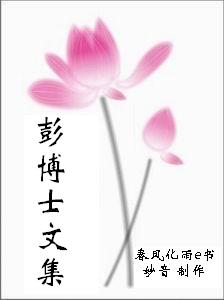

# 封面

彭博士文集

**　简　介**

彭鑫博士，毕业于北京中医药大学，硕士导师为赵吉平教授，专攻针灸临床，博士导师为傅延龄教授，期间学习《伤寒论》经方的理论与应用，博士毕业后，进入中国中医科学院中医基础理论研究所工作，从事中医学方法论及中国古代术数学研究，对五运六气的临床应用颇有心得。

**目　录** 简介

**总篇**

伤德、伤身、伤命根本症解

**保精篇**

一、误认为精液没有营养，所以手淫无害于健康

二、损伤身体的表现

三、伤精的方式

四、伤精的表现

五、颈椎病与伤精

六、补肾误区—六味地黄丸

七、伤精患者请进—补精的方法全攻略

八、经验分享—伤精的药方（提供给中医同道参考）

元气篇

一、元气与脾气不好

二、元气与智力

三、元气与食欲

四、元气与容易疲劳

五、元气与呼吸

六、元气与眼神

七、元气与头发

疗病篇

一、内伤杂病的治疗思路

二、各种疑难杂症的治疗根本方法之恢复我们的“本来面目”

三、不花一分钱对癌症康复有帮助的建议

**养生篇**

一、怎样吃素才能健康

二、传统固肾功

三、补精的食品之一黑芝麻

四、睡眠营养不良

五、揉腹保健法

六、如何穿衣才能容光焕发（上）

七、如何穿衣才能容光焕发（中）

八、如何穿衣才能容光焕发（下）

九、五谷杂粮—补养精气最好的食品

十、面容有光泽的好办法—叩齿吞津保健法

十一、办公室养生之—松肩(脾胃虚弱，面色晦暗者请进)

**妇人篇**

一、问答：妇科疾患

二、痛经的治疗启发

患者篇二、痛经的治疗启发

一、中药煎煮方法

二、病患服药注意事项

三、患者用药前须知——治疗反应

**感想篇**

一、网上看病之难

二、我对火神派的看法

三、可怜的一代人

四、五运六气临床应用一得

五、好医生的标准

**问答篇**

一、关于头发

二、左归右归？

三、恢复身体的注意事项

四、冬季藏精

五、眼神的恢复

六、房事的频率

七、女性过度手淫的危害

如果您喜欢本书，请推荐给您身边的朋友 ,如有指正请mmpa88@163.com联系，谢谢。
