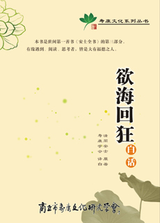

# 《欲海回狂》白话

封　面 | 目　录 | 下一页 　　　　　　　　　　　　　　　　　　　　　　　　　　　　　　 　　[电子书下载站](http://ebook.shoukang.org) 　　《欲海回狂》白话  **　** 清·周安士著
寿康学会·清凉书屋 译白
**目　　录** 《欲海回狂》普劝受持流通序
《欲海回狂》原序
　凡例
　援引大藏目次
　援引儒书目次（道书附）
● **卷一　法戒录**
　总劝（因果二则）
　劝有官君子（五则）
　劝将士（二则）
　劝求功名者（八则）
　劝塾师（二则）
　劝少年（四则）
　劝不和其室者（六则）
　劝求嗣者（五则）
　劝求寿者（三则）
　劝遇难者（三则）
　劝医士（二则）
　劝商农工贾（六则）
　劝亲狎妓童者（二则）
　劝悔过（三则）
　劝犯根本重罪者（三则）
　劝发心出世（引经十则）
● **卷二　受持篇**
　居官门（十科，七十五条）
　居家门（十科，一百条）
　广戒门（十科，一百二十条）
　灭罪门（七科，六十条）
　经要门（四科，二十四条）
　胎狱观（不分科，三十九条）
　虫寓观（不分科，十九条）
　不净观（六科，十二条）
　四觉观（四科，四条）
　九想观（十科，十条）
　轮回观（十七科，十七条）
　天欲观（五科，五条）
　因缘观（不分科，二十四条）
　解脱观（不分科，十七条）
● **卷三　决疑论**
　统论淫业类（八问答）
　因果析疑类（八问答）
　杂问防淫类（十问答）
　受持破惑类（十问答）
　胎娠差别类（十二问答）
　形灭神存类（六问答）
　中阴异同类（七问答）
　性学阐微类（七问答）
　恶道缘由类（十问答）
　婚嫁穷源类（八问答）
　忏悔往生类（七问答）
　如来应化类（七问答）
　跋
　附：内典字义译注
● **附录**
　省庵法师《不净观颂》
　省庵法师《四念处颂》
● **译白记　**
封　面 | 目　录 | 下一页
