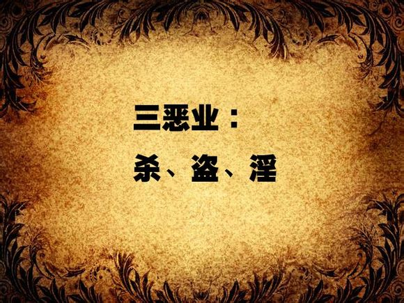

# 伤精与养精康复之道

> 分类：戒邪淫-现代　|　原文件：`伤精与养精康复之道.epub`

## 彭鑫

**简介**

本书的作者及编辑，都是七十年代末出生的人，恭逢改革开放，温饱问题得以解决，在长辈的眼里，属于很有福气的一代人。八九十年代出生的人，饮食愈发营养，衣服愈发讲究，住所愈发舒适，交通愈发快捷，看上去一代比一代幸福。但是，有哪些不好的地方吗？难道没有祸患吗？有谁能够理解当今青少年最大的痛苦所在？

古圣先贤曾经指出：“饱暖思淫欲。”人性本来如此，需要伦理道德的约束才能规范。但是中国自改革开放以来，西方学说盛行，从社会学、人类学、生理学、心理学等诸多方面，直接或者间接地鼓励青少年纵欲，性解放思潮甚嚣尘上，男女关系混乱如脱缰野马。

实践是检验一切真理的标准，时间更是检验一切真理的标准！等这些纵欲青少年在学习成绩、生活习惯、身体成长、心灵建设等诸多方面痛苦不堪时，往往木已成舟，一切都悔之晚矣！这可真是最悲痛、最可惜的祸患！

广大父母亲都很关心孩子的成长，甚至严加看护。但造成孩子身心伤害的邪淫，不仅仅是父母们看得到的外在行为，更包括背后的行为，甚至是孩子的起心动念。

由此来说，本书的作者真是慈悲到了极处！不仅教导正当的男女相处观念，帮助孩子养护健康的身心，也奉献有效的疗治手段，帮助深受危害者重获幸福。作者可称得上是青少年最真诚的朋友。

祝愿凡是读到此书的有缘人都能获得身心健康！

祝愿华夏儿女心清志朗，祝愿神州大地清净安宁！

序

社会对中医学知识的需求日益增多，但这门学科属于整体论科学类型，与人们熟悉的西医还原论模式不通约，加上中国文化近百年来，相对于西方文化，渐渐被人们淡忘，因而向公众有效地介绍中医学实际上是十分不易的，对传播者提出了很高的要求。首先自身必须透彻认识中医学内涵，还要有丰富的实践经验，真正了解公众需求，此外还得找到恰当的表达方式，让读者能够准确理解，本书作者彭鑫博士便是难得的兼具这四个条件的青年才俊。我年长彭博士近二十岁，与他长期学术交往，经常得到清新的启发与热忱的激励，获益匪浅。他旺盛的求知欲、深厚的学养以及善解人意的个性给我留下深刻、美好的印象，我们成为忘年交和事业知音。

在中医学的理论框架中，精、气、神是三个最基本、最核心的概念，它们贯穿哲学与科学，融合理论与实践，是进入中医之门的钥匙，许多中医学概念都可以从中衍生，大量养生保健问题也都能由此作出最为根本的解答。尤其值得一提的是，这三个概念既有中医学术属性，也有常识色彩，不那么学究气，而易于被公众接受。彭博士正是从这里出发，探索并形成了他独具特色的中医学养生理念与方法。本书从“精”入手，结合普遍存在的对医理、养生、疗病、用药等各方面的疑问，深入浅出、生动实用、针对性很强地进行了解说，以期帮助读者更好地了解自己的需要，很有指导意义。更为可贵的是，彭博士无保留地将经过自己亲身检验的多种养生保健方法和盘托出，奉献给大家。

这是一本写给公众的普及著作，但对中医专业人士也有助益。它贯穿了一条从理论到实践、从传统到现代、从科学到生活的主线，既准确把握读者的实际需求，又恰当对接中医经典的理论范畴，将普通人生活中遇到的问题与困扰，引申到有深度的科学探讨，同时也在轻松的漫谈中，实现了古代圣贤与当代人的近距离对话。这种功夫对中医从业者是不可缺少的，不论从事理论研究、临床诊疗，还是养生保健与产业开发，都必须做到将古奥的传统知识与现代生活密切融合，否则便会出现一种十分尴尬的场景：或者端出一杯没有味道的淡茶，或者拿来一壶倒不出来的浓茶。这都不是我们这个时代需要的东西。只有将浓郁的香茶倒进茶杯，方便品尝，才能满足人们的需求。这就是生活对中医界的要求，一点儿也不过分。

马晓彤

中国中医科学院中医基础理论

研究所科教处长，中医学博士

伤身、败德、折寿的根源

——在山东青岛企业家交流会的演讲

（2009年5月2日）

各位领导，各位来宾，各位长辈，各位老师：

大家上午好！

我先自我介绍一下：我的名字叫彭鑫，“彭”就是彭德怀的彭，“鑫”就是三个金的鑫。我是北京中医药大学博士毕业。博士毕业之后，我任职于中国中医科学院，从事中医理论和中医临床的研究工作。到现在，我学习中国传统文化五年了，感觉中国传统文化以及古圣先贤的教诲，无论对于我们的内心还是我们的身体，都是非常有价值的。下面我就跟大家汇报，讲座的题目是“伤身、败德、折寿的根源”。

现在社会上非常流行一个话题，那就是“养生”。所谓养生是指让自己的身心保持一种健康状态。反过来看我们现今社会，随着国力的增强，人们物质生活日渐丰富，与之相反的，却是人们的健康素质下降，中风、糖尿病、癌症等诸多疑难杂症的罹患率逐年上升。

古人有句话叫作“行有不得，反求诸己”，作为一名中医师，我们身上担负的责任就是两个：第一个是治疗疾病，第二个是养生保健。那么人民的健康出了问题，我们责无旁贷。作为一名中医师，在这里我向大家道歉，是我们做得不好。

刚才我讲到，现在人们身体呈现一种衰败的状态，表现出来的种种疾病，很多医院都无法解决，病痛伴随人们的一生。在这里面有个很重要的原因，这个原因也是自古以来历朝历代的医学家所重视的一点，那就是男女关系混乱对人体的伤害是极为严重的。

现在的中国社会，随着西方价值观的泛滥，我们看到，在这个有着五千年文明的中华大地上，却出现了一种非常混乱的现象，什么现象？——那就是性的开放和泛滥。

我们走在大街上，看到很多广告牌上的图片都是非常露骨，引起人们的欲望。走到报刊亭，看到50%以上的报刊、杂志封面上的女主角穿着都是非常暴露，引起人们的邪思邪念。我们打开计算机，连上网络，我们就会发现，计算机和网络里面的不良链接层出不穷，很多国际、国内知名的网站，在它的主页上都有这种信息的链接。我们打开电视机就会发现，电视剧里面所演的情节，包养情妇、婚外情这种情节非常普遍。

一方面，这些性欲泛滥的思想，对人们的思想造成了污染；另一方面，它对人们的身体、心灵造成了双重重创。

性欲的泛滥，古代医生称为“相火妄动”，“相”是宰相的相，“火”是水火的火。按照中医学理论，身体里面的火有两种：一种是“君火”，一种是“相火”。“君”是指君主的君。即人体的火气，君主应该当位，宰相应该起到辅佐作用，本来安于本位的宰相职责没有做好，这样一“相火妄动”，就会耗伤人们的阴精，导致疾病重重，然后很多疾病由此而发。

我在从事中医临床研究工作中，总结了以下诸种对身体的损伤。下面跟大家一一汇报。

首先是现在社会上流行的一种疾病，每年这种疾病的发病率都在增加，而且呈现一种低龄化趋势。这种病是什么？――就是糖尿病，现在很多人称之为“富贵病”。在我国20世纪六七十年代以前，这种病的发病率不高，随着改革开放，随着人们物质生活提高，这种病的发病率愈来愈高。下面我就跟大家汇报，为什么男女关系混乱会导致糖尿病的发生。

我们大家都有一种概念，就是饮食过度、饮食不节会导致糖尿病。这种理念按照中医理论来讲，叫作“中消”。糖尿病在古代叫作“消渴”，“消”就是消失的消，“渴”就是口渴的渴。古人把“消渴”分为三种：“上消”、“中消”和“下消”。

“上消”是因肺阴虚、肺气不足所致，表现为口渴多饮。“中消”是指饮食不节，致使中焦脾胃功能失调，导致糖尿病。“下消”是指房事不节、纵欲、熬夜、心神不宁、思虑过重等，导致下焦肝肾不足，进而引起糖尿病。“下消”这种糖尿病，现代临床尤其多见。大家要注意――不仅仅是饮食不节导致的糖尿病发病率很高，现在有很多纵欲过度导致的糖尿病也层出不穷。这种类型的糖尿病有典型的特点，我给大家描述一下。

第一点是下肢发凉。人老从哪开始的？是从腿。清朝有个医家叫叶天士，曾经说过一句名言：“男子向老，下元先亏。”什么意思？就是一个人开始老，是从他的下焦，也就是说从肝肾、腰腿这块先开始的。有一类糖尿病患者的表现就是下肢无力、脚凉，其伴随的症状是什么？就是小便频、面色灰黄，这都是肾气不足的表现。这种表现叫作“肾阳虚”。我在临床中就遇到好多这样的案例，患者控制饮食，也进行调理，但是不节制房事，血糖指数还是降不下来，这样下去，所导致的结果是非常严重的。

我举一个在临床中遇到的案例。这个人做旅游产业的，是企业家。他从30岁开始得糖尿病，典型的表现就是两只脚无力，走路脚下虚浮，用老百姓话讲就是脚底下没根。外在表现是脸色灰黄，小便次数特别频繁，而且有“淋漓不尽”的现象。“淋漓不尽”实际上是前列腺炎或者前列腺肥大的一种表现，这在70岁以上的老人多见，为什么在这个才30岁的年轻人身上就有？一句话，伤肾，也就是纵欲引起的。我把完他的脉之后发现，这个人两个尺脉是非常沉的。

中医的脉诊叫作“浮中沉，寸关尺”。寸关尺，尺脉候的是肾，“尺”就是在手腕部内侧桡动脉之后的位置。如果这个人尺脉很沉、很细、无力，那么说明这个人肾气不足。我把这个企业家的脉时，就发现他的肾气非常不足，而且外在表现也是肾阳亏虚、脾阳不足这种现象。按照中医理论来讲，这叫（肾）火不暖（脾）土。这种情况下的糖尿病，仅仅靠控制饮食、降血糖的药、胰岛素等是没法控制的。继续往下发展的话，很有可能导致一种现象，叫作“坏疽”。

“坏疽”是什么意思？就是两只脚血液流通不通畅，时间长了，就会导致局部坏死，最终的结局就是截肢。这个患者从30岁得糖尿病，找我看病时是40岁，已经得了10年。临床统计，糖尿病10年以上的患者，有30%的危险引发“坏疽”。我跟他讲，这个病要想治好控制住的话，必须节制房事。按照古代医家的教诲，至少有一到两年的时间禁欲，把肾气保存好，否则的话，身体就会出现很大的麻烦。但是这个人丝毫不听我的建议，他看病主要是为了两点：一是治疗糖尿病，另外是治疗阳痿。

阳痿，实际上就是人肾气不足的一种身体自我保护。中医倡导人们要随顺自然，也就是自然保健的养生方法。就像我们进入一个寒冷的环境当中，皮肤出现鸡皮疙瘩，实际上就是身体的一种自我保护功能启动了。鸡皮疙瘩一出现，就说明全身的汗毛孔收缩，抵御外在的寒气。这个人糖尿病10年，又有纵欲历史，然后出现了阳痿，实际上就是身体所发出的信号，就是请他节制房事，要自我保护。结果他却让我给他治疗这个疾病，然后鼓舞他的阳气。

大家试想，我们一个人进入寒冷的环境当中，本来汗毛孔收缩，结果这个人还要求医生给他开一种让他的汗毛孔舒张的药。这叫什么？这叫“逆天者亡”。所谓的天就是自然，也是自然规律。顺应自然规律，身体就会健康；违背自然规律，身体就会急剧衰败，最终导致死亡。这个人找我看病，实际上就想做“逆天而亡”的这种工作，我跟他说，这个病要想治好，必须节禁房事，否则不可能好的。

他不听我的规劝，还引用了一句名言：“人生在世须尽欢，莫使金樽空对月。”在这里，因为有很多企业家，我就把这个问题着重给大家点出来。老百姓有一句话，叫作“男人有钱就变坏，女人变坏就有钱”。这里面的“坏”，很重要的一点就是男女关系的混乱。

现在很多人一旦有了钱，所追求的就是性方面的享受，而他不知道自己在享受的同时也是在往火坑里跳。我跟这个患者谈到这个问题的时候，他说：“彭大夫，你要想让我节禁房事，比杀了我还难，因为我……”剩下的话我就不说了。我说：“好，你现在做的事情是逆天而亡的，也就是自然规律会约束你的，会教育你的，咱们一年之后见。”“你这种情况，我跟你直接讲，半年之后，你的脚就不仅仅是凉了，会出现发木发麻的情况。你若是再不节禁房事的话，再过半年，你这只脚的局部血液循环就会坏死，到最后的结局就是截肢。我把这个话放到这。”他一笑了之，他说：“性生活与糖尿病有什么关系？”我说：“那好，咱们看事实！”

一年之后，他给我打电话：“彭大夫，你所说的话全都应验了！”他说：“我从离开你之后，三个月，我的脚本来是凉的，已经变成麻木的。”大家都知道，这是人体的阳气开始往回撤的表现。观察生活就会发现，小孩子的手脚永远都是温暖的，即使到了很冷的冬天，他光着脚出去，手脚都是很红的。随着人年龄的增长，阳气愈来愈少，就会出现手脚开始发凉，再一步就是发麻发木。

糖尿病患者如果出现这种脚凉、发麻发木情况，说明他的阳气已经开始往回撤了，血液不循环了。他说：“半年之后，我这个脚知觉就非常地不清楚。”什么叫不清楚？就是虽然脚踩在地上，但是感觉脚好像离了地很远，好像垫了一层厚厚的海绵。这是气血已经通不到脚上去的一种表现，神经开始麻木。一年之后他给我打电话：“我现在出现什么情况？就是我脚的中指和无名指这两个脚趾，任何感觉都没有，而且开始变黑。”

去医院检查之后，医生告诉他说：“这叫糖尿病坏疽，最终极的治疗方法，那就是截肢。”听到这个诊断之后，他是非常害怕的，就给我打电话。我在电话里告诉他说：“坏疽分很多种，有因为气滞血瘀的，有因为肾虚的，其中肾虚的坏疽是不可能治好的，因为你以前把自己的身体消耗得太过了。”

怎么讲？就是在他一年前有阳痿这种情况的时候，实际上就是身体提出警告了，说您老人家一定得悠着自己的元气，不要再消耗太过了。结果他不听，反而吃一些壮阳药，喝所谓的壮阳酒，来使阳气愈发消耗。消耗没了之后，人的骨髓枯萎了。按照古人的话讲，这叫“骨髓枯”。人的骨髓枯萎了，等待他的那就是恶果。所以这个人给我打完电话后，我说这个病很难很难治了。这个案例在华佗的医案里面都有记载，他说“神仙在世”也无法挽救这一类的疾病。这个人最后的结局就是，把他脚的中指和无名指锯掉。情况非常严重，这是我谈的第一个案例。

下面我跟大家汇报的另外一种疾病就是中风。中风的原因有很多，用现代医学的眼光看来，中风无非就是两种：一种是脑血管破裂，另外一种是脑血管阻塞和痉挛。

按照中国古代医家的论述来讲，所谓的中风实际上就是身体内在的火气上涌，导致上焦的气紊乱，然后导致疾病。古代中医的传统理论学说来讲，中风就是肝火上炎、肝风内动，或者是痰浊内扰，但是这里面还有一个很重要的病因，那就是肝肾不足。

有时，肝肾不足导致肝失疏泄，进一步导致肝气郁结，肝气郁结既久，气盛化火而导致肝火上炎，肝火灼伤肝阴又导致肝阴虚或肝肾阴虚，一方面可使肝火更旺，另一方面阴虚水不涵木、阴不制阳而导致肝阳上亢，阳亢无制又可导致肝风内动。所谓肝风内动，就是指肝肾阴液精血亏虚，血不养筋，阴不制阳，肝阳亢奋，步履不稳、头摇肢颤、语言蹇涩，甚至突然昏仆、口眼歪斜、半身不遂等中风症状。

肝风挟痰上蒙清窍，心神昏愦，则突然昏倒，不省人事；风痰窜扰脉络，患侧气血运行不利，则导致半身不遂、口眼歪斜；如果痰阻舌根，则出现舌体僵硬、不能言语。这类情形在临床上多见于眩晕、头痛、中风及西医的高血压、脑血栓形成、脑出血等疾病。治疗以镇肝熄风为法，常用天麻钩藤饮、镇肝熄风汤之类。

记得在2006年，我当住院医生的时候，曾经一个晚上送走了3个中风患者，都是死于多脏器衰竭。这3个患者的平均年龄，大家注意――都是40岁上下，最年轻的38岁，最大年龄的是42岁。第二天，我写死亡病程的病例汇报，一边写一边想，为什么中风呈现出一种低龄化趋向？我们回想20世纪七八十年代，那时候的中风，大多数都是六七十岁，甚至八十多岁的老人家，才会出现这种情况。为什么现在年轻人，三十多岁的人，中风却这么多，甚至导致死亡？当然不可忽视的是，现在的饮食结构发生了变化，人们吃得好了，身体里面的脂肪存留增多。那我会反问，吃得好了，脂肪存留增多，就一定导致中风吗？我们发现生活中不是这样的，很多人也是大鱼大肉，但是并没有中风。导致中风的另外一个原因，用中医的眼光看来就是肾气不足，也叫肝肾不足，导致肝肾不足最重要的原因就是纵欲。

下面我跟大家分享的这个案例，就是我出版界的一个好朋友，也是一个企业家，才32岁就中风。这个人姓孙，找我看病的时候，他非常自信地告诉我：“彭大夫，我现在非常有钱，半年换三个女朋友。”他认为这是他值得骄傲的事情。我说：“那你离灾难就不远了！”为什么？因为一个人如果肾气亏虚，会导致一系列的“恶果”，在后面我会跟大家详细地展开。所谓的“恶果”，就是身体和心理、事业、家庭所出现的重重危机。这个人是所谓的社会青年精英，他找我看病，想让我调理一下他的身体，并进行一些合理的建议。因为现代人随着生活水平提高，对自己身体状况的要求也愈来愈高。他希望通过中医调理，把身体调整到一种平衡状态。这个人的外在表现是什么？两条腿特别的细。

大家注意，两条腿特别细、下肢无力的人，用中医的眼光看来，大部分是属于肝肾不足的人。这个人不仅两条腿特别细，而且走路没劲，脚下没有根，把他的脉，也是尺脉特别沉。他的另一个表现就是小便频，一晚上去厕所大约七到八次，这是伤肾的一个很严重的表现。他找我看病说：“你先帮我解决我小便频的问题，因为我需要睡眠，合理睡眠，第二天还要处理很多事情，光这样的情况就会影响我的工作。”我说：“好，但是你必须答应我一件事情，就是吃药期间绝对不能有房事。”他咬了咬牙说：“好！”然后我给他开了清朝有个医学家叫陈士铎的一张名方，叫作“引火汤”。他吃了这个方子之后，两个星期症状缓解，一晚上平均起夜一次到两次。

然后他跟我说：“接下来我应该怎么保养身体？”我说：“接下来你保养身体的原则非常简单，那就是禁欲一年以上。”作为医生必须说实话，而不是说好听的话。现在很多医生，为了随顺患者的欲望，不断地妥协，实际上这样是对患者身体的一种极度摧残。因为这个人是严重的伤肾，我跟他讲至少得禁欲一年以上，而且不能够与所谓的女朋友有不正当的性行为，这些东西对身体都会产生极大的损伤。

我讲这句话的时候，他非常不以为然，为什么？因为他以前接待客户的一个很重要手段就是，晚上吃完饭之后把客户送到歌舞厅、卡拉OK，甚至是一些情色场所。实际上，这不仅是自己往火坑里跳，也把别人推到火坑里去。我跟他讲，如果不约束自己的话，身体会损伤得非常严重。但他不听。在我第二次见他的时候，他的寸脉就出现一种很奇怪的现象——寸脉过寸，就是手上的这个脉象跑到大鱼际这个地方来了。这在中医来讲叫作“寸脉过寸，中风可虞”，就是这种现象一旦出现，可能就会中风。我就告诫他说：“你这段时间一定要保养好肝肾，不要再有这些行为了。如果再有，将来中风是没跑的，因为你的这个现象已经出现了。”他不听，他说：“我这么年轻怎么会得这种疾病，不要吓唬我了。”我说：“那就看自然规律！”

我刚才讲的，中国古圣先贤，包括古代医家所总结出来的这些情况，都是经得起历史考验的自然规律。若是不想遵从的话，以身试法完全可以。这位孙总就继续做着自己想做的事情。半年之后，我再见他，发现这个人出现一种很奇怪的现象，就是精神极度亢奋，以至于晚上睡不着觉。他见我的时候，还有另外一个女子在他身边，这个女子非常妖艳，令我想起了一个词，叫作“红颜祸水”。我们都知道古人所说的“红颜”，并不是指漂亮，而是指妖艳。妖艳的女人对男人有三种伤害：第一种伤害，是吸引男人，把男人的肾精给消耗掉；第二个伤害，是妖艳的女人惹是生非；第三个伤害，是妖艳的女人使男性沉溺色欲，最后丧失理智与理想，导致人生事业的失败。

大家都知道，很多朝代的毁灭都和女子有关。离我们最近的清朝、明朝，吴三桂冲冠一怒为红颜，讲的就是这个事实，把一个朝代都给毁了，更何况一个人！我跟他说：“这个女子对你的伤害会很重，你赶紧跟她远离，否则的话，您离这灾难就不远了。”他不听，还跟我说：“我好不容易赚到这些钱，难道不能让我享受一下吗？”我说：“你这种享受，实际上是过分纵欲，这对身体的损伤很大，对你将来的事业和家庭，以至于后半生，损伤都会很大。你如果现在不听，那咱们就看事实的发展是怎么样子的。”这个孙总继续过着那样糜烂的生活，半年之后现象就出现了。口眼歪斜，半身不遂，走路都难以平衡，眼睛闭不上，这就是典型的中风。如果是肝肾没有不足的普通中风患者，可能半年一年，走路就可以恢复，这叫中风康复。但是肾虚型的中风，三年恢复不了。这个患者从开始到现在三年了，走路还是不利索，说话连不成句。这就是伤肾所导致的恶果。

他中风之后见我说的第一句话就是：“彭大夫，我太后悔了，没有听你的话，导致现在我这种情况。”我说：“这个叫作邪淫，‘邪’就是邪恶的邪，‘淫’就是荒淫无道的淫。这个邪淫对身体的损伤，那简直是太严重了。”一方面，邪淫可以使一个人肾气损伤，导致身体的种种疾病；另一方面，一个经常伤肾的人，他的心情都是浮躁的，特别容易发脾气，脑子都是混乱的，容易做出各种各样的错误决定，这叫作心火亢盛、肾水不足。人一旦出现这种状态，那就是离灾难不远了，无论你的事业、家庭、身体，都会出现种种恶果。

古人告诫我们说：“万恶淫为首。”为什么这样讲？――因为一个人、一个朝代的君主，假如说荒淫的话，这个人、这个朝代离毁灭就不远了。这位孙总以身试法，最终的结局是事业衰败。他原先是做出版业的，业绩非常好，自从中风之后，事业一落千丈。以前跟他有染的女子，都离他远去，他自己孤零零地在医院里面，每天护工扶着他下床，推着轮椅让他晒太阳，自己说话也连不成句。这就是以身试法所导致的恶报。我刚才提到“红颜祸水”，下面我给大家强调一下，为什么要提这一点。

因为现在社会上很多女子打扮自己，实际上是往妖艳的方向去打扮。现在很流行的一个词语叫作“性感”，所谓的“性感”，就是能够引起异性的性趣。把自己打扮得愈性感、愈暴露，以此为美，而不是以此为丑，这是人们审美观的一种变化。而这种变化所导致的结局是非常严重的：一方面导致身边的有些男子邪念重重，浮想联翩；另外一方面，她走在大街上造成的负面影响也非常大，使一个人心神无法安定下来，邪思邪见特别多。

在临床中，我作为一个医生，特别喜欢看现在社会人的种种健康状况。中医来讲叫作望闻问切，因为医生有一个职业病，就是见任何一个人，第一反应就是看这个人有哪些问题，然后通过面相、身材、语音判断出他的身体健康状态。

我观察发现，有这样几种表现，供大家参考。

第一种，现在很多人的眼神是游移不定的，没有定力。这说明一个人的神不专注、不清净、不稳定。神不足，精就不足，老百姓经常说精气神，一个人的精，就是这个肾精要是不充足的话，他的眼神必定是散乱的，而且与别人对话时，眼神四处游走不定，没有一个定力。

第二种，现在很多中年以上的人，腿脚没有力气，走路好像拖着一个沉重的身体在走。这种就是肾气亏虚的表现。

第三种，就是很多青少年的脸色非常不好看。什么脸色？就是脸色苍白，而且没有血色。离得远远的，你会看到脸上好像蒙了一层灰；近距离看的时候，会发现他的脸其实洗得很干净。但是为什么还有一层灰呢？这实际上就说明他的内在精华不足。

一个人内在精华不足的话，他外在的神气是不饱满的，非常衰败的。现在我们看到这些中学生，要么是脸色惨白，要么就是像豆芽菜一样，身体不饱满，特别瘦弱。有统计说，目前我们国家青少年所存在的问题是耐力下降。体力分为两种：一种是爆发力，一种是耐力。这种现象就是耐力不足，无法长时期地坚持工作，这都是肝肾不足最严重的表现。现代社会的人心浮气躁，做任何事情都不专注，没有定力，这实际上都是肾精不足的外在表现。

我们观察整个社会，为什么会出现这种现象？现在打开电视机，连上网络，走在大街上，翻开杂志，我们所遇到的、所看到的这些不清净的，容易导致人们产生邪念的机会非常多。这是一个很严重的社会问题，不仅对一个人的身体造成损伤，而且让人变得心情非常浮躁。我们都知道诸葛亮有一句名言：“非淡泊无以明志，非宁静无以致远。”一个人如果心情不宁静，他的事业不会做得长久和成功：一个人如果心里邪思邪念非常多，对他的家庭、家人，以至于对自己的一生，乃至于对我们整个民族，都会造成很大的损伤。

下面我给大家汇报的，就是性冲动、性泛滥对当代青少年的损伤。孔子在两千多年前《论语》里面曾告诫过，“少之时，血气未定，戒之在色”。什么意思？就是人在年轻的时候，整个身体没有发育好，气血是非常不稳定的，这个时候尤其需要注意不要让他的思想受到邪淫的污染，否则对青少年的身心都是很大的摧残。

我在临床中就曾经遇到过两个案例，都是血的教训。第一个是两个月以前，在我的门诊上遇到一个少年。这个年轻人名叫小可（化名），今年25岁，刚刚大学毕业。因为我之前写了一系列劝导人们要保养肾精、要清净心念的文章，并发表在网络上，他看到之后，就来找我看病。他说：“彭大夫，我这个病病了十年，我都没有找到原因，经过很多医生的治疗，都没有治好，花了很多钱。自从看了你这篇文章之后，我才知道自己的问题出在哪里。”他说这句话的时候眼圈都红了。小可说：“我以前，我在十年前，我初中的时候，我是全家人的希望，我每次考试都在全班前十名，我当时的这种状态，全家人对我的希望非常大，将来能考上名牌大学，能考上清华、北大。结果，在那一年我接触了一个朋友，他把我带到他的一个同学家里面去，看了一盘黄色录像，从此之后，我就染上了一个非常不好的习惯——手淫，这个习惯伴随了我十年。”自从染上这个恶习之后，小可的脑力、体力极度下降。半年之后，学习成绩一落千丈。

按照中医的理念来讲，肾主骨生髓，脑为髓海，“肾者，作强之官，伎巧出焉”。什么意思？就是一个人肾气如果足的话，脑力就会好，有两种体现：一种是记忆力好，一种是思考能力强。

一个人肾气足的话，记忆力就好，思考能力就强，他的学习成绩一定会好。现在的教育，大多数属于技能培训，并不是对人的真正的教育。所谓技能培训，首先就是要掌握知识，必须要靠理解力和记忆力。假如一个人肾气亏虚、脑力不足，他的理解力和记忆力都会下降。

小可说：“当时染上这个坏习惯之后，我就发现自己的脑子好像空了、木了一样，上课的时候老师在那儿讲，我就好像是在演电影一样，脑子一点都不跟着活动，而且记忆力极度下降，做题做不出来。”这是他的第一个表现。

在半年之后，出现第二个表现，小可当时是学校足球队的队长，体力非常好，跑步速度非常快，耐力特别强。自从染上手淫的恶习，半年之后，他的体力急剧衰败，稍微一动，身体就气喘吁吁，大汗淋漓。这是一个人元气不足最严重的表现。我们反观现在很多年轻人，都有类似情况，实际上都与伤精有很大的关系。

小可说：“我出现这两种表现之后，心情非常沮丧，也不想跟别人交往，不想跟周围同学、老师交往。自己一个人关在屋子里面，谁都不想接触。家里人以为我有心理上的疾病，就去找一些心理医生给我进行疏导。”他说：“很多心理医生给我疏导之后，我当时感觉心情很舒畅，但是很快这个心情又郁闷了。”为什么会出现这种情况？按照《黄帝内经》的说法，这种情况叫作“独闭户塞牖而处”，“独”是单独，“闭户”是闭上门户，“塞牖”就是关上窗户，是形容一个人待在一个小房间里边，把窗户还有门都关好，一个人独处。这种情况一般出现在胃气不足、肾精大衰的人身上。这个少年半年之后就出现这种情况。

这种情况不仅仅是心理的问题，而是生理问题导致的心理问题。假如不把患者的肾精补足，让他戒除邪淫的话，他的心理永远是处于一种阴暗的状态。按照古人的话讲，这叫作阳气不足。有过这方面经验的人，都会有这种体验。假如说肾气不足，前一天晚上房事之后，第二天可能原来制定的计划就不想去做了，本来踌躇满志的豪情就没有了。假设说计划第二天想写论文，想进行深入思考，也无法进行。为什么？是因为当一个人的肾精不足、阳气大衰时，身体就会出现这种执行力下降的表现，而不仅仅是心理的问题。小可跟我描述的这种情况，就是第三个表现。

第四个表现是心情非常烦躁。他说自己坐在书桌前看书，心里面好像长草一样，根本看不进去。为什么会这样？按照中医理论，一个人肾水不足，心火就亢盛，心火一亢盛，他坐在那当然坐不下去，没有定力。

小可出现的这四种表现，他的父母也不知道。我刚才讲的这个案例，实际上就是给大家一个警醒，回去之后一定要看好自己的小孩，不要让他染上这些恶习。小可在初三的时候染上这个恶习，一共十年，他都不知道自己问题出在哪里，直到他在网上看到我写的文章之后才幡然悔悟，来到诊所找我看病。他当时的心情非常激动，我说：“不要激动！这个病是可以治好的，你还年轻。首先你得有自信心，把自己的这个坏习惯改掉；第二个，我给你帮忙，我会告诉你怎么样补肾，给你开中药；第三方面是一定要孝顺父母，因为只有孝顺父母，这个人心情才是最通畅的，心情一通畅，身体的阳气就足。”

古人曾经说过：“万恶淫为首，百善孝为先。”在座的每个人手里都发了一个蓝颜色的小水杯，这个小水杯上面写了一段话：“身体发肤，受之父母，不敢毁伤。”如果一个人把自己的身体毁伤了，说明这个人不孝顺；反过来，一个人要想对父母孝顺，首先就是要让自己的身心保持一种健康的状态，不要让父母操心。小可十年来一直让他的父母非常操心，带着他四处求医，没有结果。我对这个孩子讲完这段话之后，他非常感动。我说：“我给你看病是不要钱的，我义诊。你把这药方拿走，随处哪家药店都可以抓。吃了这些药，然后再配合我刚才讲的这些要点，第一个是戒除邪淫，第二个就是孝顺父母，你的病肯定能好的。”

结果他按照我说的做，两个月之后给我发短信说，现在腰已经不疼了，然后脑力开始恢复，开始有精气神了，做工作也是非常有信心。这说明按照中医的理念，身心是不二的，身体和心理是互动的。身体出了问题，就会导致心理的问题；反过来，一个人心理出了问题，身体照样会出现各种各样的疾病。所以古人曾经说过“相由心生”。“相”就是一个人的外在表相，“心”就是我们的内心。相不仅仅是指这个人的面相，身体的种种表现，包括疾病的现象，都属于相。

一个人相不好，实际上就是反映一个人的内心世界不是非常健康。所以说，中医实际上是治人，不是治病，因为病是长在人身上。一个人只有身心双重健康了之后，身体才可能恢复，才可能健康。我给小可进行治疗，把他十多年的问题解决，他的父母也非常感动，对我表示感谢。在这里，我跟大家还要引伸出一个话题，就是小可所出现的第三种现象，目前国内出现得不少。这种现象也可叫作“都市隐者”。“都市”就是大都市的都市，“隐者”是什么？“隐”是隐士、隐藏的隐，“者”是之乎者也的者。现在很多青年出现了这种情况，就是待在家里面，不想工作，不想学习，也不想交往，一个人闷在屋子里面，过着衣来伸手、饭来张口的生活，叫作“啃老族”。

这一类人群在东亚一个岛国，出现得非常多。我不提那个国家的名字。那个国家在20世纪三四十年代引入了西方性解放思潮，其所生产的相关光盘和书籍，在整个亚洲排名第一。那个国家有1%的人口出现了“都市隐者”的情况。“都市隐者”就是丧失了工作、生活、学习的能力，把自己关在屋子里面，过着衣来伸手、饭来张口生活的人。按照中医来讲，就是废人，这个人再往下发展是没有救的。这种人群在那个国家占了1%的比率，换句话说，那个国家有一百万的青年处于这种状态。

我国在东南沿海和大中城市也出现这种苗头，在台湾地区、韩国这种情况也可见。古人曾经说过，一个人如果肾气不足，将来一生就不会有太大的作为。因为按照中医理论，肾受纳五脏六腑之精华而储藏，也就是说这个人的肾气，就像银行一样，它把身体里面的精华都储藏在保险柜里面，然后供人一生去应用它，去做事业，去服务于社会。假如把这个保险柜里面的存款无节制往外提取的话，这个人的生命质量就会下降得非常快，即出现早衰这种情况。

下面我跟大家念一段患者的信。这封信正说明了若是过度、过早手淫，对青少年产生的影响就是早衰。这位患者写道：“彭博士：你好！我想反映一下我自己的伤精历史（伤精就是伤肾，手淫的历史），希望给持有‘手淫无害论’’的人们一个警示。”他说：“我11岁的时候染上手淫，然后射精，迅速地沉迷其快感当中，无法自拔。最多一天射精4次，持续8年之久。”

患者给我写这封信的时候是19岁。他有什么表现？第一个是骨头痛，全身的骨节疼痛。肾主骨生髓，肾气不足的话，骨骼就非常不饱满，容易疼痛。患者十八九岁人的身高、相貌、体重和一个小学生一样，皮肤黑，牙齿痛，口里有腥臭味，听力差，智力、记忆力更是差得无法说。第二个是梦多，一天晚上做梦3次，睡眠质量极度降低。第三个是全身骨骼细小、酸痛、软弱，无法长久站立15分钟以上。第四个是大脑经常眩晕，稍微一转圈就晕得要命，想吐，头脑迷糊，有空虚感，经常嗡嗡作响。第五个是思考力、理解力和记忆力极度下降。患者现在赋闲在家，无法继续工作和学习。第六个是手经常抖，手抖说明肝不足，肝风内动。第七点是驼背，右肾酸痛，整个脊柱直不起来。第八点是眼睛突出。第九点是头发焦枯、稀疏。大家听到这些表现之后，很快联想到一个80多岁老人的表现，但是这出现在这个19岁的少年身上。

在上一个星期的周末，这个少年的父母从家乡领着他来我的诊所看病。一见到这个孩子，他所说的这些表现都表现出来，就像一个早衰的小老头。这就是伤精的恶果。这是我讲的青少年的损伤，希望在座的各位引起重视。

下面我再给大家汇报一下自己身边发生的故事，那是我的一个初中同学，他的表现用四个字来形容，叫作“以丑为美”。前年的寒假，我们同学聚会的时候，他当着很多人的面跟我说：“彭鑫，你是学中医的，你给我把把脉，看我身体是不是特别健康？”我还没把脉，他就继续说：“我现在的性欲很旺盛，身体很好，说明我身体很好，你试一下。”我一试他的脉，心里边暗自嘀咕，恰恰相反，他的肾脉是非常亏虚的。这种亏虚就像一盏油灯，在油快要没有的时候，火苗是最旺的。他现在就处于这种状态。我私下跟他说，你这个肾气已经亏得不行了，要是不谨慎对待这个问题的话，将来会出现种种恶报，身体会出现种种情况。他不相信，说：“我这身体很好，而且我很年轻，以此为荣，经常换女朋友。”“是这样子的。”我说，“你必须得注意这件事情，否则的话身体是不会复元的，而且将来的麻烦也不远。”因为中医理念有一个叫作“虚则亢”，就是一个人真正虚弱了之后，他才会亢奋。一个人真正充实的时候，他是不亢奋的，永远是稳定的。所以古人有一句话，叫作“精满不思欲”。就是一个人真正精力充沛，肾气非常足，肾精很充足的时候，他那个欲望是很低的。反过来，精虚的话，欲望就重。我说他现在这种情况，顶多维持半年，半年之后，身体会出现各种各样的表现，他不听。

第二年我们同学聚会的时候，他坐在那里，整个人像蔫了一样，冬天在屋子里面，一起吃饭，他还戴着帽子，谁都不想接触，也不想跟大家说话，那种眉飞色舞的神情完全丧失。周围同学就小声告诉我说：“彭鑫，咱们那个同学，在半年之前头发脱没了，光头了。然后骨折过两次，打球、骑自行车跟别人不小心一碰就骨折了。”

按照中医理论，一个人的肾气在哪些方面表现出来？第一点就是在头发上，中医有句话叫作“肾之华在发”，就是肾的精华体现在头发上。一个人肾气若不足的话，头发就会脱落、焦枯，没有光泽。

第二点是肾气表现在骨骼上。假如一个人骨骼很坚硬、很饱满、很有劲，筋骨很强壮的话，说明肾气很足；假如说这个人经常骨折，动不动就出现筋骨上的损伤，说明他肾气不足。因为肾主骨生髓，骨骼不强壮、不饱满就说明他肾气不足。这个同学一年之内出现了两次骨折，这是非常少见的。在年轻人来讲，稍微一碰不会出现这样或那样的骨折，结果他出现得很频繁。

我联想到唐朝有个著名的道教仙人，叫作吕洞宾。吕洞宾道号纯阳子，他曾经写过一首诗，劝导世人不要邪淫：“二八佳人体似酥，腰间仗剑斩愚夫。虽不教君人头落，暗地使人骨髓枯。”就是一个非常姣好的少女看上去很美好，她不把你的人头砍下来，但却暗地里把你的肾精、骨髓消耗干。我们观察生活就会出现这样的情况。有些人身体外形看着很肥胖，但是在秤上一称，他的体重却特别轻，这是一种。另一种是一个人外在体形看着，不是很胖、很强壮，在秤上一称却特别沉。身体外在胖、重量轻的这些人，实际上就是内在骨骼的气不充足，也就是骨密度降低、骨质疏松，这实际上就是伤肾的一种表现。现在流行的一个养生话题叫作补钙，大家都知道补钙，但我们一家人都吃一锅饭，都吃同样的菜，为什么你缺钙，别人不缺钙呢？不是因为饭里面没有钙离子，而是因为你身体根本藏不住这种钙质。一个人骨骼骨密度增强、肾气足的时候，骨骼是非常充盛的，而且骨密度也是增高的，钙质增多。假如一个人肾气不足，即使吃上一吨的钙片，都不会把这个钙给封藏到身体里面去。

中医的理念不仅是考虑到物质这个层面，还考虑到能量和信息这个层面。整个世界的组成是物质、能量、信息三个方面。现在的医学大部分考虑的都是物质，对能量和信息考虑得不多。但是中医学恰恰就是把物质、能量、信息统在一起考虑。中医用一个字来形容，就是“气”。“气”把这三个方面的内容都包含进来。我跟我的同学说，一个人肾气不足的话，他的骨骼就容易骨折，骨密度减低，骨质疏松。那个同学的表现就是一年当中骨折两次，而且头发脱光，这就是肾气衰败。

按照中医的望诊，我们作为职业医生，非常喜欢看这个人的气色，他的气色是透露出一种什么感觉来？脸色苍白且灰、发暗，两个眼圈特别黑，这反映肾的本脏已经开始衰败了。一旦出现这种情况，且不注意养生保健，继续天天耗伤元气精神，通常在两年之内就会承受到肾衰、肾炎、透析。这在古代医案里边层出不穷。

袁世凯找了多少姨太太，把身体给淘虚了，肾气一虚，最后死于尿毒症。尿毒症是肾气极度衰败的体现，这就是一个很典型的案例。这说明假如不按照自然规律来做的话，恶果就会不断，有时候直接体现在你的身体上，而且这种速度非常快。中国古圣先贤有一句话，叫作“天道祸淫，其报甚速”。天道就是上天的道法，就是自然规律；祸淫，祸就是灾祸，让这个邪淫的人出现灾祸，这种速度是最快的。

实际上，我们知道“祸福无门，惟人自召”，即所谓的祸和福并不是老天安排的，而是自己感召来的。这种感召实际上就是错误的思想、行为、做法，导致的结果就是不良的身体、心理、状态，以及事业、家庭的重重损伤。我刚才讲的这一系列案例，恰恰就印证了古圣先贤的教诲。我们反观现在有些不良影视剧，有些不良媒体上的宣传，倡导大家对“性”感兴趣，以暴露的图片、暧昧的文字，以及露骨的镜头作为表现，让人们的内心不平静。

我们都知道，现在的青少年，尤其是“80后”“90后”，饮食中有很多激素成分。前几天我看到北京市的一个统计数字说，现在的女生来月经的时间平均是9.2岁。在30年前，女生平均来月经时间是12岁。那个年龄是正常的，现在这个年龄是不正常的，用中医的眼光看来，这就是病态。

现在的孩子是被激素催熟的！身体迅速发育，内在的荷尔蒙增多。这是内在的问题。外在环境放眼望去满目疮痍，打开电视、网络、手机，上面有些电视剧、广告、视频、图片，还有一些花边新闻，内容都非常暧昧，使得这些青少年内在的身体容易处于一种“相火妄动”的状态。还有一种误导是教材，在青春期教育里曾明确写“手淫无害健康”。这三方面加在一起，就导致现在走在大街上，会发现很多人有气血不足的表现。我曾经看过20世纪六七十年代那个时候青少年的那种红光满面的表现，到现在这一代年轻人已经荡然无存。所以说这是一个非常大的危机，对于整个民族来讲，都是一个很严重的社会问题。

在此，我纠正一个误区，就是“手淫无害健康”。这在很多关于青少年健康教育的书里都这么写。它的理论是根据男性手淫所射出来的精液里面的成分是蛋白质、核糖核酸和碳水化合物成立的。经过分析，这些营养成分跟一杯牛奶的营养成分近似，于是得出一个结论，认为一次手淫射精之后，喝一杯牛奶或者吃一个鸡蛋就可以补充回来。按照这个逻辑来想，好像是没有问题，但是实际上问题非常多，这个理念里面，只注重分解和分解后的营养成分，没有注重合成，这是典型的还原论思维模式，这种方法论适用于一部分科学研究，但不是全部。打个比方，在座的每个人，会后可以拿到一张光盘，一个光盘里面所含的信息很丰富，把这张光盘粉碎，分析它的化学成分，你会发现这张光盘和一次性饭盒的化学成分是一样的，但是一张充满着各种信息的光盘，跟一个一次性饭盒的价值能同等吗？肯定不能。同理，男人一次射精，精液里面所传承的各种各样的生命信息，都是极度的浓缩和汇聚，也不能跟牛奶和鸡蛋比较。

精液，可以传宗接代，反问：牛奶可以吗？答案是不言而喻的。所以说这种理念实际上是非常错误的。古人曾经说过，“一滴精，十滴血”，即是说人体吃了这么多营养合成一滴精的精华，所消耗的你身体的元气，跟合成十滴血所消耗的元气和能量是同等的，并不是说一滴精液跟十滴血的化学成分是等价的。

因此，现在的很多医学工作者，实际上是对古圣先贤医学著作的一种误读。他们认为古人说的没有任何道理，而我的这些临床案例恰恰就印证了，这种说法是非常错误的。

在日耳曼民族想要征服全世界的时候，民族的统治者曾经制定了一个规矩：所有的男子在睡觉的时候必须要把手放到被子外面，不能有邪淫的行为。他们认为要想强国强种，只有从戒邪淫开始。

我有一个专门从事警犬培训的好朋友，他举了一个例子，在这里也提供给大家作为参考。他发现警犬在进行一次交配之后，嗅觉的灵敏度降低一半，警犬在三次交配之后直接淘汰，没有破案能力了。我们知道，每个民族的智商与其性方面的严谨程度成正比。全世界智商最高的是犹太人，犹太人里面智商最高的是德系犹太人，平均智商在130以上；智商最低的民族是中非和南非的一些部落民族，平均智商是54。这些部落民族，男女的性关系是非常泛滥、开放的。这实际上就是文明程度、身体状况，以及智力状况的一种最直接的体现。古人说“厚者富，清者贵”，“厚”是指一个人非常厚道，有包容心，这种人是“富”，有财富的；“贵”是指一个人“清”，头脑身心特别清净。只有身心清净，做事情考虑问题才会周密周全，才有定力，思维能力以及统考全局的能力才会增强，这种人在社会上地位高，是“贵”。富贵代表的是清卓。愈清净的民族社会地位就愈高；愈浑浊的民族社会地位就愈低，而且处于一种落后的原始状态。这说明我国古圣先贤给我们留下的这些宝贵财富，是非常有价值的，经得起时代和民族的检验。

我跟大家再讨论一个话题，即女性伤精会导致什么样的恶果。之前重点是讲男性的伤精，其实女性伤精对身体的损伤也非常严重。体现在四个方面，首先，女性手淫对肾的损伤，这种损伤，最直接的外在体现就是毁容。我在临床中治过好多这样的女孩子。有位女性患者在给我的信中说，她很小的时候染上这个恶习，之后她的一个外在表现就是头发大片大片地脱落，脸上长痤疮。

我们都知道女性是很爱美的，脸上长痤疮，对自信心打击非常大。肾气不足的女性，长的痤疮有几个典型的表现：一是，集中在下颔周围，下颔代表的是肾；二是，痤疮的深度很深，是暗疮，颜色是晦暗的；三是，脸色青黄，尤其是从山根，即是从印堂到嘴周围全是青黄色的。一旦出现这几种表现，就是女性伤肾，肾气亏虚了。这种痤疮非常难治，对女性来讲就属于毁容。

其次，现在这个社会实际上男性是主动的，很多女性是被动的。被动造成的一种恶果就是堕胎，由此导致的妇科病非常多。我在临床中所遇到的25~35岁这个年龄段群体，找我看妇科病的80%都有过堕胎的历史，而凡有过堕胎历史的妇科病，都是非常难治的。按照现代医学统计，女性堕一次胎就会降低25%的生育能力。换句话说，堕胎四次，生育能力几乎降到零。现在女孩子，怀孕就流产，或是胎死腹中，究其原因，如果以前有过堕胎的历史，就非常容易产生这种情况。这也是不孕不育最根本的原因之一。

第三，现在很多女孩子穿衣服不太注意，把自己能暴露的地方全都暴露出来了。尤其是夏天，把后背、肚脐、后腰命门这些都暴露在外边；甚至到了冬天还穿着短裙着丝袜，把腿全都暴露在冷风当中。这些表现，实际上对自身的损伤是很严重的。有些女性穿成这样，实际上是想表达所谓自己的美。她们认为所谓的美女，所谓的性感，都是用这种方式来表达。

我跟大家举几个案例。第一个是关于露背装。曾经有个女孩子跟我说：“我特别容易感冒，经常咳嗽。”我问她：“是不是以前经常穿这种暴露出后背的服装？”她说：“是，大家都这样穿。”我说：“你注意，穿这种服装是什么时候？是夏天。夏天，人体的阳气往外散，全身的汗毛孔打开，你这个时候穿这种服装，在烈日炎炎下没有问题。现在的屋子里都有空调，一旦进入有空调的房间，那个寒气长驱直入。它从哪入的？从这个后背的大椎穴，‘大’就是大小的大，‘椎’就是锥子的锥，用木字边，大椎穴，从这个大椎穴一下子就进入你的身体，直接损伤肺气。一个人肺气一不足，将来就百病丛生，特别容易感冒，这是它第一点。这是穿吊带对身体的损伤。”

第二个是关于穿低腰裤。把中医所认为宝贵的丹田和命门，这两个大穴暴露在外边，所得到的结果就是子宫寒。子宫就是胎儿在娘胎里面住的处所。假如说屋子又寒冷又潮湿，孩子住在里面是非常难受的，甚至住不下去，将来会出现小产或是胎死腹中。现在有女性怀孕三四个月，甚至到了六七个月的时候，还会出现小产，主要是由于子宫寒气重，气滞血瘀导致。

第三个是关于短裙。穿短裙所导致的就是下肢暴露在外边，让寒冷的空气一吹，经络受到痹阻，最重要的是肝经和肾经痹阻，肝肾主女子的胞宫，这两个经络一痹阻，将来得的病也是妇科疾病。比如说，子宫肌瘤、附件炎这类疾病。还有就是过了45岁之后，就会出现风湿、类风湿这种情况。

我在2003年曾经为一个欧洲访问团做翻译，对方主要访问我国的针灸学术研究情况。在这过程当中，他们观察到有80多岁的老人家，在针灸完之后，自己从床上下来，自己弯腰系鞋带。访问团的领队就问我：“这位老人家多大岁数？”我说：“83岁了。”他表示很惊讶！他说：“在我们国家，83岁的老人都是推着轮椅的，你知道吗？结果到了这里，我们却发现很多中国的老太太不需要轮椅，而且人家走路走得也非常稳健。”这是因为中西方传统文化不同，西方女性年轻的时候穿短裙，然后受冷风吹，年纪一大腿脚就不利索了。

最后，女性如果滥性的话，无疑于是一种自杀性行为。

古人有一句话，“三精成一毒，专伤不洁女”。意思就是三个男性的精液混在一起，就是一种毒性非常厉害的毒药，专门伤害那些在男女关系上不干净的女性。这种女性会得一种病，在古代来讲叫作“产回头”，用现代的话讲就是子宫颈癌。这在现代科学研究中都有印证，有医生在美国一个监狱里调查发现，从事妓女工作的女性得子宫颈癌的比率，比其他职业的女性要高五倍。当时我在妇科实习，有一些卖淫小姐来妇科看病。这些女孩子80%都是子宫颈糜烂，下一步发展，那就是子宫颈癌，癌变的可能性非常大。在这个行业里面所得的病是非常非常多的。这实际上就是不遵从古圣先贤的教诲，把这个身体给损伤了的一种表现。

下一个我和大家分享的话题是中医与西医的区别，我们到底应该听谁？现在一些西医的性学家研究认为，男女的性过度对身体没有损伤。

但是我国古人不这样认为。他们认为，人要顺应天地自然之道。孙思邈在《千金方》里曾经说过，一个正常的男人，30岁的时候是8天一次房事，40岁的时候是16天一次，50岁的时候是20天一次，过了60岁就不该再有性行为了。这是健康人的标准，如果是已生病的人则更应该遵守这个标准，更应该清净自己的身心。反观现代的社会，很多人在30岁时，不是八天一次，而是一天八次！把身体损伤得极其厉害，导致的恶果就非常多。我在临床中经常会遇到这种情况：一个30岁的人，脉象却是60岁的脉象，早衰！这种情况非常多。

我国的中医理念是传承了五千年的经验和教诲，是很稳定的。西方的很多理念以推翻自己作为进步，现代教科书五年就更新一次。譬如说，以前西医认为，人只要扁桃体一发炎，就建议把扁桃体割掉，而现代医学研究认为，扁桃体有很好的免疫功能，不能随便切除。试问二十年前被切除的那帮孩子谁负责？再有以前有个国家在小孩出生之后就把阑尾给切掉，因为他们认为阑尾没用。但是现代医学研究发现阑尾有用，阑尾是很多淋巴细胞成熟的地方，它对人体的免疫力增强很有作用。试问在二十年前，被切阑尾的这帮小孩子，谁来负责？通过这些对比可以发现，西医是在摸爬滚打不断探索，摸着石头过河的情况下发展的，而中医不是，中医五千年来没有变，经得起人和时间的双重考验，是非常有价值的。我们却不重视，甚至嗤之以鼻，作为子孙，作为华夏儿女，在这一点上我们对不起祖先。

《黄帝内经》曾经说过：“恬淡虚无，真气从之；精神内守，病安从来。”“嗜欲不能劳其目，淫邪不能惑其心。”“春秋皆度百岁，而动作不衰。”译为白话，是指人们不要被外在的色欲及其他欲望所迷惑，内心不要被肮脏的事情所污染，这样的话，一个人身心才能健康，就算活到一百岁，动作都不会有衰老现象，仍然会很灵敏。这实际上才是人们正常的身心状态。作为中国人，我们有责任和有使命来继承祖先给我们留下来的这些宝贵的教诲和传承。所谓“为天地立心，为生民立命，为往圣继绝学，为万世开太平”。 戒色论坛

我的汇报完毕，谢谢大家！

（下一部分内容为现场问答实录，略有修改，意思不变。）

提问：您能不能把网站的地址告诉我们？

彭博士：我的个人官方网站：http://www.pengxinboshi.com

新浪微博：http://weibo.com/pengboshi

微信公众号：pengxinboshi

在网站和微信、微博平台上，我会定期跟大家分享国学、中医学以及养生相关的内容，欢迎大家关注。

提问（刘延宁女士）：对不起，我有个问题，就是在这一两年里，有电视台曾经组织过一次关于某科学家和老中医的对谈，谈论的焦点在于是否要取消中医，但在那一次座谈时，老中医好像没有赢得那次论坛。可否告诉大家，老中医没有赢得论坛，缺少了什么？谢谢。

彭博士：谢谢刘老师的提问，您的问题非常重要。我跟大家分享一下，为什么中医没有获胜？为什么很多人要取消中医？首先，中医人应该反省。解放前我们全国的中医数量是80万；刚解放的时候，中医队伍是60万；而现在的中医队伍是30万，在这30万里面，有至少一半以上的中医师，在中医院里面，实际上也是在做着西医的事情，而真正中国传统的治疗方法和医术没有传承。这是我们整个中医队伍所面临的问题。之所以有人对中医提出种种的质疑，实际上，是因为不了解中医。这位提出取消中医的倡议人，自己是学理工的，在他的人生经历中，遇到好多中医队伍当中所谓的庸医，延误了病情，于是他把一腔怨恨发泄到整个中医里来，就倡导取消中医。这种做法用一句话来形容，叫作“以偏概全”。我们不能因为一两个人的过失，否定了整个队伍。这实际上是一种误解。

争论的矛头针对的并不是真正的中医，而是伪中医。真正的中医有两个特点，第一个特点，它可以解决病痛。在西医没有传入中国之前，将近五千年的历史中，中医维护了中华民族的健康，在这片神州大地上，中医起着举足轻重的全民保健作用。以致于在建国初期，我国曾创造了一个奇迹，就是用占世界2%的医疗资源，解决了占世界上22%的人口的医疗问题。毛主席也曾经说过中医学是一个伟大的宝库，我们应当加以挖掘，予以提高。在20世纪五六十年代，赤脚医生依靠一根针一把草，解决占我国绝大多数的人口的医疗问题，这难道不是中医的功劳吗？在事实面前，真正的真理是不需要辩解的。

第二个特点，按照我们现代的眼光看来，这两者之间存在着互相的不理解，这按照现代的学术眼光看来，实际上是中医和西医两个学术的理念和价值观完全不一样。中医的方法论是整体观、辨证论治和平衡。西医的方法论是还原论和部分系统论，导致了西医的整个的逻辑是形式逻辑。而中医学的方法论，强调人与自然、人与社会、人体自身，以及身体与精神、生理与病理的谐调统一的整体观念，是建立在对纷繁复杂的自然、生命现象的长期观察，从而对照、归纳、总结规律的取类比象的基础之上。

中西医在最初时就有了分水岭，到了后来这种分歧会愈来愈大，这实际上就是古人与西方现代医学创始人，在思考问题上有了细微的区别，以致于演变成现在这种状态。这就存在着现代科学跟中医学无法沟通的现象，但是，我向大家负责任地说，中医学非常科学。假如中医不科学，国家会让中医变成科学院吗？

提问（吴小兰女士）：刚刚听到彭博士的一席话，感觉非常好，中医是什么？人的身体是讲究一个平衡，中医就是中庸，中庸就是中用。

彭博士：对，就是中用，就是有实际效果。

提问（吴小兰女士）：任何事情过度就是透支，透支就是亏损。所以说企业要做平衡表，看看一季度进、出各个方面。人也是一样，要有一个平衡，二三十岁破坏身体的平衡，什么都过度，内在和外在的都起了不合理的变化，不合乎天道的变化，所以得病。比如说，刚才彭博士讲，女人做娼为娼易得子宫颈癌，在夫妻，不可怕，赶快去治，应该没有什么大问题。但是这种病毒一旦到了三期，它的复制是很多倍的。

彭博士：恶变性很高的！

提问（吴小兰女士）：可以说是N次方。我们国家也希望妇女要普查。中医是符合科学的，中医治病不是头痛医头、脚痛医脚，而是整个看待一个事物的发展，把内在联系和外因，都结合起来，就是彭博士刚才讲的，都是用这样内外的因和果，把它阐明了。五行、天道和自然完全是吻合的，但是我们对世界的认识还非常肤浅，是需要我们子孙后代慢慢研究进步的。现在用X光、伽马刀，还有很多先进仪器，它本来是存在的，但因为人有限制，所以看不见、听不清。中医虽然没有所谓先进的仪器，并受到压抑，也没有很多的阐述和论文，但是近十几年来有很大的前进。中医是中华民族文化重要的组成部分之一。所以说今天，大到金融风暴也好，小到我们人的细胞，我们的能量，就是刚才彭博士讲的“气”。“气”就是能量，这个“气”是可以转换成物质，物质又可以转换成“气”。如佛经上所说，物质就是“色”，“色即是空，空即是色”。何谓“空”？代表气，就是能量。所以说《心经》的这两句，我看可以这样理解吧？

彭博士：对，非常好，非常对，吴老师。

提问（吴小兰女士）：所以说中医是我们的瑰宝。大家都要科学地、客观地看待中医和西医。中西医都是很客观地来研究我们人类。我们的民族，是有健康保障的民族，才能够在这960万平方公里站得稳稳的。今天这个问题的确是很严重，尤其是青少年是我们国家的未来，在座的都是为人父母，所以我呼吁，希望在这方面从自己的家做起，影响到自己的亲戚朋友，十传百，百传千，使我们有一个健康的民族、健康的人民，这样才能达到和谐，家庭幸福。谢谢。

主持人：我给大家介绍，刚才思路清晰、表达出这种在国内外一流观点的，是82岁的吴小兰同志。吴小兰女士是我们尊敬的叶剑英元帅大儿子——叶选平的夫人，她原是深圳市的副市长，在20多年前，她为我们国家建立了第一套股票交易平台。

彭博士：吴老师的这番话，使我联想到古人所说的，“年过百岁，而动作不衰”。老人家给我们讲演时思路清晰、行动敏捷。我们再次以热烈的掌声，恭祝吴老师身体健康，长命百岁！

下面再讨论一点，有一个老师的提问也非常有代表性，他说如何落实现阶段中学生的性观念问题？用什么样的方法来解决中学生的手淫问题？尤其是作为家长，应该怎么做？

我的回答非常简短，就两条。第一条，管好自己的孩子，从以身作则开始，我们在座的为人父母者首先要自律，身教胜于言教。第二条，是给孩子创造比较良好的环境，乃至于老师、家长、家庭、整个社会把孩子周围的严重污染给断绝。只有做好这两点，然后并予以《弟子规》、四书五经等传统文化的熏习，才能让他树立正确的人生观和世界观。

提问（刘延宁女士）：刚才彭博士讲的是自下而上，从我们每个人做起，每个家庭做起，每个学校做起，甚至是我们社会的每个成员做起。但是我再讲一个方面，我们在国际上一流的政府管理理论里有条规矩，就是当政府职能失灵的时候，市场调节；当市场职能失灵的时候，政府调控；一旦政府职能和市场职能都失灵的时候，那就由社会公众群体，乃至于社会组织，来进行习惯与常识，注意，不是道德伦理，是习惯与常识，进行社会平衡。那么在彭博士讲的，从我们每个家庭做起，解决这问题的同时，还有一个自上而下，我们要向全国人大、全国政协进行提议、建议，彻底解决这个问题。

彭博士：好，谢谢刘老师。再次感谢大家。

### 宝精篇

### 一、“精”到底是什么

先秦著作中对于“精”、“精气”的描述：

《易传·系辞上》说：“精气为物，游魂为变。”

《管子·心术上》说：“一气能变曰精”。

《管子·内业》说：“精也者，气之精者也。”“凡物之精，此则为生，下生五谷，上为列星”，“天出其精，地出其形，合此以为人”。

《庄子·知北游》：“人之生，气之聚也，聚则为生，散则为死。”

《吕氏春秋·圜道》：“精气一上一下，圜周复集，……精行四时，一上一下，各与遇，圜道也。”

在古代哲学中精、气与精气的概念是同一的，二者之间没有严格的界限。《管子》中不但出现了“精气”二字，还明确指出精与气的互生关系。据学者研究，在古代哲学中，精和精气内涵是同一的，二者都是指存在于宇宙中无形可见的运动不息的极细微物质，是宇宙万物的构成本原。（王洪图，《中医药学高级丛书——内经》，人民卫生出版社，2000年11月）这种说法有点像现代物理学所讲的物质与能量的本源。

中医学根植于传统文化的土壤，这些先秦诸家从哲学的角度对人和生命的认识，对中医学中对人的生命规律的认识产生了深远的影响。中国古代哲学在思维领悟和方法论层面的高屋建瓴，为中医学的理论构建和临床实践提供了扎实的依据和指导。

中医学讲究“天人合一”，宇宙是一个大我，我是一个小宇宙。宇宙的规律与人体的规律是相应，《黄帝内经》所言：“善言天者，必有验于人。”也就是说，把天地的规律琢磨明白了，人体生命的规律自然就明白了，因为二者是相通的。天地造化有“精”，人体生命也有“精”，其含义如何呢？这个问题中医学作了回答。

1.狭义之精与广义之精

《黄帝内经·素问·金匮真言论》：“夫精者，生之本也。”这首先说明了“精”是生成宇宙世界一切物质与生命的基本构成。人类生命发源于自然，人类生命的基本构成和运动发展，当然应溯源于宇宙自然之“精”。

中医学经典著作《黄帝内经》分为上下两部，上部《素问》、下部《灵枢》。认为精是构成人体和维持生命活动的基本物质。在中医学理论中，“精”的概念虽有多种含义，但大致来分，有广义和狭义两种：

狭义之“精”，是指具有繁衍后代和促进生长发育作用的生殖之精，这是中医学“精”概念的初始含义。

广义之“精”，是指人体内的气血、津液、骨髓、脑髓以及水谷精微等一切精微物质，是构成人体和维持人体生命活动的基本物质。这是从精华、精微之意的角度出发，对“精”的初始含义的延伸。

广义的“精”的概念与古代哲学中对于“精”的认识相通，均为构成物质和生命的本原。假如以文字学和考据学角度来看，在《黄帝内经》中，精一共有十多种含义，因与本文关系不大，故从略。

《黄帝内经·素问·生气通天论》：“阴阳离决，精气乃绝。”《黄帝内经·灵枢·天年》：“百岁，五脏皆虚，神气皆去，形骸独居而终矣。”

人体精气的存在是以精神、形神、体用统一为前提的，阴阳离绝，生命走到终点时，精气便当离绝；而当神离去之时，人体精气便也不复存在，所留存的虽仍可勉强称为构成万物的物质，但已非生命之精气。

2.先天之精与后天之精

人体精气的种类在《黄帝内经》中较多，按精的来源又有先后天之分，先天之精即生殖之精，后天之精为水谷之精、脏腑之精等。

（1）先天之精

《黄帝内经·灵枢·本神》篇说：“故生之来谓之精。”《黄帝内经·灵枢·决气》篇也说：“两神相搏（抟），合而成形，常先身生，是谓精。”这种精，就是先天之精，它禀受于父母，是构成胚胎的原始物质，也是人体功能活动的源泉，故《灵枢·经脉》又说：“人始生，先成精”。古人通过对“男女媾精，胎孕乃成”的观察和体验，认识到男女生殖之精的结合能产生一个新的生命个体。《灵枢·天年》认为人之始生，“以母为基，以父为循”。可见，父母遗传的生命物质是与生俱来的精，谓之先天之精。然而在胚胎形成之后，直至胎儿发育成熟，全赖女子胞中气血的养育。因此，先天之精为原始生命物质，主要贮藏于肾。

（2）后天之精

后天之精来源于水谷，又称“水谷之精”。人出生之后，要赖脾胃对饮食的消化吸收，将饮食化生为水谷精微，以营养各个脏腑组织，才能维持正常的生命活动，使机体不断发育、成长和壮大。水谷之精由脾胃化生后贮藏于五脏。如《黄帝内经·灵枢·本神》说：“是故五脏主藏精者也。”由于这部分精微来源于后天，故称为后天之精。

人体之精虽有先天和后天之分，但两者又是相互依存，相互促进。首先，人始生于先天之精，先天之精为后天之精的化生准备了必要的条件，人诞生以后，又需要后天之精的充养，使先天之精得以传承。《黄帝内经·素问·上古天真论》说：“肾者主水，受五脏六腑之精而藏之，五脏盛乃能泻”。说明藏于五脏中的精气充盈豁达，则流归于肾，又转化为生殖之精，以繁衍后代。可见先天之精是生身之本，后天之精是养身之源。因此，无论是先天之精或是后天之精的匮乏，都可能引起精虚不足而致病。

本书所说的“伤精”，重点指的是“狭义之精”，即是指具有繁衍后代和促进生长发育作用的生殖之精，此精藏于“肾”，故又称为“肾精”。在古代将“伤精”多数称之为“肾亏”，表现为：头晕耳鸣、发脱齿摇、健忘迟钝、神疲乏力、腰膝酸软、双足无力、膝下冰冷、骨质脆弱，男子阳痿、早泄、精冷，女子宫寒、不孕、痛经等。因为“狭义之精”亦是“广义之精”的一部分，是由人体内部构成人体和维持人体生命活动的精微物质演化而成，因此伤“狭义之精”，其表现不仅限于生殖之精的匮乏，更广泛见于“广义之精“的不足。

### 二、驳“手淫无害于健康”论

传统西医认为，精液的主要成分有：蛋白质、核酸、葡萄糖、水，还包含了抗坏血酸（维生素C）、钙、氯、胆固醇、胆碱、血型抗原、柠檬酸、氨酸、去氧核糖核酸（DNA）、果糖、肌醇、乳酸、镁、氮、磷、钾、嘌呤、嘧啶、丙酮酸、钠、山梨醇、精液素、尿素、尿酸、维生素B12，还有锌等。人类成熟精子形似蝌蚪，长约60微米，由含亲代遗传物质的头和具有运动功能的尾所组成，分头、颈、中、尾四部分。顶体是覆盖头前端2/3的帽状结构，是一种特化的溶酶体，外包以单位膜，紧包细胞膜的那层为顶体外膜，贴近核膜的那层为顶体内膜。内外膜之间的狭窄腔隙中含有顶体物，其中含有多种水解酶和糖蛋白，如透明质酸酶、唾液酸苷酶、酸性磷酸酶、顶体素、β-天冬氨酰-N-乙酰氨基葡萄糖胺—氨基水解酶、ATP酶、放射冠穿透酶等，总称为顶体酶。精子里面还含有普通的氨基酸等物质组成。

有专家指出，从营养成分的角度来看，一次排出的精液营养不如一杯牛奶的营养，所以得出结论：精气泄漏对身体无害，喝一杯牛奶，营养就补充回来了。这个结论乍一听，好像很有道理。但是仔细一分析，发现其中大有值得商榷之处。

例如，给一个八十多岁的老者喝一杯牛奶，是否也可以产生像年轻人一样多的精子？显然是不可能的。人体好比工厂，饮食是原材料，精液是产品，中间过程需要人工、水、电等能量的消耗。好比一张包含丰富内容的光盘，将它分解后的成分与一个废品收购站的塑料饭盒成分相同，但二者的价值能够等同么？一堆砖瓦、钢筋、水泥原材料与用这些原料建好的大厦，两者之间能画等号么？所以，仅考虑原材料的因素，把中间加工的各个环节耗能忽略掉，显然是有待商榷的。 戒色论坛

请看下面的公式：

进食必要的营养+人体的合成=精液

物质+能量=精华

显然，精液的产生，仅仅只有营养是不够的，还需要人体的合成，而这个合成过程需要能量。这种合成的能力，中医称之为生机！也就是人体合成、生发的力量。皮肤破了会自动愈合，身体有了疾病能够自我修复，青春期饭量增大，身高体重增加……这都是人体生机的体现。有了生机，生命才有活力；缺乏生机，生命就会衰老。

很多东西用分解的眼光来看，就没有了生命力。比如小麦种子，埋在地里春天可以发芽、成长；分解后发现无非含有一些蛋白质、碳水化合物、脂肪等。但是把一个含有小麦各种营养成分的药片埋在土里，一万年也不会发芽，因为药片里面缺乏生机，没有生命力。

因此，生命科学领域里，仅仅用物质分解的眼光来看问题是非常片面的。众所周知，人体由钙、蛋白质、脂肪、水分等各种元素组成，从婴儿长成到成年，需要十八年；而构成人体的这些营养元素，用不了半年就能吃完，一个婴儿半年能长成十八岁的小伙子么？显然不可能。

因此，生命力的一大关键在于能够合成。只注意分解后的成分，而忘记将这些成分合成所需要的能量，这种观点是片面的。如果机械地把精液等同于一杯牛奶的营养，我们不禁要问：精子和卵子结合能孕育新的生命，牛奶可以么？

有所谓“手淫无度则伤精”，这里所伤的“精”，指的不仅仅是精液里面的营养物质，更重要的是损伤人体的生机、生命力，古人称之为：“肾气”、“元气”、“真阳”。古人谓“一滴精十滴血”，并不是说一滴精液和十滴血的营养等同，而是指合成一滴精跟合成十滴血所需要的能量、生机是等同的，非常宝贵。因为人要传宗接代，精液里面所包含的信息和能量必然是最为精密和丰富的，它可以生成一个新的生命，因此是物质与能量的高度集中。所以合成所需要的能量、生机就会特别多，因此古人建议节欲宝精，以保存能量和生机，不轻易丧失生命力，身体才能健康，延年益寿。

### 三、精有多么重要

精是构成人体和维持人体生命活动的精微物质，具有繁衍生命、生长发育、生髓化血、濡养脏腑、生气化神等作用。

1.繁衍后代

生殖之精，为生命起源的原始物质，通过男女受精，便可产生一个新的生命个体，因而生殖之精具有繁衍后代的作用。

先天之精与经过脏腑代谢后的后天之精共同藏于肾中，组成肾中精气，随着肾中精气的不断充盛，形体逐渐发育成熟，到一定年龄便产生了一种叫“天癸”的物质。“天癸”具有促进人体发育并使之具备生殖能力的作用，使新的个体又具备了生殖机能。因此，肾精不仅产生生殖之精这种物质，而且化生肾气以促进生殖。这一给予后代的生命遗传物质，即是新生命的“先天之精”。肾精充足，则生殖能力强；肾精不足，就会影响生殖能力。故补肾填精是临床上治疗不育不孕等生殖机能低下的重要方法。

精是构成人体的基本物质，也是人体生命活动的物质基础，故《素问·金匮真言论》说：“夫精者，身之本也。”肾藏精，精能化气，肾精所化之气称为“肾气”，是人体生长发育和生殖能力的主宰。人从幼年开始，肾的精气逐渐充盛，则有“齿更发长”的变化；发育到青春期，肾的精气进一步充盛，产生促进性机能成熟的“天癸”，于是男子产生精子，女子出现月经、按期排卵，具备了生殖能力；待到老年，肾的精气又逐渐衰减，性机能和生殖能力随之减退乃至消失，形体也日趋衰老。《素问·上古天真论》说：“女子七岁，肾气盛，齿更发长。二七而天癸至，任脉通，太冲脉盛，月事以时下，故有子……七八，肝气衰，筋不能动。八八，天癸竭，精少，肾脏衰，形体皆极，则齿发去。”这段经文充分说明肾之精气的盛衰对人生长发育和生殖功能起着决定性作用。

2.抵御外邪

精为人体之正气，有抵御外邪而使人免于疾病的作用。因此，精气充盛，则卫外固密，不易受邪；反之，精气亏损，卫外功能无物质保证，阳气卫外不固，就容易受到外邪的侵犯。总之，精盈则生命力强，能适应外在环境的变化，抵抗各种不良因素的影响；精虚则生命力减弱，适应能力与抗病能力也会相应削减，容易产生病变。故《素问·金匮真言论》云：“夫精者，身之本也。故藏于精者，春不病温。”

我们总是听说，某某人因为感冒致死，都感到很奇怪，其实，这感冒正是人体正气不足的表现，感冒并不致命，但感冒引发的其他疾病却可能非常严重，甚至致命。我曾见过一个60岁的美籍华人，他就是由一场感冒而引发其他疾病致死。

他曾做演艺产业，身边美女如云，年轻的时候在这方面非常不检点。结果50多岁患小脑萎缩和肾病。脑髓是全身精华的高度汇聚，脑为髓之海，脑髓萎缩就容易痴呆。而小脑萎缩，行动就失调。我第一次见时，他从宾馆里出来，推着一个小车，侍者扶着他，一步一步挪过来。这就是小脑萎缩很典型的一个表现，走路不稳。他的第二个病就是肾气衰，尿蛋白和血肌酐都是超标的。当时肾本藏的颜色已经显于脸上，面色黑黄，而且脚特别凉，嘴里有一股臭味。这是“火上水下”之象，我们以前讲过的“否”卦。我把脉时发现肾气已经很弱了。通常医生看病的时候，都会根据自己的医术能力考虑是否接治。这个患者，已经表现出“肾气大亏”之象，生命之根本已经动摇，很难回天，于是我很坦诚地告诉他说：“以我目前的能力，无法治愈。”就没有给他处方，给了生活上需要注意的一些建议，劝他另请高手诊治。

《素问·阴阳应象大论》说：“年四十而阴气自半也，起居衰矣。”即使人正常地使用，过了40岁后，肾精就自动损伤过半了。更何况他有这样的经历和背景，种种的表现都不是特别好。我当时给他一个忠告，叮嘱一定要预防感冒。宋代的医家许叔微说过：“老怕伤寒少怕劳，伤寒专死下虚人。”伤寒病专对那些下焦肝肾不足的人，产生致命性的打击。

我们相识是在2006年底，2007年是丁亥年。以中医的眼光看来，每一年的运气都不一样。中医有门专门的学问叫“五运六气”，“五运”就是天之五行，“六气”就是地之六气，五运六气一结合，每年的干支甲子都不一样，运气就不同，那么每一年人容易得的病就不一样，这种学问从上古一直传到现在。从五运六气来推算，2007年是丁亥年，亥是厥阴风木，丁壬化木，木气不足，巳亥又是厥阴风。像这种年份，春天的阳气一旦蒸腾起来，肾精不足的人得了感冒就很容易把肾根连根拔起，这个人水火一分离，情况就不妙了。结果第二年春天三四月份的时候，这个患者得了感冒，而且是伤寒性的感冒，引发肺部感染，最终致死。

3.生长发育

肾中精气具有促进人体生长发育的作用。人出生后，随着肾中精气的不断充盛，人体不断生长发育直到成熟，然后随着肾中精气的不断衰退，人体不断衰老。因而，随着精气的盛衰变化，人体呈现出生、长、壮、老、已的生命规律。若肾精充盛，则人体生长发育正常；若肾精不足，则出现青少年生长发育缓慢、发育不良，或小儿出现五软、五迟等病变。

所谓五软，指五六岁以内的小儿出现头软、项软、手足软、肌肉软、口软这五种生长发育障碍现象的疾病。又名软瘫。明朝名医薛铠（1368—1644）著作《保婴撮要》指出，小儿五软病多因先天精气不足，肝肾亏损，气血虚衰，筋骨肌肉痿弱无力；或后天调护失宜，病后失养，以致脾胃虚弱，气血化生无源，筋骨肌肉失于滋养。一般情况下症见患儿全身肌肉或部分肌肉痿弱无力；头项软则不能抬头，或抬之不高、抬之不久；口软则虚舌出，或啜食咀嚼无力；手软则不能握举，或握之不紧；脚软则不能立、不能行，或立之不久，行之不远。若仅手脚某侧或单肢痿软，但智力尚好者，尚属于轻证；若见头项倾斜，不能抬举，神情呆滞，舌常伸出，涎出不禁者，则预后不良。

所谓五迟，是指立迟、行迟、发迟、齿迟和语迟，为小儿生长发育迟缓的疾病。一般来说，小儿２\~３岁还不能站立、行走为立迟、行迟；初生无发或少发，随年龄增长头发仍稀疏难长为发迟；牙齿届时未出或出之甚少为齿迟；１~２岁还不会说话为语迟。

清乾隆四年（1739年）由太医吴谦负责编修的医学教科书《医宗金鉴·幼科心法要诀》指出：“小儿五迟之证，多因父母气血虚弱，先天有亏，致儿生下筋骨软弱，行步艰难，齿不速长，坐不能稳，要皆肾气不足之故。”五迟的患儿筋骨痿弱，发育迟缓，头发稀少，色泽无华，坐起、站立、行走、生齿及语言等均明显迟于正常同龄小儿，常伴智力低下。

小儿五迟的病因，是先天胎禀不足，肝肾亏损，后天失养，气血虚弱。肾主骨生髓，为生长发育之本；齿为骨之余，髓之所养；肝主筋，筋束骨而运动枢利。若肝肾之气亏，则骨弱筋痿，故见立迟、行迟、齿迟之证。语言为智慧的表现，为心所主，若心气不足，则智力不发达，而语言迟缓。发为血之余、肾之苗，若肾气不充，血虚失养，故见发迟。

五软与五迟在临床证候上互为并见，但有所侧重。五软以痿软无力为主症，而五迟则以发育迟缓为特征。

4.充养骨髓 戒色论坛

肾藏精，精生髓，髓分为脑髓和骨髓。

肾主藏精，精能生髓，髓通于脑，脑为髓海。脑髓的盈虚与肢体、耳目及神志活动有关。《灵枢·海论》说：“脑为髓之海”，“髓海有余，则轻劲多力，自过其度；髓海不足，则脑转耳鸣，胫酸眩冒，目无所见，懈怠安卧”。《素问·灵兰秘典论》说：“肾者，作强之官，伎巧出焉。”《素问·脉要精微论》)说：“头者，精明之府，头倾视深，精神将夺矣。”均说明了肾精充足，则骨骼坚强，骨髓充实，行动矫健有力；肾精亏虚，则脑髓不足，倦怠无神。

脑髓能够养脑，肾精充足，故脑髓充盈，则意识清楚，思维灵敏，语言清晰。

骨赖骨髓以养，肾精充足，故骨髓充满，则骨骼坚固有力，运动轻捷。

齿为骨之余，牙齿亦赖肾精所生之髓来充养。肾精充足则牙齿坚固而有光泽。

若肾精亏虚，不能生髓，则骨骼失养，牙齿松动甚至脱落；髓海不足，则头昏神疲，智力减退。

我们可以通过以下一位网友的自述，看到一个大好青年因为放纵邪淫欲望而损伤生机，在18岁的青春年华之际，呈现衰老颓废迹象的案例。

彭博士：

你好！

我向您反映一下我自己的伤精历史，希望能给持有“手淫无害论”的人们一个警示！

我11岁无知染上手淫射精，沉迷其快感无法自拔，最多一天手淫射精4次直到射不出为止，一般一天有2次，持续8年之久。

现在的症状表现是：

1.骨头痛，皮肤黑，18岁的人身高相貌体重和一个小学生一样，牙齿痛，口有腥臭味（尿味），听力差，智力、记忆力更是差得无法说（学啥忘啥，随记随忘，遇事转瞬就忘了，苦恼得无法形容）。吃过六味地黄丸等少数中药，均无任何效果，后未再吃中药。遗精过多，一月8次（都是做带性的梦导致遗精）。

2.梦多，有时一晚做3次梦。

3.牙齿痛，颜色焦黄呈，半透明状，牙齿小。指甲白里带红，半月痕几乎没有，指甲壳有波浪皱纹和黑色线条，手指短小。

4.全身骨骼细小，显得不粗壮。骨骼比一个小学生的骨骼还小，骨关节萎缩变形，骨骼里经常酸痛无力，骨软有时无法站立，骨骼有空洞感，站立不稳。

5.大脑经常眩晕，稍微转一个圈，头就晕得要命想吐。头脑迷糊有空虚感，经常嗡嗡作响，大脑经常一片空白。

6.思考力、理解力差得无法形容。大脑整天感觉像做梦和喝醉酒一样不清醒，人显得特别痴呆，经常头晕眼花。

7.手经常抖，拿东西就抖。手爪黑，像个鸡爪一样。

8.背驼。右肾酸痛，肾一痛骨骼也特别痛，每天骨骼都酸痛。

9.眼球突出干胀。

10.头发颜色干焦，无光泽。

5.化血生血

精生髓，髓可化血，精足则血充，故有“精血同源”之说。临床上用血肉有情之品补益精髓，可治疗血虚证。

《素问·平人气象论》说：“肾藏骨髓之气也。”《素问·生气通天论》说：“骨髓坚固，气血皆从。”这说明肾精所化的骨髓与气血有密切关系。后世《张氏医通》则进一步明确了精与血的关系，如说“气不耗，归精于肾而为精；精不泄，归精于肝而化清血”，认为精血互相资生，精可以转化为血。肾精充足，自然可以治疗血液方面的疾病。

举例：中医用滋养肾阴、温补肾阳的方法来治疗白血病，即是“精能生血”的理论应用。

慢性白血病通常在早期呈现全身乏力、多汗低热、消瘦、脾脏中度至极度肿大，晚期则可出现贫血、出血及相关感染症状。急性白血病则呈现肝、淋巴结肿大，胸骨压痛，齿龈肿胀，口腔溃疡，脑膜刺激征，昏迷等症状。

白血病是造血系统的恶性疾病，通称“血癌”。在中国古代俗称“血证”，为肾虚肝弱导致。其病变部位在血分骨髓。因而西医针对白血病的最佳治疗方案，是骨髓移植。《灵枢·经脉》曰：“人始生，先成精，精成而脑髓生，骨为干，脉为营，筋为刚，肉为墙，皮肤而毛发长。”先天之精与骨髓生成有直接关系。因此中医治疗白血病，则救其根本，使用补肾填精或温补肾阳的方法，补足肾阴与肾阳，肾精充足，则血证自然消解，临床中取得很好的效果。

6.濡养脏腑

精能滋润濡养人体各脏腑、组织、官窍。先天之精与后天之精充盛，则全身脏腑、组织、官窍得到充养，各种生理机能得以正常发挥。若先天禀赋不足，或后天之精化生障碍，则肾精亏虚，五脏之精亦告衰竭，脏腑组织官窍得不到精的濡养和资助，其功能则不能正常发挥，甚至衰败。如肾精有损，则见生长发育迟缓或未老先衰；肺精不足，则见呼吸障碍，皮肤失润无泽；肝精不足，肝血不充，筋脉失养，则见拘挛、震颤或抽搐等症。

7.生气化神

精可以化生为气。先天之精可以化生先天之气（元气），水谷之精可以化生谷气，再加上肺吸入的自然界清气，综合而成一身之气。气不断推动和调控人体的新陈代谢，维系生命活动。

精能化神，即维护人的思维、记忆、分析、想象等意念活动，精是神化生的物质基础。只有积精，才能全神，这是生命存在的根本保证。反之，精亏则神疲，精亡则神散，生命休矣。

“精足则神旺”，一个人精足，自然神旺，表现为记忆力强，思维能力好，分析判断能力、专注力、想象力都发达，求知欲旺盛，从事脑力工作不疲不累，具备持久性和耐力，同时心态清朗乐观，安宁祥和。“精足则肾水充足”，心火得肾水滋润，则性格柔和，不容易发怒、焦躁。

反之，“精虚则神疲”，精亏虚，则神疲乏力，记忆力、思维力、分析判断力、专注力、想象力都下降，意志消极，工作生活提不起兴趣，索然无味，稍一工作便觉疲劳，喜欢闭门在家或久卧于床，不愿面对工作、生活，同时心态焦躁不安、容易莫名其妙发脾气。“精虚则肾水枯”，心火得不到滋润，久之性格缺乏耐心，容易着急，心烦易怒，缺乏信心，自卑自怨，耽误大好光阴。

### 四、伤精的三大主要方式

生活中，损伤身体的方式有很多，针对现代人普遍存在的问题，总结损伤元气的三大主要方式为：

1.最直接的方式：邪淫（好色、手淫、纵欲、嫖妓……）；

2.最快速的方式：熬夜；

3.最剧烈的方式：真动怒。

上面的三条只要占了一条，而且经常犯的话，元气就会大幅度降低。如果不当回事的话，身体就会一下子跌落下去，百病丛生，到时候悔之晚矣。

除了邪淫、熬夜、真动怒，伤精还有一条特殊途径，即吃冰冷的食物。长期吃冰冷的东西，就损伤胃气，女性易患妇科病，男性易患阳萎、肾病等。

寒凉对身体的损伤非常之大。我曾接诊过一个男性患者，看起来体格非常健壮，冬天也只穿一件短衫，他按照西方的运动方式来锻炼身体，认为有肌肉、不怕冷就是健康。但是在就诊的一个小时之内他去了三次厕所，他的脉象外表强劲，沉取无力，是典型的肾气不足。患者自认为身体很好，但我说了三点，他立刻心服口服。一是他的腰部，即肾所在的位置感觉寒凉；二是虽然有力气，却不耐久劳，虽然力气大，但需要耐力的运动却总是落后；三是性功能差。这种人火气非常大，喜欢跟人动手。他自己也说，和别人生气发火时候，表面上看起来很强势，回到家却感觉浑身发软，像滩泥一样，一点力气也没有，非常饿，却又没有胃口，实际上是身体空虚感的一种表现。

### 五、泄精后的三种即时反应

根据现代人伤精和古人医学著作中的种种表现进行总结，概括为以下三个方面。因每个人体质有所差异，以下描述可能会与读者的身体表现稍有出入，仅供参考。

1.脑内有一种被抽空的感觉

一般人在泄精后，即刻便会感到大脑有一种被抽空的感觉。在中医看来，肾主骨生髓，脑为髓之海，脑与整条中枢神经皆为包藏在脊椎骨中之髓，肾精的丧失会导致脑髓的空虚。现代研究发现，脑脊液的组成与精液组成十分相似，泄精所丧失的物质与营养中枢神经的物质非常相似，中枢神经缺乏滋润，思维变得迟钝，自然有一种抽空的感觉。《素问·灵兰秘典论》：“肾者，作强之官，伎巧出焉。”一个肾精充足的人，其记忆力和思考能力都比较高，精于构思技巧，智力超群。在美国航空航天局工作的科学家有严格的性禁忌要求，就是为了让科学家保存肾精，使智力保持一个比较高的水平。反之，经常泄精就会导致肾精不足、脑髓不充，影响思维和记忆下降，甚至痴呆。

2.饥饿感

一般人泄精之后，胃里面都有一种空虚饥饿的感觉，总想吃点东西来补充能量。从中医角度来看，性生活之后，无论男女都会耗费大量的元气，造成冲脉的空虚，而冲脉与足阳明胃经相会于腹股沟处的气冲穴，冲脉气虚必然从多气多血的足阳明胃经调气以补充，使胃经气血大量损失，脏腑与经络相连，导致胃的气血大量损失，脾胃气虚导致饥饿感。

3.身心疲劳、空虚感

精气亏乏或超过四十岁的人，在泄精之后通常都会有一种身心空虚、情绪低落、身体疲劳的感觉，特别是在手淫之后，有一种懊悔的感觉。本来计划去做的事情，往往因为泄精之后所导致的空虚疲劳而做罢，严重影响一个人的行动力。泄精会导致人体能量大量丧失，生机阳气亏乏，而人的种种活动都是靠着阳气来驱动，阳气足的人精力充沛，行动力强，做事情一诺千金，雷厉风行，成就一番事业，阳气弱的人萎靡不振，做事畏畏缩缩，气虚胆怯，没有勇气，缺乏行动力，最终一事无成。古人说“有一分精神，便有一分事业”，讲的就是这个道理。

这里，还要注意，有些人还存在两个认识误区：

误区1.练功可增强性功能

如果说练拳可以增强性功能，那么中国的各种武术应该在这方面没有禁忌，但是恰恰相反，中国的武术非常注重守精，无论内家外家，皆是如此。如果房事后浑身发软，证明精气外散，不可能练好功。

我的太极拳老师林先生曾讲过民国时期的一位练铁砂掌的拳师，练到整条前臂都可插进热砂，相当于可以直取人心。下山前拳师的师傅再三叮嘱两件事，一不要伤及武林同门，二千万不要近女色。只要一近女色，功力就后退。因为身体的强壮度，完全靠精华来支持。人的元气是一定的，从其他地方走了，就很难重新聚集精华了。

很多练拳人怎么练都练不好，反而把自己练得枯瘦，就是因为部分人已经把精华消耗掉了。尤其是练内家拳，如果不加以节制，就会促寿。因为内家拳是将全身的精气聚集到丹田，房事就将这些精气瞬间倾泄，然后再练，再聚，再行房，再泄。普通人则不一样，平时的精气都是散居全身，反而损耗没有这么大。如同将家里的财宝都收敛到一个坛子里，小偷把整个坛子一端走，就家贫如洗了。

误区2.女性有益无损

有人认为，男女房事对女性没有损伤。实际上女性的损伤也相当大。民间流传一种说法，说男女同房时，女人吸收男人的阳气，对身体好。其实反推一下就知道，这是毫无道理的。如果按这种说法，妓女接触的男性最多，得到的“阳气”最多，应当受益最多，但是事实却恰恰相反，她们身体非常差，气色晦暗，尽管涂脂抹粉，但看上去给人的感觉却脏兮兮的，衰老得也快。

在房事中，无论男女耗损都很大。精有两种，一种是有形的，包括男性的精液和女性分泌的润滑物，都是依靠人体先天的能量产生。女人房事过多，先天精华耗散也很多，肯定会导致早衰。一种是无形的，就是精气，也就是我们身体里的能量，用在脑力上，可以思考很缜密的问题，思维很专注，记忆力强，用在锻炼身体上，身体可以练得很强壮，都是依靠无形之精的支持，即是能量的支持。

### 六、损伤身体的五种直接表现

1.食欲欠佳，喜欢刺激性食品

泄精之后，人体的能量大量丧失，导致足阳明胃经空虚亏乏，脾胃之气不足，食欲变得低下，吃饭不香，只有吃刺激性的食品，如麻辣烫、辣椒、烧烤等味道比较厚重的食物，才会感到有嘴里滋味，胃口才会变得好一点。

从中医角度来看，人的元气充沛，口中津液充盈，吃粗茶淡饭都会有滋有味，即使吃窝头喝米粥都会觉得香甜无比，这说明脾胃健运，中气充沛，消化能力强健。如果人的中气不足，脾胃之气衰败，人的食欲就会降低，即使是山珍海味摆在面前，也懒得动一下。

经常泄精的人，面色萎黄，口中干燥没有津液，口臭，甚至唾液都有臭味，没有食欲，只有吃非常刺激的食品才能勾起食欲，这都是脾胃之气大衰的表现。

2.思考及运算能力下降

人的思考、运算、统筹能力都依赖于大脑，一般人在泄精之后第二天，很难提起精神进行深度思考，想问题往往想到一半就感到疲劳，不愿往下思考了。写文章、工作计划、学习运算、复习考试，乃至于生活杂事等，都会感到力不从心，这是脑力下降、精力不足的表现。从中医角度来看，肾主骨生髓，肾气通于脑气，肾精充足脑力才能充沛，智力才会高。

犹太人是全世界公认的高智商族群，无论在商业还是高科技领域，都有着出类拔萃的成就，这与犹太民族高度的处女情结不无关系。犹太人对于男女色欲的禁忌是非常严格的，这种民族性格造就了犹太人的良性遗传。老牌英国人也是如此，心神清净就会肾气充足，脑力充沛而智力超群，自然在各个领域都会做出超群的成就。相反，几乎没有性禁忌的一些族群，智商普遍较低，也比较落后。

华人的智商历来在全球名列前茅，也与中国传统教育有关。如果没有精气，这是不可能达到的。日耳曼民族决意征服亚欧大陆的时候，曾严格要求12岁以上的男孩睡觉时把双手放在被子外，就是为了防止手淫。

历史的更迭也是一样，每个朝代到了末期，必然从上至下，荒淫无度，渐渐皇室没落，江山易主。小到个人，大到国家，宝精何其重要。我们在生活中可以看到，凡是作风正派、一身正气的人，内心清净无染，肾水自然充足，记忆力和思维能力就比较强，工作学习就容易做出成绩，社会地位比较尊贵，古人说的“贵格”就是讲的这个道理。相反，心理晦暗邪淫又经常泄精的人，记忆力和思维能力都会下降，做事情丢三落四，考虑问题不全面，久之身体衰败，相由心生，容貌也跟着猥琐晦暗，使人看到后心生厌烦，工作和学习很难做出成绩，社会地位比较低下，古人所说的“贱格”，讲的就是下贱卑微的地位。

可见一个人的贵贱完全掌握在自己手里，心神清净光明，身体自然元气充沛，事业成功，家庭幸福，所谓富贵人格；反之，如果心神肮脏晦暗，肾精元气亏耗，身体萎靡不振，事业也很难成功，家庭波折重重，即是贫贱的表现。

3.心神不能宁定，学习成绩下降

经常泄肾气的人，肾水不足，火就会比较亢，心为火之脏，导致心神不能宁定。诸葛亮《诫子书》里面讲做学问之道的大原则是：“非淡泊无以明志，非宁静无以致远。”心神不宁，做什么事情都感觉不能持久，心中毛毛糙糙，好像长草一样，这种状态怎能学习得进去呢？

我接诊过一个患者，是朋友的小孩，15岁的初中生，父母陪他来找我看青春痘，小伙子脸色发暗，青春痘的根都比较深，颜色淡红，两个眼睛感觉好像没睡醒觉一样，头发长长的。我把完脉之后，就对他的父母说：“你们稍微回避一下，我和孩子单独谈谈。”

等他父母出去以后，我跟那个中学生说：“你是不是基本上每节课下课都要去厕所小便？”

“对啊，大夫你怎么知道的？”

“你小便是不是总是感觉尿完了，但实际上还有，弄得内裤上都是？”

“是啊，大夫，我这是怎么回事啊？都没和我爸我妈说。”

（这个孩子的脉象说明肾气极虚，典型的伤精表现。）我就开门见山地说：“你这是肾虚，主要是因为手淫太多导致的。”

“书上不是说手淫对身体没有坏处么？”

“并不是书上所有的观点都对，你现在肾气这么虚，不就说明书上的很多观点并不一定正确，有时候恰恰相反！以后再也不要看黄色网站了，不要再手淫了，那对你身心摧残都很严重。肾气不足，记忆力就不好，学习成绩就下降，而且容易发脾气……”

“这些毛病我都有，你可千万不要跟我爸我妈说啊”

“你只要以后把这个坏毛病改了，我就不说。你可不要骗我，你的气色和脉象可骗不了我！”

之后，我就给他开了桂附地黄丸合桂枝加龙骨牡蛎汤，治疗伤精。然后我就问他的父母，这孩子是不是学习成绩下降，而且喜欢上网？

他们说：“是啊，以前刚上初一的时候，学习成绩排名前三名，突然从今年开始，学习成绩大幅度下降，二十多名了，青春痘与这个还有关系啊？”

“当然了，以后你们盯紧点，不要让他再上网了，每天十点之前早睡觉，保证学习成绩提高。”

“好的。”

经过三个月的治疗，这个患者的青春痘下去了，面色红润，脉象也不沉弱了，最重要的是，学习成绩提高了，全班前三名。

我一直为他保守秘密，他后来也非常感谢我。

最近看到儿童读经班的小朋友，小学毕业后考中学，都是名列前茅。圣贤的教育，开智慧而破邪念，让儿童从小便得到很好的熏陶，“正气存内，邪不可干”（《素问·刺法论》），邪念不会萌动，肾气就足，脑力就好，学习能力自然比一般人要高得多。

人的心神宁静，思考问题才能深入。尤其是应试教育，淘汰的是记忆力、理解力差，心思不缜密的学生。当然，并非所有的学生学习成绩差都是泄精引起的，但是可以肯定的是，泄精无疑是学生成绩下降的重大诱因。

很多人认为，有的学生考试成绩不好，是临场发挥障碍，属于心理素质的原因，但实际上心理素质的好坏与精足与否关系非常大。一个肾精充足的人，无论遇到什么突发情况、什么场合，都能心神宁静，从容处理。所以奉劝广大家长，要想让您的小孩现在学习成绩好，长大后身体健康，事业成功，有所作为，对社会和国家作出贡献，“戒邪淫”这一课不得不上啊！

4.容易疲劳

肾精亏泻，元气不足就容易疲劳。其表现形式是，本来计划好的事情不想去做了，往后退。本来打算第二天出门郊游，结果房事后第二天早晨醒来感觉特别累，强打精神去爬山也会感到气喘吁吁；本来想好的文章构思第二天灵感全无，面对电脑还没有一小时就感到疲劳，眼睛生涩；还有如工作、开会时哈欠连连，驾车时无法集中精力，听课时思想总是开小差，做事情心有余力不足，眼睛看不了文字、一看就头晕，工作疲惫不堪、总是出错，出门忘带钥匙，见面想不起名字，做事情丢三落四、大脑健忘，做事情犹豫不决、瞻前顾后，下班后一头栽在床上不想起来，晚饭凑合一下就行……

生活、学习、工作中会遇到以上种种情况，虽然不能说都是肾气亏虚导致的，但是经常泄精气，或曾经常泄精气而导致肾气亏虚的人容易出现以上种种表现，这些都是元气不足导致的。

举两个正面的例子。

例一：我的博士生导师，精力充沛，白天处理繁重的工作，夜晚还经常熬夜写文章、写标书，事业成功，家庭美满。按古代说法，是属于那种富贵双全的人。在一次偶然的机会，导师无意中说，他非常看不起乱搞男女关系这种做法，虽然他单独出国、出差机会很多，但每次住酒店，都绝不会看成人频道、黄色录像等，更不会找妓女嫖娼。他本人心地清净，洁身自好做得非常好！小处见大，我们可想而知他的德行，不邪淫这一点做到了好处多大！

例二：我的一个师兄，快四十岁了，但看上去像二十多岁的人，记忆力非常好，很早就通过了台湾中医师考试，身体特别棒，待在他身旁你会感到阳气特别充足。他去年才结婚，在28岁之前，他甚至都不知道男女之间是怎么回事，在这方面特别晚熟。

我问他：“以前没有交女朋友么？”

“没有啊，太麻烦了，还花钱。”师兄以前是个穷书生，年轻时只知道好好念书，其他一概不懂。

“那你有没有勃起过？”

“有啊，但我觉得很痛苦，不知道该怎么办。”

这次大陆的中医师资格考试，师兄熬夜复习了三天，参加考试，顺利通过，而一起考试的很多人复习了半年多却还没有通过，虽说有基础，但是他的精力、体力、脑力，不是一般人比得了的。

肾气充足的人，精力特别旺盛，体力充沛，头脑清晰，做事情效率高而有条理，行动力就强！一个大企业家曾经说过，任何事业“拼到后来其实是在拼体力”。在清华大学，流行的一句话就是“考GRE（美国研究生入学考试）拼的是体力！”据说1986年世界杯足球赛，阿根廷足球队在赛前就进行封闭式训练，完全实施性禁忌，使球员们精力充沛，判断灵敏，最后夺得冠军。所以肾气充足的人，事业就非常容易成功！

一般世俗上说“男人有钱就变坏”，但是心地清净光明的人，决不会乱搞男女关系、婚外恋、包二奶之类的事，所以夫妻和睦，家庭就幸福美满。这不是富贵双全么？古人说：“心地清净者，贵格之相也。”所谓贵格，就是高贵的品格，在社会上有地位，受人尊敬，这其中是有深刻的医学根据的！

5.脾气变坏，容易激动

经常泄精的人，肾的封藏能力不足，心火就容易上犯，心情变得急躁，经常莫名其妙发脾气。

健康人的身体是地天泰卦的格局，火在下，水在上。水在上表示心是清凉的，火在下表示肾阳充足，阳气固秘，丹田气暖。水火既济，身体就健康。

不健康的格局是天地否卦，火在上表示心火上炎，水在下表示肾气虚寒，丹田发凉。水火分离，火往上，水往下，上下不能交通，身体就不健康，百病丛生。

生活中我们会发现，人生气的时候，往往头脑发热，手脚冰凉，这便造成了“火往上，水在下”这种不健康的格局，时间长了，口中干燥，甚至口臭，小腹冰凉，双脚冰冷，上热下寒，水火不能交通。该睡觉的时候心火下不来，心神不能安定，就会造成失眠。所以一般失眠的人都有口干舌燥的表现，这便是肾气不足、心火上炎的表现。这种患者，用“交泰丸”治疗效果非常好，或者用张仲景治疗“心下痞”的名方半夏泻心汤加减治疗效果非常好。

这种不健康状态发展下去，心中烦躁，长期失眠，就会造成抑郁症，甚至会出现自杀倾向。身体会导致心理发生问题，解决好身体的疾病，心理的疾患也跟着解决了。

七、伤精与颈椎病 戒色论坛

现代社会患颈椎病的人非常多，而且有年轻化趋势，其有外在原因：使用电脑过度、长时间不活动、精神紧张等。其内在也存在问题，那就是伤精。

一个肾精充足的人，无论怎么用电脑，不运动，精神紧张，他的颈椎照样好好的，工作之后稍微舒展一下筋骨，就会神清气爽。而肾精亏乏的人，就是再怎么舒展筋骨、做瑜伽、搞按摩推拿……用了种种办法，当时可能舒服，过一晚上之后该僵硬还是僵硬，该疼痛还是疼痛。

肾精通于脑，脑脊液的成分与精液的成分非常相似，脑脊液就是在脊柱里面润滑营养大脑、脊髓等中枢神经的润滑油，它的缺乏会导致大脑、中枢神经工作不敏锐。泄精之后，脑子变得不灵光，记忆力差，思考能力差，其实就是这个原因，这与中医所说的“肾主骨生髓，脑为髓之海”的道理恰恰一致。

经常泄精的人，非常容易得颈椎病，脖子会感到很僵硬，一扭头就感到很疼，其原因就是脊柱里面的肾精不充盈，导致骨髓枯竭，骨骼得不到滋养，就会变硬乃至变形，甚至增生。这其实按照中医理论，都是骨髓外溢的问题，其原因在于肾不藏精。

我在临床中遇到一个患者，颈椎病反复发作，找过很多医生针灸、按摩、推拿，往往当时舒服过后其效甚微。这个人两脉尺部极沉，典型的肾精亏乏之证。我就跟他讲了一个道理，人体有两大类型的疾病，一种是水充足但是管道不通所导致的疾病，这一类疾病用针灸按摩的办法迅速起效；另一种是水不足所导致的疾病，无论管道怎么疏通，因为缺水，水管过一万年还是不出水，这一类疾病需要滋补，中药配合饮食进行治疗。这个患者的疾病是由于肾精不足而导致的，针灸按摩的方法只能起到暂时缓解的作用，之后可能会更加疼痛，因为针灸推拿不当会耗气，感觉就是做完推拿之后特别累，甚至需要吃饭补充体力。我说完之后，这个人一下子就服气了，之后我给他开补肾填精的中药并配合饮食疗法，告诉其注意洁身自好，节欲宝精，大约用了一个半月时间调理，其颈椎病得到了明显的改善，脖子比以前柔软多了，对我非常感谢。他的脉我试了一下，两个尺脉微微起来了，代表肾气有所恢复。

其实，肾精充足，骨骼的疾病就会减少发生，骨头特别坚硬，很难出现骨质疏松。所以骨质疏松与喝不喝牛奶、吃不吃钙片关系不大，与肾气有着绝对密切的关系。打个比方，同样一家人每天吃一样的饭菜，为什么有的人骨质疏松，有的人骨骼坚硬呢？问题不在于吃什么，而在于能否吸收转化，也就是前文所说的合成能力，也叫作能量、生机，中医叫作元气。

从中医角度来看，激素就是把人的肾精急速调出来使用，帮助人渡过难关，救急可以，但是绝对不能大量、长时期应用，使用激素的一个后遗症就是骨质疏松、股骨头坏死。有时候感叹，西医就是一把双刃剑，就好像主父偃评价霍去病一样：“锋利的刀子，用着顺手，但也非常容易折断！”

中医讲究调和，西医讲究杀灭，这两种医学的基本理念不一样，最终结果也大不相同。

### 八、伤精与精力

熬夜或失眠之后的第二天，通常都会感到困倦，喜欢打哈欠，两个眼圈发黑，容易疲劳，嗜睡等。这些其实都是伤及肾精的表现。脑通于肾，肾气不足的人工作、学习特别容易哈欠连连，在古代来讲叫作“脑气不足”。

同样的，经常泄精的人，肾气不足，表现跟经常熬夜、失眠的人非常相似，其道理是一贯的。现代医学称之为酸性体质，身体容易酸困劳累，白天想睡觉晚上却睡不着。《伤寒论》把这类病描述为“少阴之为病，脉微细，但欲寐”，其中的“但欲寐”就是想睡觉但睡不着的意思，这是阳气衰败的表现，需用温补阳气的四逆汤加减进行治疗。

我在临床上遇到一位中关村工作的白领男士，33岁，困扰他多年的症状有两个。第一个是白天嗜睡，只要睡意一来，无论是开会还是会见客户，都必须停下手中的工作，找一个地方小憩一会，不睡不行。第二个是黑眼圈，范围已超出眼镜框以外，远处看好像熊猫一样。他对自己这种形象非常不满意，因为有时候需要会见比较重要的客人，眼圈黑黑的给别人印象不好，非常影响工作。其肾脉并不是很沉，我判断他并不是伤在“淫欲”上，问有没有过熬夜的历史，他说曾经在1999年有过将近一年的熬夜历史，那时候身体底子比较好，没有在意，由此落下了病根。分析过病情之后，我用补中益气汤配合肾四味（枸杞子、菟丝子、仙灵脾、补骨脂各30克）进行治疗，一周之后患者嗜睡的感觉大为减轻，两周后黑眼圈开始好转，经一个月治疗之后，范围已经缩小到眼镜框以内了，就只有眼睛周围浅浅的一圈。我叮嘱他说，吃药期间最好不要有房事，节欲宝精对恢复身体非常重要！现在他脸色已经从黑黄晦暗变得有光彩了，每次复诊开心得不得了。

人的肾气不足，就会精力不济，百病丛生，所以在这个物欲横流的时代，对患者进行健康宣教与治病同等重要。健康宣教的首要任务就是帮助青少年戒除邪淫，帮助中老年人树立节欲宝精的正确理念，我在临床中就是这样做的，临床疗效就比一般医生要好一点点。如果全中国的医生都能这样做，我相信将来医院的患者至少会减少一半。

### 九、伤精与怕冷

经常泄精会导致肾阳虚。《黄帝内经》病机十九条就说“诸寒收引，皆属于肾”，肾气不足就会导致身体畏寒怕冷、全身无力。相反，如果肾气充足，手足就会温暖，全身阳气充足，即使寒冷的冬天也不会感到很冷。

肾气不足特别是肾阳虚的人，一个很重要的表现就是两脚发凉，尤其在冬天，两脚特别容易冷。有的人严重的肾阳虚损，甚至到了夏天还需要穿长裤保护好膝盖以下的部位，否则两腿寒冷。

叶天士曾经说过“若子向老，下元先亏”，是说人的衰老从下肢开始。小孩子走路是边跑边走，两条腿有使不完的劲，年轻人也喜欢到处跑，天南海北任我行，上了岁数以后就不想往外跑了，两条腿阳气渐渐消退，到了七老八十，两条腿上楼都费力了，甚至还需要拄着拐杖。人的肾气充沛，两条腿就有劲，而且柔韧性好，两条腿灵活轻巧，足底总是暖洋洋的，说明经络通畅，阳气充盈。佛教唐卡中表法身心健康的药师佛足底心是红颜色的，从中医学的角度来看，这代表两条腿的经络气脉全部打通，阳气充沛而身体健康；从印度医学角度来看，这代表人体三脉七轮中的海底轮打开，沉睡的拙火能量唤醒，人体自然就会健康长寿。相反，如果人的肾气亏虚，两只脚就会冰凉，下肢的柔韧性也比较差，走路沉重而且笨拙。如果是妇女脚凉，通常会伴随妇科疾患，如痛经、月经不调、子宫肌瘤、附件盆腔炎症等。

有的人两只脚底好像火烧一样非常烫热难耐，恨不能把脚放在一块冰凉的石头上，这是不是健康的表现呢？答案是否定的。足底发烫到这种程度就是一种病态了，说明肾阴大虚，火气外散。这种感觉不会持续六个月以上，火气散尽，很快两只脚就冰凉下来，这时候肾阴肾阳都会虚弱，两只脚会感到越来越麻木、冰凉。一般这种情况多出现在某些大款身上，这与他们的生活习惯有着密切的联系。我在临床中看到有些有钱人出去找小姐、乱搞男女关系，消耗肾阴，精华丧尽；同时饮食不注意，顿顿鸡鸭鱼肉、山珍海味，喝酒抽烟等不良习惯导致体内的热毒激增，把肾中仅有的阳气沿着经络逼到足底散尽。如果找不到高明的医生，误以为是“上火”而用了苦寒伤阳之品以泻火的话，肾阳很快消耗殆尽，两脚发烫的感觉很快消失，剩下的就是肾阴肾阳两虚的外强中干的身体，各种疾病蜂拥而起，糖尿病、中风、癌症、肝病……治疗起来非常棘手，而且预后不好，治愈率极低。所以有钱人的疾病比穷苦人的难治，原因就在此。古代医圣张仲景曾经说过“夫尊荣人骨弱肌肤盛”，讲的就是这一类人群。“骨弱”讲的是肾气不足、骨髓不充，“肌肤盛”指的是外表肥胖壮盛，实际上都是外强中干，内气严重不足，这不恰恰是现在某些大款们的写照么？所以，如果不戒除邪淫，补亏填漏，无论怎么吃药，都是收效甚微，治标不治本。进一步说，癌症、糖尿病、中风、肾病、心脏病等重症，要想治愈，首先就是禁房事三年，否则，纵然是神仙手眼，也无从措手。

### 十、补精全攻略 戒色论坛

鉴于网上的咨询越来越多，而且大部分问题重复，针对有诸多伤精表现的年轻人，可参照下面总结归纳的方法进行实践，快则三个月，慢则半年，一般都能恢复。

1.生活习惯

（1）严格执行戒邪淫

戒除手淫，戒除看黄色书刊、网站、图片、视频等所有行为和心理，从根上杜绝元气泄漏的原因。有家室的网友，可以跟配偶商量好，节制房事，最好杜绝房事一段时间，尤其有肾病、肝病、癌症等重病患者。

（2）合理睡眠

一天当中，夜晚（21:00～凌晨3:00）就相当于一年当中的冬季，“肾应冬”，所以这个时候要好好睡觉，睡眠质量好了，肾气就能补足了。所以建议各位上网的朋友，九点准时关机下网睡觉，这对于恢复肾气非常重要。

（3）少看电视、少上网（工作需要者除外）

看电视、上网的时候全神贯注，消耗脑力体力精力。我们有这种体会，连续上网两个小时比看书四个小时都累，为什么呢？因为电脑屏幕是不断闪灭刷新的，很容易造成眼睛疲劳。肝肾同源，肝开窍于目，长期上网的人黑眼圈，眼睛干涩，而且精力不能集中，这都造成了精力的亏乏。

因此我建议网友，工作一段时间，关掉电脑，到公园、楼下散散步，练练拳，晒晒太阳，对健康的恢复很有帮助。

2.饮食建议

平时饮食以素为主。五谷杂粮是补精养气的最好食品。五谷作为主食，是饮食中最为重要的组成部分，具有“补脾胃、长肌肉、和五脏”的功效。最好食用粗粮，因为没有经过细致加工的粮食，谷气充沛，补养人的元气最好。

也可以食用补精粥，具体做法是将黑豆、芡实、板栗、山药等分放在一起煮。同时吃黑芝麻盐，黑芝麻盐性平，可以作为补肾食品长期食用。

3.运动养生

（1）每天散步一小时

每天走路一小时，因为走路无形中就是在活动肾经和膀胱经，尤其是走太极步，对这两条经络的锻炼效果非常好。所谓太极步，指的是把握住“顶头悬、气沉丹田、力透涌泉、沉入地心”的练拳要领来走路，练过太极拳的网友应该能够掌握，实在不行，就迈开腿尽力迈大步（注意不要气喘吁吁）走路，拉开腿后面和后内侧膀胱经和肾经。有道是“百练不如一走”，著名肾病专家赵绍琴治疗肾病时就主张患者应当每天走路一小时活动肾经、膀胱经。

（2）保健功法

本书所推荐的“传统固肾功”“叩齿吞津保健法”对恢复肾气非常有帮助。

4.药物补精

中医看病讲究辨证论治，同样是伤精，每个人类型也不完全相同，有的表现为虚寒、有的表现为虚热，有的是气虚、有的是阴虚、还有的兼加湿热……所以用方可能不一样。患者要找当地的明医调理，就能慢慢恢复。且每个人年龄和伤精程度不同，治疗起来就有快慢之分，所以不能着急。

药物只是辅助作用，帮助人恢复身体健康，并不是最根本的解决方法，信心和合理的生活方式才是根本之道，呼吸缓慢、运动柔和、心境祥和、会放松。最重要的是具备仁、义、礼、智、信五种内在的德性，这叫内五行，是生命内部最为重要的五种药，直接调整身体，速度非常快。而且很多病的根本原因，也是这五种德性的不圆满所导致的木火土金水五行不全，外在表现就是心肝脾肺肾五脏不和，再往外表现就是疾病了。

伤精的人，肾气亏虚，肝血不足，心火亢盛、肺金不降、脾土不温，五行不和，每个人偏性不一样，药物的调整上讲究很多，在这里不一一说明了。

5.心态养生

很多人问：“我想戒邪淫，为什么戒不了啊？脑子里面总是浮现一些乌七八糟的内容，应该怎么办？”

说白了，这就是内心不够清净。怎样使自己的内心清净下来，脑子变得专注呢？一开始从行动上就要纠正自己的一些错误做法，其中效果最大最直接的有两个。

（1）要孝顺

父母是天，也是我们每个人的根本，元气的根本，我们的那口气是父母给的，生机要想茁壮，要往根上浇水，我们的命根就是父母啊！这是肾气真正的总开关。伤精不可怕，可怕的是内心的冷漠和阴暗。孝顺的人，慢慢地智慧就会开，身体自动就会恢复正常，速度非常快！在这里我负责任地告诉大家，我接触的所有真正孝顺父母的人，身体都非常好，眼神都很有定力，元气足！内心也非常清净，厌恶黄色淫秽的东西，这都是阳气足之后自动的表现。

伤精的朋友们，我们要反省：是否顶撞父母，让父母操心，爱和父母闹别扭较真，让父母日夜焦虑愁苦？平时多多念诵《佛说父母恩难报经》，把自己变成大孝子，相信你的身体就会迅速复原，眼睛变得有神，有定力并不很难！

（2）多行善

我有一个师兄，学佛之前身体非常虚弱，到了冬天几乎不敢出门，肾阳虚，经常感冒，患有严重的鼻炎，擤鼻涕的卫生纸每天都会用完三包。他自从学佛之后，坚持做自己力所能及的善事，比如写文章劝善、讲授传统文化、投身公益事业、做义工、义诊，每天忙得不亦乐乎，不到半年的时间，身体的阳气迅速恢复，感冒鼻炎也不治而愈了！现在他60多岁了，北京寒冷的冬天里基本上是单衣单裤过冬（不是因为家里缺钱买不起，而是不需要），两只脚不穿袜子直接穿单皮鞋都不会感到寒冷，全身好像火炉一样，跟他接触你会感到暖洋洋的，特别温暖祥和！

这个师兄告诉我了一个养生最关键的秘诀：“善！”

人要有了善心，阳气就慢慢开始恢复，阴气就慢慢开始消退。

所谓阳气，就是身心的健康表现，如精力充沛、身体健壮、声音洪亮、内心光明、爱心、清净、真诚、自在、随缘等。

所谓阴气，就是身心的各种疾病，身体五脏六腑的毛病，内心的、肮脏的、黑暗的、潮湿的，如贪婪、好色、凶恶、嫉妒、傲慢、嗔恨、生气、烦躁等，都属于阴暗不好的内容。

行善使人阳气足，内心的阴霾一扫而光，所谓“天道无亲，恒与善人”，功德到一定程度，内心自然就清净了，元气恢复得特别快，身体健康指日可待。

### 十一、治疗伤精的临床经验简介

精的失常以精虚为主要病机。精虚，即精气亏虚，主要是指精的不足和功能低下而产生的病理变化，临床中也有医生将其称为“伤精”“肾虚”“元气虚”等。

精虚当责之于脾、肾，以肾精亏虚为首要。肾精乃禀受于父母的先天之精，得后天水谷之精培补而成，为生殖之精和五脏六腑之精的根本。《内经》认为房劳过度、情志过激和饮食失节及风、暑、热等外邪所伤，均能导致精损亏虚。

因先天禀赋不足，或后天失养，或过劳伤肾，以及脏腑精亏不足，日久累及于肾等，均能导致肾精亏虚的病理变化。

一般意义上的精亏多指肾精的亏损。肾精亏虚主要表现为生殖系统、脑髓和骨骼的病变。表现为生长发育不良，生殖功能减退，智力体力下降等，临床可见儿童囟门迟闭、骨软齿迟、生长发育迟缓，女子不孕，男子精少不育或遗精、阳痿、早衰，老年脑髓空虚、智力减退、骨质疏松等症状。秦越人《难经·论经脉十四难》指出：“损其肾者，益其精。此治损之法也。”治疗应“益其精”。张机《金匮要略·血痹虚劳病脉证并治第六》有“失精家”和“精气清冷”的病证，补充了阴寒、无子、发落、梦交、少腹弦急、脉虚缓迟等精虚临床表现。巢元方在《诸病源候论》将精虚归纳为“七伤”和“虚劳”，并分无子、少精、尿精、失精、梦泄精、精出血等多种证候。张介宾在《类经附翼·求正录》指出“命门之水，谓之元精”，把肾精与命门联系起来，认为肾精虚应分为阳虚（火虚）和阴虚（水亏）两个方面。叶桂在《临证指南医案》把精病同肾肝和奇经八脉联系起来，把精虚分为精血不足和精气不足两种证候。现代医家将精虚的病证分为虚实、湿热下注而肾精失藏，房事强忍而败精阻窍，火腐精血而瘀浊内停等。

此外，精虚之源又在于脾。后天水谷之精来源于饮食，依赖脾胃的运化功能而化生为具有丰富营养价值的精微物质，与先天之精结合，化生为五脏六腑之精，藏之于肾。由于饮食失宜或脾胃功能失常等，可致水谷之精乏源或生成不足，形成水谷之精匮乏的病理变化。脾胃虚弱导致精虚，主要表现为水谷之精匮乏，症见面黄无华、肌肉瘦削、头昏目眩、疲倦乏力等虚弱状态。

肾精亏虚和水谷之精不足，皆可导致五脏六腑之精不足的病理变化，其临床表现随病变所在之脏腑而异。因此治疗伤精病症，要辨证论治，未可执着于单纯的补精。我们通过下列临床治疗案例来简略说明。

1.补肾误区——六味地黄丸

网友提问：“我买了知柏地黄丸，请问和六味地黄丸相差多少？我只是想补一下，每个星期五吃10颗怎么样？”

彭博士回答：“再重复一遍，不要随便吃药！”

我在临床上遇到很多患者，找我看病之前不知道听谁说的还是自己研究的，买药吃了一大堆，导致身体出现了种种不好的表现，我还要再花时间把它消除，特别麻烦。

下面介绍一下在广大群众的观念中补肾声誉比较高的六味地黄丸的应用注意事项。

（1）基本情况

【组成】熟地黄160g、山茱萸（制）80g、牡丹皮60g、山药80g、茯苓60g、泽泻60g。

【功用与主治】滋阴补肾。用于肾阴亏损，头晕耳鸣，腰膝酸软，骨蒸潮热，盗汗遗精，消渴。

（2）历史沿革

最早来源于汉代张仲景《金匮要略》里面的肾气丸，主治“男子消渴，小便反多，以饮一斗，小便一斗”。后来宋代名医、儿科专家钱乙将肾气丸中的温补药桂枝和附子去掉，改为六味地黄丸，记载于《小儿药证直诀》中，用来治疗小儿先天不足、发育迟缓等病症。

这里注意，六味地黄丸原本是给小儿吃的，小儿是纯阳之体，按照古人的说法，专门补肾阴就可以了，一补肾阳就容易动火，因为小童子元阳没有泄漏。

自宋代以来，六味地黄丸被后世医家扩展应用于临床，其应用范围逐渐发展为补肾滋阴之药。如明代名医薛己最善补肾，他就主张，肾阴虚用六味地黄丸，肾阳虚用八味地黄丸。薛己的实践为许多后世医家认可，他们倡导的补肾观点对后世的影响非常大，以至于后世医家大都遵循六味地黄丸滋补肾阴的主张。此外，从药方的组成来看，它可以达到三阴同补（补肾阴、补肝阴、补脾阴）的效果，比如：熟地黄可以补肾阴；山茱萸则是肝肾同补，通过补肝来达到补肾的目的；山药能健脾益肾，通过健脾来补后天。由此可以看出，六味地黄丸更适用于肾阴虚患者的治疗。

问题来了，什么是肾阴虚，什么是肾阳虚呢？

肾阴虚的典型症状是潮热、盗汗、手心和脚心烦热、口燥咽干，此外还有遗精、梦遗、早泄等。

肾阳虚的典型症状是腰膝酸软、不耐疲劳、经常觉得乏力、四肢发凉、喜热怕冷等。有些肾阳不足的人，也可能会出现勃起功能障碍、早泄、滑精等性功能问题。

但是问题来了，患者从来不照着书本得病！什么意思呢？

现在临床上的实际情况是，很多肾虚的亚健康人士往往肾阴虚和肾阳虚混杂在一起，有的时候还兼夹一些湿气、寒气、虚火、中寒等。比如有的人腰酸腿软、稍微一走路就腿沉，平时怕冷，吃点东西就拉肚子，平时手脚冰凉，可是一到了热的屋子里面手心脚心还容易出汗，牙龈还经常渗血，嘴里面干燥没有津液，口臭，记忆力差，早泄遗精，性功能障碍，吃饭不香，吃点凉东西还容易拉稀，脾气还急躁，眼睛平时红红的、干涩疼痛，颈椎难受，后背发硬……这都是我平时临床最常碰到的情况。你说他是阴虚吧，他还怕冷；你说他阳虚吧，他还手心出汗；阴阳俱虚吧，还稍微一吃点补药就上火，“虚不受补”，还兼有脾胃虚寒，肝气不足。碰到这种情况就应该临证组方了，根据患者的病情加减用药，而不是单纯肾阴虚用六味地黄丸，肾阳虚用金匮肾气丸了。

所以，在临床实际中，很难分清具体是肾阴虚还是肾阳虚，那种很典型的肾阴虚或者肾阳虚的患者在整个肾虚人群中的比例非常小，所以很多人问我：“大夫，我是肾阴虚还是肾阳虚啊？”这种问题很难回答。

（4）六味地黄丸的服用误区

很多广告、药商宣传一个理念：“六味地黄丸可以补肾”，于是就造成了在广大人民群众心里，好像六味地黄丸成了补肾的专用药，这种观念害人不浅啊！

①阳虚的人越吃越虚

现在很多人一听说自己肾虚，就买六味地黄丸吃，结果出现什么表现呢？有一部分人面色偏白，体质虚弱，畏寒怕冷，手脚冰凉，腰酸无力，小便频数，这都属于肾阳不足的表现，这样的人吃六味地黄丸只会把肾气弄得越来越寒。此外，许多勃起功能障碍患者，还一味地服用六味地黄丸，病症就会“雪上加霜”。

②脾胃弱的人不适宜吃

还有一类人，虽然肾阴虚但脾胃功能不好，也不适宜吃六味地黄丸。六味地黄丸是偏于补阴的药，配方中阴柔的药多一些，吃了后会妨碍消化功能，因此脾胃功能弱、消化不良者慎吃。我在临床上见到的误服六味地黄丸导致损伤的，最多的就是这一类人，以中老年人为主。这些人长期服用六味地黄丸，弄得自己脾胃虚弱，大便溏泄。因为中老年人本来脾胃功能就慢慢减弱，服用更要谨慎，长期连续服用的话，就不可取了。服用两周后如果效果不明显，可能是选药不对症，可以找一位中医大夫对身体的症状进行诊断，对症选药。

与六味地黄丸相同功效的知柏地黄丸，在六味地黄丸的基础上加了知母、黄柏两味清热滋阴的药，加强了清热的力量，用来治疗阴虚火旺，如手心和脚心烦热、口燥咽干、舌尖红等肾阴亏虚、虚火上炎的病证。知柏地黄丸更不能盲目服用，偏性更大。

③服药之前应该先去咨询中医医生

一般人服药前，应先去咨询医生，了解自己身体状况，有没有肾虚，是肾阴虚还是肾阳虚，该不该服用六味地黄丸，服多长时间，尽量避免由于盲目用药而造成的身体不适。

有一类体内有湿热的人，诊断指征为苔厚，舌苔黄腻（不是在吸烟和饮橙汁后），胃肠里面胀闷，大便不成形而且粘滞，挂在大便池里冲不下去等。

这一类人大款的比例特别大，肥胖患者居多，整天吃肉喝酒，造成体内的湿热特别严重，虚胖，大肚子，稍微一活动就气喘吁吁，去医院检查脂肪肝、高血脂、肝囊肿、高血糖、高血压……这一类人还特别喜欢补，80%认同吃六味地黄丸补肾，结果是面色恍白、腰足寒冷、性功能下降，这都是想补养肾气却用药不当所导致的结果。

④糖尿病≠肾阴虚≠六味地黄丸

目前的一个误区是，好像所有的糖尿病患者都是肾阴虚，大家都吃六味地黄丸。按照中医的理论，糖尿病类似古代的消渴病，古人大体分为三类，上中下三消。吃得多、喝得多、小便多、体重减少——三多一少，为其诊断标准。

但是现在很多糖尿病患者相反还很胖，吃得喝得也不多，小便也不是很多，但就是血糖高、尿糖高，那么这些人在古代中医看来就不能划归为“消渴病”范围之列。

按照张仲景《金匮要略》里面的记载，治疗消渴病的古方，应该是“崔氏八味丸”，也就是现在的桂附地黄丸，也叫金匮肾气丸（同仁堂版的又加了车前子等利水药），用来治疗“饮一斗、小便一斗”的消渴病，后世医家总结为下消病，也就是肾气不足的消渴病。

现在糖尿病患者的很多表现已经和古代消渴病患者的表现不一样了，而且古代消渴的下消病的古方是桂附地黄丸，也不是六味地黄丸，所以不能单纯的用“糖尿病=消渴=下消=六味地黄丸”的逻辑来对应。碰见糖尿病就用六味地黄丸治疗，这种观点是有待商榷的。

举个例子：我在老家碰到一个患者，父亲的朋友，患糖尿病快十年了，不知道听哪个“老中医”（有时候老中医不一定是明白中医）的建议，说是糖尿病就服用六味地黄丸，结果吃了一年多，脸色越来越晦暗，小便越来越频，浑身气力不足，疲劳感特别强，一看这个人就是长期睡眠不好，面色疲劳。我毅然决然地说：“赶紧把六味地黄丸停了！”

“那不是补肾的药吗？”

“肾虚很多种，不适合您这一种！您自己吃了这么长时间，感觉肾气足了么？”

“……”

“以后再也别瞎吃药了！”

“嗯！”

于是我给他把脉，看舌，又问问一些症状，开了桂附地黄丸加上补充肾阳的中药服用，配合“仙人揉腹”功法锻炼。半年之后再见，脸色有光彩了，疲劳感减轻了，精力充沛了，尿糖有所下降，患者对我的医术赞不绝口。

我说：“我这点东西在古人那里根本算不上什么，只不过规规矩矩看病，就能达到这个效果。现在很多中医师看病不遵循中医的理论，治不好病也不反思，而且用西医的思路指导中医用药，最终结果就是南辕北辙，治不好病，使患者觉得中药疗效差，败坏了中医的名声！”

2.伤精的药方（供中医同道参考）

中医看病讲究辨证论治，同样是伤精，每个人类型也不完全相同，所以用方可能不一样。我只能说一下大概。

如果单纯的伤精，就像前面所讲的那个中学生一样的话，去药店买六盒桂附地黄丸（同仁堂的蜜丸），每天晚六点用淡盐水送服一丸。或者按照下面的药方拿中药泡水喝：

熟地黄6g，山药6g，枸杞子6g，山萸肉6g，党参5g，杜仲6g，菟丝子6g，炙甘草5g，焦三仙各3g。

把这些药买来，放在保温杯里，用滚开的水600毫升冲进去，盖好盖子，焖一小时，就可以喝了。一日三次，饭前（脾胃不好的人饭后）半小时服用。一天一剂，以上是一剂的量。

以上的方子由明代著名医家张景岳的大补元煎化裁而来，该方熟地、山萸肉补精血，山药、党参补土助金，枸杞子兼补肝肾肺之阴，杜仲、菟丝子暖腰补命门，焦三仙防滋腻、开胃气，炙甘草调和诸药兼补中焦。全方功用为救本培元、大补气血，主要针对气血大亏、伤精伤气之证。

我在临床中多用此方加减变化治疗伤精患者，中焦虚寒加干姜或炮姜、炒白术、茯苓，湿气重的加苍术，痰重的加二陈，下焦精华不足的加重熟地黄，上焦有火、睡眠不好的加茯苓、交泰丸和煅龙骨、牡蛎，属心阴虚的加酸枣仁，遗精、精关不固的加金樱子、五味子、煅龙牡，腰痛明显的加重杜仲的量，脱发的加何首乌、旱莲草、女贞子，眼睛酸涩的加菊花、枸杞子，防滋腻太重、太阳经不开的加炙麻黄，前列腺问题的加车前子、牛膝、萆薢等。再根据患者的体质、寒热温凉加以调整，效果不错。以上是我的一点点小经验，拿出来供大家分享。

外地来京不方便的患者可将此方抄下来，找当地有处方权的医生开方，最好能把把脉，看看舌，在方子的基础上根据个人体质加减变化，效果就更好。

注意：中药要在中医师的指导下应用。患者可以将此方抄在纸上，拿到中药店或中医诊所，找医生把脉、看舌之后，确定是否能用。因为每个人的体质不同，服药后的反应也不一样。千万不要自己抄下方子就直接应用。

如果感到服药后有上火、牙痛、口干的话，就说明不太适合患者的体质，需要停药。再配合吃黑豆、芡实、板栗、山药放在一起煮的粥，同时吃黑芝麻盐，并严禁房事保养肾精，效果就会不错，就会慢慢好起来的。但是这样效果比较慢，至少三个月的时间。如果配合保健功法（固肾功、叩齿功）的锻炼，就能快一些。

3.益智仁的使用

中医认为“肾主骨生髓，脑为髓之海”，肾精常泄的人脑力一般不足，比较迟钝甚至健忘，相反，肾气充足，记忆力、思维能力就好，学习工作效率就会高。这在前文有详细的说明。

在中药里面有一味药，叫作“益智仁”，我在临床中经常用它来治疗很多伤精的疾病，收到良好的效果。特别是现代的青少年需要应付繁重的学习压力，加之年少无知、频繁手淫的话，肾精不足，脑力就会下降，专注力、记忆力下降，老师讲的内容往往理解不了、记不住，学习成绩便会严重滑坡。在我的门诊上，很多伤精的青少年经过调理之后，补充了肾气，学习成绩明显上升，印证了古人所说的道理。

益智仁的功效是暖肾温脾、固精缩尿，而从“益智”的名字上，我们就可以体会出来这味中药对人的智力会产生好的影响。在古代用该药配合山药、乌药合成缩泉丸，用来治疗小儿遗尿，效果非常好。古为今用，在临床中用它配合其他药物来治疗伤精所导致的记忆力智力下降、梦遗严重等，效果也非常好。

我们在熬粥的时候可以配合放少量的益智仁（5克），往往就能起到比较好的效果。但该药需要其他药物的配合，不能多用，否则散气（古书记载），最好能在中医师的指导下应用，效果才会发挥出来而对身体没有负面损伤。

### 元气篇

### 一、元气与智力

中医认为“肾主骨生髓，脑为髓之海”，肾精常泄的人脑力一般不足，比较迟钝甚至健忘，相反，肾气充足，记忆力、思维能力就好，学习工作效率就会高。

我在门诊中经常会遇到染上手淫恶习的青少年来就诊，他们明显的特征就是体力、脑力严重不足，学习成绩下降。

可是现在的青少年，外在的诱惑太多，色情刊物、讯息、视频、图片随处可见，内在又因为营养的过盛、食品中的激素含量过高，导致性发育过早，再加上很多所谓的“手淫无害健康”、“精液没有营养”之类的似是而非的理念，内在身心的变化，外在环境的诱惑，再加上不良理念的诱导，这就使得很多青春期处于懵懂阶段的青少年心理防线全面崩溃，过早地丧失精气，导致脑力、体力的双重不足，十年、二十年之后，身体衰败、事业不振、家庭不和，种种不良后果，追根溯源，肇始于萌芽之一念！

“年少之时，血气未定，戒之在色！”孔老夫子在两千多年前已经有了明训，祖先在医书里面记载节欲宝精的劝导比比皆是。我们应当翻开古书，好好把经历了数千年淘汰而积淀下来的经典经验，与一些刚刚提出没有一个世纪、随时不断更新、推翻自己的所谓医学新观念作一下对比，我想，生活中的真实体验会将答案公布在自己的身体反应上的。

### 二、元气与呼吸

我们观察婴儿的呼吸，腹部一起一伏，这叫作“气入丹田”，小孩子元精充沛，这是身体健康的表现。随着年龄的增长，七情六欲的侵扰，加之不注意节欲宝精，元气随之耗散，呼吸就会变得越来越浅，很多人吸气到不了小腹，只是在胸部便感觉憋闷不畅了，这说明身体开始变差，内气不足。在医院里，濒临死亡的患者，呼吸非常短浅，仅是在喉头部位急速地喘息，这是生命力微弱的外在征象。

中医认为“金水相生”，金代表肺，水代表肾。肾气不足的人，吸气就很难纳到丹田，所以老年人哮喘有一种类型就是“肾不纳气”，其表现是气短、胸闷、吸少呼多，稍一活动便容易出汗，怕风，容易感冒，浑身乏力，甚至心慌心悸，老百姓把这种表现叫作“亏气”。我在临床中常常听到有人说“胸中感到发空”，“提不上气，身上没劲”，这些所表达的就是气阴两伤的表现。经常泄精的人伤肾气，肺气就会不足，呼吸就会短促无力，胸闷气短，稍微一活动就气喘吁吁，大汗淋漓，因为肺主皮毛，肺气不固，皮毛开泄，自然汗出如雨。所以，我们经常看到很多青少年好像温室里的花朵，经不得风雨，稍微干一点体力劳动或室外运动就气喘汗出，一方面与缺乏锻炼直接相关，另外一方面，也与伤精关系密切。这在临床中特别多见，其中伤精患者一个重要的症状就是自汗甚至盗汗严重，体力不足，动则气喘，说明生命元气能量的匮乏。

此外，古人说“开口真气散”，说话多就会耗肺气，操心多、睡不好觉就会伤阴血，二者合起来就是气阴两伤。

佛陀在《四十二章经》曰：“佛问沙门：‘人命在几间？’对曰：‘数日间。’佛言：‘子未闻道。’复问一沙门：‘人命在几间？’对曰：‘饭食间。’佛言：‘子未闻道。’复问一沙门：‘人命在几间？’对曰：‘呼吸间。’佛言：‘善哉，子知道矣！’”

这不仅道出了人生无常，变化迅速，也说明生命与呼吸有莫大的关系。凡是修行得力，呼吸必然变得又深又长，绵绵不绝，这是丹田气足、生命力提高的表现，相反，呼吸粗重、散乱，则是身体元气不足、心中烦恼比较多的表现。

### 三、元气与眼神

中医认为“肝开窍于目”，肝肾同源，肾气不足，肾水便不能滋养肝木，两眼便无神，眼圈发黑，俗称“熊猫眼”。肾气充足的人，眼睛清澈明亮，奕奕有神。经常想乌七八糟色情事情的人，眼睛往往很浑浊，眼神游离而没有定力，这在相书上称为“桃花眼”，代表好色，一辈子命不好。

古人总结的很多经验，都有深刻道理在里面。好色的人，从外表就能看出来，肾气不足，其人脑力、精力、体力就会比较差，工作事业不容易成功，男女关系混乱，家庭必然一团乱糟，这不是命不好是什么？古人称之为“下贱之命”。

### 四、元气与头发

中医认为“肾之华在发”，肾的精华都表现在头发上。《黄帝内经》第一篇“上古天真论”中关于生命生、长、壮、老、已整个过程中，以“天癸”“肾气”代表一个人的内在能量，而其外在显示则主要表现在牙齿、头发、筋骨、面部、月事、精气等方面，其中头发多次提及，如：“女子七岁，肾气盛，发长齿更；……五七，发始堕；六七，……，发始白；丈夫八岁，肾气实，发长齿更；……五八，发堕齿槁；六八，……发鬓斑白；……八八，则齿发去。”说明头发与肾气之间的关系至为密要，是肾气盛衰的一个重要外在显示。

肾气充足的人，头发通常比较茂密黑韧而且有光泽；而肾精不足的人，头发往往稀疏、焦枯，甚至提前变白。房事过频或者手淫无度的人，直接消耗肾精，肾水不足，头发就好像小草没有雨露的滋润一样，变得焦枯干涸了。“发为血之余”，肝藏血，肾水不能滋润肝木，肝血就不会旺盛，肝血虚往往头发变白。所以我们在生活中观察，凡是爱发脾气的人，喜欢熬夜的人，用脑过度的人，头发变白都比一般人要早；“聪明绝顶”，聪明人，也就是说用脑操心过度的人，脱发通常比一般人要早（遗传除外），可能很早就谢了顶。有些人虽然脱发，但是神采奕奕，眼神炯炯，精神不衰，这说明元气旺盛；还有的人脱发，但是脸色发乌，油腻不净，眼神黯淡浑浊，精神衰败，这就说明元气亏虚，肾精受损，在临床中多见于中老年肾亏伤精的患者。

一个人肾精充足，元气充沛，不仅体现在头发上，而且在头骨也有显示。肾精充足的人，头骨壮大，额头饱满开阔，天资聪颖，头顶额角有一股自然往外膨胀突出的气势，古人称之为“头角峥嵘”，形容人年轻有为，气概不凡。而元气虚衰、肾精不足的人，则头骨干瘪，额头窄小晦暗，脑力不足，古人所谓“头尖额窄”，形容一个人相貌猥琐，气质低下。这虽然是古人总结的一个生活和社会经验，但是却非常符合中医医理。

从中医角度来看，“肾主骨生髓，脑为髓之海”。肾精充足，则骨骼坚实，脑髓充满；肾精不足，则骨骼空虚，脑髓亏少。肾精充足，元气充沛，人的脑力、体力、魄力、行动力都俱足充沛，自然事业容易成功；相反，元气亏衰，肾精不足，则整个人精气神亏少，就容易走下坡路，无论事业还是生活，遇到困难就会退步不前，自然成就不高。

但凡事并不是绝对的，有的人虽头型小，额头也不大，但是却精华内涵，好像一颗饱满的小松子，外表一般，但营养丰富浓缩；也有的人虽然外表可观，但却内在空虚，好比一个没有籽的空瓜子，往往壳很大，但咬开却发现里面空空如也。

有一句话叫作“相由心生”，我们看到佛经中记载佛陀的四十八相里面就有一相是“顶肉髻相”，这其实代表的是阳气充足。肾精充足的人，头顶总是往外突出，所以我们看到得道高僧的画像，有很多是头顶鼓起很高，这代表着智慧。有一次我去海岛金山寺参访学习，看到寺里面的一个师父头顶充足，年纪很轻，一打听才知道这位师父是属于“童真入道”，未接触人事便入了佛门，善根深厚。他看到谁都是特别安详而谦虚的样子，眼神非常清澈有定力，声音也非常清越，相好光明，让人接触之后就对佛法产生向往之心。

### 五、元气与声音

肾经过咽喉，肾虚，肾水不能上济，咽喉部经脉得不到滋养，声音就粗哑干瘪而不清澈洪亮。丹田气不足，感觉发音时好像被憋住了。一位高音歌唱家朋友曾亲口告诉我，行业内老师都私下里叮嘱，歌剧演出前至少要禁欲一周，否则HighC根本唱上不去，演出效果可想而知。人最难发声的是腹腔，也就是丹田，歌唱家需要调动腹、胸、鼻腔共振，就需要用气，对气息非常敏感。古代的拳师也讲究禁欲，丹田发声叫“虎豹雷音”，类似内家拳的“雷音”。要想发出“雷音”，丹田气必须非常足，全身经络打开，音发得非常深厚；否则气一虚，这种音是发不出来的，即使勉强发出来，也发得不饱满。

歌唱家如果懂得戒邪淫的道理，心正了，发出来的音肯定非常好听；身体的气不足，发出来的音就干瘪，某个音域的音就发不出来。

### 六、元气与听觉

中医认为“肾开窍于耳”，肾气亏虚容易导致耳鸣、耳聋，尤其是耳鸣声音像蝉鸣，是比较典型的肾虚。人老了之后肾气不足，往往就容易听力出现障碍，现在很多年轻人听力都开始下降，这是肾气不足的一个重要表现。肾气不足的人，心比较粗，细小的声音听不到，而肾气足的人，听力往往特别好，极其微细的声音都能听见，甚至人的心声都能听得见。唐代高僧窥基法师在睡觉中都能听到蚂蚁打架的声音好像雷鸣一样。所以说，真正修行开始的初步功夫就是把身体转化了，心身不二，真正懂得这个道理，用功就容易上路了，肾气很快就会得到补充。

### 七、元气与牙齿

“肾主骨，齿为骨之余”，肾的精华不仅体现在头发上，还体现在牙齿上。肾气足的人牙齿坚硬晶莹而密实，肾气虚的人牙齿容易松动。还有的人年纪轻轻，小时候并没有服用过四环素而导致的后遗症，一张开嘴满口的牙都是焦黄干枯的，其实这是肾精不足的外在体现，提示其身体内在的衰败。

肾水不足，火气就大，热迫血妄行，齿龈就容易出血，肾虚的人往往会在房事后第二天刷牙出血。此外，胃火上犯就会口臭。我的一个朋友，喜欢讲黄色笑话，看色情录像，年纪轻轻有一个门齿就松动脱落了，而且嘴里总有一股臭味，让人觉得很脏。

### 八、元气与骨骼

《黄帝内经》云，“肾主骨生髓”。如果一个人肾气不足，骨髓就不能充满，骨质就会疏松，非常容易骨折。我有一个朋友在年轻的时候特别喜欢看黄色录像、手淫，身体特别不好，一年之内大型骨折两次，小型骨折四次。打篮球时别人受到冲撞毫发未伤，他却会骨折，去医院整复接骨，这就是骨头特别脆弱不坚实的表现。

为什么老人也容易骨折呢？因为老人肾气慢慢衰弱，骨质渐渐疏松，就容易骨折，这是自然衰老的过程。其实这都是肾气不足的表现。现代研究表明，练习太极拳可以防止骨质疏松，下面简要介绍一下太极拳补肾的原理。

台湾著名的诗人、画家、中医师郑曼青（1902—1975）回忆，当年曾经教导过他的太极拳大师杨澄甫先生说过，练习太极拳可以敛气入骨，使肾气充盈，骨髓坚满，别人与之推手时感觉沉重异常，好像绵里裹铁一般。内家拳讲究“换力”，把全身的僵劲换去，形容为“把牛马之力换成狮虎之力”，老虎平时行走时全身肌肉放松，松松垮垮的，不像牛马身上的肌肉轮廓分明，但是出击的时候力量却特别大。这种平时松柔的感觉，就是狮虎之力的练习方法。老虎的骨头好像岩石一样坚硬，足以证明其肾气的充足。

松沉的感觉练出来，迈步如猫行，走路好像猫一样松柔，再按照其要求逐步练习，内气渐渐敛入骨髓，肾气就会逐渐充盈，骨髓就会充足，骨骼就会坚硬沉重，密度大。这种人给人的感觉，就是厚重沉稳。

我有一个朋友，是练习传统内家拳的，有一天无意中说到体重的时候，他说：“真奇怪，我们老师身高不到一米七，也看不出他多么胖，但是体重和我差不多，一百六十多斤。”我一听完就告诉他说：“你们老师是有真功夫的，肾气非常充足！”因为肾气足，骨髓就满，密度就大，外表看起来平平，体重却非常沉重，传统内家拳练习得法就会达到这种效果。

俗语讲：“伤筋动骨一百天！”骨折是一种外伤，愈合需要动用肾精的滋养，也就是说，骨折是一种外力把肾气伤了。昨天我在临床看了一个患者，骨折后愈合慢，而且浑身无力，瞌睡连连，说话语声低微，气虚不足，这便是骨折后抽提元气重新构建骨骼所造成暂时性元气不足的表现。所以很多伤精的患者，其表现和骨折后的患者相似。

我给那个骨折的患者打了一个比方，身体好像一个城郭，里面的劳动力就那么多，如果外来有敌人入侵，那么身强力壮的年轻人就会先暂时放下手里的劳动，跑到城墙周围修筑防御公事、帮助驻军抵御侵略，那么城内的很多工作就暂时搁浅了。

元气也是这样。只要身体有了损伤，体内就会总动员，进行自动协调，把营养和生机先供应伤口、创口。尤其是骨折，身体自动调动气血灌注滋养伤处，骨内膜和骨外膜的成骨细胞增生，在骨折端内、外形成的骨样组织逐渐骨化，形成新骨，会合形成骨痂，随软骨细胞的增生、钙化而骨化，而在骨折处形成环状骨痂和髓腔内骨痂。两部分骨痂会合后，这些原始骨痂不断钙化而逐渐加强。这些骨化合成都不需要我们自己动脑子，身体自动完成，人体不愧是一个“小宇宙”，很多演化和生成根本都是自动的。

那么好了，我在前文说的人体的一个重要作用就是“合成”，把我们吃的东西里的各种元素经过合理搭配，组成五脏六腑、四肢百骸、毛窍关节，我们人就神采奕奕地活起来了，就好像女娲抟土造人一样，用泥巴捏成人形后吹一口气，一个个小人就活了。

泥巴是什么呢？就是我们身体的各种元素，我们身体的各种元素组成比例跟地壳中各种元素的比例非常接近。换句话说，我们身体的各种物质无一不是来自地壳，是土吧。而这口气是什么呢？就是生机，也叫元气。没有这口气，我们每个人都是泥人图片；有了这口气，我们就活了，成了眼睛乱转、鼻孔出气、心眼挺多、张口说话、四肢动作……的活生生的人了。

所以古代的传说不是瞎说，这里面有着很深刻的内涵。

书归正传，伤筋动骨所造成的伤害与伤精有相似之处。所以基本都需要至少一百天才能恢复，而且需要节欲宝精。而元气不足、肾精不固的话，也容易导致骨折！

### 九、元气与腰腿

在肾虚的表现里面，最常用的四个字就是“腰膝酸软”。中医认为“腰为肾之府”，经常泄精的人肾气亏虚，腰、膝就会出现空、痛、冷、酸、沉、乏力的感受，且不耐久劳，特别是站立时间久了，这种不适感明显加重。因为“久立伤骨”，站得久了就会导致肾气不足，特别是站姿不正确，腰部不放松，导致整条脊柱的生理曲度增大，反过来也会导致腰部的不适。

肾气不足的人站立时，从侧面真是东倒西歪、一波三折，腰往前挺，臀部往后翘，时间长了还会因为腰部酸痛而弯腰驼背，给人一种委琐而不舒展的感觉；肾虚的人坐着的时候不由自主弯腰驼背，好像能够省力一样。我在临床中建议患者坐姿要端正，很多人这样回答：“直着腰坐在那儿太费力！弯着腰舒服些。”其实这些都是内在肾气不足的体现。很多脊柱类的疾病，如强直性脊柱炎等，与伤精有很大的关系，其根本在于督脉阳气不充，肾气不足。

肾气不足的人，走路就会脚下无根，走起路来摇摇晃晃，两腿虚浮无力，不扎实。相反，肾气充足，两条腿就特别有力，走路稳重，古人形容为“安步当车”，就是说走路稳健好像车一样缓缓行驶，没有起伏波动。传统内家拳的入门功法就是站桩，通过站桩的锻炼，使得两腿扎实有力，下盘稳固，走起路来稳重，落地生根。传统武术有一句话，叫作“要把骨髓洗，先从站桩起”。通过站桩可以补肾强腰，增加内气，从而进一步脱胎换骨、改造生命（详见后文补充肾精的方法介绍）。

古代的相术里面有这样的说法：如果一个人走路“脚不点地”的话，说明这个人做事情不踏实，而且寿命不长。这是为什么呢？从医学的角度来讲，走路脚跟不点地，说明其肾气不足，而且心浮气躁，这样的人做事情自然不够踏实，而且因为肾气亏虚，所以寿命也不长。所以古人说“寿夭看脚踝”，讲的就是这个道理。

在医学中，有一种病叫作“足跟痛”，多发于中老年人，其病因从中医角度大体可分为血瘀气滞、寒凝湿痹和肾气不足三种类型。特别是上了岁数的老年人，足跟疼痛大多与肾气不足有关。足跟内侧有足少阴肾经通过，因此足跟通于肾。内服补肾中药，外用温阳活血的中药泡脚，效果比较好。在临床中，很多不到四十岁的年轻人也发生这种疾病，多半属于肾气不足。因为肾气常泄的人，气虚精亏，使脏腑、经络与相关组织失去精气滋养，“不荣则痛”，属于“因虚而致痛”。此外，肾气不足，下肢的经络就会虚弱，特别容易受风寒等外邪侵袭，更容易导致寒凝疼痛。

在养生保健功法“八段锦”里面，最后一式叫作“背后七颠百病消”，通过足跟的起落锻炼身体，特别是震动肾经，可以达到强壮腰膝的功效，其原理就是足跟通于肾。

### 十、元气与容颜

肾气充足的人脸上放光，神采奕奕，相反，如果肾气亏虚，虚火上炎，脸上就容易长痤疮，色泽比较暗，根比较深，尤其在下颏部。反复不愈的顽固性痤疮，大多是肾的寒气和脾胃的湿气导致。

从西医的角度来讲，皮肤的好坏取决于内分泌是否协调。从中医角度讲，肺主皮毛，肺气足，皮肤就光泽；肝主血，肝血充足条畅，皮肤就红润。金水相生、肝肾同源，肺和肝都与肾有着密不可分的联系。肾水不足，肺阴空虚，皮肤就粗糙，毛孔大，干燥；肾水不足，水不涵木，肝血就不足，皮肤就苍白，没有血色，晦暗。

爱美是人的天性，尤其是女性的天性，所以，关注自己的皮肤病、痤疮、色斑的多是一些女性。我在临床上发现，很多皮肤不好的女性，睡眠通常不好，要么晚睡觉、熬夜，要么失眠、多梦，通过调理睡眠，皮肤就得到了改善。

2006年，有位朋友的女友在吃饭的时候问我：“皮肤怎么才能保养得好、有光泽？我现在总是起痤疮怎么办？吃点什么药么？”

我告诉她：“最好早睡觉，特别是十点以前睡觉，夜晚内分泌调整，养肝。女性以血为本，肝养好了，血自然充足，皮肤自然好看！”

她听我的话以后，每天十点前睡觉，并名之曰“美容觉”。一个月之后再见，容光焕发，对我的建议赞不绝口。

痛经的女性皮肤通常比较苍白，没有血色，如果再加上喜欢吃辣椒类的刺激饮食，皮肤就很容易起痤疮，都是那种颜色晦暗、根深、顽固的痘痘，说明肝血不足、郁阻，必须把肝气调畅好，皮肤才能恢复。按照西医的说法，内分泌失调导致的皮肤病。应用中药调理之后，内分泌也就正常了，痛经好了，皮肤也就变好了。

人体是一个内外相应的系统，“形诸于外者，必变动于内”。中医的思路大多数是从内在考虑，而不是在皮肤表面上做文章，这就好像擦玻璃一样，外层擦得再干净，里面那一层脏了，照样还是看上去很脏。最近有一个找我看皮肤的患者，说起很多美容院的技师，看到顾客脸上长了痘痘就想帮她挤掉，这不由使我联想到一首唐诗：“野火烧不尽，春风吹又生。”因为皮肤的问题实际上是内脏问题的外在体现，仅仅把野草剪除，根还留着，甚至还经常施肥浇水，那野草还会茁壮成长起来的。思路的差异，导致有的人忙于除草，而有的人则着眼于改造土壤。

### 十一、元气与胃肠消化系统

泄精会直接导致冲脉元气的损伤，最终造成多气多血的足阳明胃经气脉的衰竭，长此以往，胃气不足，就会感到胃脘涨满、食欲不振，只有吃了刺激性的食物后，才能打开食欲，因此造成恶性循环，这就叫作“嗜食辛辣”。反过来，辛辣的饮食又会耗伤胃阴，表现为反酸、烧心、恶心、呕吐、便干等，还会导致胃消化系统的各种器质性病变，如慢性浅表性胃炎、胃溃疡、十二指肠溃疡、痔疮等。

我们反观社会现象，早年在北京、上海的大城市，其饮食口味多为当地习惯，而近年来，四川口味、成都小吃遍地都是，麻辣、酸辣、辛辣的厚重口味似乎越来越受欢迎，很多年轻人好像没有辣椒、孜然、花椒等刺激性调味品，饮食就无法下咽。这一方面说明饮食口味在地域上呈现多元化趋势，毕竟大城市的外来务工人员和流动人口比重较大，其中四川、云南、湖南、陕西等地人们的饮食口味因地域特点，其本身就偏辛辣；另外一方面，也与伤精有很大关系，尤其是房事过频和熬夜，一般来讲第二天都会胃口不好，口中无味，喜欢吃一些辛辣厚味以刺激食欲。

中医所谓的“厚味”，即食品味道厚重，如辛、辣、麻、过咸、过酸等，它与“肥甘”，即油腻、甜腻的食物，和在一起称为“肥甘厚味”。厚味伤脾，肥甘生痰。辛辣的饮食会耗伤胃阴，表现为反酸、烧心、恶心、呕吐、便干等，还会导致胃消化系统的各种器质性病变，如慢性浅表性胃炎、胃溃疡、十二指肠溃疡、痔疮等等。肥腻油腻的食品，阻滞脾胃健运，导致消化不良以及胃肠功能紊乱，还会继而引起肥胖、高血糖、高血压、高血脂等三高表现。因此古人养生倡导粗茶淡饭的饮食原则。明朝御医龚廷贤所著养生专书《寿世保元》中也说：“善养生者养内，不善养生者养外。养内者以活脏腑，调顺血脉，使一身流行冲和，百病不作。养外者咨口腹之欲，极滋味之美，穷饮食之乐，虽肌体充腴，容色悦泽，而酷烈之气，内浊脏腑，精神虚矣，安能保全太和。”所以，应多吃五谷杂粮、蔬菜水果，少吃膏粱厚味，以使神清体健，从而达到益寿延年的目的。

### 十二、元气与情绪、性格

肾水不足的人，火气就容易上炎，心里烦躁，脾气通常都比较大。但是发完火之后会感到非常疲劳，甚至比绕着操场跑完5000米都累，原因就在于消耗元气最剧烈的途径是真的动怒，怒气把身体里面的能量迅速燃烧完毕，并留下很多毒素在血液里面。发脾气的时候人脸色发青，原因就是皮肤下面的毛细血管供血不足，甚至血液成分发生了改变。

美国心理学家爱尔马做了一项实验，他们把人生气时血液中含的物质注射在小老鼠身上，以观察其反应。初期这些小鼠表现呆滞，胃口尽失，整天不思饮食，数天后，小老鼠就默默地死去了。美国生理学家爱尔马也做过此类实验，他收集了人们在不同情绪下呼出的“气水”，即把有悲痛、悔恨、生气情绪和平静时呼出的“气水”做对比实验。结果又一次证实，生气对人体危害极大。他把平静时呼出的“气水”放入有关化验水中沉淀后，是无色的，清澈透明，悲痛时呼出的“气水”沉淀后呈白色，悔恨时呼出的“气水”沉淀后则为蛋白色，而生气时呼出的“气水”沉淀后为紫色。把“生气水”注射在大白鼠身上，几分钟后，大白鼠死亡。由此，爱尔马分析：人生气10分钟会耗费大量精力，其程度不亚于参加一次3000米赛跑；生气时的生理反应十分剧烈，分泌物比任何情绪下都复杂，都更具毒性。

中医认为，肝肾同源，肝木要依靠肾水的滋润才能条畅柔和。肝主情志，心情经常烦躁、发怒、生气、郁闷，都与肝（中医的肝，不是器官肝脏liver）有关。怒则伤肝，“气往上冲，头脑发热”，而手脚冰凉，脸色铁青，也就是说发怒的时候，全身的血液往头上涌，手脚的末梢循环不好。这种情况时间长了，血管的脆性增大，容易得高血压等疾病。老年人脑血管弹性降低，中风的发生率就会比普通人高很多。生活中中风的老年人，大多数脾气性格比较倔强、执拗、不服输、较真……由于性格不柔和，肝血得不到滋润，肝风内动，就得了中风病，而在治疗上，多用养血柔肝的药物治疗，往往效果不错。

肾气充足的人，肝木往往柔和，内心平静谦卑，不容易发怒生气，不会给自己的身体造成更多垃圾，因此神完气足，健康长寿。这无论从中医还是西医的角度来看，都是有道理的。

泄精会导致阳明脉衰，足阳明胃经不足。从中医角度来看，性生活之后，无论男女都会耗费大量的元气，造成冲脉的空虚，而冲脉与足阳明胃经相会于腹股沟处的气冲穴，冲脉气虚必然从多气多血的足阳明胃经调气以补充，使胃经气血大量损失，所以长期伤精，胃气就会不足。除了喜欢刺激性饮食以外，还有一个重要的表现，在《黄帝内经》中描述为“独闭户塞牖而处”，意思就是关上窗户门自己呆在房间中，不喜欢跟外界打交道。表现为喜欢独处暗室，不喜欢交际，而且有的还表现为性格内向懦弱、多疑、易受惊吓、抑郁等。

在亚洲的某个国家，出现一种特殊的社会现象，很多年轻人，虽然到了工作年龄，但依旧整天呆在家里无所事事，完全没有工作、学习、人际交往的能力，过着衣来伸手、饭来张口的颓废日子，生活依赖父母供养，被称为“都市隐者”。保守估计其总数占全国人口的1%，成为一种严重的社会负担。该国家是性开放时间比较早的几个国家之一，“援助交际”“色情女优”等淫秽信息与社会职业充斥于该国家，对整个亚洲的影响非常大，而这种社会形态所带来的健康危害也日益在年轻一代中显露出来。

“都市隐者”的表现，与《黄帝内经》对一个人精华耗尽、元气不足、冲脉气虚、胃经大衰的表现描述非常近似。我们在生活中会有这样的体会，当生病的时候，会感到做什么事情都没有信心，也懒得去做，俗话讲：“没有心气儿了。”遇到事情喜欢往不好的方面考虑，心里面是灰暗的，缺乏信心而多疑，对外界事情特别敏感，非常容易受惊吓，“一惊一乍的”，这都是身体能量不足的外在表现。身体亏衰，心理自然就阴暗，身心之间是相互影响的，因此，“都市隐者”所患的可能并不是一种心理疾病，用身心疾病来形容也许更恰当一些。

我在临床中遇到一部分抑郁症患者，其双尺脉比较沉而且细，两眼无神，心情低落，睡眠不实，多梦易醒，食欲不振，精神倦怠。部分患者内心烦躁不安，不喜欢跟陌生人打交道，喜欢一个人在房间里半天不出门。我用柴胡加龙骨牡蛎汤配合补肾的几味中药进行调理，收到比较满意的效果，患者两眼慢慢明亮有神，气色逐渐恢复，心情也开朗起来。当然我也对其进行心理疏导和养生建议，如戒邪淫、早睡觉、吃素、与人为善等，综合效果非常好！

### 十三、元气与肥胖及相关隐患

一般来讲，“肥人多湿”，肥胖的人体内湿气比较大，尤其是腹部脂肪堆积，大腹便便，兼有行动笨拙，这都是脾胃阳气不足，脾气不能健运，湿气在体内停留的外在表现。但也有人体型壮硕，心宽体胖，这其实也是身体健壮的表现。如何区分二者呢？

第一，身体健壮的人虽然胖，但是气力充足，身手矫健敏捷。影星洪金宝年轻时候虽然身体偏胖，但是身手敏捷，动作干净漂亮，这种便不是病态。但是，身体肥胖而又浑身无力，精力下降，行动笨拙，这是体内阳气不足的表现，属于病态。

第二，身体健壮的人虽然胖，但是脸色光润，说话中气充沛，大便通畅成形，这说明脾胃气足，肾阳充盈，套用“膘肥体壮”来形容再恰当不过了。

然而肾气不足、脾胃气弱的肥胖人群，脸色灰黄、发青，说话无力短气，浑身乏力，白天喜欢睡觉，大便稀溏不成形，这便是虚胖的表现。现实生活中，很多人有钱后花天酒地，行为不检点，把肾气伤了，身体变得虚胖，最终百病丛生，痛苦不堪。

有的人说：“我就是一天到晚喝凉水，也比别人胖很多！怎么回事？”很简单，就是体内湿气太重了。

我记得以前在家乡有一个练太极拳的拳友，肚子很大，练拳的目的就是想减肥，虽然很用功，但是成效不大。当时指导他的老师总是提示他说：“松腰。”因为他的习惯动作就是挺着肚子练太极拳。这种习惯对身体影响非常不好，因为挺肚子必然挺腰，腰是向前弯曲的，从外形上看来，腰的部位是瘪进去的，这样的姿势时间长了就会伤肾，导致肾气不足。“肾为先天之本，脾为后天之本”，肾阳虚就会导致脾胃阳气虚弱，湿气就会增大，其外在证验就是肚子的脂肪堆积，而腰部不灵活。如果不纠正这种姿势，再用功练拳，湿气不去，肥胖是不会减下去的。

肥胖的问题不解决，各种疾病就会自动找上门来，高血脂、高血压、中风、糖尿病、脂肪肝、肝硬化、肝癌等一系列问题就会出现，这其实都是元气虚所导致的副产品。

### 养生篇

### 一、补养精气的佳品——五谷杂粮

1.“五谷为养”的道理

《素问·藏气法时论篇第二十二》中提出：“五谷为养……气味合而服之，以补精益气。”

五谷，古人指粳米、小豆、小麦、大豆、黄黍五种粮食，后人多泛指各种粮食，为养育人体之主食。五谷富含碳水化合物、蛋白质和脂肪等，营养配比很合乎人体需要。我国人民的饮食习惯是以碳水化合物作为热能的主要来源，而人类生长发育的自身修补则主要依靠蛋白质。故“五谷为养”是符合现代营养学观点的。

从中医角度来看，所谓“五谷杂粮”都是植物的种子。一颗小小的种子埋在土里，第二年春天它可以发芽，成长、壮大，最终成长为一棵完备的植物，说明种子里面具备旺盛的生命力，浓缩了植物所有的精华。种子是植物经春、夏、秋、冬一年四季所结果实之精华，具足完备的四季之气，升降浮沉四气均平。气平以养生，因此我们祖先有智慧，将之定为主食，有其深刻内涵！如果单纯从营养学、化学角度来看，无法理解种子的“生命力”。打个比方，将一片化学成分与一颗小麦种子完全一样的营养片埋在土里，浇水施肥，相信一万年也不会发芽。为什么？是因为药片没有“生机”，也就是没有生命力。因此祖先在观察天地自然的时候，自然会把“生命力”考虑进来，称之为“生机”或“阳气”。也就是说，我们吃主食的时候，不仅吃了各种化学营养物质，还吃粮食的“阳气”。

所以，衡量一种食品是否营养充足，不仅要看其化学物质组成，还要体察其“气”是否均衡。不同的植物“气”不同，寒热温凉各有所偏，这用化学手段是检验不出来的。五谷作为主食，是饮食中最为重要的组成成分，因为小麦、粳米、大米、小米等等，均是味甘、性平，具有“补脾胃、益气血、长肌肉、和五脏”的功效。但是，现在的精制大米、白面等细粮，其加工过程中把种子的皮、胚芽剥掉，损伤了种子中的生命力，缺乏生机。大米放在水里无法发芽，营养价值大幅度降低，所以最好食用完备的种子，也就是粗粮，没有经过细致加工保持原始生机的粮食，其谷气充沛，补养人的元气最好。

2．不同饮食原则的分析

时下出现很多“饮食新理念”，其中之一就包括不吃主食、以蔬菜为主的饮食原则。有两类人群持这种观点：第一类，想减肥的女性；第二类，某些佛教人士。我在临床中发现，很多减肥的女性为了控制热量摄入，不吃主食只吃蔬菜水果，久而久之，面有菜色，要么萎黄晦暗，要么脸色苍白，精神体力衰弱，大便稀溏，疲劳无力，造成月经量少、甚至绝经，来门诊求治妇科疾病，希望调理月经。中医认为“脾胃为后天之本，气血生化之源”，不吃主食，水谷精微无从摄取，气血无从生化，后天之本亏耗，导致月经量少、月经不调甚至闭经。因此，我诊治这类疾病的患者，通常要求其恢复正常饮食，以保证气血之来源，此外，建议喝小米粥加红糖以充养脾胃，迅速恢复元气。在北方，妇女生完小孩坐月子的时候，老婆婆通常给产妇做小米粥加红糖，以补养身体。小米在中医看来是补肾健脾利湿的佳品，古代行军打仗多以小米为军粮，吃小米不仅耐饿，而且除去脾胃湿气，避免水土不服所导致的肠胃疾病。近代的抗日战争，八路军“小米加步枪”打败了日军，战士们的主食也是小米。一把小米，撒到地里是一片庄稼，小米是高度浓缩了的“生机”，产妇生完小孩，生机消耗很大，所以民间用小米来帮助其恢复生机元气。很多女孩子，喝了小米粥加红糖，不仅月经调顺，而且脸色红润光彩，真印证了五谷杂粮补养身体的道理。

佛教界有一些居士，也是不吃主食仅吃蔬菜，但是据我观察，大部分遵从这个饮食原则的人久而久之面黄肌瘦，身体衰惫，气色晦暗。其原因不外乎上文所讲的仅靠蔬菜是无法维持气血来源的。蔬菜多为植物的茎和叶，其疏通力量比较强而补养力量比较弱，气血虽然可以得到疏通但得不到补养，尤其是脾胃没有水谷滋润，久之就会造成脾胃气虚的病机。

以上论述是针对一般人而言，凡事都有特例，既然有人提出不吃主食只吃蔬菜的原则，就说明有一部分人是这个原则的亲身受益者。那么，什么样的人适合这种饮食原则呢？我总结为“心地清净，元气充沛”的人可以超越一般的养生原则。凡是修行有成就的人，内心清净无染，妄想分别执著淡泊，元气消耗极少，依靠修行禅定所获得的能量补充（禅悦为食），全身元气充沛。正如古人所说“气满不思食”，真正元气充盈的人，不思饮食，因此一天仅仅吃一顿饭甚至一碗粥就可以了。如台湾著名的广钦老和尚，数十年来不吃主食，仅吃水果维持体力，活到九十五岁高龄，身无疾苦，安然往生。

在佛教经典《增一阿含经》中，以“禅悦食”为五种出世间食之一。并在《杂阿含经》指出，有众生进入初禅，“离生喜乐，处处润泽，处处敷悦，举身充满，无不满处”。凡是修行真正契入境界，功夫得力，均会有全身气力充足之感。毛凌云居士所撰《念佛法要》卷二中就有这样一段描述念佛功夫得力的文字，现摘录如下：

清竺峰圆融大师，姓姚，德清人。年三十，出家受具戒，持守无缺。笃好礼念，以往生净土为决定志愿。不畜徒，不自住庵，恒依人修，免杂用心。居无定所，合则留，不合则去，意气洒落，不为胶执，亦不乐随众作务。常静掩一关，礼念并行，不礼则念，不念则礼，无一时间断，亦不参以他法，竟以此终其身。尝于午间敲鱼念佛，直到次日日晡时（下午3～5时），人见其终无休歇，大声唤之，始止，自谓才如半日耳。问其饥否，则曰：“我口甜水如蜜，常咽常盈，受用无量，更不思食也。”胁不帖席者数十年，故少梦。偶有梦，亦不离礼念，更无异缘。梦中常见佛菩萨活动如生，间予奖励，或导引念佛。忽自知时至，念佛而逝，年六十四，顶示暖相。

圆融大师精进念佛一天一夜，竟不会感到饥饿，反而觉得口水甘甜，受用无量，这恰恰说明法喜充满，禅悦为食，便会得到能量的补充，不需要依靠一般的饮食。

又如历史上著名的永明延寿禅师，据历史记载他三十岁悟道，“后住永明，日课一百八事，夜往别峰，行道念佛”。每天由早到晚，讲经、作佛事，要做一百零八件事情，而且夜晚还要到其他峰顶念佛。明代学者洪觉范说：一个人每天要做这么多善事，而且日中一食，一定骨瘦如柴，结果看到他的画像，却是身体壮硕、方面大耳的帝王之相。永明延寿禅师一天的工作量是巨大的，然而需要补充的能量却很少，足见禅定功夫之深。禅定并不一定是面壁打坐，行住坐卧都不离禅定，禅悦为食自然身体健壮。

然而一般佛教居士，没有专业修行，或者因为功夫不到，还需要应付日常工作，有的护法居士为佛法、为众生而奔忙操劳，这就必然需要消耗大量的脑力和体力，假如不加以补充，就会导致上文所说的脾胃虚弱、气血不足的亚健康状态，长久以往，可能会引发各种疾病。因此，任何规律都有其适用范围，每个人在接受不同的养生观点时，要参考自己的实际情况，斟酌采纳，方能如理如法。

### 二、补充气血的食疗方法

1.常喝小米粥

做法：小米适量，小火慢慢煮熟，气血不足者可加红糖少许。

功效：小米具有健脾和胃、补益虚损、和中益肾、除热、解毒之功效，还可以治疗脾胃虚热、反胃呕吐、消渴、泄泻等疾病。《本草纲目》说，小米“煮粥食，益丹田，补虚损，开肠胃”。

经常喝小米粥，可以温补脾肾，增强生命力，对身体虚弱的人不啻为一帖补养良方。

2.印光大师的饮食建议

（1）提倡吃面食

“先后天衰弱，当以善于保养为事。若欲靠食物滋养，食素人宜多吃麦。食麦之力大于米力不止数倍。光吃了面食，则精神健壮，气力充足，音声高大。米则只可饱腹，无此效力。麦比参力尚高数倍。有钱人服参，乃是钱无处用，故作此消耗耳。非真能补人也。”（《印光法师文钞三编·卷二·复蔡契诚居士书一》）

（2）提倡吃豆油

“又大磨麻油亦能补人，小磨麻油以炒焦枯了，力道退半，人但知香，实则是焦味耳。”（《印光法师文钞三编·卷二·复蔡契诚居士书一》）

“黄豆，豆油，补料最多，宜常服之。早间粥中，宜下磨破之黄豆。平常食油，专用豆油，较比猪油，补力更大。”（《印光法师文钞续编·复鲍衡士书》）

（3）佐以干果食疗

“莲子、桂圆、红枣、芡实、薏米，皆可滋补，岂必须血肉方能滋补乎？”（《印光法师文钞三编·卷二·复蔡契诚居士书一》）

（4）五仁粥

根据印光法师的建议，结合中医理论，提供以下食疗的方法，而达滋补气血、调理脾胃之功效。

做法：莲子十粒、桂圆（剥掉外壳）十枚、红枣（掰开）十二枚、芡实（大型超市或药店都有）一两、薏米一两，一起用小火熬粥。

功效：补气化湿，固肾强精。

粥中之莲子，可以补脾止泻，益肾涩精，养心安神；桂圆补益心脾，养血安神；红枣补中益气，养血安神；芡实可以开胃助气，固肾涩精，补脾止泄。此四种配伍相辅相成，温补脾肾，养血安神，同时佐以薏米，其性味甘淡微寒，功用健脾利湿，流通湿气，正可兼制桂圆之热，温阳而不助火，又可反佐红枣之腻，使补虚而不留湿。诸种补养食品相配，共奏补气养血、固肾强精之效。

“药补不如食补”，滋补粥长期服用，对于气血不足、脾虚久泻、遗精带下、心悸失眠、怔忡健忘、血虚萎黄等现在社会常见虚弱类疾病确有良效。其中加大桂圆、大枣的量，便可以对治失眠，不过要注意一点，桂圆与大枣阴虚者要慎用。加大莲子、芡实的量，针对脾胃虚弱、泻下、遗精的患者。加大薏米的量，针对湿气较大的肌肉酸重、关节疼痛、水肿、脚气、白带、肺脓疡患者。此外，现代研究中发现薏米里含有抑制癌细胞的成分，因此对于癌症患者，薏米粥不失为调养身体的佳品。

3.补精粥

做法：黑豆、芡实、板栗、山药各等分，放在一起文火煮粥。同时吃黑芝麻盐。

黑芝麻具有补肝肾、润五脏、益气力、长肌肉、填脑髓的作用，可用于治疗肝肾精血不足所致的眩晕、须发早白、脱发、腰膝酸软、四肢乏力、步履艰难、五脏虚损、皮燥发枯、肠燥便秘等病症。元代的名医朱丹溪称赞黑芝麻的功效说，“入肝、脾、肾三经，补虚赢，耐饥渴寒暑，填坚髓骨，益气力，长肌肤，明目轻身，延年不老，益元阳，兴阴茎”，“其补益之功，不可思议”。

黑芝麻最好的吃法，就是把芝麻从超市买来，炒一炒，炒干后碾成细末，混入少量的食盐，做成芝麻盐，每次吃饭的时候撒到馒头上或放到粥里面一起吃，又好吃又补肾。

我曾经治疗过一个司机师傅，肾气极虚达到血精的程度，每天弯腰都很困难，用黑芝麻盐每天服用一两，当然还配合中药的调理，一个月之后面色恢复，腰不疼了，一直到现在血精也没有发作。因为黑芝麻算是平性的，所以黑芝麻盐可以作为补肾食品长期服用。

三、增加“睡眠营养”

人体的恢复是在安静中恢复的，修行人进入禅定可以得到休息，但是一般人需要依靠睡眠才能进入深度放松的程度，以达到恢复体力的目的。

地球上的规律是：日出而作，日落而息。万物在白天的时候活动，夜晚的时候潜藏，这是自然规律，人应该顺应自然界的规律，就会比较健康，否则，自然的规律就会反作用于人体。

我们看到，自然界有一些动物是昼伏夜出的，比如猫头鹰、老鼠、猛兽等，但，都是短命的！

长期频繁过度的夜生活，扰乱了人体正常的生理规律，给健康带来潜在威胁，从而出现各种病症，医生称之为“夜生活综合征”。2007年11月28日腾讯网就发表22岁小伙猝死网吧的报道，告诫年轻人“夜生活”应适度，并提到“夜生活综合征”造成年轻人猝死几率明显增加，为本是年富力强、生命力活跃的年轻人敲响了警钟。

凡是夜生活丰富的人群，熬夜多的人群，平均寿命降低。如中关村的平均死亡年龄是53.4岁（2007年数据统计），这个人群的特点是：熬夜、三餐没有规律、压力大、运动少……熬夜占了很大的比例。

凡是熬夜的病人，从脉象上来看，肝气虚的非常多见。前段时间就有一个1999年在北京中关村创业的老板找我看病，眼圈黑得不得了，害怕跟别人合影，一合影就两个熊猫眼，而且白天嗜睡，睡意袭来，即使对面坐着重要客户也要去睡觉，否则精力实在支撑不住！他还有脂肪肝。这个人肾根不虚，心地比较清静，排除邪淫伤肾，细细问来，原来从1999年到2002年这三年基本上每周熬夜三次，身体就是那个时间消耗太严重了，年轻身体好不觉得，一旦稍微虚弱就表现出来了。我用了健脾养肝的方法去治疗，并叮嘱十点之前睡觉，两个星期之后嗜睡消失，一个月之后黑眼圈缩小，慢慢褪去变浅。

我经常形容：睡眠好像吃饭一样，营养最丰富的主餐就是半夜子时这两个小时，一定要把这段时间“睡了”，其他时间（从凌晨1点到早上起床）就好像是副菜，点缀一下，可以达到营养均衡，但是主餐一定要吃啊。

现代社会尤其是在大城市昼夜颠倒，很多人都是十二点之后睡觉。甚至有一个香港的大老板跟我说他凌晨两点睡早上九十点钟起床，这个人眼睛很大但是无神，毛孔粗大，脸色黑黄，容易疲劳、发脾气，虽然很有钱，但是身体条件极差。他来找我看颈椎病，我就告诉他：“长期睡眠不均衡会导致伤及肾精，肾精不充足骨髓就不充满，颈椎病就容易产生，要想好病，必须早早睡觉！……睡眠要挑营养丰富的时间，子时睡眠最补养身体，比吃人参、燕窝、大补药还好！”大老板的饮食营养不可谓不好，可惜身体极差，其中原因就是“睡眠营养”不良。

人体的恢复是在安静中恢复的，修行人进入禅定可以得到休息，但是一般人需要依靠睡眠才能进入深度放松的程度，以达到恢复体力的目的。

地球上的规律是：日出而作，日落而息。万物在白天的时候活动，夜晚的时候潜藏，这是自然规律，人应该顺应自然界的规律，就会比较健康，否则，自然的规律就会反作用于人体。

我们看到，自然界有一些动物是昼伏夜出的，比如猫头鹰、老鼠、猛兽等，但，都是短命的！

长期频繁过度的夜生活，扰乱了人体正常的生理规律，给健康带来潜在威胁，从而出现各种病症，医生称之为“夜生活综合征”。2007年11月28日腾讯网就发表22岁小伙猝死网吧的报道，告诫年轻人“夜生活”应适度，并提到“夜生活综合征”造成年轻人猝死几率明显增加，为本是年富力强、生命力活跃的年轻人敲响了警钟。

凡是夜生活丰富的人群，熬夜多的人群，平均寿命降低。如中关村的平均死亡年龄是53.4岁（2007年数据统计），这个人群的特点是：熬夜、三餐没有规律、压力大、运动少……熬夜占了很大的比例。

凡是熬夜的病人，从脉象上来看，肝气虚的非常多见。前段时间就有一个1999年在北京中关村创业的老板找我看病，眼圈黑得不得了，害怕跟别人合影，一合影就两个熊猫眼，而且白天嗜睡，睡意袭来，即使对面坐着重要客户也要去睡觉，否则精力实在支撑不住！他还有脂肪肝。这个人肾根不虚，心地比较清静，排除邪淫伤肾，细细问来，原来从1999年到2002年这三年基本上每周熬夜三次，身体就是那个时间消耗太严重了，年轻身体好不觉得，一旦稍微虚弱就表现出来了。我用了健脾养肝的方法去治疗，并叮嘱十点之前睡觉，两个星期之后嗜睡消失，一个月之后黑眼圈缩小，慢慢褪去变浅。

我经常形容：睡眠好像吃饭一样，营养最丰富的主餐就是半夜子时这两个小时，一定要把这段时间“睡了”，其他时间（从凌晨1点到早上起床）就好像是副菜，点缀一下，可以达到营养均衡，但是主餐一定要吃啊。

现代社会尤其是在大城市昼夜颠倒，很多人都是十二点之后睡觉。甚至有一个香港的大老板跟我说他凌晨两点睡早上九十点钟起床，这个人眼睛很大但是无神，毛孔粗大，脸色黑黄，容易疲劳、发脾气，虽然很有钱，但是身体条件极差。他来找我看颈椎病，我就告诉他：“长期睡眠不均衡会导致伤及肾精，肾精不充足骨髓就不充满，颈椎病就容易产生，要想好病，必须早早睡觉！……睡眠要挑营养丰富的时间，子时睡眠最补养身体，比吃人参、燕窝、大补药还好！”大老板的饮食营养不可谓不好，可惜身体极差，其中原因就是“睡眠营养”不良。

### 四、传统固肾功

本功法我于2004年教给一个患有强直性脊柱炎并严重伤精的小伙子练习，配合药物治疗，三个月之后其病大有好转，一年之后恢复工作。很大一部分强直性脊柱炎与肾气亏虚有着密切的联系。这个患者康复后继续练习固肾腰的动作，直到今年（2009年）都没有复发。该患者的特点就是知道问题的严重性，坚持练习，老老实实特别听话，每天练习300次从不间断，整个督脉渐渐畅通，肾气就恢复了！建议各位伤精的朋友实践一下，就知道我说的不是虚言了！

1.动作要求

①松静站立，两膝挺伸，两足相并，双手搭于后腰。

②上身前俯，同时两手从后腰命门开始，沿双腿后侧下行，攀握两足跟。

③双手绕足一周后，双手手心对双足内踝，上身慢慢直立，同时双手沿双腿内侧上行至脐下三寸丹田处，恢复直立。然后双手向两侧分开，环腰一周至后腰命门相合，重复动作②，循环反复。

糖尿病兼肾虚患者可加练该动作100~500次。

④收功：身体直立，气沉丹田，两手手心相合，扣于小腹，静养片刻。

2.动作要领

（1）卷地毯

本动作要点在于前俯时，颈椎、胸椎、腰椎、骶椎、尾椎，一节一节从上往下弯曲，好像卷地毯一样，从上往下次第卷起，细心体会脊柱每个椎间关节弯曲、松开的感觉；直立时，从下往上，尾椎、骶椎、腰椎、胸椎、颈椎，椎间关节一节一节由弯曲而竖直，细心体会每个椎间关节由弯曲变竖直的感觉；直立后，体会整个脊柱贯通一气的感觉。此外，要保证在两膝直立情况下，俯身前屈，这样才能充分刺激脊柱、督脉以及命门、阳关、委中等穴位。在身体充分前屈中，两掌尽力向下推摩，如果由于韧带原因不能推至脚跟，可在脚跟之上小腿处完成余下的导引动作，切不可弯曲膝关节。锻炼得法，会感到腰部温暖发热，整条脊柱轻松通畅而阳气充沛。

（2）呼吸

开始时可以自然呼吸，练至熟练后，可配合上身前俯时呼气，直立时吸气，整个动作配合呼吸，缓慢柔和。

（3）越慢越好

本功法练习中越慢越好，最好能体会到脊柱一节一节慢慢卷的感觉，一分钟6次为妙。质量比数量重要得多。有一个网友来诊所找我看病，他说做固肾功没有效果，我让他做了一遍，发现原来是动作太快，气血精华根本没有收入督脉的缘故。我给他纠正后，每天做50下，结果效果出奇好，可见要领的重要性。

3.保健机理

（1）从中医角度来看

肾是人体中极为重要的脏器，被称为“先天之本”。其主要生理功能为藏精，主生长、发育、生殖，主纳气，主水液，主骨髓，主志。肾主藏，是生养身体的根本，五脏六腑之精华皆由肾所秘藏，是身体的“能量库”。肾主生殖之精和五脏六腑之精，决定人的性功能和生殖能力；肾精充养骨骼，滋生脑髓；肾脏合三焦、膀胱二腑，主津液，对血液有过滤和排泄废物、毒物的作用；其与肺、脾二脏配合，共司体内水液代谢和调节。人的生、长、壮、老、死的过程，与肾的功能有着直接的关系。如果肾气不足，则会出现精力下降、腰膝酸软、下肢无力、骨软无力、头发稀疏、健忘耳鸣、意志消沉、小便频数、阳痿早泄等诸多表现。

八段锦中该式的动作，通过前屈后伸，刺激了人体脊柱、腰部，以及沿脊柱上行的督脉、足太阳膀胱经（足太阳膀胱经在背部有两条纵线，分别位于督脉旁开一寸五分与三寸之处），刺激了这些经络上的命门穴、肾俞穴、气海俞穴、关元俞穴和腰阳关穴等要穴，并对肾脏起到了牵引按摩作用。肾脏受到牵引按摩，增强了生化肾精、肾气的功能，尤其使位于第二、第三腰椎棘突之间，关系肾气出入和维系生命活力之命门穴的通达能力也得到增强；与之相关的，位于命门穴外侧一寸五分处的、足太阳膀胱经上的肾俞穴，其转输肾气的职能作用也会增强（此穴如转输能力差，就容易产生腰肌劳损的表现）；而位于督脉上第四腰椎棘突下陷中，是人体督脉肾气、阳气必经关隘的腰阳关穴（此穴位于人体上身与下部之间，是人体躯干作转体运动和俯仰运动时的最大受力点，肾气、阳气至此，最容易受到阻滞，容易产生腰椎间盘突出），此穴因受剌激而疏通，以及因肾脏功能的增强而使其通关的能力也增强。腰为肾之府，肾生髓主骨，肾气、肾精增强能温养腰部，腰部受温养，其所处经络和穴位能畅通，又有益于肾气、肾精的化生功能。

双手从腰部往下一直摩运到足跟，环足一周后，沿足三阴经上行，加上呼吸吐纳和意念引气作用的结合，进一步刺激了该摩运路线的足太阳膀胱经和足少阴肾经，特别是在两膀胱经上的委中穴（委中穴是“四要穴”之一，也是足太阳膀胱经五俞穴中的合穴，还是足太阳膀胱经下行与足少阴肾经上行的交会处，故对腰部的保健和痛症有极好效果），使经络和重要穴位畅通，腰的保健强壮作用进一步加强。

综上所述，八段锦该式动作在形、气、意三者的结合下，达到固肾壮腰的作用。

（2）从西医角度来看

该动作通过脊柱大幅度的前屈后伸，可以充分伸展腰腹肌群；双手攀足，可以牵拉腿部后群肌肉。本节动作能提高腰腿柔韧性，防止腰肌劳伤和坐骨神经痛等病状。整个脊柱的运动，使脊椎及其两侧肌肉群都得到了锻炼，松柔的锻炼可使每节椎体位置正常，有效防止了腰椎病、颈椎病的发生。腰部保护着重要的内脏器官、神经、血管，该动作压缩、舒展脏器，具有内按摩功效，使肾上腺、前列腺、输尿管、膀胱等生殖泌尿系统方面的功能都得到了改善。

### 五、美容养颜妙术——叩齿吞津保健法

我经常对我的病人讲一个道理：“很多人虽然把脸洗得干干净净，但是远远望去，好像蒙了一层灰一样，这就是中医所说的气色晦暗，其原因在于元气肾精不充足。所以，美容不是表面功夫，只有脏腑安和，气血均平，经络通畅，元气肾精充沛，气色才能由内而外润泽透亮，皮肤自然会变得细腻嫩滑。”

下面这个方法，是古代经久不衰的健身术，几乎任何一本养生专著都会把它收录，足可见古人对这种方法的重视程度和实用价值。

我曾经拜会一名老中医，七十余岁高龄，爬山依旧健步如飞，很多随同爬山的年轻人都气喘吁吁，疲惫不堪，而老人家却谈笑自若，未见疲劳之态。其气色明润含蓄，声如洪钟，问及养生之道，答曰“叩齿吞津法”。跟老人同行时，经常听到旁边“咕咚”一声咽口水的声音，那便是老人将叩齿吞津养生法融入生活中，随时咽津以充盈肾精，久而久之，元气充沛，自然身轻体健，气色明润。现将叩齿吞津法介绍如下：

“叩齿吞津保健法”是传统中医重要养生术之一。古人认为齿健则身健，身健则长寿。据文献记载，一千四百年前梁武帝时的医家陶弘景，年过八旬，齿紧完好，身体健壮，他的主要健身方法就是叩齿法。他认为“齿为筋骨之余”，叩齿则会筋骨健壮，精神爽快。唐代名医孙思邈主张，“清晨叩齿三百下”。明朝有位长寿者叫冷谦，史载活了一百五十岁，他的长寿经验就是“每晨睡醒时，叩齿三十六遍”。宋朝大诗人苏东坡也有叩齿健身的习惯，他曾说：“一过半夜，披上上衣，面朝东南，盘腿而坐，叩齿三十六下，当会神清气爽。”乾隆皇帝是清朝在位最久、寿命最长的皇帝，他的长寿秘诀之一也是“齿宜常叩”。古谚语曰：“晨起，叩齿三百响，齿坚固。”人随着年龄的增长，身体各器官由成熟逐渐走向老化，其功能渐渐衰退，牙齿也不例外。对中老年人来说，牙齿的健康与否至关重要，切不可掉以轻心。

1.功法要领

（1）叩齿

早晨醒来后，先不说活，心静神凝，摒弃杂念，全身放松。口唇微闭，心神合一，闭目，然后使上下牙齿有节奏地互相叩击，铿锵有声，次数不限。刚开始锻炼时，可轻叩20下左右，随着锻炼的不断进展，可逐渐增加叩齿的次数和力度，一般以36下为佳。力度可根据牙齿的健康程度量力而行。此为完成一次叩齿。

（2）吞津

从传统中医养生之道来看，叩击结束，要辅以“赤龙搅天池”。即叩击后，用舌在口腔内贴着上下牙床、牙面搅动，用力要柔和自然，先上后下，先内后外，搅动36次，可按摩齿龈，改善局部血液循环，加速牙龈部的营养血供。当感觉有津液（唾液）产生时，不要咽下继续搅动，等唾液渐渐增多后，以舌抵上腭部以聚集唾液，鼓腮用唾液含漱（鼓漱）数次，最后分三次徐徐咽下（咽津）。

（3）时间及次数

以上为一次完整的“叩齿吞津保健法”，每当做时以十次为佳，一天当中早、中、晚各叩齿十次，多做更佳。其中早晨叩齿最重要，因为人经过一夜休息，牙齿会有些松动，此时叩齿既巩固牙龈和牙周组织，又兴奋了牙神经、血管和牙髓细胞，对牙齿健康大有好处。

2.保健机理

（1）从西医的角度来看

现代食物结构已经发生了很大的变化，使牙齿的咀嚼功能相对减弱，经常叩齿就更具有现实意义。在欧美发达国家，牙医是最吃香的行业，我们在普及护牙和治牙的同时，经常叩齿，做好牙齿的自我保健也不可忽视。人们一般都认为，牙痛不是病，而世界卫生组织则把引起牙痛的龋齿和牙周病列为全世界重点防治的慢性非传染性疾病之一，口腔健康是关系到全人类健康水平的大问题。现代医学证实，口腔疾病可引发多种疾病，如心脏病和胃病就与牙周炎有关。

从现代医学对牙齿功能研究的认识来看，牙齿的牙腔内有由血管等组织构成的牙髓，是牙的营养通道。牙所需要的营养在血液里，叩齿产生的生理性刺激，可以振动牙髓及牙床，巩固牙齿和牙周组织，兴奋牙神经、细胞和血管，促进牙体和牙周组织的血液循环，改善牙齿的营养供应，增强牙周组织的抗病和再生能力，增加牙齿的自洁作用，发挥类似咀嚼运动形成的刺激，提高牙体本身的抵抗力，使牙齿变得坚硬稳固、整齐洁白，有益于口腔健康。经常叩齿，还可以使咬肌及牙齿的咬肌部保持和增强机能，并维持其一定体积的充盈度，在一定程度上减缓因年老机体萎缩造成的凹脸瘪肋状。已经有牙病的患者，经常叩齿也能起到很好的辅助治疗作用。叩齿时，嘴、舌充分活动，血液循环加快，这对延缓面部皮肤衰老大有裨益。

叩齿后跟着做吞津，所谓“津”，就是口腔活动后所产生的唾液。唾液能维持口腔的清洁，帮助浸湿、软化食物以利吞咽，其中含有淀粉酶，对食物有消化作用。现代医学研究证实，唾液中含有免疫球蛋白、氨基酸、各种酶和维生素等，这些物质能参与机体新陈代谢和生长发育，增强免疫机能。

（2）从中医的角度来看

在叩齿过程中，口腔唾液增多。我国传统医学认为唾液能滋养五脏六腑，现代医学研究证明，唾液中有许多与生命活动有关的物质。养生学家把唾液称之为“金津玉液”，同精、血一样，是生命的物质基础。《素问·宣明五气篇第二十三》指出：“五藏化液：心为汗，肺为涕，肝为泪，脾为涎，肾为唾，是谓五液。”唾液与脾、肾二脏密切相关，对人体健康长寿、摄生保健起着十分重要的作用。李时珍认为唾液有促进消化吸收，灌溉五脏六腑，滋阴降火，生津补肾，润泽肌肤毛发，滑利关节孔窍等重要作用。《红炉点雪》指出：“津既咽下，在心化血，在肝明目，在脾养神，在肺助气，在肾生精，自然百骸调畅，诸病不生。”

叩齿吞津所发挥的养生作用可以概括为以下几个方面：

健脾：脾胃为“后天之本，气血生化之源”，“百病皆由脾胃衰而生也”（李东坦《脾胃论·脾胃盛衰论》）。叩齿能健脾胃表现为两个方面。一是叩齿能健齿。齿健，则食物易被嚼细，胃负减轻，从而养胃；二是脾“在液为涎”，与胃相表里，涎为口津，是唾液中较清稀的部分，具有帮助食物消化的功能。叩齿催生唾液，咽之有助于胃“腐熟水分（饮食物）”和脾的“运化、升清”（把水谷化为精微物质，并将之“灌溉四旁”、布散全身），减轻脾胃的负担，达到健脾胃的目的。

补肾：肾为“先天之本”，生命之源。叩齿健肾的机理有二。一是“齿者，肾之标”（《杂病源流犀烛·口齿唇舌病源流》），由肾中精气所充养。肾中精气充沛，则牙齿坚固而不易脱落；肾中精气不足，则牙齿易于松动，甚至早期脱落。牙齿健否是肾健否的标志之一，叩齿能健齿、充肾精，故可健肾。二是肾“在液为唾”，唾为口津，是唾液中较稠厚的部分，叩齿催生唾液，是谓“金津”，又称“玉液”，“津”通于“精”，为肾精所化，咽而不吐，有滋养肾中精气的作用，故可健肾。

强骨益脑：肾主骨，“齿为骨之余”。齿与骨同出一源，为肾精所养。叩齿能健肾，充盈肾精，利及骨骼，持恒进行，能致骨坚，故可健骨。《素问·阴阳应象大论》说“肾生骨髓”，而脑为髓海，肾中精气充盈，则髓海得养，脑发育健全，就能充分发挥其“精明之府”的功能，反之，肾中精气亏虚，则髓海不足而失养。叩齿能健肾，使肾中精气得充，故可健脑。

聪耳明目：《灵枢·脉度》说：“肾气通于耳，肾和则耳能闻五音矣。”肾中精气充盈，髓海得养则耳聪；肾中精气虚衰，髓海失养则耳鸣，甚或耳聋。又“肾受五脏六腑之精而藏之”（《素问·上古天真论》），“五脏六腑之精气，皆上注于目”（《灵柩·大惑论》），精气充盈则目能辨五色。叩齿能充盈肾精，故可聪耳明目。

美颜荣发：叩齿可活动面肌，加强面部血液循环，改善面肤的营养，进而美颜。发的生长赖于精血，精血充盈，则发长而光泽；精血虚衰，则发白而脱落。肾藏精，“其华在发”，叩齿可使肾精充盈而荣发。

（3）针对糖尿病患者的说明

糖尿病患者在中医看来主要为阴精亏乏，而造成“上中下三消”。叩齿吞津保健法持之以恒，所产生的“津液”便可自上而下灌溉五脏六腑。津液滋润上焦心肺，使人产生“不思小饮”之感，即产生的津液将心肺中虚燥的火气清润后，糖尿病属“上消”型患者的“口渴欲饮，喝水多而不解渴”的症状便会消失；津液滋润中焦，会使人食欲正常，即产生的津液将中焦脾胃滋润后，胃中亢进的火气自然褪去，糖尿病属于“中消”型患者“食欲亢进，吃得多”的不正常表现就会慢慢消失；叩齿本身可以固齿，齿为肾之余，经常叩齿，可以固密肾气，同时，产生的津液可以滋润肾阴，糖尿病患者属“下消型”的“小便多，腰酸易疲劳”的感觉就会慢慢消失，肾气逐步充盈。可见，叩齿吞津法通调上中下三焦，补充阴精，固充肾气效果非凡，不啻为糖尿病患者日常保健方法的上上之选。

总之，“百物养生，莫先口齿”（史淑荣，《活人书：以自然之道养自然之身》，重庆出版社，2010年9月）。牙齿是人体的重要器官，承担着保护消化道的重要任务。古代养生家对护齿很重视，总结出许多有关固齿保健的方法。其中，“叩齿”和“咽唾液”是其中重要的两项。常叩牙齿，能强肾固精，平衡阴阳，疏通气血，畅通经络，从而增强机体的健康。现代医学研究证实，叩齿能对牙周组织进行生理性刺激，可促进牙周组织的血液循环，兴奋牙神经和牙髓细胞，增强牙周组织的抗病能力和再生能力，使牙齿变得坚硬稳固、整齐洁白。

### 六、仙人揉腹保健法

仙人揉腹保健法又称为“内壮法”，即通过一整套简单有序的轻柔按摩方法，使内脏元气汇聚，气血运行通畅，而达到“内气强壮”的目的。本套揉腹法与一般的局部揉腹方法不同，该方法可以全面打通中、下二焦，联通整个腹部的经络，健身效果非凡，故此得名“仙人揉腹法”。

仙人揉腹又称“延年九转法”，据雍正年间长白人颜伟记载：

“燕台（即黄金台，又称贤士台、招贤台，燕昭王为接待贤士而筑，故址在今河北易县东南）有一位姓方的道人，没有人知道他究竟有多大年纪，同他在一起的人们都说，这位道人与他们的祖父相识，大概是一百来岁的人了。方道人力大无穷，说话声如洪钟。他身高约有七尺，挺拔健壮，推他的身体就像推铁塔一样不可动摇。有人开玩笑要试试他的力气，拿来一根长绳捆在他的手腕上，然后让十多个人用力向后拽这根绳子，他一拉手，那十多个人就都被拉向前来。他还能用两个手指钩住两个人，把他们钩起来，离开地面。方道人健步如飞，没人能追得上。他常常在转眼之间前去通州买饼，步行四十多里归来，饼仍然烫手，为此人们都称他为地仙。我从小多病，以药物、食疗、练气功等各种方法治病的高手，我全都尽力拜访过，最后才认识了方道人。

人们用各种方法试探方道人神奇技能的故事，这里就不多说了。因为我急于治病，便恳求方道人传授一两个健身的方法。方道人说：“我的方法高妙之处在于治病不用药物，体察《易经》的道理，合乎运化的规律，自然界靠了这些而生机蓬勃，人靠了这些而益寿延年，哪里仅仅是治病呢！”我虔诚地向他求取治病的方法，方道人便把揉腹的方法告诉了我。这个方法之妙合于阴阳的道理而又极有分寸，我按要求逐步去做，疾病果然渐渐痊愈。此后我把这个方法告诉亲朋好友中体弱多病的人，他们学做了之后也都有极好的疗效。就是方道人那些奇异超人之处，被众人看成是神仙一般的地方，也完全是得益于揉腹的方法。我不敢把这个方法秘密隐藏起来，据为己有，于是绘出示意图，写出说明文字，附上歌诀，以使它广为流传。这样，既是为了我一生中得力的健身方法不被埋没，也是希望大家都能获得长寿。”

文中的方道人就是清代康雍年间著名养生家方开，他是清代安徽新安（歙县）人，他所创编的“仙人揉腹法”，对保养身心、消除疾病有奇效。体弱多病的颜伟正是向方道人学习了该法并坚持练功常年不间断，身体才一天天好起来。亲友们都说此功有奇效，于是“仙人揉腹法”在民间广为流传。

附原文：

燕台方道者，不知纪年，偕之游者，辄言与其祖父相习，约近百年人物也。多力，声如钟。七尺，挺坚，撼之若铁。戏者以长绳系其腕，令十余人拽之，彼引手，十余人制而前。以二指钩二人，悬而起。行如飞，追者莫能及。常一刻往通州市饼，行四十余里归，饼犹炙手，人皆称为地仙云。余少年多疾，药饵导引凡可愈疾者，无不遍访，最后始识方君。凡游戏玩弄之术试其技能者不俱述。盖余以却病为急第，求指示一二延年之方。方君曰：“吾道之妙，医不假药，体乎易简之理，合乎运行之数，天以是而健行，人以是而长生，岂第却病已乎？”虔求其方，语以揉腹一法。妙合阴阳，中按节度。余循习行之，疾果渐减。后以此法语亲交中病者，无不试有奇效。即方君之瑰奇伟异，群目为神仙中人者，亦率由此。余不敢自秘，绘图列说，附之歌诀，以广其传，既不昧平日之得力，亦欲世人共登寿域云尔。

1.仙人揉腹法之操作练习

预备势：在保暖的前提下，脱衣松裤，正身仰卧在床上，最好能够枕在矮枕上，全身放松，凝神静虑，调匀呼吸，舌抵上腭，意守丹田。

第一式：按摩心窝部。两手缓缓上提，在胸前两手中三指（食指、中指、无名指）对接并按在心窝部位（即胸骨下缘下柔软的部位，俗称心口窝），由右→上→左→下按顺时针方向做圆周运动，按摩21次。（图1)\[插图作者：寇大巍、孙丽慧]

第二式：回环按摩腹中线及腹两侧。两手中三指对接，由心窝顺摩而下，即一边顺时针转动按摩一边往下移，移至脐下耻骨联合处（即小腹下部毛际处），然后两手向左右分开，一边按摩（左逆时针右顺时针）一边向上走，回到心窝处，两手交接而止。循环做21次。（图2）

第三式：推按腹中线部位。两手中三指相接，由心窝腹中线部位推下，直推至耻骨联合处，共21次。（图3）

第四式：右手绕脐腹按摩。以右手手掌由右→上→左→下按顺时针方向围绕肚脐摩腹21次。（图4）

第五式：左手绕脐腹按摩。以左手手掌由左→上→右→下按逆时针方向围绕肚脐摩腹21次。（图5）

第六式：推按左侧胸腹。左手做叉腰状，置左胁下腰肾处，大指向前，四指托后，轻轻捏住；右手中三指按在左乳下方部位，然后以此为起点，直推至左侧腹股沟（俗称大腿根）处，连续推按21次。（图6）

第七式：推按右侧胸腹。右手做叉腰状，置右胁下腰肾处，大指向前，四指托后，轻轻捏住；左手中三指按在右乳下方部位，然后以此为起点，直推至右侧腹股沟（俗称大腿根）处，连续推按21次。（图7）

第八式：盘坐摇转。改为盘坐势，两手拇指在里，四指收拢，握捏成拳（道家称为“握固”），分别轻按两膝上，全身放松，足趾微向下屈。上身微往下俯，进行缓缓摇动。先自左→前→右→后按顺时针方向摇转21次；然后自右→前→左→后做逆时针方向摇转21次。摇转的幅度宜大，如摇转向左时，应将胸肩摇出左膝；摇转向前时，宜将上身摇伏膝上；摇转向右时，应将胸肩摇出右膝；摇转向后时，上身宜尽量往后倒。摇转以舒适为妙，不可心躁图速，着意急摇。（图8）

练习次序：将一至七式依次做完为一遍，每次连做2～３遍。做完后，起身盘坐，按第八式摇转，左右各21次。

2.注意事项

①练功前一般要求解开衣裤，以直接揉摩为宜。姿势第一至第七节，以正身仰卧为主。

②揉腹时必须凝神静虑，动作轻松、柔软、缓慢，不能用拙力，保持呼吸匀畅，切忌闭气着力。摇转上身时不可过快过急，练功后应自感轻松舒适、无疲劳感为度。

③初练功者早晚各做一次，不可间断，只要持之以恒，必见成效。每次如认真作，大约需要三十分钟，越慢越好。

④练功期间，由于胃肠臑动增强等生理功能的变化，常会出现腹内作响（肠鸣音）、嗳气、腹中温热或易饥饿等现象，这属正常的练功效应，可顺其自然，无须作任何处理。

⑤凡腹内患有恶性肿瘤、内脏出血、腹壁感染及妇女妊娠期间，均不宜练此功。

3.揉腹效验

①腹部温热：一般认真作到第二到三遍时会感到腹部温暖。这是内气汇聚的表现。

②胃肠蠕动有声：坚持揉腹，动作熟练后慢慢每次都会出现胃肠蠕动的感觉，有时甚至别人也能听到你肚子“汩汩”的声音。这是内气汇聚后运行通畅的表现。

③头脑清爽愉快：认真做完揉腹保健法，会感到明显的头脑轻松，疲劳感一下子消失。因为揉腹可以使中焦气健运，清气上升，头脑轻松。

④排除宿便：揉腹后可能出现大便黑臭，或者拉肚子、肚子疼等表现。这是内气汇聚攻冲宿疾、排出胃肠毒素的表现。

⑤食欲改善：胃口变好，消化吸收功能增强。身体瘦弱者体重会增加；虚胖者身体会变得结实，肚子赘肉消失，腹部有弹性。这是元气汇聚充沛的表现。

⑥面色光润，身体健壮：坚持锻炼揉腹，面色会变得越来越光彩，皮肤细嫩，身体强壮。因为长期揉腹可以使内脏血运丰富，内分泌协调，内脏元气充盛自然面色红润，身体强壮。

4.养生机理

（1）从中医学角度分析：

中医学认为，“背为阳，腹为阴”。腹部是五脏六腑所居之处，有肝、脾、胃、胆、大肠、小肠、肾、膀胱等脏器分布，因而腹部被喻为“五脏六腑之宫城，阴阳气血之发源”。本保健法与普通的揉腹方法不同，不仅将上脘、中脘、下脘三穴打通，而且揉法一直沉到丹田，将中焦和下焦连成一片，通过圈揉和俗称“回环晃海”的动作（就是以盘坐姿势，上身沿顺时针方向与逆时针方向做环转运动）横向联通手阳明大肠经、足阳明胃经、足太阳脾经、足少阴肾经、足少阳胆经、足厥阴肝经和任脉等经脉，使整个腹部的内脏得到运动，使内气迅速汇聚运行。坚持揉腹法，自能“通和上下，分理阴阳，去旧生新，充实五脏，驱外感之诸邪，清内生之百证，补不足，泻有余，消食之道，妙应无穷，有却病延年实效耳”。

本功法属于强壮功法，通过培护脾肾达到补气益精的目的，因此常练此功，有助于治疗肺结核、高血压、神经衰弱、慢性肝炎、遗尿、尿潴留、遗精、阳痿、早泄等虚损性疾病，同时对于女子痛经、月经不调亦有一定的辅助治疗作用。

（2）从现代医学角度分析：

现代医学认为，揉腹可增加腹肌和肠平滑肌的血流量淋巴液循环，增加胃肠内壁肌肉的张力及淋巴系统功能，增强胃肠蠕动，增加消化液的分泌，从而加强对食物的消化、吸收和排泄，明显地改善大小肠的蠕动功能，可起到排泄作用，防止和消除便秘。从而有助于防治消化不良、胃炎、胃下垂、胃神经功能紊乱、慢性结肠炎和便秘等疾病。另外，坚持揉腹还可有效地消除积存在腹部的脂肪，有助于防治肥胖症。因为血液大量进入腹腔，对高血压病、糖尿病和冠心病等疾病均有不同程度的治疗作用。此外，揉腹可以产生“啡肽”类物质，能够迅速缓解大脑疲劳，使人产生愉悦清爽的感觉，非常有助于脑力劳动者恢复疲劳。

针对糖尿病人的说明：

①本保健法可以刺激内脏运动，使脏腑气血运行通畅，特别是胰腺的血运通畅，可以帮助恢复胰岛功能，唤醒沉睡的胰岛，增多胰岛素的分泌，提高胰岛素活性，直接解决糖尿病的根本原因。

②本保健法通过外在的手法按摩，可以促进内脏血液运行，加速肠、胃、肝脏、胰腺等的血液供应和新陈代谢，消耗血液中的糖能量，从而直接而有效地降低血糖含量。

③金元时代的名医李东垣认为，中焦脾胃受饮食劳倦所伤是导致消渴病（糖尿病）的根本原因，这种分析恰恰与当前社会状态吻合。糖尿病人群有很大一部分四五十岁，属于社会中坚力量，饮食没有规律，要么饿过劲、要么猛吃猛喝，饥饱不调，损伤中焦脾胃；工作压力大，睡眠休息不足，疲劳得不到缓解，生命能量一直处于透支状态，这些都会导致“元气不足、阴火上升”，导致消渴的产生。李东垣把这个过程就描述为“饥饱劳役，损伤脾胃，百病丛生”，治疗从中焦脾胃入手进行调理。只要中焦脾胃运化良好，气血运行通畅，内脏功能自然健运，胰岛功能恢复，糖尿病自然消失。本保健法以按摩腹部为主，通过外在的自我按摩，使体内中焦之气汇聚运行，恢复中焦脾胃功能，从根本上治疗糖尿病。我在临床中曾做过实验，凡按照规定认真做该保健法，糖指数均会下降1～3不等，尿糖指数下降两个加号，最多降低三个加号；长期坚持此保健法的锻炼，可脱离降糖药物而维持血糖稳定。

5.问答

①注意事项之⑤提到“腹内患有恶性肿瘤”不宜用此法。请问，乳腺癌手术后可用否？谢谢！

回答：乳腺癌手术后急性期，不适宜用此法锻炼。待病情稳定后可用此法，但手法要和缓轻柔，以自己舒适为度，避免出现疼痛、酸胀、紧张、用力的情况。

②我今年六十多了，以前得过几个病，切除了子宫，又做了乳腺癌手术和甲状腺手术、静脉曲张手术。练习“仙人揉腹”法后，胃口比以前好多了，但是有轻微脱肛的感觉，我还能继续练吗？

回答：按照您的病史并参考您的年龄推断，您可能存在气血不足的表现。“仙人揉腹”的锻炼方法可以“通和上下，分理阴阳，去旧生新，充实五脏……补不足，泻有余”，有去病延年的实效，特别对脾胃中焦之气不足有着良好的作用。脱肛一般在中医辨为中气不足型比较多，建议用补中益气汤等健脾升阳的药物进行治疗。您锻炼后感到胃口变好，这是脾胃之气健运的表现，说明您已经从此法当中受益。唯一需要注意的是，整个练功过程中手法轻柔和缓，肚腹舒适通畅为度，尤其是第三、六、七式，向下推按过程中不应用力，应沿皮肤表面擦行。相信您持之以恒，脱肛症状也会得到不同程度的改善。

③我做到第二遍的第七步时，就非常想睡觉，不想摇转了，是不是正常反应？应该继续做，还是顺应自然地去睡觉？

回答：这是正常现象，说明气血向内脏汇聚。如有精力可以继续摇转；如感到特别疲劳，就停止做功，放身睡去。此时的睡眠最为补养身体，尤其是老年人。入睡困难、睡眠浅是大多数老年人的普遍现象，这是因为人老则气血衰弱，胃气不降、肝胆气虚或心肾不交，皆可引起失眠。练习本法有促进睡眠的功效，据实践验证，一般练习之后睡眠质量提高，这也是本法“通和上下，分理阴阳”的实际效验之一。

### 七、办公室养生小术——松肩

不经常运动的人，特别是办公室工作人员，因为用电脑的缘故，双肩容易紧张而不能松沉，乃至影响到颈椎和整个后背，好像背着重物。从外表看来，这类人双肩习惯性上耸，即所谓的“架肩”，长此下去，脾胃之气容易积滞，进而面色苍白，四肢瘦弱，抑或是虚胖，体力不佳，从中医角度来看，这些均是脾胃虚弱、气机壅滞所导致的。因为双肩为中焦气血流通的关键枢纽，明代李梴的《医学入门》保养导引方法中的“开关法”和“起脾法”，均是用松肩的方法以调理脾胃之气。一般人上肢用力时，往往力量锁在肩关节而透不到双手，但是传统锻炼方法则要求松肩，力量在肩关节不停留直接贯通到双手，如太极拳、形意拳、八卦掌等均有如此要求。下面为大家介绍一种锻炼双肩的方法，打通肩部的滞涩，恢复气血流通。

①预备式：坐在椅子上或放松站立均可，两手交叉抱胸。

②摇肩：左右转圈摇摆，肘尖的轨迹呈“∞”字形，大约100次。

③转肩：两手自然下垂，手指自然伸直，肩膀用力由后向前转圈（后—上—前—下—后）；之后由前向后转圈，各100次。要领：动作缓慢柔和，手臂放松，垂直下坠，好像挂在肩膀上的钟摆一样，丝毫不着力。

④开肩：本动作是在走路过程中完成的，走路时双手随步伐前后摆动，像军人的“齐步走”。手摆动的水平高度在肚脐和胸之间，大约在中脘、上脘的位置。要领：步伐不要太快，要像散步一样放松，手臂像钟摆一样摆动，手指自然伸直，全身放松。

以上动作①②③可连续做，每次大约半小时，适合于办公室工作人员疲劳时缓解压力，放松身心。动作④可在上下班走路时做，每次最好持续半小时。

动作效应：

一般在锻炼10分钟后，就会感觉肩关节周围发热，30分钟后会感到整个背部包括颈椎，都会有温热的感觉，说明通过运动阳经气血通畅，颈椎病、肩周炎、失眠、头痛等疾病会得到缓解。在做动作半小时后，手指会有温暖而柔软的感觉，说明手三阴经逐渐通畅，心、肺、脑血管疾病都会有所减轻。

本方法简单，但是功效卓著，长期锻炼可以增进食欲，健壮脾胃，增强体格。为什么参过军的人体质都比一般人要好？他们面色红润，声音洪亮，精神面貌和体力都非常棒。包括大学生军训，我的一个同班同学军训后连晕车都治好了。其中一个重要的原因，就是天天齐步走，暗合妙道，松开双肩，脾胃之气调畅，中焦脾胃是后天之本，它一旦强壮，自然有病祛病无病强身了。晕车本是脾胃病，用这种方法治疗，自然会收到良好的效果。

小建议：办公室工作人员，精神压力比较大，工作长时期不活动，难免心情郁闷，进而影响脾胃功能，食欲不振，消化不良，面色萎黄，睡眠不香。遇到这种情况，您可以在饭前饭后、睡觉之前，花十分钟做一下松肩，使气血运行通畅。如果持之以恒，食欲逐渐就会旺盛，睡眠自然就会香甜。

### 八、如何穿衣才能容光焕发

从健康的角度来看，很多疾病与穿衣服不适当有密切的联系，尤其是现在很多妇科疾患，与近年来所流行的服装有关。

1.暴露的服装所带来的风寒病

夏日炎炎，很多女性贪图凉爽或爱美，选择露脐装、吊带、短裙等服装，殊不知这对健康有莫大的危害。因为夏天暑热，万物蕃秀，人体的阳气蒸腾于表，全身毛窍大开，以便于出汗散热。然而，全身毛窍大开正给了风寒之邪可乘之机，趁此毫无防御的时候长驱直入，轻则造成经络痹阻的疾病，重则伤及脏腑，成为陈寒痼冷，俗语讲“坐下病根”！

所以古人说：“避风如避箭！”六淫当中，“风为百病之长”，风邪就像尖刀一样，突破人体的外在屏障最为迅速。而寒邪伤人最为肃杀，《医方类聚》指出：“寒者，天地杀厉之气，中伤于人，不急治之，随经传变，生死存之，旬日可见，是以古人谓之大病。”指出了寒邪所致的一片杀厉之气。“风”与“寒”相合，就像前锋为突破力极强的尖兵，后面紧跟重型装备的大部队，二者组合，杀伤力最为迅猛。所以“虚邪贼风，避之有时”，古人教我们回避这种致病因素，以保养天真元气。在临床中我发现，现代社会的大部分疾病是因为“风寒”所致，而现代人的生活方式（吹空调、熬夜、吃冰冷饮食、工作压力大、不运动、房事失度……）又容易造成阳虚体质，所以近来中医界“火神派”的兴起与风寒伤阳的关系殊为密切。

圣人之教，“春夏养阳，秋冬养阴”，就是教我们顺从天地造化，不要与自然规律相违背。夏天本来炎热，却要空调直吹，“自伐天和”，造成寒病，而暴露的着装更加剧了风寒的入侵。下面就不同着装对人体的危害，一一详加说明。

（1）露脐装——丹田虚寒、脸色发青

穿露脐装时，腹部的神阙穴（俗称肚脐）暴露于外。该穴在人体的经络中占有重要位置。神阙穴为任脉中一个特定穴位，为脐下肾间动气之所，十二经脉之根，与五脏六腑、十四经脉、四肢百骸都有着不可分割的紧密联系，是人体气机运转的重要枢纽。针灸或按摩该穴位，可以培元固本、回阳救逆、补益脾胃、理气消滞。该穴无皮下脂肪组织，通透性很强，因此最容易被外界风寒之邪所伤。

夏天正当人体关窍大开的时候，在早晚寒凉和空调的房间里，风寒之邪很容易侵入。轻者出现腹痛、腹泻、感冒、流清涕、头痛等表现，重者风寒直入肝脾肾三脏，使丹田气寒、阴阳失衡而导致百病丛生。

爱美的女性请注意，一旦丹田气寒，肝血亏耗，月经就容易不调，内分泌就容易紊乱，远远望去脸色铁青惨白，长此以往还容易痤疮丛生，不但没有达到美丽的目的，而且还因此失去“青春的容颜”，得不偿失啊！

（2）吊带、露背装——肩背疼痛、呼吸不畅、容易感冒、脸色灰暗

吊带、露背装等暴露颈部、后背、腰部服装，会将后背的一些关窍暴露在外，风寒很容易入侵。其中比较重要的经脉和穴位包括以下几种：

①督脉

督脉是人体奇经八脉之一，总督一身之阳经。督脉的作用包括：

a.它对全身阳经脉气有统率、督促的作用，故有“总督诸阳”和“阳脉之海”的说法，主生殖机能，特别是男性生殖机能。

b.督脉循行于脊里入络于脑，与脑和脊髓有密切的联系。

c.体内的脏腑通过足太阳膀胱经背部的俞穴，受督脉经气的支配。因此，脏腑的功能活动均与督脉有关。

总之，督脉有调节阳经气血的作用，督脉暴露于外，风寒湿邪等入侵，督脉气血不通，全身阳气受损，人体抵抗外邪的免疫功能下降，各大脏腑失去阴阳平衡了，疾病就会缠身。

②大椎

大椎，属于督脉，位于第七颈椎与第一胸椎棘突之间，六条阳经都与督脉交会于大椎。

《伤寒论》记载：“太阳与少阳并病，头项强痛，或眩冒，时如结胸，心下痞硬者，当刺大椎第一间……”《针灸甲乙经》载：“伤寒热感烦呕，大椎主之。”《千金方》载：“若脊强反折，灸大椎，并灸诸脏俞及督脊当中。”《针灸资生经》载：“大椎，治温疟疚疟。”《玉龙歌》载：“满身发热痛为虚，盗汗淋淋渐损躯。须得百劳椎骨穴，金针一刺疾俱除。”《景岳全书》载：“背中骨节第七椎下穴灸三壮，喘气立足。”明朝著名针灸医家徐凤在其《针灸大全》中称“大椎穴”为“百劳穴”。意谓针灸该穴可以调治各种“虚劳”疾病，也就是现在所说的各种亚健康、体质虚弱性疾病。如《行针指要歌》载：“或针劳，须向膏肓及百劳。”《针灸大成》载：大椎“主肺胀胁满，呕吐上气，五劳七伤，乏力，温疟痎疟，气注背膊拘急，颈项强不得回顾，风劳食气，骨热，前板齿燥”。可见大椎穴之临床应用很广，不仅可以治疗风寒感冒、咳嗽哮喘、发热体痛等肺系疾病，还可以治疗五劳七伤等各种内脏虚损的内科杂病，具有宣阳解表、清热通阳、驱邪除蒸、肃肺宁心、通督解痉、强卫固表、扶正截疟、清热开窍等各种功能。

大椎在颈部正后方，是人体的一大关窍，如果不慎风寒入侵，轻则出现头痛、颈部僵硬、肩背酸痛等表现，如果体质虚弱兼有风寒强度较大的话，就会出现胸闷、气短、哮喘等伤及肺气的表现。“肺为一身之华盖”，主全身之气，金水相生，肺气虚就会导致肾气不足，人的整体就会变得虚弱，久而久之，劳病就产生了。在某种语境下，古代的“劳病”特指“肺痨”，现在专指肺结核疾病，所谓“老怕伤寒、少怕劳”，在古代是非常难以治疗死亡率极高的疾病，几乎属于不治之症。所以我们观察古人的服装，无论夏天多么热，都会把颈项部位保护好，尤其是女性服装，更强调这一点，所谓“颈项要暖”。可见，古人的服装有其维持伦理道德的一面，也有其养生保健的深刻道理。

③背俞穴

背俞穴，就是五脏六腑之气输注于腰背部的俞穴，属足太阳膀胱经的经穴。背俞穴全部分布于背部足太阳经第一侧线上，即后正中线（督脉）旁开1.5寸处。背俞穴指脏腑之气输注于背部的一些特定穴位，如肺俞、心俞、肝俞、脾俞、肾俞等五脏之背俞穴等，其位置与相应脏腑的位置高低基本一致（见图）。

脏腑有病时其相应背俞穴往往出现异常反应，如敏感、压痛等，而刺灸这些穴位，又能治疗其相应脏腑的病变。可见背俞穴与体内之脏腑关系十分密切，如果相应脏腑的背俞受到外在邪气的入侵，就会导致相应脏腑的疾病。明代名医李梴的《医学入门》中所描述的“乳子调护”篇就强调养护小儿的十条准则，首先就是“一要背暖”，因为后背是内脏的屏障，小孩子不加保护的话，就会造成脏腑受邪，体质下降而疾病丛生。成人虽然抵抗力比小儿要强，但直接把后背暴露在外面，也会招致各种疾病。

民间有种说法，“扎针拔罐，病好一半”，意思是通过针灸和拔罐的方法，可以解除很多疾病的痛苦。其中拔罐，通常选用的穴位就是位于后背的背俞穴，脏腑疾病通过针对后背俞穴的拔罐方法可以疏通气血，使症状得到很好的缓解，对很多病的治疗都有辅助作用。但是，有一些深入脏腑的痼病，用拔罐的方法仅能“病好一半”，而另一半病根却很难祛除，这就需要依靠调理脏腑的药物以配合治疗方能痊愈。这些痼病沉疴，很多都与背部受凉有密切的关系。

现代社会中空调的应用虽然给人们带来了清凉，然而同时也造成了很多“寒性疾病”。夏天人体毛窍大开，若遇到空调温度过低，寒冷的风气就会势如破竹般进入人体，造成损伤。我曾治疗过一个病人，是个中年女性，2004年夏天在办公室开会，空调冷风打到17度的低温，风力最高，而她恰恰坐在冷风直吹的地方，空调正对着她的后背，开会时人很多，不能把空调关掉，也不能随便就走，就这样足足吹了一个小时。从此之后，她开始颈椎、后背疼痛无比，整个后背怕冷、僵硬，好像一口大锅扣在背上，拔罐、针灸有一定效果，但无法去根。2005年夏天找我看病，我一看，这是典型的“风寒袭肺”的疾病，虽然拔罐针灸可以起效，但是这样只能疏通经络，陈留在脏腑深层的寒气不除，病是不会好的。于是我用温经散寒、调和营卫的桂枝汤加葛根、鸡血藤、川附片、干姜等温阳的中药进行治疗，记得当时用干姜、附子等药的用量很大，以至于药房主任专门签字才能拿出药来。经过近两个月的治疗，患者体内正气渐渐恢复，寒气慢慢消融，“扣在后背上的大锅”消失了，身体恢复了健康。从这个病例中，足可以看出风寒伤人之深之重，尤其暴露的后背感受风寒，寒邪直接侵袭内脏，从而造成脏腑深层的疾病。

（3）短裙——妇科疾病、黄褐斑

短裙会导致腿部受寒或使经脉痹阻。腿部经脉中最重要的是足三阴经（包括足太阴脾经、足厥阴肝经、足少阴肾经），经络与脏腑相通，足三阴经所对应的肝、脾、肾三脏与女性月经有密切的关系。肝、脾、肾三脏不调，就会引发各种妇科疾病，如痛经、崩漏、经期紊乱、月经量少、闭经、盆腔炎、附件炎、宫颈糜烂、子宫肌瘤、卵巢囊肿、不孕不育等等，而中医治疗月经病以补肾、调肝、益脾为三个治疗大法，足可见腿部经络与妇科疾病关系的密切程度。那么，不适当的着装究竟有哪些危害呢？

首先，短裙容易使膝关节和足三阴经受风寒，直接将腿部暴露在外，甚至有一些爱美的女性，在寒冷的冬天穿裙子，将膝盖完全暴露在外面，任凭寒风侵袭，寒痹经络，很容易造成痛经和膝关节炎。

在西方影片里，有很多给老人推着轮椅的镜头，在欧美尤其是英国，风湿性关节炎的发病率极高，而我国的街头，这种推着轮椅上街的镜头并不多见。记得有一次欧洲针灸访问团参观北京某家医院的针灸门诊，我为他们担任翻译，当看到一位八十多岁的老太太自己弯腰系鞋带的时候，欧洲访问团成员表示非常惊讶：“岁数这么大的老人能够自己弯腰系鞋带，行动不需要别人扶助，这在我们国家是很少见的！真令人羡慕！”我告诉他们说：“老人能够弯腰系鞋带在我国并不稀奇，我们中国人自古以来遵从良好的养生方法，这对健康非常有帮助！”之后他们表示感兴趣，并希望进一步学习。从中医的角度分析，我国老人受传统思想影响，穿着比较谨慎，注重保暖，一般不会冬天穿裙子、夏天穿短裙，避免了寒风直接侵袭腿部。而在欧美国家，我们经常会看到年龄很大的女性为了所谓的“美观”，在寒冷的冬天居然穿裙装，将膝盖暴露于外，尤其是英国，作为一个岛国，其气候偏于寒湿，这就更加造成了膝关节疾病的高发。在英国行医的中医师用祛风寒、止痹痛类的中药治疗风湿、类风湿疾病收到良好的效果，而这一类的疾病在西医除了用一些激素和镇痛药物以外，缺乏更好的方法解除寒湿所带来的关节病痛。从这个角度来看，我国老年人膝关节疾病罹患率与西方相比要低许多，乃至于很多八十多岁的老人虽然年岁很大依旧腿脚灵活。从他们可以自己系鞋带而令欧洲人大为叹服的表现来看，我国的传统的、民间的养生常识，不仅经得起五千年的时间验证，而且也经得起跨越洲际的空间验证。

我在临床中深深体会到，目前越来越多的西方国家开始重视中医学以及相关的养生保健方法，因为这些方法都是不花一分钱就能防病于未然。中国传统的养生和治病方法经历了全世界1/4人口的近五千年的没有中断过的临床验证，是全世界任何国家地区都不可能拥有的“大样本”临床检验结果，凝练为经典保存下来。这与通过小白鼠实验所提供的统计数据是不能相提并论的，因此，欧美、日本、韩国等对中医的研究恰恰是围绕临床实效而展开的。越来越多的西方国家对中医研究开始感兴趣，而中医在我国甚至有人提议取消，这种鲜明的对比不得不令人深思。

2.高跟鞋与紧身装束导致气血不畅的疾患

（1）高跟鞋——骨关节病、妇科疾病、剖宫产

高跟鞋在意大利叫“Stiletto”，原意为窄细的匕首，含有尖锐、性感、致命的意思。不过，从健康的角度来看，高跟鞋这把匕首却是双向的：另一端瞄准我们自家的身体健康。我们双脚被达芬奇誉为“世界上最伟大的工程设计”。两只脚掌合共拥有五十二块骨头，已经是全身骨头总数的四分之一。它们结合筋肉，发挥结构性避震功能，“而由这两只脚合作踏出的每一个步伐，都毫不马虎地展现出粗细有致的流利动作”。

鞋型款式与足部健康密不可分，一般的情况下穿鞋跟高度适宜的鞋子可使全身的体重均匀分布于全足，但高跟鞋过高且细的跟部以及过于尖窄的鞋尖，却改变了全足均匀承受体重。当女性朋友穿上高跟鞋之后，骨盆前倾、身体前倾、重力线前移，全身重量落于脚掌且受力集中在脚趾，为了维持稳定，势必采取挺胸、翘臀、绷紧小腿、腰后伸等姿势重新建立平衡。且由于穿了高跟后，缩短了脚跟着地的时间，步态比平常提升得更快。所以换句话说，优雅的女士们其实只用了脚尖来走路，于是对身体造成如下损害：

①脚的损伤

在力点转变下，首当其冲的是拇指关节，动辄屈曲到六十至九十度，本来平摊于足底的全身体重一下子压缩在拇指关节上，使拇指形成外翻、变形、囊肿、神经瘤。据估计，单单香港便有十五万人有拇指外翻的问题，当中一半都跟穿高跟鞋有关。而在拇指关节失去活动能力成为一个僵硬的平台后，步态作出病态性补偿调整，把压力分配到其他脚趾上，而高跟鞋的尖头却进一步把五只脚趾塞进只能容纳四只脚趾的空间内，加剧压力分布不均的问题，造成趾间神经炎、趾囊肿进而纤维化的反应，使神经萎缩、血供减少，导致脚掌及脚趾发生难耐的灼痛感，关节炎和骨刺等问题接踵而至，严重的须用外科手术来纠正。

高跟鞋所造成的损伤还有引发足弓塌陷或消失。当足弓消失后，会影响正常的步态行为，走路变得非常费力，且使体重异常地传至前足。足弓对人体的影响很大，以前部队在招收新兵时，如果没有足弓就不能参军。野战部队的行军要求迅速而又需要耐力，良好的足弓会缓解体重的压力，适应长途奔袭，反之，没有足弓走路就非常容易疲劳，不能耐受长途行军，因此足弓的检查作为一条重要标准，列入参军身体审查中。

高跟鞋还会使后足及踝关节处于局部高压力状况。任何穿高跟鞋的女性，如果忽略后跟骨块所受的周期性应力，就容易产生疲劳性骨折或足后跟疼痛。

②小腿的损伤

由于高跟鞋提升脚跟，小腿后部的肌肉长期处于收缩状态，久而久之，导致有些女性产生肌腱短缩，长年紧绷还可能导致小腿肌肉损伤。至于何谓“长年”，按骨科医生的说法是“一日五六小时、一周五日、维持两至三年”。一般平素脚踏高跟的白领丽人都不难“达标”。

③腰胯的损伤

有学者专门作研究，探讨穿高跟鞋对中青年女性腰椎生理曲度的影响。对20例健康中、青年女性志愿者在穿不同高度的高跟鞋后，摄立位腰椎X线侧位片，测量腰椎曲线指数（LCI）、腰椎前凸度（Cobb角）和骶骨倾斜角（SSA），并对其进行2km行走试验，调查腰背不适情况。最终得出结论：穿高跟鞋可使腰椎生理曲度增大，易引发腰痛。

因为重心的转移，身体不得不通过调整站姿来重组平衡。也就是说，腰椎增加的弧度，是为了抵销穿高跟鞋后整个人前倾的压力，把原本分散在整条腰椎的压力，聚焦到第四、五节的凹陷处，容易导致腰背痛。由于过度的腰后伸使腰背肌收缩绷紧，腰椎小关节剪切应力增加，关节囊处于紧张状态。长期下去，腰背肌、关节囊及小关节易发生劳损，产生腰背痛。当然，穿着高跟鞋，下肢不得力，站立和行走都不能随心所欲，整个身体的反应、协同能力下降，也容易发生腰扭伤。扭伤时肌肉、韧带发生程度不等的撕裂和微量出血，可表现为急性腰痛，也可加重原有的腰痛症状。

此外，研究表明，穿过高的高跟鞋时足跟上提，由于躯体重力的关系，使腰椎代偿性前凸，髂骨整体向后方倾斜，耻骨弓向后下方移位，使骨盆的倾斜度过大，产前易形成“胎头高浮”、“悬垂腹”、“跨耻征阳性”等表现，促使医生倾向于选择剖宫产。

④妇科、美容的损伤

从中医的角度来看，大脚趾的受压、足跟痛、小腿肌腱的紧绷，使足三阴经始终处于紧缩痉挛的状态，特别是足厥阴肝经、足太阴脾经通过大脚趾，而足少阴肾经通过足跟，三条经络汇聚于小腿内侧，高跟鞋所造成的生理改变恰恰使得本来通畅的三条经络变得阻塞不通。我们去公园就会看到，园林工人给小草浇水时所用的手腕粗细的橡皮管始终处于直的状态，再不就是缓缓的弯曲，水流就会通畅，如果把胶皮管弯一个锐角，水流一下子就阻塞了。人体的经络也是这样，如果把本来通畅的经络弯曲、紧绷甚至痉挛，气血就不会流通，久病入脏，脏腑就跟着受损。

肝经损伤会导致气血不通，月经血块、痛经；脾经损伤会导致气血运化失常，月经量少、崩漏、白带增多；肾经损伤就会导致腰痛、腰酸、沉、胀、空疼等，甚至闭经。其实寒就是凝滞不通，很多寒是因为温度低导致，还有很多寒症是因为经络长期痹阻而导致。我们生活中都有体验，如果蜷曲手臂时间过长就会导致手的温度降低，是因为毛细血管循环不畅，末端循环不好。如穿高跟鞋时间过长，久而久之形成下肢经络不通，气血凝滞，这与“寒”所带来的疾患非常相似，治疗方法也是温经散寒为主。

此外，腰背肌肉的紧绷、腰椎生理曲度的增大无疑导致人体的迅速衰老。现代医学研究认为，人体的衰老与脊柱的关系殊为密切，人在婴儿时期其脊柱基本呈一条直线，成年后生理弯曲出现，随着年龄的增大，弯曲程度越来越高。所以老人如果驼背弓腰，一般身体不是很好；但如果腰板笔直，通常寿命都比较长，身体比较好。具有养生功效的传统内家拳强调的是“身弓”的塑造，即通过站桩、盘架子等锻炼恢复脊柱的婴儿状态，这就是返后天为先天的修炼次第。“腰为肾之府”，练习内家拳的松腰可以充盈肾气，肾气充实的外在表现是面容光润、头发茂密且黑、两眼有神、皮肤细腻、记忆力好、精力充沛。相反，高跟鞋所造成的腰椎生理弯曲加大，无疑加速脊柱老龄化的趋势，使得整个腰部气机有失顺畅。久之肾气亏虚，所带来的面色无华、头发稀疏、记忆力降低、月经紊乱，以及连带而来的痤疮、皮肤晦暗、毛孔粗大等等，都与肾气不足有关系。

爱美的女士，为长久美丽打算，为了后半生少病少痛打算，奉劝您不要继续用“尖锐的”高跟鞋继续损伤自己宝贵的脚、膝关节、腰和脊柱，不要再给您宝贵的肝肾经络打结了。恢复一双朴实无华的平跟鞋，相信它所带来的实实在在的健康利益和经络通畅后容光焕发的气色，足以抵消那仅仅相差几厘米掺杂着苦涩的暂时的美丽。

（2）紧腿裤——不孕不育

时下不孕不育越来越多，到处都是专业治疗不孕不育的诊所、医院的广告，我也经常遇到一些亲戚朋友咨询不孕不育的问题。这不仅与现代人的饮食、辐射、污染、身心压力大等因素有关，也与现代人的着装有很大关系，其中牛仔裤、健美裤、尼龙连裤袜、尼龙内裤等紧身裤对下肢的过于紧束所造成的经脉压迫、拘紧，就是相当重要的致病因素之一。

从现代医学的角度来看，这些紧裹臀部、瘦窄的裤子，布料比较厚实且透气性能差，影响机体的散热和排汗，致使局部温度、湿度升高，导致此处的温度几乎接近于体腔内的温度。由于皮肤长期处于血液循环不良和潮热环境里，局部又有许多阴毛生长而更易藏污纳垢，加之女性特有的生理因素，卵巢功能活跃，白带分泌增多，阴部常呈湿润状态，这种温暖潮湿的环境，有利于细菌的生长繁殖，容易发生阴道炎、湿疹、皮肤溃破、尿路感染等泌尿生殖系统疾病，在炎症刺激下会引起外阴瘙痒，产生尿频、尿急、尿痛等症状，给人带来痛苦。由于特殊的解剖关系，女性泌尿生殖道、尿道口、阴道口和肛门都是“邻居”，到了月经期，再加上此处又潮又热，非常有利于细菌的滋生，非常容易导致反复的泌尿生殖道感染，严重时还可能导致输卵管发炎、不通、粘连，最终导致不孕不育。

临床观察发现，年轻女性患阴道炎的发病率逐年上升，其主要原因与穿着紧身裤和不良卫生习惯有关。

据统计，在患阴道炎的年轻女性中，有40%以上是因穿紧身裤所致。长期穿着紧身裤所造成的女性阴道炎、盆腔炎、尿路感染等，是造成某些类型的女性不孕症的重要原因之一。

紧身裤对男青少年的健康同样不利。据科学研究，男性阴囊里的睾丸，要在比体温略低的情况下才能产生精子，而阴囊有一种“热胀冷缩”的功能，在天热、天冷时使睾丸离开人体或贴近一些，维持睾丸产生精子的适宜温度。穿紧身裤后，睾丸紧靠身体，无法根据外界气温变化调整和身体之间的距离，使睾丸温度得不到调节。阴囊长期贴近身体，就会将睾丸人为地置于一个相当于体腔温度的高温环境里，非常不利于它的生长。湿热还使睾丸压向腹股沟而增加温度，以致睾丸生精功能减退。这样一来，不仅精子的生长发育受到了限制，而且其活力也会随之下降，于是就有可能产生不正常的精子，甚至不能产生精子。长此下去，不育的结果也就在意料之中了。紧身裤穿得过久，不仅影响睾丸的生理机能，而且是引起遗精、手淫的原因之一。由于会阴部出汗不容易散发，就为细菌、真菌的生长提供了条件。有些男青年易患股癣、会阴部皮肤疖肿、阴囊湿疹，也和长期穿紧身裤有关。

从中医的角度来看，紧腿裤的弊端就一句话——“痹阻经络”。穿上紧腿裤后，整条腿感觉紧绷，与此同时，腿上的六条经脉（三条阴经三条阳经）一下子全部紧张起来，从而造成肝经、脾经、肾经、胃经、胆经、膀胱经的不通。这些经络痹阻，就会导致一系列的后续问题，如妇科疾患、男科疾患，乃至于影响脾经、胃经所导致的脾胃病等疾病，都与紧腿裤有或多或少的联系。

我们看古装片就会发现，古人的衣服大都宽松舒适，这样的着装不仅使身体感觉舒服，而且使经脉气血运行通畅，心情也会安和。反之，现代很多流行服装为了凸显身材，做成瘦身款式，这种衣服穿在身上感觉紧绷，导致经脉气血运行不畅，人的情绪也会跟着紧张起来。紧身衣的问题不仅体现在健康方面，这种衣着还会影响到人的情绪，使人焦虑和不安，而这种情绪反过来对身体的影响也是很密切的。身心医学研究证明，焦虑型性格最容易患溃疡性疾病，如胃溃疡、口腔溃疡、阴道溃疡、粘膜溃烂等疾患。

所以，衣着的健康，不仅仅体现在对人体的直接影响上，在身心两个方面都有影响。宽松、舒适、保暖的服装不仅使经络舒畅、气血流行，而且防患于未然，不给自己和他人增加邪念，内心清凉安和，身心通泰；反之，穿着过于暴露和紧身，不仅使气血经络痹阻不通，造成种种疾病，而这种穿着背后所隐藏的，恰恰就是想吸引别人尤其是异性关注的目的，这种念头本身就不纯净，容易引起异性的邪念，会给自己招致不必要的麻烦。“祸福无门，惟人自召”，《周易·系辞上》所谓“冶容诲淫”，说的就是女子装饰妖艳，容易招致奸淫，古人早有明训。

所以在穿着方面，无论是站在健康角度上，还是为人处世的存心，都应该以安和、宽松、平整为好，这样可以使气血流通、元气充沛，而且容易保持从容安和的心态，身心健康自然容光焕发！

心窝

肚脐

耻骨联合

（图1）

（图2）

（图3）

（图4）

（图5）

（图6）

（图7）

（图8）

足太阳膀胱经

### 疗病篇

### 一、内伤杂病的治疗思路

网友提问：

这一段话就是我这几年的症状：肾气亏虚，虚火上炎，脸上就容易长痤疮，色泽比较暗，根比较深，尤其在下颌部。反复不愈的顽固性痤疮，大多是因为脾胃的湿气和肾的寒气导致的。

我去抽血检查过，医生说我得了多囊卵巢综合症，雄激素太高，雌激素不够，多毛，爱长痘痘，月经推后。我最近在研究中医，得知雌激素不够是因为肾虚。我在饮食和作息方面控制得很严格，泡脚半小时，十点半睡，六点半起床，每天吃薏米、黑米之类的（食物）。

最后想请问，对于多囊卵巢综合症，我应该怎么办？有什么补肾的方法适用于我？万分感谢！

彭博士回答：

多囊卵巢综合症用中医的眼光看来原因有很多，肾虚只是其中一种，除此以外还有寒凝冲任、气滞血瘀、肝肾不足、肝郁气滞、湿热下注、气血不足、痰湿内停等。而且在临床上通常都是各种情况混杂在一起，没有单纯的一种，往往寒凝冲任还伴有肝肾不足、气滞血瘀等情况。这在临床工作中，即使见到了患者本人，也需要详细参考望、闻、问、切四诊，单纯通过网上的文字，无法对您进行准确判断，进而给出有针对性的建议。

妇科病、内科病、儿科病和一部分外科病，在中医眼里其内在病机都有相通之处，因此治疗的原理原则、治则治法也就大同小异，这时就会出现一种情况：一个中医大夫，既精通内科，又兼善妇科，还能够把很多小儿科疾病解决得很好。于是一个中医大夫出门诊的时候，外面候诊的患者群往往比较混杂，既有青壮年，又有老年人，既有中年妇女，又有小孩子，甚至有一家都来排队挂号，找一个大夫看病。这种情况在西医门诊是基本不会出现的。由于中医和西医在认识人体、生理、病理、疾病等角度、观念不同，以至于落实于治疗上存在差异。

翻开历代中医医家的著作，我们往往会惊叹于古代医生的技术全面性，内外妇儿四科全通，而且学习时间并不很长就会处理繁杂的疾病，其关键点就在于：这四科的医理相通。

在这里，我只能把自己治疗这类内伤杂病一点小小的经验，提出来与大家共享。

第一步，治疗这类疾病，首先调理脾胃。

妇科病患者大多数中焦气机不畅，即消化不好，面色差，精力不足，容易疲劳，大便稀溏或者便秘，食欲不好，口中浊气大等，这都是中焦失调的表现。

这就需要把脾胃气机打开，因为“脾胃为后天之本，气血生化之源”，脾胃好了，中药药气才能纳进去，脾胃不好，药气阻滞于中焦，无法发挥作用，久而久之，损伤肠胃，这也是很多人说吃中药吃得肠胃不好了的原因。

很多人的身体本来很虚，但是吃点补品就上火。这叫作“虚不受补”。可能很多人都听说过，但是不知道怎么调理，其实很简单，先调理脾胃，对应到人体就是气机通畅，然后再补虚就解决问题了！

调理脾胃的方子有很多：理中汤、四君子汤、六君子汤、四磨汤、安中汤、下气汤等。根据患者的具体情况随症加减。

所以，先把脾胃调理好，是我治疗所有内伤杂病的起手总原则。“凡治病不忘顾护脾胃”，这也是历代医家的疗病原则。

第二步，针对病机进行有目的的治疗。

胃口好了，中焦气机通畅了，药物喝进去能够所谓“直达病所”，这时候就开始进行有目的性的治疗了。像多囊卵巢综合症，最多的一种表现就是“寒热痰瘀错杂”，主要表现为：形体肥胖，面色偏黯，毛发浓密，胸脘满闷，倦怠乏力，头晕目眩，下肢冰凉，畏寒怕冷，口中上火，白带量多或黄臭有味，闭经不孕或月经量多、经期提前，少腹作痛或见腹中包块按之疼痛，舌体胖大，边有齿痕，舌质紫暗或有瘀斑，苔厚腻，脉沉细或滑。

治疗时在临床上就需要加减变化，需要很长一段时间的调养才行。这类患者大多数伴有心理问题，多疑、抑郁为外在表现，所以在原来温阳化湿、清肝散瘀的基础上，还要佐以条畅肝气之品。

临床常用的方剂有温经汤、二陈汤、完带汤、八珍汤、小柴胡汤、五积散、四七汤、少腹逐瘀汤等，加减变化应用。

第三步，巩固疗效。

一般疾病临床治愈之后，还需要开一些调理之品，以化痰除湿、健脾温阳等巩固疗效，并注意调节饮食、睡眠、运动等，以防止疾病再次发作。

以上是我自己的心得体会。因为没有见人，我就不写药方了，可以找当地医生诊治，我写的东西可以提供给您作参考。谢谢您的信任。

二、各种疑难杂症治疗的根本方法——恢复内心光明

其实，我们来到人世间的最初阶段是没有疾病的（特殊先天疾病除外），即所谓的婴儿状态，古人称之为“纯阳之体”，因为小孩子的身体是一派阳气充足的表现：

1.元气足。婴儿长时间哭叫嗓子都不会哑，而成年人讲话一小时就感到口干舌燥，嗓子冒烟了。

2.肾气充足。婴儿没有任何欲望的情况下阴器会勃起，小孩子在早晨醒来的时候也会出现这种表现，这是肾气充足，道家所谓“活子时”来临的表现。随着青春期到来，阳气一破，这种表现就慢慢消失了。而元气衰败的人根本就不会出现这种表现。

3.心生欢喜。小孩子一天平均笑170次，发自内心的喜悦，而成年人一天平均笑7次，有的时候还是皮笑肉不笑。喜悦是体内阳气充足的一种外在表现，内心的喜悦可以制造出很多有益身心健康的化学物质，如内啡肽、免疫因子等，可以提高机体的免疫力和恢复能力。

一个人发自内心的喜悦可以感染别人，给人感觉很阳光，手脚温暖而乐于助人，这都是阳气充足的外在表现；相反，一个整天阴沉着脸，作苦大仇深状的人，则给人感觉阴霾之气甚重，与之握手往往感到冰凉粘湿，这便是古人所说的阴气重的人。

内心温暖，乐于助人，就能产生阳气；相反，内心冰冷，没有怜悯心，甚至总是阻碍别人的人，往往手脚就比较凉，阳气就比较少。

4.手脚温暖。小孩子的一个典型特点是不怕冷，全身就像一个小火炉一样，无论冬天多么大的雪，出去玩起雪来根本不在乎冰雪的温度，两只小手红红的，温暖有热力，这都是纯阳的表现。古人说，“若得小儿安，三分饥与寒”，小孩子冻不出毛病，相反特别容易热出问题来。今年过年时，我看的一个小孩子所患的顽固性鼻炎，就是他奶奶“捂出来的病”。小孩子本身阳气重，再加上衣服捂得严严实实，经常出汗，皮毛不固伤了肺气，肺热内耗伤了肺阴，进进出出难免被风寒所袭，肺经寒邪内留，这种小孩子就特别容易感冒、发烧、咳嗽、鼻塞。出现症状后再去医院输液，抗生素起作用后，体温立刻下降，血象也不高了，把本来正气抗邪的气机一下子打下去，寒气闭在深层次的肺脏里面，这就埋下了将来得过敏性哮喘、过敏性鼻炎、湿疹等疾病的病根。

5.不知疲倦。阳气足的人，做事情不知疲倦。小儿是纯阳之体，精力体力充足，可以连续玩上一整天都不会感到疲劳，而陪同玩耍的大人往往就顶不住了。

这次回老家时，三岁的小外甥拉着我玩各种各样的游戏，仅仅一上午的时间我就被“折磨”得不行，中午吃完饭之后，更是呼呼大睡起来。回想起来，为什么这么累呢？可能是过年休息不好，找我看病的人比较多，这是内因，外因就是陪小外甥玩，这是一个累人的体力活。相反，我那小外甥吃饭之后照样生龙活虎地玩耍。

小孩子玩耍的时候内心比较空净，心里面不藏事，而大人往往牵挂比较多，精神相对紧张得多，实际上这种紧张往往就消耗很多体力和精力。有的人会说：“我不紧张啊，也没有牵挂啊，怎么还那么累呢？”所谓的不紧张，恰恰就是紧张习惯了，下意识紧张不能放松，特别是和孩子玩的时候，一方面需要调整自己的思维模式和表达方式，说话、动作、看好小孩不要出危险，另一方面可能心里还想着工作、事业、家庭、人际关系等，操心比较多，而小朋友心里没有这些，只是一心一意地、很享受地、很松弛地玩，不会为明天、后天、大后天操心，内心比大人要清净得多，妄想杂念就比较少，所以消耗的精力和体力就不多。

小孩子的纯阳之体印证了一个道理，人体是内外相应的，也就是说：内心光明清净，外在自然元气充沛，阳气充足，体力精力充足；内心阴暗潮湿、贪婪愚痴，外在自然晦暗无华，阴气十足，别人不喜欢接近。

因此，只要我们恢复本来纯净纯善的内心，元气自然恢复充沛，伤精也会不治而愈。小孩子之所以元气充沛，肾精充足，最重要的是他们每天开开心心、无忧无虑地生活，把每一件事情都当作新鲜的、好玩的、享受的去做，不在乎得失利益，不在乎明天、后天、大后天会怎样。彻底放下身心世界的时候，你会感到能量在自动向体内汇聚，身体得到迅速补充和调整，很多顽疾不治而愈。恢复成纯阳之体，从我们的内心开始吧。

### 二、各种疑难杂症治疗的根本方法——恢复内心光明

其实，我们来到人世间的最初阶段是没有疾病的（特殊先天疾病除外），即所谓的婴儿状态，古人称之为“纯阳之体”，因为小孩子的身体是一派阳气充足的表现：

1.元气足。婴儿长时间哭叫嗓子都不会哑，而成年人讲话一小时就感到口干舌燥，嗓子冒烟了。

2.肾气充足。婴儿没有任何欲望的情况下阴器会勃起，小孩子在早晨醒来的时候也会出现这种表现，这是肾气充足，道家所谓“活子时”来临的表现。随着青春期到来，阳气一破，这种表现就慢慢消失了。而元气衰败的人根本就不会出现这种表现。

3.心生欢喜。小孩子一天平均笑170次，发自内心的喜悦，而成年人一天平均笑7次，有的时候还是皮笑肉不笑。喜悦是体内阳气充足的一种外在表现，内心的喜悦可以制造出很多有益身心健康的化学物质，如内啡肽、免疫因子等，可以提高机体的免疫力和恢复能力。

一个人发自内心的喜悦可以感染别人，给人感觉很阳光，手脚温暖而乐于助人，这都是阳气充足的外在表现；相反，一个整天阴沉着脸，作苦大仇深状的人，则给人感觉阴霾之气甚重，与之握手往往感到冰凉粘湿，这便是古人所说的阴气重的人。

内心温暖，乐于助人，就能产生阳气；相反，内心冰冷，没有怜悯心，甚至总是阻碍别人的人，往往手脚就比较凉，阳气就比较少。

4.手脚温暖。小孩子的一个典型特点是不怕冷，全身就像一个小火炉一样，无论冬天多么大的雪，出去玩起雪来根本不在乎冰雪的温度，两只小手红红的，温暖有热力，这都是纯阳的表现。古人说，“若得小儿安，三分饥与寒”，小孩子冻不出毛病，相反特别容易热出问题来。今年过年时，我看的一个小孩子所患的顽固性鼻炎，就是他奶奶“捂出来的病”。小孩子本身阳气重，再加上衣服捂得严严实实，经常出汗，皮毛不固伤了肺气，肺热内耗伤了肺阴，进进出出难免被风寒所袭，肺经寒邪内留，这种小孩子就特别容易感冒、发烧、咳嗽、鼻塞。出现症状后再去医院输液，抗生素起作用后，体温立刻下降，血象也不高了，把本来正气抗邪的气机一下子打下去，寒气闭在深层次的肺脏里面，这就埋下了将来得过敏性哮喘、过敏性鼻炎、湿疹等疾病的病根。

5.不知疲倦。阳气足的人，做事情不知疲倦。小儿是纯阳之体，精力体力充足，可以连续玩上一整天都不会感到疲劳，而陪同玩耍的大人往往就顶不住了。

这次回老家时，三岁的小外甥拉着我玩各种各样的游戏，仅仅一上午的时间我就被“折磨”得不行，中午吃完饭之后，更是呼呼大睡起来。回想起来，为什么这么累呢？可能是过年休息不好，找我看病的人比较多，这是内因，外因就是陪小外甥玩，这是一个累人的体力活。相反，我那小外甥吃饭之后照样生龙活虎地玩耍。

小孩子玩耍的时候内心比较空净，心里面不藏事，而大人往往牵挂比较多，精神相对紧张得多，实际上这种紧张往往就消耗很多体力和精力。有的人会说：“我不紧张啊，也没有牵挂啊，怎么还那么累呢？”所谓的不紧张，恰恰就是紧张习惯了，下意识紧张不能放松，特别是和孩子玩的时候，一方面需要调整自己的思维模式和表达方式，说话、动作、看好小孩不要出危险，另一方面可能心里还想着工作、事业、家庭、人际关系等，操心比较多，而小朋友心里没有这些，只是一心一意地、很享受地、很松弛地玩，不会为明天、后天、大后天操心，内心比大人要清净得多，妄想杂念就比较少，所以消耗的精力和体力就不多。

小孩子的纯阳之体印证了一个道理，人体是内外相应的，也就是说：内心光明清净，外在自然元气充沛，阳气充足，体力精力充足；内心阴暗潮湿、贪婪愚痴，外在自然晦暗无华，阴气十足，别人不喜欢接近。

因此，只要我们恢复本来纯净纯善的内心，元气自然恢复充沛，伤精也会不治而愈。小孩子之所以元气充沛，肾精充足，最重要的是他们每天开开心心、无忧无虑地生活，把每一件事情都当作新鲜的、好玩的、享受的去做，不在乎得失利益，不在乎明天、后天、大后天会怎样。彻底放下身心世界的时候，你会感到能量在自动向体内汇聚，身体得到迅速补充和调整，很多顽疾不治而愈。恢复成纯阳之体，从我们的内心开始吧。

### 三、不花分文而有助癌症康复的建议

癌症，亦称恶性肿瘤（Malignant Neoplasm），是由于人体内细胞增殖机制失常而引起的细胞大量增生，进而侵入周遭正常组织，甚至经由体内循环系统或淋巴系统转移到身体其他部分的恶质病。这类过量产生的致病细胞，被近来某些医学研究专家称为“低幼细胞”。低幼细胞就好像社会上的不良少年，正确的方法是加以管教和引导，使之归入正途，而不能简单粗暴地一概枪毙。人体的第一任医生就是身体本身，每时每刻都在进行着自我调整，医生的作用是在身体需要帮助的时候扶一把，渡过难关。古人把医生比作“丞相”，丞相辅佐君主治理天下，起的是协助作用。最重要的是君主一定要是明君才行，否则昏庸无道，累死丞相也不会把国家治理好的。

下面的建议是针对癌症患者的一些忠告，提供给广大癌症患者作参考。我们看到很多抗癌协会的会员，虽然家里困难，但靠着精神的力量，最长时间的带癌经过了40年，依旧朝气蓬勃，可见内在的信心和正确的观念足以使身体的癌细胞改邪归正。也就是说，假如一个国家君主英明，励精图治，天下百姓自然同心协力，渡过难关。

### 1．化解心结

（1）憋出来的大疙瘩

我在临床中体会到，很多癌症患者是因为心里面窝了一口气，闷在身体里面出不来，心结导致气脉打结，气脉打结导致肿瘤发生。中医认为，气血经络不通、脏腑阴阳失调是疾病的根源，尤其是癌症，根本原因是整个气脉不断打结，越结越多，最终形成一个大疙瘩——肿瘤。

因此，“生气憋闷”是形成肿瘤的“快捷方式”。我最近看了一个患者，是因为家里面的矛盾心里窝了一口气无处倾诉，得了肺癌，而且是晚期，老太太才66岁，半年前体检时还一点问题都没有呢。还有一个患者，退休前是一个政府部门的领导，退休后半年得了食道癌，查出来就是晚期了，原因是以前一顿饭参加好几个饭局，忙得不可开交，退下来之后一整天半个饭局都没有，对比太明显，内心失落，无人倾诉，闷在心里，变成癌症。

因此，憋屈的事情要化开，否则最容易得癌症！

（2）生气的毒素

美国生理学家爱尔马做过实验，他收集了人们在不同情况下的“气水”，即把悲痛、悔恨、生气时和心平气和时呼出的“气水”做对比实验。结果证实，生气对人体危害极大。

为了帮助很多“气病”患者尽快痊愈，也为了提高中药作用的疗效（因为生气导致气脉紧张，中药的作用不容易发挥），我经常劝导患者要大肚量、宽容，并帮助他们算一笔账：

当您生气时，

通常不能解决问题——赔时间；

气出病来，自己还要掏钱医治——赔钱；

给别人造成伤害，很难弥补——赔人缘；

生气心情不好，生活质量降低——赔心情。

总之，生气是赔本的买卖，希望您在生气前仔细算算帐。

（3）适度喜悦，爱心与行善的喜悦有益健康与康复

七情之中，“喜则气缓”。《素问·调经论》指出：“喜则气和志达，荣卫通利，故气缓矣。”这就是说，心藏神，如果适度之喜，则气脉舒缓。反之，如果嘻笑不休、狂喜太过，则会损伤心之机能，使心气涣散，精神浮荡，神不守舍，气机弛缓。清代医家何梦瑶著述《医碥·气》中说：“喜则气缓，志气通畅和缓本无病。然过于喜则心神散荡不藏，为笑不休，为气不收，甚则为狂。”适度的喜悦，可以使气脉柔和舒缓。过度喜悦则使气脉涣散，那就成为病态。

平时我们之所以感觉身上紧紧的，好像被什么东西捆住一样，胸口也感觉闷闷的，是因为心结太多，直接影响气脉，使之紧张不放松，身体感觉沉重。喜就是喜悦、祥和，古人造“藥（药）”字，上面草字头，底下一个“樂（乐）”，就是认为喜乐、真乐可以愈病，是世间最好的药的意思。

喜乐的来源是什么？古人说“助人最乐”，帮助他人所得到的喜悦是最为珍贵的，这种爱心里面生发起来的喜悦是所有情绪里面最良性的信息，所构成的气脉波动是最为有益的。

（4）美国科学家的试验——善心使人长寿

俗话说：“善有善报，恶有恶报。”这句话在最近的科学发现中已被证实。据美国《科学》杂志2003年7月25日报道，人们很早就认识到社会交往有助于身体健康。密歇根大学（The University of Michigan）的心理学家发现了其中的奥秘：给予。这项研究成果发表在当年7月的《心理科学》这一学术期刊上。在长达五年的研究中，科学家调查了423对上了年纪的夫妇，对每一位测试对象都会进行两项调查。一项是物质上的帮助，比如亲戚朋友间的搭车、捎带东西，或是帮着照看孩子；另一项是配偶间精神上的支持。在这项持续几年的研究过程中，有134名测试对象过世。研究人员发现，从别人那儿获得帮助对本人的过世率所产生的改变微乎其微，而令人吃惊的是，给予别人帮助则对本人大有益处。即在扣除年龄、性别、身体状况、精神状况及社会经济条件外，给予别人“物质上”的帮助能使致死率降低42%，而给予他人精神上的支持也能使致死率降低30%。密歇根大学的心理学家Toni Antonucci对这一发现评论说，显然我们过去忽视了行善的重要性。研究人员之一Stephanie L. Brown则表示说，看来我们要想增进寿命的话，不妨去试一下关心和帮助他人。

（5）江本胜博士水试验

著名的“水结晶试验”是在1994年由江本胜先生在IHM研究所产生的，他们让水在瞬间低温下结成像冰一样的固态，在冷房中用高速摄影机拍摄下来水的结晶过程。

首先，以蒸馏水为对照样本，然后，对它播放不同的音乐，最后，听过优美音乐的水样本，都形成了六角形结构的灿烂结晶；相反的，现代重金属音乐使得水的结晶产生了解体的效果。他们还在同样的水上，分别贴了天照大神和恶魔字样的标签，结果发现贴有天照大神的水形成了六角形结构的灿烂结晶，而贴有恶魔字样的水没有形成晶体，而且形状杂乱、样子怪恶。后来他们在同样的水上，分别贴上了希特勒和一个五六岁天真烂漫小女孩的照片，结果发现拍下晶体的照片差异非常之大，贴上希特勒照片的水，不但没有形成晶体，而且形状非常丑恶；贴有小女孩照片的水，长出的晶体非常漂亮，形成了六角形结构的灿烂结晶。

后来，他们又用非常纯净的水和被污染过的水做对比试验，结果长出的晶体也是截然相反的。而请来和尚对着被污染过的水念经，被念完经后被污染过的水长出的晶体又形成了六角形结构的灿烂结晶。经过一系列的试验结果表明，凡是加上好的信息和意念的水都形成了六角形结构的灿烂结晶，而加上不好的信息和意念的水都使得水的结晶产生了解体的效果，形状杂乱，形态非常的丑恶。

江本胜博士在水试验中发现，凡是贴着“我爱你”、“谢谢你”的标签的水结晶最为美丽，因此他感悟到：爱与感恩是的宇宙的核心。人体70%是由水构成的，“爱”和“感恩”能够净化我们体内的水分子。不仅如此，按“相由心生”的基本原理，内心中充满的“爱”和“感恩”，会导致整个身体能量场发生变化，全身的基本粒子、细胞、组织、器官整体发生重新组合，疾病得到痊愈，全身细胞得到滋养，身体重新恢复生命力。

（6）微笑疗法

据去过印度的人介绍，在印度首都新德里的一个公园内，听见一阵朗朗笑声，只见十几个身穿白衬衣的中年男子，在草坪上围坐一圈仰天大笑。原来，这些人是“笑一笑俱乐部”的成员，他们每天清晨5时半聚会，用笑声开始新的一天。每当东方破晓之时，他们便在老师的带领下，伸展双臂，把手高高举过头顶，然后开始微笑；稍后，则从微笑转为“咯咯”的笑；5分钟之后，双手放下，自然垂立身体两侧，手指微曲，开始低声暗笑；几分钟过后，便仰天放声大笑。整个过程约为一个小时。

据说，“笑一笑俱乐部”风靡了印度全国，感染了全世界。印度有句谚语：“你对生活笑，生活也对你笑；你整天哭丧着脸，生活也对你哭丧着脸。”故而印度人大多爱笑。而“笑一笑俱乐部”的创始人、印度医生卡特利亚，经过大量研究之后发现：只要是笑，大脑就会发出指令，让身体分泌“快乐”的化学元素。所以他经常对学员说：你只要笑，不要问为什么笑。笑过之后，你就会身心健康，活力四射。据闻，近几年全球有5000多家“笑一笑俱乐部”相继成立（见2006年5月19日的《人民日报》）。

西方也有句谚语：“一个小丑进城，胜过一打医生。”科学证明，笑能使人的肺部扩张，胸部肌肉得到舒展，人在笑声中如同做了深呼吸运动，并清除了呼吸道的废物；笑能使消化液的分泌增加，消化道的活动增强，促进食欲；笑还能使思想放松，心情舒畅，有助于睡眠。西方科学家经过研究后认为，笑能促进内脏器官活动，调节内分泌系统，提高机体的抗病能力和缓解病痛，还可以增强人体的免疫功能，从而减少疾病的发生。

美国哈佛大学的哈勃特博士和查尔斯博士曾对“笑”做出如下的定义：笑是一种缓解紧张，进入一种美妙状态的客观实在。而且真心的微笑，无论是对于笑者还是对于他人，都会收到一种奇妙的效果：人的心理得到充分放松，人体整个神经系统可从紧张状态下解放出来，人在这种状态下是最幸福甜美的。当然，只有发自内心的、真诚的微笑才能有利于健康，如果强颜欢笑而内心苦楚的话，依旧没有效果。

无独有偶，法国一位名叫亨利·理班斯坦的医学博士也说：“笑，是一种类似于原地跑步的锻炼方式，它可以使肌肉强壮，加强心律，加快脉搏，扩张支气管，加速肺部换气；不仅等于给内脏按摩，而且也等于给小腹和胸大肌推拿，由于吸收了更多的氧，因而也净化了血液。另外，笑能提高工作效率，祛除劳动的疲劳，对神经过敏或容易暴躁发怒的人来说，是一剂良药。人在笑的时候，脑子里会产生儿茶酚氨和其他荷尔蒙，这些物质能使体内自行产生吗啡，有利于镇静。”故而根据笑的生理效应，亨利博士发出忠告说：“为了你的健康，不应当放弃任何开怀大笑。”

因此，科学家认为，鼓励人们尽可能地发挥人生的光明面，用行善、助人、欢乐、爱护与情感来充实生活，以积极的态度来对待人生，是有助于健康、消除“愁眉打百结”和减少疾病的有效之举。一个情绪开朗的人，应是嘴边常挂三分笑的乐者，尽管生活中不免有烦恼和挫折，却能有效地调控自己的情绪。

中医认为，七情当中，唯有“喜则气缓”，适度的喜悦，可以使气脉缓和通畅。心结打开，气结就打开，肿瘤多数是因为气结所致，经常发自内心的微笑，就会使神经肌肉放松，气血就会流行通畅，肿瘤化为无形。抗癌明星宛庆余的抗癌心语：“积极乐观的心态，能大大提高人身体的免疫力，很多时候比药物治疗更重要。”

### 2.饮食清淡适量

癌细胞适合生存的环境为酸性环境，饮食中动物类食品（鸡鸭鱼肉）、奶制品以及经过化学加工的食品，都是酸性的，帮助癌细胞生长，为癌细胞提供养分。而且高蛋白物质不容易消化，虚弱的人吃进去反而会消耗脾胃的元气，加重病情。因此饮食应当清淡，最好吃五谷杂粮。

（1）提倡喝小米粥

小米是粗粮，弱碱性，容易被人体吸收。中医认为小米可以和胃益肾、清热解毒、祛除湿邪。某些肿瘤最初根源多为脾肾不足和痰湿内盛，小米能够起到很好的辅助治疗作用。

（2）提倡节食

有一种疗法叫饥饿疗法，日本人曾经做过实验，把很多癌症患者集中到大森林里面，提供有限的食物，让患者处于半饥饿状态，结果60%的癌症患者自愈了。

因为进食量减少，胃肠道得到休息，身体的元气恢复，疾病自然痊愈。我们观察自然界的动物就会发现，动物生病时，自己窝在洞里不吃不喝，经过几天的静养，身体就恢复了。在西方，很多机构提倡断食疗法，其原理就是使脏腑安静休养，自我痊愈。

### 3.运动调节

（1）体力不支的患者可以练习“腹式呼吸”

“腹式呼吸”简单易学，站、坐、卧皆可，随时可行，但以躺在床上为好。仰卧于床上，松开腰带，放松肢体，思想集中，排除杂念，也可说是进入气功态。由鼻慢慢吸气，鼓起肚皮，每口气坚持10～15秒，再徐徐呼出，每分钟呼吸4次。循环往复，保持每一次呼吸的节奏一致。细心体会腹部的一起一落，如果每口气直达下丹田则更好。做腹式深呼吸一般每日两次，在城市可选在上午10时和下午4时，每次约10分钟。练腹式呼吸一般是用来养生保健，由于其吸入的氧量高于正常情况下的两三倍，所以也可用来治疗人体内脏各部位的疾病。如能长年坚持每天做腹式深呼吸，就会“无心插柳柳成荫”，收到强身延龄的奇效。

（2）有体力的病患，采用拜佛的姿势来进行锻炼

拜佛是一种很好的健身方法与自我医疗技术。姿势要领就是在拜佛之前深呼吸三次，做到身心放松、精神宁静；每次拜下去的时候，随着动作的深入用嘴慢慢呼气，动作完毕尽量做到把体内所有气排除干净，要全身内外有缩紧、身体周围有进气的感觉最好；起来的时候用鼻子慢慢吸气，也是尽量做到气充饱满，感觉身体周围都有向外排气的感觉；身体周围包括身体末梢的每个部位，每次呼吸要鼓动小腹；拜佛的时候最好做到空腹（即为肚子不撑不饿）；时间是起床后或睡觉前。

向下礼拜时，注意要由第一颈椎开始，一节一节地往下俯，稍微停顿片刻；起身时，也要柔和而缓慢地由第五腰椎开始，一节一节地向上起立。尽量柔和而缓慢地反复运动、抻拉每一条棘间韧带与脊柱周围相关韧带与骶棘肌。拜佛促使全身运动，促进新陈代谢，改善腰背部气血运行，按摩刺激所有内脏与血管，增强腰背脊柱及相关韧带、肌肉的强韧程度。防治腰背疼痛，并有助于腰肌劳损、腰椎间间盘突出症的康复，具有“脊椎医学”的疗效。还能拉开放松肩胛附近的肌肉、韧带，使肩关节灵活，解除肩硬、酸痛等症状。这个借助拜佛来健身的方法，还对平素身体虚弱、多愁善感、长久失眠的人士很有帮助。

（3）喜欢走路的患者，可以练习“甩手疗法”

练习时，就是以端正站立的体姿，或者一边行走，一边两臂同方向前后摇甩，向后用点气力，向前不用力，由随力自行摆回。两臂伸直不宜弯，眼睛向前看，心中不怀邪念，只默默数数，开始由二三百次起，逐渐做到一千多至二千多次，约半小时。甩手运动是一项十分有益的健身运动，学会易，效果快，可以治愈相当多种慢性病，关键在于勤习。

（4）精神紧张的患者，可以练习静坐或站桩

静坐保健技术的练习

①静坐宜选洁净和空气流通之所，但不可让风直接吹到身上，防止外感风寒；最好能另觅静室，假使条件不许可，也可就在卧室中。窗宜开，使空气流通，但有风处不宜坐，门能关闭更好，以免别人的骚扰。且光线不宜过暗，太暗则容易昏沉；光线亦不可太强，太强则容易心神紧张、散乱。

②练习静坐时，或另备坐凳或就在床上，但以平坦为宜，座上需铺被褥或垫子，务使较厚，以便于久坐。

③在入坐之前，应宽松衣带，使筋肉不受拘束，气机不致阻滞。但在秋冬寒冷时，室温过凉时，要将双膝和后脑包裹暖和，即使在热天静坐，也不宜使膝盖裸露，以免受寒。

④静坐以天朗气清和月圆之际最好，暴风雷雨等恶劣天气时则不宜。

⑤饭前饭后1小时之内不宜静坐，以免妨碍消化或分散心神。

⑥静坐前应先行洗漱，着宽松衣服，摘下手表、眼镜、饰物等，以便气血贯通。

⑦初习静坐者大多无法双盘，则以单盘为宜。单盘时需加坐垫，坐垫厚薄依身体状况而定，总以舒适为原则，坐垫的软硬程度以适中为好。亦可采用高度适中之椅凳，垂腿而正坐。

⑧初习静坐不必勉强自己坐得太久，每次10分钟、20分钟即可，以后再逐渐延长。

总而言之，静坐的关键，在于调身、调息、调心。就是姿势端正、放松，调整呼吸过渡到顺其自然调心入静。

初习静坐者往往由于不习惯而导致精神紧张，肌肉僵硬，不能很快进入静态。可在口中默念“松”字，将音拖长，三遍即可。同时，在意念上也要暗示自己从头到脚全身放松，且面带微笑，不可冷峻或呆板。

心神过于散乱，短时间内难以入静的初学者，或在山林泉野之中，没有办法找到静室入坐，但想要尽快进入相对静止状态，可采用“外耳声法”来对治。即静坐时聆听有规律的外界声音，比如溪涧流水声、山间瀑布声、风吹铃铛声、寺院梵唱声等。当你将心念专一在声音上，能够轻松、自在、安闲地保持这一状态时，渐渐会觉得声音变得悠长、悦耳、轻微。坚持若干次静坐后，你会在静坐的某天某一时刻，于不知不觉中突然入于寂静，一切声音都听不到了，甚至觉得自己的身体都不存在了，这正是儒家所说的“坐忘”，道家的“虚极静笃”，是一种真正意义上的入静。无论这一现象持续的时间长或短，都应算是静坐养生的好现象。随着静坐定力的加强，这一现象持续的时间也会逐渐延长，由几分钟、几十分钟，甚至到几个小时。

另一个方法是“鼻息法”，也叫“安般守意法”。其法是静坐时，注意鼻呼吸出入的气，使意念与呼吸配合为一，即“心息相依”。此时注意数息、调息和听息，吸气进来细长慢，呼气之时快短急，在调整呼吸的同时，要耳听呼吸、脉搏和心跳，一路做下去，直至百息、千息方可。当此之时，出息、入息的长短、轻重、冷热、有无，心中清清楚楚，“悉皆知之”，随着呼吸渐渐由粗且重到细而匀，直至趋于若有若无，细若游丝，甚至感觉不到自己在呼吸，即转入道家所说的“胎息”，进入身心恬然凝静状态，也就是真正进入了定境。

在最初静坐的一段时间里，身体的不同部位通常会出现不同程度的冷、热、酸、麻、胀、痒、痛等感觉，其中犹以腿部和背部的感觉最为明显。于是，一些人感到担心，以为身体出了什么问题。其实，这很正常，而且应该算是一种好现象。首先，腿部不习惯于盘足而坐，背部也不习惯竖直，酸麻的感觉就会很明显，随着静坐次数的增多和时间的推移，便会逐渐适应。同时，人体经络遍及全身，何处潜伏病机，该处经络便凝滞不畅，人在静坐时，气机发动，循经络而运行，遇到凝滞处便予以冲击，人即产生各种感觉，所谓“通则不痛，痛则不通”，直至气机畅达，这些感觉方可消失，这也正是自身疗治病痛的一个过程。只要习静者了解其中的道理，持之以恒，很快就可达到初步健身的效果。

在调心入静这方面，还可以采用著名中医师胡海牙老先生所传的“听皮肤”方法来练习，具体如下：

全身放松，淡淡将念头散于周身皮肤及毛孔，听皮肤毛孔的开阖。皮肤毛孔之开阖，用耳朵本来是听不见的，但将意识放在全身的皮肤毛孔，自然会感觉到皮肤是在一开一阖，一呼一吸。如此久之，呼吸之息氤氲布满于全身，一开一阖，遍身毛窍与之相应，而鼻中反而感觉不到气的出入。这个方法的原理在于，肺与皮肤本就相互通透。《灵枢·决气篇》曰：“上焦开发，薰肤，充身，泽毛，若雾露之溉。”如露水云雾灌溉土地，这句话讲的是肺气对皮毛有润养的作用。但还有另一层反向作用，就是皮肤可以宣发肺气，皮肤上的毛窍本就是气门，可以反过来调节肺脏，这就是中医里“皮毛宣肺气”的理论，气息浮沉在皮肤上符合生理的正常。习之既久，内脏与皮肤浑然一体，皮肤与虚空相交接，祛除疾病，延年益寿绰绰有余。

事实上胡海牙先生的“听皮肤”法是人人皆可采用的静功练习方法，并且练习的体姿可以不拘坐卧，凡有空闲时间，则随时随地皆可练习，很是方便。

北宋大文学家苏东坡陈述他修习静坐法的体会说：“其法至简易，唯在长久不废，即有深功，且实行二十日，精神自已不同，觉脐下实热，腰脚轻快，面目有光。”南宋爱国诗人陆游修习静坐养生法，收效颇大，直至晚年仍精力过人。他在《看钟》诗中说：“乘除尚喜身强健，六十登山不用扶。”年近九十时，他高兴地在《戏遣老怀》诗中写道：“已迫九龄身愈健，熟视万卷眼犹明。”唐代大诗人白居易晚年疾病缠身，他在服药治疗的同时，坚持静坐养生，以致“中宵入定跏趺坐，女唤妻呼多不应”，以此祛病延年，终享遐龄。静坐养生的健身效果从中可见一斑。

站桩保健技术的练习

中国传统保健技术及武术锻炼中，站桩是基本功之一。这种训练方法有助于增强体质、锻炼坚强意志与定力。对静坐易于昏沉散乱的学人，不失为对治良方。但较耗体力，对修习者的定力、意志、耐受力、体能都是一种挑战。可以制定弹性的训练，来增强身心的机能。

我们介绍最常见的、极为简易的太极拳基本功——无极式站桩功。

①练习方法：两足平开与肩同宽，双手下垂放松，五指分开，掌心略内涵，虎口圆撑，两手离开身侧约10\~15厘米，双目轻闭，舌舐上腭，自然呼吸。两膝微屈但膝盖不可超出足尖，臀略下坐但髋关节与尾骨不可后突，腰身正直。全身重心稳定在双脚之间。呼吸自然而渐至深长。全身心保持松而不懈、紧而不僵的状态。精神宁静而集中。约5~15分钟后，缓缓站直结束训练。

②站桩的生理反应：初期经常出现全身难受或局部肌肉关节酸麻胀痛感和全身疲劳感，受过创伤的疤痕处可发生瞬间旧伤疼痛反应，以及神经衰弱者出现头痛、胃肠病患者出现腹痛、关节炎患者出现关节肿胀疼痛等种种疾病的病灶反应。这说明站桩引起机体生理活动的内在变化，新陈代谢发生改变。甚至出现左右肢体高低失衡感、麻木、出汗、表皮变色、温差等各种奇特感觉。肌表皮肤如蚁虫爬行感或如电走窜感，是由于毛细血管扩张，血循通畅血流加快之故。继而腿部肌肉振颤跳动感，但随肌肉关节耐劳力和神经系统控制力增强，跳动振颤感渐渐消失，变为轻微颤抖乃至岿然不动，此时，腿部肌肉韧带关节的坚韧性、稳定性与力量都增强。若每次能练习达20分钟以上，全身温热汗出而备感轻松畅快。最后，大脑皮层内抑制作用、新陈代谢、血液循环等身心整体机能增强，体内产生特别舒畅的感觉，头脑清爽，胸腹空灵，所有症状消失，精神振奋，四肢有劲，精力旺盛，不惧长途远涉之劳，亦不惧风餐露宿之苦，对于云游参学是有相当帮助的。对于站桩中产生的种种无从解释的现象，当见怪不怪而其怪自败，对一切现象与觉受但心中了了分明而不排斥、不拒绝、不追求、不惊怖、不喜慕、不贪恋。须知一切均是变化迁流的幻象，不可执着生障，但一心不动即可。

我们不是武术家，只以此术增强健康、养生益寿。因此，要针对练习时间、下肢弯曲角度方面制定弹性的计划，给身体与心理一个适应与缓冲的时期。尤其女士的体质普遍偏弱，更要由易而难，可由2\~3分钟开始，过几天增加一分钟，或根据自身状况弹性掌握。如能坚持30~60分钟，对于整体身心素质一定会有极大的利益。

③站桩养生保健的基本机理：人老由腿起。古人观大树虽凝然不动却根深蒂固、枝繁叶茂、生生不息，因仿而习站桩。且腿部有脾、胃、肝、胆、膀胱、肾、阴阳跷凡八条经脉，肾为先天之本，脾胃为后天之本、气血生化之源，肝藏血，阴阳跷主司下肢运动等功能。站桩不但直接锻炼了腰腿力量与坚韧性，更间接激发相关内脏与经脉及经络循行部位及脏腑组织的生理功能，使人体摆脱疾病与亚健康状态，获得坚强的身心。对于体质偏弱、坐禅易昏沉的学者来说，站桩使人的精神身心处于张驰有道的状态，松中有紧，紧中有松，刚柔相济，外练筋骨皮，内养精气神，是一种能在短期内整复体质，并对治平时因阳气偏差弱而时常感觉畏寒、头脑昏沉散乱的技术。

### 4．慎用放疗和化疗

作为一名医生，我亲眼目睹了癌症患者放化疗前后的变化，放化疗之后：头发脱落、眼窝深陷、两眼无神、皮肤变薄、气色晦暗、不喜饮食、意志消沉，从中医角度来看，是正气大衰的表现。

肿瘤患者进行放化疗，机体产生大量的有害自由基，从而导致多种副作用发生。放化疗在杀死癌细胞的同时，也会将正常细胞杀死，还能导致胃肠功能紊乱、骨髓抑制等副作用，大大降低了患者的生存质量。即使一个原来非常强健的人，经过三次放化疗之后，身体的抵抗力也会大幅度降低，整个生命质量变得非常低弱。长期化疗，恶性肿瘤细胞则会产生耐药性。

记得有一个在英国开诊所的朋友告诉我说：“现在西方人渐渐对放化疗非常谨慎，因此很多人选择以中医为代表的自然疗法。有一个白人女士告诉我说：‘我不会接受化疗的，它会把我治得像一个鬼一样，最后去世。’因此在欧美，得了癌症求助于中医中药的病人越来越多。”

我听了英国朋友的一番话，不禁感慨万千，我们国家的人民，守着中医中药的宝库，不知道好好应用，反而滥用被西方谨慎使用的放疗和化疗。西方的医学家看到我国的滥用程度，甚至不敢跟我们合作，他们说：“你们国家这种应用方法，在我们国家是违法的。”

放疗和化疗究竟有哪些危害？请看下面的介绍。

（1）化疗的副作用

化疗是恶性肿瘤综合治疗中的手段之一，用于多种肿瘤的治疗，但化疗在发挥抗癌、抑癌作用的同时所带来的一系列毒副反应也不容忽视，化疗药物对人体正常细胞如骨髓细胞、胃肠道粘膜细胞等也有相当程度的损伤。临床化疗过程中常出现的毒副反应有：

①免疫功能下降

化疗药物可损害患者的免疫系统，导致免疫功能缺陷或下降。免疫功能指标如E-玫瑰结试验、CH50、C3补体、T细胞亚群，NK细胞活性、白介素Ⅱ等，在化疗后均可不同程度地下降。大部分抗肿瘤化疗药物有免疫抑制作用。

②身体衰弱

患者可出现周身疲乏无力、精神萎靡、出虚汗、嗜睡等。

③骨髓抑制

大多数化疗药物均可引起骨髓抑制，表现为白细胞和血小板下降，甚者红细胞、血色素下降等。

④消化障碍

食欲下降、饮食量减少、恶心、呕吐、腹胀、腹痛、腹泻或便秘等。很多化疗药物通过刺激胃肠道粘膜引发上述症状。

⑤炎症反应

发热、头晕、头痛、口干、口舌生疮等。

⑥心脏毒性

部分化疗药物可产生心脏毒性，损害心肌细胞，患者出现心慌、心悸、胸闷、心前区不适、气短等症状，甚至出现心力衰竭。心电图检查可出现T波改变或S-T段改变等。

⑦肾脏毒性

有些化疗药大剂量可引起肾功能损害而出现腰痛、肾区不适等。

⑧肺纤维化

环磷酰胺、长春新碱、博莱霉素等可引起肺纤维化，拍胸片可见肺纹理增粗或呈条索状改变。对既往肺功能差的患者来说更为危险，甚者可危及生命。

⑨膀胱炎

异环磷酰胺、斑蝥素、喜树碱等，可使病人出现小腹不适或胀痛、血尿等一系列药物性膀胱炎症状。

⑩神经系统毒性

主要是指化疗药物对周围末梢神经产生损害作用，患者可出现肢端麻木、肢端感觉迟钝等。如长春新碱、长春花碱、长春酰胺、诺威本等，均可出现不同程度的神经毒副反应。

肝脏毒性

几乎所有的化疗药物均可引起肝功能损害，轻者可出现肝功能异常，患者可出现肝区不适。甚者可导致中毒性肝炎。

静脉炎

绝大多数化疗药物的给药途径是静脉滴注，可引起不同程度的静脉炎，病变的血管颜色变成暗红色或暗黄色，局部疼痛，触之呈条索状。严重者可导致栓塞性静脉炎，发生血流受阻。

（2）放疗的副作用

①全身反应

表现为一系列的功能紊乱与失调，如精神不振、食欲下降、身体衰弱、疲乏、恶心呕吐、食后胀满等。轻微者可不作处理，重者应及时治疗，结合中医中药，提高机体的免疫力。

②局部反应

皮肤：

干性皮肤表现为皮肤瘙痒、色素沉着及脱皮，能产生永久浅褐色斑；油性皮肤表现为照射部位湿疹、水泡，严重时可造成糜烂、破溃。

粘膜反应：

轻度：表现为口腔粘膜红肿、红斑、充血，分泌物减少，口干，稍痛，进食略少。此期应注意保持口腔清洁，饭后用软毛刷双氟牙膏刷牙。应进软食，勿食过冷、过硬、过热食物，禁辛辣刺激性食物，戒烟酒。

中度：口咽部明显充血水肿，斑点状白膜、溃疡形成，有明显疼痛，进食困难。

重度：口腔粘膜极度充血、糜烂、出血，融合成白膜，溃疡加重，并有脓性分泌物，剧痛，不能进食，并偶有发热。

### 5.中药配合治疗

中药配合补肾气、养脾胃、疏通经络的方法，全面调理身体，帮助患者自我恢复。临床中需要根据患者的情况加减变化，在此不一一详述了。

### 妇人篇

### 一、妇科疾患的治疗步骤

患者提问：

请你讲解一下关于妇科炎症――如盆腔炎和输卵管炎的中医治疗方案吧。我被折磨得腰膝酸软，无力做事了。谢谢！

彭博士，我记得您以前说过，过去的中医看病三副药下去即可痊愈，现在虽然因为种种原因不可能这么快，但是连续吃3～6个月的中药治疗妇科炎症的话，你觉得合适吗？我想这不把胃和食道吃坏了啊，我现在吃不到一个星期就已经感觉胃部烧得厉害，很难受，吃三个月是不是说明这个方子不对症啊？现在吃中药几个月的好像很多，当时那个医生就说中药很慢的，让我有耐心，至少三个月。你能给介绍一下这方面的知识吗？谢谢！

彭博士回答：

现在盆腔炎、附件炎、输卵管炎、卵巢囊肿、子宫肌瘤的发病率呈现上升趋势，妇科病特别多而且缠绵难愈，不好治疗！

前文所说的三服药就能治好的是指一些时气病，因感四时、五运、六气而发的疾患，多半治疗起来快速，但是内科、妇科、体质等杂病，很多都是经久不愈的。

首先，我的医术也是非常有限的，我治疗的一些妇科疾患确实需要长时期服药，三个月甚至半年的都有。特别是气血不足的患者，又不好峻补，只能慢慢养，慢慢锻炼，恢复健康的生活节奏，饮食、睡眠、运动、心情再加上药物的调整，才能恢复。

一般妇科疾患的治疗步骤，我采取的次第方案是：

1.首先开启脾胃，除非某个脏器系统特别虚弱，一般情况下以调理脾胃为主。

2.根据情况分别处理。

第一大类，疏肝补肾。大多数妇女的肝、肾系统存在这样那样的问题，特别是曾流过产的妇女，本身流产就伤气血，再加上如果小产后调摄不当，坐下病根，体质便会一直虚弱，白带多臭，脱发面焦，黑眼圈，少气懒言，困倦易疲劳……这都属于肝肾不足的表现，我一般就用傅青主的方子进行调理。所以作为女性，洁身自好很重要！

婚前性行为导致的流产，往往草草行事，对身体的损伤很严重。流产在古代称为小产，也就是一次小的生产，对女性的损伤不言而喻，所以古代名医在著作里面都会讲小产后的调补方剂，如生化汤、八珍汤等等。如果不注意调摄，其结果伤血破气，经络郁阻，很多少女就此埋下了疾病的种子，有的甚至伴随一生！我在门诊遇到这一类的患者特别多，在此强调一下。

第二大类，温经散寒。现在社会，空调、冷饮、生冷饮食、露背装、露脐装、超短裙……这些都会对身体造成“寒”的损伤。

这些寒气久而久之，就会痹阻经络，出现月经不调、痛经、小腹凉、手脚冰冷、脸色青黄、面无血色……这一类患者我通常用芎归胶艾汤或者温经汤或者大小建中汤进行调理，快则一个月，慢则三个月半年，就会收到效果。

第三大类，痰、湿、虚等导致的疾患，说起来就比较麻烦了，这属于经久不愈的疾患，治疗时间最长，效果也慢，而且需要不断调整思路，随证治之。在此不一一详述了。

3.收尾工作。

我的收尾工作还是用调理脾胃的方法。“万物土中生，万物归于土”，中焦脾胃属土，是后天之本，气血生化之源，最重要的就是把脾胃气血调理通顺，饮食调理恰当，就会起到很好的保健防病的效果。

以上就是我治疗妇科疾患的主要思路，供大家参考。

附录：

生化汤

【方源】《傅青主女科·产后偏》上卷：“惟生化汤系血块圣药也。”

【组成】全当归八钱（24g）、川芎三钱（9g）、桃仁去皮尖十四枚（6g）、干姜炮黑五分（2g）、甘草炙五分（2g）。

【组成方解】当归补血、活血、祛瘀、生新，为君药；川芎行血中之气，桃仁活血祛瘀，共为臣药；炮黑之干姜入血散寒、温里定痛，为佐药；炙甘草调和诸药，为使药。

【方歌】生化汤是产后方，归芎桃草酒炮姜。消瘀活血功偏擅，止痛温经效亦彰。

【用法】黄酒、童便各半煎服。

【功用】化瘀生新，温经止痛。

【主治】产后瘀血腹痛。恶露不行，小腹冷痛。

生化汤有养血、活血的功效，可以帮助产妇在产后补血和及时排出“恶露”――即排出分娩时随子宫内膜、胎盘附着处内膜脱落的含血黏液等物质。因此生下宝宝后，就要喝生化汤，不论是剖腹产或是自然生产，在宝宝出生后的第一周内，每天都要饮用生化汤，一天分6次喝，顺产喝7天，剖腹产要喝14天。有助于子宫内污血排出体外和防止血崩，对恢复子宫功能极有帮助。

八珍汤

【方源】明朝朱丹溪《丹溪心法》卷四。在元朝的医药学家沙图穆苏编辑的《瑞竹堂经验方》中又名“八珍散”。

【组成】当归（酒拌）10g、川芎5g、白芍药8g、熟地黄（酒拌）15g、人参3g、白术（炒）10g、茯苓8g、炙甘草5g。

【组成方解】八珍汤可以对治失血过多，或心脾不足以致气血两亏，症见面色苍白无华、短气懒言、肢体倦怠乏力、头晕目眩、心悸怔忡、舌淡、苔白、脉细虚等。方用人参、白术、茯苓、甘草补脾益气；当归、白芍、熟地黄滋养心肝；加川芎入血分而理气，则当归、熟地黄补而不滞；加姜、枣助参、术入气分以调和脾胃。全剂配合，共收气血双补之功。

【方歌】四君四物加姜枣，八珍双补气血方。再加黄芪与肉桂，十全大补效增强。更加橘味志去芎，养荣补心安神良。

【用法】清水二盅，加生姜三片，大枣二枚，煎至八分，食前服。

【功用】补益气血。

【主治】气血两虚。面色苍白或萎黄、四肢倦怠、气短懒言、头晕目眩、心悸怔忡、食欲减退、舌质淡、苔薄白、脉细虚。

芎归胶艾汤

【方源】《金匮要略》卷下。

【异名】胶艾汤（《金匮要略》卷下）、胶艾四物汤（《医学入门》卷八）。

【组成】芎藭、阿胶、甘草各6g，艾叶、当归各9g，芍药12g，干地黄18g。

【组成方解】阿胶补血滋阴、安胎止血，艾叶温经止血、安胎止痛，共为君药；当归、芍药、地黄、芎藭即四物汤，养血和血，调补冲任，均为臣药与佐药；甘草为使药，健脾和中，配芍药缓急止痛，合阿胶善于止血。诸药配合，以养血止血为主，兼能调经安胎。

【用法】上七味，除阿胶外，以水1升、清酒600毫升合煮，取600毫升，去滓，入阿胶溶化，每服200毫升，日三服；不愈更作。

【功用】养血止血，调经安胎。

【主治】妇人冲任虚损，崩漏下血，月经过多，淋漓不止；产后或流产损伤冲任，下血不绝；或妊娠胞阻，胎漏下血，腹中疼痛。现用于功能性子宫出血、先兆流产、不全流产、产后子宫复旧不全等出血属于血虚者。

小建中汤

【方源】《伤寒论》。

【组成】饴糖30g、桂枝9g、芍药18g、生姜9g、大枣6枚、炙甘草6g。

【组成方解】方中重用甘温质润的饴糖作为君药，以温中补虚，缓急止痛；用性味辛温的桂枝温化阳气、祛散寒邪，用性味酸甘的芍药来和营益阴，共为臣药；大枣补脾益气，为佐药；用炙甘草和中益气、调和诸药，为使药。诸药合用，共奏温养中气、平补阴阳、调和营卫之功。其中饴糖配桂枝，辛甘化阳，温中焦而补脾虚；芍药配甘草，酸甘化阴，缓肝急而止腹痛。六药合用，温中补虚缓急之中，蕴有柔肝理脾、益阴和阳之意，用之可使中气强健，阴阳气血生化有源，故以“建中”名之。

【方歌】小建中汤芍药多，桂姜甘草大枣和。更加饴糖补中脏，虚劳腹冷服之瘥。更加黄芪名亦尔，表虚身痛效无过。

【用法】上六味，以水七升，煮取三升，去渣，内饴，更上微火消解。温服一升，日三服（现代用法：水煎取汁，兑入饴糖，文火加热溶化，分两次温服）。

【功用】温中补虚，和里缓急。

【主治】中焦虚寒，肝脾不和证。腹中拘急疼痛，喜温喜按，神疲乏力，虚怯少气；或心中悸动，虚烦不宁，面色无华；或伴四肢酸楚，手足烦热，咽干口燥，舌淡苔白，脉细弦。本方常用于胃及十二指肠溃疡、慢性肝炎、慢性胃炎、神经衰弱、再生障碍性贫血、功能性发热等属中焦虚寒、肝脾不和者。

### 二、痛经的治疗启发

女孩小雅（化名），25岁，打扮得漂漂亮亮的，找我看病主要的症状就是手脚冰凉，痛经。

这个女孩子脸色白，泛青。说到这里，插一句，什么叫泛青？有的女孩子脸色白白的，没有血色，没有光泽，有些血管青青的都能看到，这种脸色就叫作泛青，表明体内有寒，要么痛经，要么手脚凉，要么肚子怕冷，稍微一吃点凉东西就拉肚子，总之，用中医的眼光看来，寒气蕴于中、下二焦。

我把完脉之后问她：“你小的时候是不是喜欢吃冰激凌、冰糕之类的东西？”

“对啊，我小的时候最喜欢吃冰了！最多的一次是一天十五根冰糕。”

“这就是你得病的根源啊！”我告诉她，“小的时候吃冰太多。你是不是以前来月经的时候也不注意？比如吃凉东西，用凉水洗衣服，天热太吹空调了？”

“对啊，我以前确实不注意，但现在我吃不了凉的了，一吃凉的就拉肚子，以前小的时候没事。”

我说：“按老百姓话讲，你这就坐下病根了！必须把寒气化开才能好。”

“您说的寒气是什么？我用热水袋腾腾肚子不就把寒气赶走了？”

我说：“中医所谓的寒，不是单纯指温度上的寒，你用暖水袋腾完之后该凉还是凉啊。中医的寒指的是一种病气，六淫之一，通过热性的药物可以扭转它。”

说到这里，顺便介绍一下中医用药的道理：古人把人体的疾病原因大致总结为风、寒、暑、湿、燥、火六种因素，也就是自然界的六种状态，因为古人的思想认为“天人合一”，也就是自然界和人体是相应的。自然界中的每一种动植物都有自己的个性，性格比较平和的，古人认为可以长时期服用，就是粮食、蔬菜等，所以《本草》记载五谷类的性是平的，大都用“味甘、性平”来形容。那么自然界中得天地自然之气偏性比较大的，就可以用来作为药物，比如附子，生长在阴寒潮湿的山沟沟里，它的性味特点是“辛、甘，大热”，因此就具有抗寒的功效，可以用它来平衡体内的寒气。也就是说，中药其实就是利用大自然的植物的偏性扭转人体的偏性，从而达到治病的效果。

好了，书归正传，既然寒气痹阻中、下二焦，那就温阳化气，用辛甘化阳之品，我就给那个女孩子开了张仲景《伤寒论》的方子——当归四逆加吴茱萸生姜汤，合四君子汤与干姜，一周之后手足寒大为缓解。因为没来月经，也不知道痛经好点了没有，但是她说了一个情况。

“大夫，我吃完您的药之后，肚子里面暖暖的，特别舒服。”

我说：“对啊，给你开的是暖胃温经的药，当然会有这种效果了，而且……”

“而且我都不用热水袋腾肚子都会感到温暖呢，我现在知道什么是你所说的寒和热了，其实不只是温度。”

我说：“对了。”

就中医学理与临床经验引申陈述一下，我在临床上遇到的痛经患者，75%的表现为手脚冰凉，痛经时疼痛特点是疼的时候用热暖水袋放在小腹上就会缓解一点，还有腰酸沉、白带清稀、饮食怕凉、睡眠质量差，个别脸上还起青春痘，脉沉、舌苔白润。按照中医辨证，这一类痛经是因为寒凝经脉所导致的，追溯病因，95%都有贪凉、饮冷（即穿着不注意受寒，饮食生冷）的坏习惯，还有就是月经期不注意保暖（用凉水洗衣服、冬天穿短裙、夏天吹空调），这些都是得病的因素。所以奉劝女性朋友们，注意保暖、饮食温暖，就会少得很多病。

寒凝经脉不仅会导致痛经，还会导致卵巢囊肿、子宫肌瘤、附件炎、黄褐斑……各种妇科病，为什么呢？“女子以血为本”，寒凝经脉则气血凝滞不通，自然就会出现各种各样的不通的疾病。为了避免麻烦，养生从小就要培养好习惯。

### 三、被忽视的女性问题

女孩通常被认为乖巧、懂事，而常常被人们忽视，而事实上，陷入手淫的女孩并不少见。让我们看看下面这位女大学生的来信吧！

彭博士：

你好！

我是一个20岁的女生，现在的身体，我感觉很不好。无意中看见了你的帖子，我感到深深的懊恼，很后悔我曾经手淫，它把我的身体弄垮了。我从来没对任何人说过，因为感到羞愧，我觉得这是一件很无耻的事情，但是自己却做了。

初一的时候，我们宿舍的同学给我看了一本有很多黄色内容的言情小说，从此一发不可收拾。我以前不知道原来令自己获得快感的事就是手淫，但是一旦染上了，它给我的心灵和身体都扣上了巨大的枷锁。我多少次告诉自己不可以这样，却感到力不从心。我很苦恼，希望你可以救救我。

我一直是一个品学兼优的学生，成绩一直是班里的一二名，体育也很棒，大一的时候我也拿了一等奖学金。在大家的眼中，我是一个幸福的人，什么都有，但是我自己知道，我失去了最宝贵的健康。如人饮水，冷暖自知。

大一下学期，我的脸上开始长了很多痘，都是很小很小的米粒一样的东西。其实以前也长过，高三的时候已经完全好了，可能在大学期间参加社团活动，经常要对着电脑熬夜，熬到一两点都不睡的样子，所以所有的不健康都一下子爆发出来了。

我尝试过各种方法，但是都没有用。我彻底地绝望了。所以我趁着交换项目，来到了上海。现在我的脸依然是很恐怖，一大片一大片，额头左脸颊和右脸颊特别严重，长了消、消了长，连眉毛里面也长。夜里睡觉有时候还很痒。我不敢面对我以前的同学。所以我选择逃避，我很希望能在这两个月好起来，健健康康、皮肤白净地面对我的亲人。他们也痛苦，但是他们不知道我手淫。我错了。我以后再也不会了。坚决不会了。

我有一个亲戚是中医师，放假的时候请他看过，他说我是肾阳虚，六部脉象虚。给我开了中药，还叫我吃金匮肾气丸和归脾丸。但是感觉并没有太大起色。可能跟我吃药期间有手淫有关系，因为看到自己的脸，我很痛苦。

之前我很烦的时候就手淫，手淫完之后我就很后悔，我很想死。医生，救救我吧。

现在我来说说身体的具体情况吧。

我黑眼圈很严重，很大，比我的眼睛还要大，整个人很没神气。我的眼睛挺大的，但很木，而且这几年渐渐发展成了三白眼，而且眼里边很多红根。有一次一个同学看了我以前的照片跟我说，你以前的眼神多清澈啊，现在你的眼神要么就色迷迷的，要么就阴森森的。我永远记得这句话。

我感觉自己很没有气色，眼睛和嘴巴都耷拉下来，嘴唇白白的没有血色。我以前不是这样的，我以前的样子很有福很可爱。最近我又发现我左耳朵的听力没有右耳朵好，有一段时间每天晚上睡觉的时候左耳朵都会耳鸣。我的舌头两边都有齿痕，而且我没有什么唾液的样子，经常觉得口干，一天要喝很多水，要去很多次厕所。

最近我留意了一下自己的尿液，发现有时候会有泡泡，而且好像有一层油油的东西在上面。我每天的大便正常，一天一便，但是大便比较干燥，经常是一粒一粒的，比较干结。我怀疑是不是得了糖尿病，因为听说糖尿病人长痘老不会好，一年多了，我差不多什么方法都试过了，都没有用。而且我胸口和背上也长了痘，头上也偶尔有一些突起来的小豆豆的样子。上个学期我每天晚上头发都痒得很难受，睡觉的时候就不自觉地去抓，一晚都睡不好。

我不会失眠，但是会做很多很多千奇百怪的梦，就算睡了很久，依然会觉得很累。这几年我都特别容易累，常常觉得很疲劳，睡午觉一睡就会睡很久，睡完了依然觉得疲惫。

还有就是我的手脚冰冷，一到冬天就受不了了。头发很多，很粗，以前很黑，烫头发之后变黄了，留长头发的时候头发掉得特别多，而且头发还很粗糙，我经常摸着摸着就会把它拔掉。我的手很薄，有很多青筋，感觉自己很不健康。

我现在好像没有什么大志，做很多事情也感到力不从心，很多事情明明计划得很好，却总拖着拖着就不做了。自从发现了自己的这些问题，我的成绩一落千丈，上个学期有几门考试考得极烂。

我现在是多么糟糕的一个人。我痛恨这样的自己。

彭博士，请问我现在这样还能恢复健康吗？我有治吗？请你救救我！

我很想变得健健康康，我长得挺好看的，我想要更健康，然后健健康康漂漂亮亮地跟自己爱的人在一起。我现在什么自信都没有，我的身体不健康了，脸上身上都是小疙瘩，很恶心。求求你救救我！

彭博士，请给我回信，在人生的低潮期，我真的很希望我可以再看到希望。谢谢你。

一位绝望的女学生

彭博士回答：

伤精对女性的危害绝不止如此，在中医看来，女性手淫和过度的性生活会导致阴精的丧失，身体就会发生明显的变化：

1.皮肤变得粗糙而没有弹性

这是肝肾不足的表现。肾精充足的代表就是小孩子，小孩子皮肤饱满而有弹性。还有我见过很多高僧，皮肤也是有弹性而且滋润细腻（没有用任何化妆品）。这种皮肤与美容店保养出来的皮肤在色、质、气上有重要的区别，后者给人的感觉就是“一张老皮被绷紧”的感觉，而前者则有晶莹剔透、柔软润泽的感觉，完全不一样。

2.黄褐斑增多

这是气血不畅的表现。肝属木、肾属水，水生木，所以肾精不足，无法滋养肝木，肝气失养。肝藏血主疏泄，女子以血为本，于是气血不足、不畅，黄褐斑就多。女子怀孕之后，妊娠斑就增多，原因就是全身精华供养胎儿，导致母体本身肝肾不足，而真正肝肾特别充足的女子，怀孕也不长色斑。我就见过一位女性基督徒，内心特别清净，肝肾充足，即使怀孕，气色非常好，没有长妊娠色斑。通过中药调理，可以把色斑祛除。

还有一种色斑是因为肝郁气滞导致的。色斑的问题用中医分析，大多是血瘀。大多数内心不开朗的人，所谓阴木性格的女子，皮肤特别容易长色斑，因为内心性情郁结，导致经脉气血不通，最终淤血。这一类患者在疏肝理气的基础上，配合活血化瘀药物，吃三个月，色斑就慢慢褪掉，但需要注意的是，不要再小心眼了。

3.整个脸色看上去青青白白，寒气十足，形容枯槁

大多数“小姐”和一些性生活混乱的女子都是这种面色，如不改正心行和治疗调理，最容易得宫颈糜烂、宫颈癌一类的疾病。

4.子宫寒、不孕不育

反复伤精，就会导致体内的精华流失很多，所以很多女子都会有腰痛的感觉。尤其是体弱的女子碰上性欲强的男子，本来不足的肾气就会大量溃泄，导致子宫寒、腰痛、腰酸、白带多、色青质稀、下肢无力发沉等等。

但是，不是所有的腰酸腰痛都是伤精导致的，而是伤精容易导致腰酸腰痛。

子宫寒导致不孕不育，用我老师的话讲：“子宫寒冷得像一块冰冷的岩石，撒上种子根本不会发芽！”

子宫是孕育胎儿的地方，也就是小宝宝住的房子，“子宫”么，需要温暖舒适。那子宫寒的女性，给小宝宝准备的房子就是冰冷潮湿的，小孩子是住不下去的，这就是为什么临床上见到的不孕不育患者大多数都有手脚冰冷、痛经、小腹冷、腰凉、怕冷、白带清稀、面色青黄、体质弱等宫寒的表现，容易不孕不育，而且有滑胎（掉小孩）、胎死腹中（停育）等表现。

我在2002年的时候，治过一个滑胎四次的女子，典型的宫寒，用张仲景的经方——“温经汤”加减调理之后，又怀孕了。怀上的时候每个星期跑去她家里（那时候还上学），给她把脉，开方子保胎。当时开的药是“泰山磐石散”加减，结果一直吃到六个多月，最后母子平安，生下小宝宝，起名叫“凯越”，给我留下很深的印象。

所以，女子的病，与肝肾有着密切的关系，尤其是更年期以前的疾病，基本上从肝肾论治就能收到比较满意的效果。而这里面，保肾气显得尤为重要，肾气足，阳气就充沛，子宫就温暖。女子经、带、胎、产等疾病很多是因为肾寒导致的，尤其是现在社会，伤阳气的事情这么多，表现尤其突出。

当然，导致子宫寒不仅仅是伤精这一种情况，还有吃冰、吹空调、凉水洗衣服、冬天穿短裙……所以在穿着方面，无论是站在健康角度上，还是为人处世的存心上，都应该以安和、宽松、平整为好，这样可以使气血流通、元气充沛，而且还容易保持从容安和的心态，身心健康自然容光焕发！

附录：

泰山磐石散

【组成】人参3g、黄芪6g、白术6g、炙甘草2g、当归3g、川芎2g、白芍药3g、熟地黄3g、川续断3g、糯米6g、黄芩3g、砂仁1.5g。

【功用】益气健脾，养血安胎。

【主治】气血虚弱所致的堕胎、滑胎、胎动不安，或屡有堕胎宿疾，面色淡白，倦怠乏力，不思饮食，舌淡苔薄白，脉滑无力。

【方论】方中人参、黄芪、白术、炙甘草益气健脾以固胎元，当归、熟地、白芍、川芎补血调血以养胎元，续断合熟地益肝肾而保胎元，砂仁调气安胎，糯米补脾养胃，黄芩与白术合用有安胎之功。诸药配合，使气血调和，冲任得固，自无堕胎之患。

温经汤

【组成】吴茱萸三两（9g）、当归二两（6g）、芍药二两（6g）、川芎二两（6g）、人参二两（6g）、桂枝二两（6g）、阿胶二两（6g）、牡丹皮去心二两（6g）、生姜二两（6g）、甘草二两（6g）、半夏半升（6g）、麦冬去心一升（9g）。

【功用】温经散寒，祛瘀养血。

【主治】冲任虚寒，瘀血阻滞证。漏下不止，月经不调，或前或后，或一月再行，或经停不至，而见入暮发热，手心烦热，唇口干燥。亦治妇人久不受孕。

5.桃花眼和癌症

两个眼睛看上去水汪汪的好像要流出来一样，并伴有下眼睑肿。这就是著名的“桃花眼”，说明肾气亏虚，淫欲心重（肾气越亏，脑子越乱，淫欲心越重，反过来“精满不思欲”）。这样的女孩子宫寒得一塌糊涂，而且身体也不好，同时老公没有几个是身体好、长命的。这种面相影视圈最多，我在临床碰到几例，也得到了验证。

女子手淫和性生活过度、混乱，所丧失的也是身体的精华，不过女子表现得不如男子明显，主要集中体现在皮肤问题和子宫、附件、卵巢、乳腺等一系列妇科病上的比较多。还有很多女人不容易怀孕，或者怀孕之后容易流产、胎停育，这都与女子伤精有密切的联系，甚至很多宫颈糜烂、宫颈癌等疾病都与滥交和伤精有着密切的联系。

笔者以前在妇科实习的时候，就有很多宫颈糜烂的患者就诊，从其着装和谈吐气质判断，属于“小姐”一类，这个群体非常容易得“宫颈糜烂”这种疾病，再往下发展就是宫颈癌。她们的气色大多就是我所说的外表很白，但是皮肤底下隐隐潜藏一种青青的阴寒之气。“有诸于内者，必形诸于外”，一看到这种面色，就知道其内在的寒湿气很重，子宫寒，两条腿膝盖以下冰凉，痛经，腰酸，月经不调……一系列的病就会出现，治疗起来相当麻烦！

### 患者篇

### 一、中药煎煮方法

在服用中药之前，仔细阅读以下煎药方法及生活注意事项，这将有助于发挥药效，并对健康恢复产生重要的影响。

煎药方法

1．煎药之前：将药物放入带盖的砂锅（或陶瓷锅）中，用清水浸泡30分钟。首次煎煮的中药，应放入的水量大约800~1200毫升，根据药量灵活调整。

2．煎药过程：先用武火（急火）将药物煮沸，后用文火（小火）慢慢加热25分钟。

3．煎好之后：药物煎好之后关火，待温度稍降后，将药液慢慢倾入一容器中。再如以上方法，煎煮第二遍，第二遍可直接用热水煮药，待煮沸后，文火加热时间为15分钟，之后将两次煮好的药液放入同一容器中，共约600毫升（儿童减半）。（温馨提示：一般一瓶矿泉水容量为600毫升，可作参照。）

服药方法

1．服药剂量：每次服用200毫升。

2．服药次数：一日3次。

3．服药时间：离开吃饭时间大约40分钟服用。

煎、服药注意事项

1.文火加热时应避免药物溢出及过快熬干，其热度以药液似沸非沸为佳。

2.煎药时不可频频打开锅盖，煎好后也不可迅速将药液倒出，减少挥发成分的耗散，以免药气走失。

3.每次服药前应将药液加温，切不可服用冷药，除非特殊情况。

4.附子等药物需要先煎至少一小时，去除毒性。

### 二、病患服药注意事项

必须注意服药后的生活调护，这将有助于发挥药效，并对健康恢复产生积极的促进作用。

生活调护

1．饮食忌口：服药期间饮食应以温暖、清淡、简单、适量为原则。忌食生冷、辛热、油腻、腥膻、有刺激性的食物（如生冷的蔬菜、水果，生葱、生蒜、韭菜等刺激性食品，鸡、鸭、肉，以及鱼、虾、蟹等海产品），切忌饮酒。

温暖原则：饮食宜温暖，不应食用饮用冷饭、冷菜及冷水。

清淡原则：饮食应清淡，不要食用过咸、过辣、过酸、过甜的食物。饮食应以五谷、蔬菜为主，鱼、肉等类宜少吃或不吃。

简单原则：饮食应简单，一餐食物不应过杂，主菜以一种为主，适当配一两种副菜。

适量原则：饮食宜少而精，以七成饱为适量。另外，吃饭时还应注意细嚼慢咽，进餐速度不应过快。

2．睡眠：一天至少保持八小时睡眠，时间段最好在夜晚十点到次日早晨六点左右。

3．房事：服药期间应节制房事，保养肾精元气，特别是慢性虚损疾病，尤其应暂时戒此一事，否则元气不足，万难痊愈。

4．劳逸：保持劳逸结合，不可过度疲劳。汗后避风寒，穿着保持身体温暖，切忌贪凉。不可吸烟。

5．心情：避免发怒，保持心情平静舒畅。凡事与人为善，放下私心，内心自然安和，气脉自然通畅，有利于身体恢复。古人言“仁者寿”，诚不我欺！

注意事项

1．服药期间忌食生冷油腻食品，禁止房事、手淫、熬夜等损伤元气行为（开方时不再重复，如有毁犯，自己负责）。

2．服药如出现排病反应不要惊慌，请参阅下面的相关文章处理。

3．如换方三次仍无明显效果，说明本人医术欠缺，请到其他医生处就诊，不要耽误病情。

### 三、患者用药须知——治疗反应

在接受中医综合疗法治疗期间，可出现各种各样的反应，以至于有很多患者对此难以理解，甚至误认为是治疗不当引起的。对此，我们在这里作一下必要讲解。《尚书·商书·说命上》指出，“药弗瞑眩，厥疾弗瘳”，是说服了药之后，一定会出现相应的反应，如果没有这些反应，病是不可能被治愈的。这就是所谓的“治疗反应”，就是患者在接受治疗后，体内元气的抗病排病功能得到充分的调动发挥，进而对病邪进行消灭和向体外清除时，所表现出的特殊的机体反应现象。

这种现象归纳起来分三种类型：

1.治疗反应

患者在经治疗后，出现了前所未有的一些特殊症状，我们将这种反应称之为治疗反应。如肝病患者经治疗后，出现了双目红肿羞明，头晕目眩，下阴潮湿等现象。这是疾病经治疗受创后通过经络渠道进行逃窜的反应，也是经过治疗初步见效的反应。另外，还有一种现象，就是经治疗后，疾病有短暂病情加重反应，这是疾病与人体元气正邪交争的“挣扎”现象，绝不会导致病情恶化，不必有所顾虑和怀疑。如果治疗过程中，由始至终都没有这种反应，那么，这个病恐怕难以治疗，或者说难以真正治愈。

2.旧病复发反应

患者接受治疗后，几年前甚至几十年前所患的疾病又重新发作，称为旧病复发反应。如有过骨折病史的，在其骨折部位又重新出现疼痛；有过胃病病史的人，胃部的症状又重新出现等。这说明，以前所患的疾病并未彻底痊愈，由于元气功能的发挥，进行整体调整时，又将其清理出来，最终是要将其消灭排除的。这样看来，这是件大好事。这种反应，是一种良好的治疗反应，对机体具有保护性，绝不会因为以前曾患过脑溢血，这次反应就一定会再犯脑溢血，以前曾有过骨折病史，这次反应就一定会造成骨折部位的再次折断。中医调护身体，并不单纯是针对患者当前的疾病进行治疗，而是同时对机体进行整体调整治疗。也就是说，患者在治疗当前疾病的同时，其他一些原有的旧病老病也得到了很好的调整治疗。

3.排病反应

疾病经皮毛、孔窍、情志以及其他方式向体外排出所出现的反应，称排病反应。排病反应复杂多变，我们在此简单介绍如下：

①排寒气反应。对各种寒邪所致的疾病，只有将陈寒排出体外，疾病才能治愈。经临床观察，寒邪的外排，多以感冒、喷嚏、流涕、腹泻等方式排出，或从经络的一些孔窍及四肢末梢排出，还有少数患者从呼吸之气及放屁中排出。如支气管哮喘患者经治疗后，出现无原因的感冒、喷嚏、流涕以及呼吸之气极为寒冷的现象；妇女坐月子期间所患的风寒痹症，经治疗后，常常出现四肢末梢向外冒凉气的感觉。

②情志抑郁所致的疾病，多以情志方面的反应及肛门排气和呃逆等形式排出。一般女性患者经治疗后，常出现不明原因的烦躁、悲伤、委屈欲哭等情况，数日后自然消失，疾病亦随之显著缓解或痊愈。肝胃不和的患者常出现大量的肛门排气，或经食道从口腔大量噫出。

③痰湿所致的疾病，多以大量咳痰、无诱因的尿频、腹泻、大量排汗等方式排出。

④火毒所致的疾病，多以疮、痒、肿痛、发烧、尿赤、肛门灼热、腹泻等方式排出。

⑤瘀血所致的疾病，多以皮下瘀斑、便血、咳血、月经等排出。

⑥失眠及嗜睡，几乎是每一个患者都能够遇到的现象。这是人体精气神进行自身良性调整的一种表现，元气恢复必须通过睡眠补养。

⑦气感反应。临床上很多患者接受治疗后，身体的某些部位常常出现麻、胀、凉、热、酸、重、痒及虫爬、蚁走感，或出现患病部位不自主地跳动、抽搐。这是元气运行旺盛，在打通瘀滞的经络时所出现的必然反应，这与练气功或静坐时所出现的“八触反应”是类似的。

⑧发热反应。在治疗过程中，患者常常出现不明原因的发热发烧现象，这是机体免疫能力正在提高的表现。

⑨胃肠道方面的反应。胃肠道的反应在整个疾病治疗的过程中，起着至关重要的作用。因为身体疾病的恢复过程需要消耗一定的能量，而能量的来源是靠胃肠道所消化的食物精微来提供，另外，胃肠道又是多数病邪向体外排出的通道，因此，它的反应是极为复杂的。出现便秘、腹泻、食欲大开、食欲不振等等反应，这都与胃肠道的正—反方向的大幅度功能调整有关。

三种反应常同时出现。治疗反应和旧病复发反应一般都会有不舒服的感觉，不要怕，随着治疗的进展，一般七天左右会自动消失，病灶深重者则需要排半个月左右！

排病反应过程中还有两种情况：

①排病过程中，会感觉非常轻松舒适，疾病随之显著好转，最终根治！

②对急症的攻下速治，当时患者会感到很不舒适，待病攻出后，不舒适的症状消失。如用控涎丹、舟车丸、部分附子剂等。

对重症的治疗，在病情的过渡期，需要暂时静脉输液维持能量的补给，但不可长期依赖。如肝脓肿，经一个阶段的治疗，其脓毒会通过胆道排入胃肠，此时，会产生剧烈腹泻和呕吐，有时会持续三天左右，会感觉十分难受，患者大量脱水失液，这时，常需要静脉输液（糖盐和能量合剂）暂时维持营养。

以上是患者需要掌握的常识，建议您仔细阅读，以便更好地与医生配合，尽快地恢复健康！

### 感想篇

### 一、网上看病之难

最近给我发邮件求诊的病人越来越多，但经过几轮之后，我发现存在以下几个问题：

1.网友自己描述的病況与实际有差距

很多网友把问诊单填好之后，给我寄过来，很多描述不够详细，甚至有的症状描述跟后来找我看病的时候完全不一样。比如李某某，自己描述为脸色灰黄、眼圈暗黑、舌苔厚腻……但当我在诊所看到他的时候，情况完全不是他所描述的那样，脸色是灰白的，眼圈不黑，舌苔薄腻……这种情况屡见不鲜，在此不一一列举了。

2.个体差异

很多网友的提问就问一个简单的问题，但是回答起来会比较麻烦，比如“我脱发、失眠，心里烦躁……这是什么缘故？您的建议是？”“我今年23岁，伤精十多年了，现在遗精、健忘、头晕、腰酸……您能给些建议么？”

每天收到这样的提问二十个都不止，如果仅仅按照这些简单的症状就回答提问，给出建议甚至药方的话，就极有可能会误导您。为什么呢？因为中医看病是个体化的，是针对个人情况的。简单来讲，一个遗精就分心肾不交、脾胃不和、肝肾不足、肝火上炎、胆火不降、气血不足、心火炽盛等不下七种情况，再加上有的人不仅仅是一个病机，还会兼夹风寒暑湿燥火六气的混杂，非常复杂。中医看病是讲究“望、闻、问、切”四诊合参的，只通过症状描述就只有问诊这一项了，缺乏其他三种诊断手段，所以很多疾病无法判断病机。

这也是为什么很多秘方、验方有的人吃了有效，有的人吃了没效，还有的人吃了反而加重的原因。用中医的行话讲，“方不对证”。

所以，中医看病是“一把钥匙开一把锁”，而不是“一把钥匙开所有的锁”。

所以根据简单的症状描述很难作判断，勉强回答之后，往往会误导。所以只针对比较大众化的问题给予一定的答复，个人情况的提问往往谈一下我自己的经验体会供参考，不能以此作为标准。

基于以上原因，加之我个人水平、精力有限，以后就不再给人网上看病了，还望广大网友海涵。

需要看病的患者，请到诊所来。家庭情况比较差的人，可以免收诊费。谢谢大家的关心和支持。

### 二、我对火神派的看法

火神派的医书我在念硕士的时候研究过，我自己吃附子最多到二百多克一次的量，体验过附子的功效。郑钦安、祝味菊、吴佩衡、范中林、卢崇汉、李可、王正龙、三七生等各位老师的书也拜读过，有的老师还当面见过。火神派用对了很好，能起死回生，我自己也非常喜欢用大剂量附子类的中药，针对重病往往效果很好。

实际上，这在古代王好古《阴证例略》里面就讲得很清楚了，后世医家张景岳、赵献可、薛生白、陈修园，乃至于清代的黄元御，都是个中高手。

对于真火神我是恭敬的，但现在有很多假火神，一出手就是一百多克附子，而且医嘱也没有交代好，病人回家犯邪淫丧真精、熬夜耗元气……比比皆是，造成面目浮肿、急性心脏病、毒性发作、头发变白、舌苔红瘦屡见不鲜，甚至有的送到急诊抢救，说都是吃大剂量附子造成的，给火神派抹黑！

火神派的东西只要仔细研读，你就会发现里面的东西与经典和临床经验联系密切，而且自古有之，并不是什么新的派别。郑钦安的东西没有一点偏颇，完全立得住，只不过强调一下阴阳，不但善于扶阳，也善于滋阴清热。

我就曾经用扶阳的思路救好了一例濒临死亡的病人和几个顽固性的疾病，但前提是辨证准确！

附子的应用一定要谨慎，一般来讲，医生在进药的时候都要尝药，以判断该药的药力如何，确定使用剂量，尤其是附子这一类的药。我在看病的时候用到大剂量附子，首先就是自己先尝一下，考量一下药力，否则用起来不踏实。

如果不这样的话，就会造成诸多麻烦，比如网上的某某先生、某学校的某某教授之所以出了种种医疗纠纷问题，这可能与附子的产地、炮制方法、煎煮方法等等都有关系，因此要谨慎谨慎，尤其是作为医生。

### 三、可怜的一代人

回想起我们上小学的时候（80年代），整个社会风气比较保守，男女之间授受不亲，在学校里谁要是和女同学多说一句话，立刻被同学们嘲笑，所以我们成长过程是比较单纯的，污染比较少。上了中学之后，学校和家长的要求比较严格，所以精力基本放在学习上，那时候也没有电脑、网络、游戏，电视台的数目也比较少，所以一般来讲，脑子里面的污染比较少。

我们现在走在马路上，打开电脑，连上网络，打开电视……

随处可见好多“很黄、很暴力”的图片和视频，整个一代人浸泡在这种社会大环境里面，再加上西洋垃圾食品的入侵，养鸡场、养猪场的饲料里面拌上激素，把整个一代90后迅速催熟，身心发育加快，初中生怀孕生小孩，十七岁的高中生得前列腺炎，大学生就更不必说了……

现今的诱惑充斥于电视、网络、游戏、手机、书刊、平面广告，色情信息比比皆是。走在马路上，放眼望去，书报亭的杂志封面，一半以上都是勾引人欲望的画面。走进网吧，冷眼旁观，沉迷其中的青少年百分之九十以上都在聊天、打游戏、浏览黄色网站，查阅资料、发邮件等干正事的不到百分之五。游戏、网络所充斥的越来越多是暴力和色情，看看电脑游戏的封面，女主角的身材和打扮越来越露骨。而这些却吸引大量的年轻人，可想而知，这批沉迷其中的孩子，身心受到多么严重的污染。

年轻人正当生命力旺盛的时候，在目前社会媒体、网络、书刊的诱惑下，很难把持心性，非常容易手淫，甚至过早发生性行为，而导致元气衰败、丧失，精神颓废猥琐，生命精华过早丧失，不但身体衰败，智力也受到严重的损伤，很难想象，这些孩子长大后怎能挑起振兴中华的重任?!

我国糖尿病、中风、癌症这些疾病已经有年轻化的趋向，二十多岁得糖尿病，三十多岁得中风，十几岁就得前列腺炎……类似病例在医院里面已经不是新鲜事了。这些疾病的低龄化，都与精华泄漏——“伤精”有着极为密切而直接的联系。走在大街上，看看路上的青年人，他们的气色已经很难与面色红润、意气风发、行动矫健、声音朗朗、元气充足……挂钩了，取而代之的是苍白萎黄的面容、颓废的神态、污浊的眼睛、枯萎的头发、沙哑的声音、低俗的谈吐、自私的行为、衰败的体力和智力……

现代的中学生、大学生伤精的比比皆是，再不拯救就完蛋了！我就遇到一个11岁就射精，一天射精4次的小伙子，19岁了还像小学生一样，个子矮小，骨骼细弱疼痛，面色黑，丑陋，驼背，记忆力极端差，学习能力严重不足，也无法工作，待在家里无所事事……

他自己说：“口里有尿味，骨头很痛，特别是大脑像喝醉酒一样迷糊，记忆力特别差！转瞬即忘，学啥忘啥。我只能待在家，过度的手淫已经将我大脑的精华耗尽了……”

这个孩子很痛苦，家庭父母不和，经常虐待他，让人看了很可怜。

还有一种现象，就是流产率增高，特别是出现暑假后高中女生做人流高峰。2007年9月18日人民网转发《信息时报》有关报道中，一位不愿意透露姓名的妇产科医生告诉记者：“这几天不少学校开学后，我发现有不少小女孩来咨询人流的事情，有的是自己来，有的是男朋友陪同，看着他们稚嫩的面孔，我心里除了震惊，更多的是难过。”报道称暑期过后，在东莞部分医院的妇产科，“90后”女孩人流人数比平时增加不少。

甚至出现90后的孩子性行为低龄化。2003年4月9日大洋网转发《广州日报》报道显示，13岁的小学生竟然穿着校服、背着书包，去医院做引产。网络调查的数据统计说明，在现在的中学生中，已经发生过性关系的大概在10％以内。性学研究学者刘达临对北京市的中学生进行调查，得出的数字是7.4％，上海是15.3％。《中学生天地》《中学生阅读》《少男少女》《心理月刊》等杂志的专栏作者张引墨指出，“10％”意味着中国2000万中学生中的200万，他们的性问题快要到了“不可收拾”的程度。她认为，让更多的家长和教育者知道真相，是改善教育的前提，让中学生看到事例，可以使他们警醒。

北京妇幼保健所医生游川做过一项后来引起轩然大波的统计，它显示自1998年以来，在北京某妇产科医院接受中期引产手术的女性中，一半左右未婚，其中20岁以下的女孩达14％。而在该医院的另一个粗略统计表明，做怀孕14～28周、胎儿已经形成的大月份引产的女性中，50％为18岁以下少女；至于一般人工流产，少女的比例更是日益增多。

还有黄色网站也是害人不浅，台海网2007年9月21日讯（海峡导报记者陈志峰、陈洋钦）报道《厦门一17岁中学生常看黄色网站患上前列腺炎》，文中提到，当检验结果出来的时候，林平（化名）的父亲怎么也不愿相信：还在读高中的儿子，竟然会患上这种在他印象中只有成年男人才会患上的疾病。

报道中说：“偶然一次机会，林平上了一家黄色网站，从此一发不可收拾。看着看着小弟弟就开始不安分起来了。尤其难堪的是，他白天上课时也经常不由自主地想到那些画面，小弟弟也情不自禁地剑拔弩张起来。

就这样过了半年左右，他的下体开始有了不适感，反复发生尿频、尿急，还滴滴沥沥地尿不干净。

医生提醒说，中学生要多了解‘黄魔’的危害，克制自己，尽量不要上黄色网站。上网时间长了，每隔一个小时左右，至少要起身活动一下。一旦发生病情，不要讳疾忌医。”

### 四、好医生的标准

别人靠不靠谱我不知道，我谈谈自己心目中好医生的标准吧。在我的求学经历中，大约拜了二十多位老师，民间的、经院学派的、火神派的、按摩推拿导引的、火罐的、针灸的、讲病的、五运六气的……太多了！我总结好的中医，外在有这么几个标准：

1.自己和家人身体健康

只有会把自己的病、家人的病解决了，那才是把功夫学到身上来。你看很多古代医家就是先给自己、家人、老师治病，再给亲戚朋友治病，再给周围的人治病，这样起来的。如果自己的病都治不好，自己父母的病也拿不下来，亲戚朋友更不用说了，就靠广告拉病人，这种人用脚后跟想想都觉得不靠谱，最好还是敬而远之吧。这其实也是我选择老师的一个标准，“君子修身、齐家、治国、平天下”，孔老夫子早就总结过，由内而外，先从自己和自己最亲近的人开始，功夫才扎实。

2.一般来讲开药不贵

一个医生，如果给患者经常开一些没有必要的贵重药（如冬虫夏草、藏红花、川贝……），就说明他心思没有放在看病上，而是放在挣钱上了！真正的好医生是以病人病情为重，对于贵重药材适当应用，一般开药都比较便宜。

在北京，一般一副中药大概15～80块钱不等，我开过的最便宜的药方——疏风散寒、调和营卫的“桂枝汤”，一副药才3块钱，而补益气血，补肾填精的药方如八珍汤、右归饮、大补元煎等，比较贵的不过50元。

我的一个同学去了一家北京郊区的医院上班，半年后辞职不干了，原因就是看不惯院长开贵药（这很有点愤青的正义感）。他们那个院长，每服药里面必加川贝30克、西洋参15克，无论男女老少、寒热温凉、内外妇儿统统都加这两味药，药价一下子提到一副药100～500块钱，从中牟利！

很难想象一个大夫一边看病，一边心里面算计从药费里能赚多少提成，这样看病心就乱了，病是不会看好的。而且每服药里面用贵药时间长了，医术也下降，成了一个卖药的大夫（现在这一类的大夫大有人在，他们的理论是“大家都要混饭吃”）。

孙思邈说：“大医治病，当安神定志，无欲无求，先发大慈恻隐之心，誓愿普救含灵之苦。”现在很多大夫治病的时候欲望可多了，有欲有求，内心不净，病怎么能看好？

3.遇到困难家庭，免收诊费甚至药费

我所遇到的老师里面，真正的高手都有一个共同的特点：“善良”，也就是有同情心，遇到困难患者总会伸出援助之手。其人生经历之中都有一段长期的、坚持的义诊活动。这种人“天机”特别容易发动，很多智慧就在行善当中迸发出来了。医学自古以来都是神仙之学，其中蕴含了很多生命秘密，很多都属于“天机”，要想出神入化，非要打开“法界的秘密”不可。庄子说：“嗜欲深者天机浅。”欲望多的人，内心的智慧就不容易开启，所以医术水平不会太高。我们看自古以来的医家，张仲景、孙思邈、钱仲阳、葛洪、陶弘景、李东垣、朱丹溪、张景岳、喻嘉言、缪希雍、徐灵胎、王孟英……相信只要看过罗大伦先生所著的《古代的医生》这本书的人都会有这种感觉，就是医术和医德成正比的。这些医生大都有恻隐之心，心地善良，遇到困难患者免除诊费甚至药费。北京已故名老中医孔伯华，每天早上看诊前十位患者都是免除诊费的；金元四大家之一的朱丹溪，经常施舍药物给贫困患者，如八珍汤、四物汤，动辄赠送给患者一个月、两个月的药，这些药材在当时也是价值不菲，但是朱丹溪都能尽自己最大的可能帮助这些人：这些先贤们的义举，十分令人感动！

4.三副起效

我的老师之一点苍老道跟我说：“人的气三天就一变，如果是时气病（因为天地节令、五运六气、外感风寒暑湿燥火而导致的疾病）吃药，特别是经方，三副药没有动静，你可以换医生了。”（这个要求太高了，一般医生达不到）当然还有很多是慢性病，不可能短期见效果的，多数慢性病一般需要大概一个月乃至三个月才能看到效果，患者不能急功近利，还需要配合医生的医嘱，效果才能显示出来。就像张景岳治疗一个病人，吃了五年的中药，补肾益精，同时配合节欲宝精，结果最后好了，这种情况也存在。但是一般高手治疗感冒、发烧、腹泻、腹痛之类的急性病，一副药就治好了，不用出手第二次。

5.服药后神清气爽，而非灰头土脸

很多大夫为了追求疗效，不惜用一些霸气的药，造成的结果是什么呢？当时病好了，比如也不高烧了，也不咳嗽了，也没有痰了，所有症状都消失，但是有一点，整个人蔫了，灰头土脸的，没有精神了，连续一个月甚至半年都精气不足。

很多小孩子一感冒就输液，一输液体温、血象就正常，症状也消失，但是脸色发青黄、胃口不好、身体瘦弱……长期下去，吃饭吃不好，体质就差了。所以我们看到很多从小看病就喜欢吃西药、输液的孩子，长大之后的体质相对都比较差，其中一个重要原因，就是西药的副作用导致的。因为在中医眼里，有一部分抗生素是苦寒之品，激素是抽提元气之品，用了之后当时很管用，过后副作用特大，这就好像是过度开采导致水土流失、生态平衡破坏一样。而对应到中药方面呢，有一些药就是清热解毒的寒凉之品，如黄连、黄芩、黄柏、大青叶、板蓝根、牛黄、鱼腥草、青黛、紫花地丁、穿心莲、马齿苋等等，经常用、长期用也会伤阳气，而用这些药的时候，如果能够配合健脾的中药就会好一些。

我2006年就治过一个小时候肺炎用大剂量苦寒药治疗的病例，该患儿肺炎已经被“治好”了，表面上没有症状了，实际上邪气被压到深层次了，一年之后却得了哮喘，合并湿疹。因为中医来讲，小儿是纯阳之体，正气抗邪，会把肺里面的寒邪往外散出，但因为苦寒药伤了脾胃，发表能力弱，所以欲发不发，闭于胸肺，则为哮喘，“肺主皮毛”，湿疹由此而发。再找原来的大夫，再使用苦寒药，一点效果都没有了。一个才四岁的小孩子，开的药多得足足一口煮饭锅都放不下，喝了之后还是一点效果都没有，喝完后恶心、呕吐、拉肚子，小孩子对父母说：“我不喜欢喝中药！”

父母说：“良药苦口利于病，喝！”其实有时候良药不一定苦口，有时候我给小朋友开的很多药都是酸酸甜甜的，并不难喝，也把病治好了。

一个月之后，在不适当用的苦寒药的摧残下，小孩脸色蜡黄发青，体质瘦弱，容易感冒……这都是追求短期疗效所导致的。

后来我用温阳健脾、利水宣肺的的苓桂术甘汤加味，调理了一年左右才把孩子治好，胃口好了，不哮喘了，壮实了，而且一年没有感冒。调理一年期间，我跟小朋友的父母交代：“只要出现感冒表现，这就是邪气外达的表现，千万别再滥用抗生素和苦寒药清热解毒了，赶快给我打电话，我给开帮助肺气宣发的中药，把体内的邪毒排出来！”这在中医来讲叫作“阴病出阳”，好事！小朋友一年内出现感冒症状三次，我用中药解表散邪，每感冒一次，病就轻一分，三次之后，哮喘消失了，湿疹也好了一大半。

所以，无论是苦寒还是辛热、还是虫类、动物类的药，猛药一定不能长期用。著名的用猛药专家，金元时代的四大家之一，攻邪派高手张子和，人家也是一两服药汗、吐、下之后就用温和的药调养身体了，也没看到天天用这些霸道药的。

好医生开的药服了之后，感觉神清气爽，“如风吹云，若见苍天”，这种清爽通利的感觉就出来了，而某些庸医开的药吃完之后，灰头土脸、昏昏沉沉、胃口不好、脸色晦暗、精力不足……总之，就是把病人的正气耗伤了，正气不能抗邪，于是症状就消失了。因为正邪交争的时候症状最明显，比如感冒、发烧、打喷嚏、流鼻涕……这些都是身体的抗病反应，中医传统的方法是“开门逐寇”，也就是把正气扶上来，抗除病邪。但如果一味清热解毒呢，就会把人体的阳气搞虚弱了，自然抗病能力下降，人体的症状消失，表面上“好”了，实际上后续麻烦一大堆！

以上就是我自己的一点点体会，大家在当地找大夫可以作参考。

### 问答篇

### 问答一、多年手淫导致抵抗力很差 戒色论坛

网友提问：

彭博士，真的很有幸遇到您。我今年22岁，16岁开始手淫，有五年的手淫史了。初中的我成绩和各方面都很优秀，到了高中，不知怎么养成了手淫的习惯，后来成绩直线下降，最后也只考上一所三流本科。现在记忆力下降，学习力大不如以前，头发稀疏，阴茎短小，勃起不坚，尿频，尿不尽，尿分叉，极容易出汗，特别怕冷，冬天手脚都是冰凉的，特别容易上火，这个冬天吃了一些补的东西痘痘就全冒出来了。还有抵抗力很差，特别容易感冒，一感冒就难得好。我脸上从高中就开始长痘痘了，一直没治愈，期间还看过中医。去年暑假和这个寒假在吃补肾的中药，引火归元。

我很苦恼，彭博士，您能救救我吗？能建议我吃什么中成药最好了，因为现在在学校不方便煎中药，而且还有一年就毕业了，我想以一个良好的状态迎接毕业的挑战。

彭博士回答：

要想恢复身体，首先就要立志戒邪淫，否则一切都免谈。

对于开药方，我还是保持比较谨慎的态度，原因在前面我已经说得很详细了。不是我不想告诉你，实在是因为每个人情况相差较大，而药物又是因人而异，需要参酌患者的各种表现来定夺药物的宜忌，如果不当，就会有不好的反作用。所以除非特殊情况（熟悉的人、比较有把握的），否则不在网上给人看病开方，请您谅解。

还有，药物只是辅助作用，帮助人恢复身体健康，并不是最根本的解决方法。信心和合理的生活方式才是根本之道，比如按时睡眠（晚10~早6点），呼吸缓慢，运动柔和，心情祥和，会放松，最重要的是具备仁、义、礼、智、信，五种内在的德性。这叫内五行，是生命内部最为重要的五种药，直接调整身体，速度非常快。而且很多病的根本原因也是这五种德性的不圆满所导致的木火土金水五行不全，外在表现就是心肝脾肺肾五脏不和，再往外表现就是疾病了。

伤精的人，肾气亏虚，肝血不足，心火亢盛、肺金不降、脾土不温，五行不和每个人偏性不一样，药物的调整上讲究很多，在这里不一一说明了。

### 问答二、脱发的治疗

网友提问：

请问彭博士，本人的头发比较油腻，脱发较严重，头屑比较多。虽然戒邪淫七个月，头发的油腻程度有所下降，由本来的一天一洗到现在的两天一洗，脱发情况也有所改善，但最近一个月，头皮屑却突然增加很多，脱发也比一个月前多一点，请问博士，这样应该如何处理？

彭博士回答：

头发好像小草一样，土壤肥沃，水分充足，空气、阳光充足，小草的长势就好。肾精元气就是肥料，合理睡眠就是水分，经常梳头就是松土，三者配合，发质就能好，但有时候也与遗传因素有关。

头发有光泽靠的就是油脂的分泌，然而，如果油脂过多，那说明血分的浊热气太重，把血管比作水管的话——这仅仅是比喻啊——就好像水管里面流的都是浑浊的脏水，也就是老百姓说的“血稠”，冒出来的头发也表现为油腻、脏兮兮的，脸上的油也特别大，喜欢起暗疮等等，也就是血液不清亮。

其根本在于肾阴不足，与伤精有着间接的联系，尤其是邪淫容易欲火比较重，全身血液的结晶就会比较污浊，中医称之为相火妄动。肾气充足的人，头发也茂密、整齐、干净、润泽，因为“肾之华在发”，肾气充足，头发就好，而且身上没有异味，甚至清香。就像虚云老和尚一样，一年洗澡一次，却没有臭味，相反衣服上还有清香的味道，所谓“戒定真香”。

此外，饮食油腻，喜欢吃肉、鱼、海鲜和喝酒的人，血液也会变得污浊，去医院检查高血脂、高血糖等，这都是血液里面的浊气太大。浊气越大的人，心念越不清净，就容易动欲。

只要恢复好身体，肾气充足，再加上睡眠调整好，头发就能长出来。这类病例我接触过不少，包括严重脱发（鬼剃头）和头发稀疏的患者都治疗过，效果不错，慢慢头发都长出来了。

要想头发好的办法：

1.调整睡眠，早睡觉。

2.多吃黑颜色的东西，如黑豆、黑芝麻、核桃仁，或者去药店买桑椹子等，可以一起熬粥喝。

3.放松心态。焦虑导致的脱发非常多。我有一个朋友写博士论文，非常用心而且焦虑，论文答辩之后发现自己的头发又一块鬼剃头，经我给他开中药调治并配合自己放松之后，慢慢好转，现在痊愈；还有一个朋友，父亲得了癌症，她日夜愁苦难耐，头发大把大把地掉，每次洗澡掉的头发都把下水口堵住，头顶的一大片头皮都露出来了，我给她开中药调理，再加上父亲的病情得到控制，她自己的心态也慢慢缓和下来，经过三个多月的恢复，头发又都长出来了。

4.油脂太多的朋友，把饮食中的鸡鸭鱼肉等的量减下来，多吃粗粮、喝小米粥。

### 问答三、熬夜伤精

网友提问：

向您请教，熬夜怎么讲？超负荷当然伤身，那要是昼夜颠倒呢？比方说人家就是上夜班的，但每天可以保持充足的睡眠，作息也比较规律，这样对身体有害么？

彭博士回答：

熬夜对身体的损害：

人体的恢复是在安静中恢复的，修行人进入禅定也可以得到休息，但是一般人需要依靠睡眠才能进入深度放松，以达到休息恢复体力的目的。

地球上的规律是：日出而作，日落而息。万物在白天的时候活动，夜晚的时候潜藏，这是自然规律。人应该顺应自然界的规律，就会比较健康，否则，自然的规律就会反作用于人体。

我们看到，自然界有一些动物是昼伏夜出的，比如猫头鹰、老鼠、猛兽等，但，都是短命的！

夜生活丰富的地区，人的猝死率都高，比如上海、北京、纽约等地的猝死率比其他地方要高很多。

凡是夜生活丰富的人群，熬夜多的人群，平均寿命降低，如中关村的平均死亡年龄是53.4岁（2007年数据统计）。这个人群的特点是：熬夜、三餐没有规律、压力大、运动少……熬夜占了很大的比例。

凡是熬夜的病人，从脉象上来看，肝气虚的非常多见。前段时间就有一个1999年在北京中关村创业的老板找我看病，眼圈黑得不得了，害怕跟别人合影，一合影就两个熊猫眼，而且白天嗜睡，睡意袭来，即使对面坐着重要客户也要去睡觉，否则精力实在支撑不住！还有脂肪肝。这个人肾根不虚，心地比较清静，排除邪淫伤肾，细细问来，原来从1999年到2002年这三年基本上每周熬夜三次，身体就是那个时间消耗得太严重了，年轻身体好不觉得，一旦稍微虚弱就表现出来了。我用了健脾养肝的方法去治疗，并叮嘱十点之前睡觉，两个星期之后嗜睡消失，一个月之后黑眼圈缩小，慢慢褪去变浅。

我在2007年碰到一个老师，领导着一个比较知名的传统文化网站，我给她看病时她说：“我的习惯是早睡早起，也就是凌晨两三点钟睡觉，早上八九点钟起床。”她领导了一个公司，整个公司的职员都向领导学习，努力工作，毫不懈怠，坚持到深夜乃至凌晨都不睡觉。我去他们公司，看到端茶倒水、进进出出忙碌的年轻人，一个个面色晦暗，双眼血丝，疲劳无神，再看这位老师头发稀疏，面色浮红（一般人误认为是红润，其实是因为心火不降，脸色好像抹了胭脂一般），筋骨僵硬，为其诊脉发现她下焦虚寒，这是长期睡眠不佳导致的。这位老师身居高位，又是以自己的生活习惯为特长，我因此不好直接说明，只是为她开好温暖下焦阳气的药，并教她锻炼身体的方法，然后就告辞了，没有过多地劝谕。事后回忆起这位老师，真想从医生的角度提醒一下她，也同时提醒学佛的同修们注意以下三个误区：

1.“精进不等于熬夜！”

佛陀在世时很懂得养生，要求弟子中夜时分（22点~2点）入定或休息，非常符合人体的自然规律。说得严重一点，经常熬夜导致身体不好，百病丛生，疾病缠身，有悖于修行“离苦得乐”的宗旨，生病后会给自己和他人带来不便；而且长期熬夜导致肝肾不足，这种体质其外在表现就是缺乏耐心，内心烦躁，很容易发脾气动肝火，很容易“一念嗔心起，火烧功德林”。

2.“功夫不到家的人不要轻易模仿已经成就的人！”

我跟很多佛教居士讲早睡觉的时候，有人就反对说：“某某法师几百天不睡觉身体照样很好，我的师父经常熬夜，身体也非常健康！”但是别忘了，师父健康不见得你就健康，人家师父是成就的大修行者，身体通过修行转化了，所谓“跳出三界外，不在五行中”，能量级别很高，一般自然规律约束不到（后文会详细说明：能量见高低）。普通人名、色、财、食、睡一样没断，自私自利、名闻利养、五欲六尘、贪嗔痴慢具足，即使皈依，也是结个缘，佛法根本没有入门，没有通过修行离苦得乐，根本谈不上定力，没有定力，身体就转化不了，说白了，还是个欲界的低等动物，照样遵从大自然的道理！所以奉劝诸位，不要自视甚高，轻易模仿圣者行持。老老实实地修行，累了就休息，休息好了再念佛，像锅漏匠一样没有压力地修行，反而容易成就，身心自然就转化了。这里面有一个道理，越放松没有压力，修行上路越快速。

3.一般道场的作息时间是科学的

公元前六世纪，佛陀带领一千多人的僧团修行，白天讲经，夜晚入定，当时一般规定为中夜时分（22点~2点，包括子时）入定或休息，这种制度演变成丛林制度，直到今天佛教道场一直沿用这种作息时间。我所知道的大陆的道场，以五台山的寺院为例，一般夜晚九点左右休息，凌晨三点半起床修行，这种作息是非常有规律的。有的人会问了，一天才睡六个半小时，会不会睡眠不足啊？我们要知道，修行人生活简单，白天也在相对清净的环境中，远离尘世的喧嚣，内心的波动和缓，所以消耗的阳气比较少，对他们来讲，六个半小时的睡眠足够了。有的僧众用功得力，甚至能达到“不倒丹”，也就是夜晚用功打坐，不倒下睡觉，真正进入禅定状态，身体会感到轻安、舒适，疲劳很快解除，阳气能够得到迅速补充，相当于高质量的睡眠。

我经常形容：睡眠好像吃饭一样，营养最丰富的主餐就是半夜子时这两个小时，一定要把这段时间“睡了”，其他时间（从凌晨1点到早上起床）就好像是副菜，点缀一下，可以达到营养均衡，但是主餐一定要吃啊。

现代社会尤其是在大城市昼夜颠倒，很多人都是十二点之后睡觉，甚至有一个香港的大老板跟我说他凌晨两点睡早上九十点钟起床。这个人眼睛很大但是无神，毛孔粗大，脸色黑黄，容易疲劳、发脾气，虽然很有钱，但是身体条件极差。他来找我看颈椎病，我就告诉他：“长期睡眠失衡会导致伤及肾精，肾精不充足骨髓就不充满，颈椎病就容易产生。要想好病，必须早早睡觉！……睡眠要挑营养丰富的时间，子时睡眠最补养身体，比吃人参、燕窝、大补药还好！”大老板的饮食营养不可谓不好，可惜身体极差，其中原因就是“睡眠营养”不良。

### 问答四、冬季藏精 戒色论坛

网友提问：

伤精近十年，目前正在调养中（自疗）。现有很多疑惑，望解答。

1.我常看网上的治疗方案，并依其实施，收到些效果。有的医生讲，伤精患者只能在冬季调养好，现冬季已过半，而我的病还依然如故，我很担心。所以，我想问，这种观点对否？

2.伤精之病，调养的方法都涵盖哪些方面？比如，调心，药物，运动等。能否将您治疗的方法系统地写出来。当然，您也正在做这件事。

彭博士回答：

1.冬季藏精补肾的说法是非常正确的，但不是说只有冬季可以补肾。其实一年四季每天都可以补肾，一天当中夜晚（21:00～3:00）就相当于一年当中的冬季，所以这个时候要好好睡觉，睡眠质量好了，肾气就能补足了。所以建议各位上网的朋友，准时九点关机下网睡觉，这对于恢复肾气非常重要。

按照网上的方法服用药物，能达到好的疗效，但有时候也会因为自己辨证不准确而没有效果，或造成麻烦，所以建议您找高明的医生诊断处方。

2.伤精的病可以用保健的方法自我锻炼、养生恢复，内容包括呼吸、饮食、运动、睡眠、心理五个方面。戒色论坛

### 问答五、左归丸还是右归丸

网友提问：

左归丸及右归丸的适应症及注意点，敬请彭博士讲解。左归丸是否有利于养精呢？长期吃是否有害呢？

彭博士回答：

中医认为，左肾右命门，以至于明代的命门三家（孙一奎、赵献可、张介宾）对于其中的奥旨进行了全面发挥，在此不一一列举了。

简单来讲：

左归丸滋补肾阴，右归丸温补肾阳。

关于肾阴、肾阳，我在六味地黄丸的服用误区里面有所描述。这两种药丸都是来源于张介宾的《景岳全书》，这两个方子的特点是“纯补无泄”，都是好东西。

左归丸：

【组成】大怀熟地240g、山药（炒）120g、枸杞120g、山茱萸120g、川牛膝（酒洗蒸熟）90g、鹿角胶（敲碎，炒珠）120g、龟板胶（切碎，炒珠）120g、菟丝子（制）120g。打粉合丸。

【功用】滋阴补肾，填精益髓。

【主治】真阴不足证。头晕目眩，腰酸腿软，遗精滑泄，自汗盗汗，口燥舌干，舌红少苔，脉细。

右归丸：

【组成】熟地24g、山药12g、山萸肉10g、枸杞子12g、菟丝子12g、鹿角胶12g、杜仲12g、肉桂5g、当归9g、熟附片6g。打粉合丸。

【功用】温补肾阳，填精益髓。

【主治】肾阳不足，命门火衰，神疲气怯，畏寒肢冷，阳痿遗精，不能生育，腰膝酸软，小便自遗，肢节痹痛，周身浮肿；或火不能生土，脾胃虚寒，饮食少进，或呕恶腹胀，或翻胃噎膈，或脐腹多痛，或大便不实，泻痢频作。

但是我的看法，还是要在专业医生的指导下应用，千万不要自己看书、对号入座服用。因为毕竟这是药物，有偏性，中医学得不到位自己盲目服用，出问题的自古以来不胜枚举，现在社会也是一样。

无论是保健品、营养品、补品，还是锻炼方法，都是根据个人的具体情况酌情应用，不能将前提条件省略而滥用，否则“后果很严重”！

建议网友，还是要找中医师指导应用，不要自己看书对号入座，供参考！

### 问答六、恢复身体的注意事项

网友提问：

有一些猜想，不知是否正确，望博士指点。

第一点是，肾气的强弱与人身体的关系极大，因为精被淘空，牵一发动全身，气血和骨髓都会大伤，从而被淘空。

第二点是，耳与肾的关系如此深重，那么我们多对耳进行运动、按摩，对肾都会有大帮助。举个例子，如果一个人肾寒，那么把耳朵擦暖，对暖肾都应有一定帮助。我这个表里关系的推理很粗浅，希望博士指点。

第三点是，如果精被淘空，从而骨髓、肾气、气血都大损，那么，补气血的食物或药物，例如补中益气丸、当归等，适量地温补气血，对手淫患者有帮助。

博士，我不太知道这对不对，请指点在下。

彭博士回答：

1.按摩耳朵对恢复肾气是有帮助的，因为“肾开窍于耳”。

2.药物不能轻易随便地吃。补中益气丸、当归都偏燥，动火，虽然可以补气血，但是也有弊端，肾阴亏虚的人越吃越上火。此外，现在社会大部分都是肾阴阳两虚，传统的很多中药、中成药变得疗效降低，吃下去好像石沉大海一样，没有任何效果。原因在于现代人比古人多了电视机、电脑、网络，各种五花八门的资讯，整天眼睛不闲着，耳朵不闲着，元气消耗在这上面太过分了，把生命的精华都耗费在这些上面了，所以造成阴阳两虚。

对比古人，夜生活远远没有现在这么丰富，每天接近大自然，生态平衡，饮食健康无污染，也没有色情图片、网站、视频可以看，他们肾虚还要保养一年半载的，现在人肾气亏虚就更需要在平时生活上注意了。

所以，我要求我的伤精的病人至少做到5点：

1.早睡觉，十点之前睡觉。

2.按时吃饭，以五谷杂粮为主。

3.禁房事，这个不用多说了。

4.每天看电视、用电脑、上网的时间，加在一起不超过一小时。

5.坚持每天散步两小时或练习拜佛、内家拳等项目。适度运动可以疏畅脾胃，才能更顺利地让肾气下纳归元。

做到这些才谈治病的事，否则万难痊愈！

关于服药一定要谨慎，因为每个人情况不一样，千差万别，比较复杂，所以要找明白的医生调理。

现在的中医师多半不叮嘱吃药之后养生的注意事项，很多病人补肾药吃多了导致欲火旺盛，泄精频频，造成更大的损伤！

例如在北京，我就遇到几例服用火神派（以应用附子、干姜为主的中医流派）的药物时间长了头发变白的病例，病人埋怨是附子的问题，实际上他们从来也没想想自己吃药期间有没有保持肾精不泄，有没有早睡觉，有没有心平气和，有没有长期用电脑打游戏……这些都是消耗肾精的方式呀。

火神派的方子，一定要注意严禁房事、早睡觉、不操心、不上网、多运动、饮食清淡等等。这样保证肾水慢慢充足，病才能够好。一个人能够疾病去除，身体健康，那绝对是病人和医生配合的结果，而不是单纯吃点药就能治好的。《黄帝内经》说，“标本不得，邪气不伏”，讲的就是这个道理。

如何当一个有理智的病人，其实讲究很多，有时候作为中医师，需要帮助病人扭转观念，建立健康常识，这并不是一件容易的事情。

### 问答七、房事的频率

网友提问：

博士你好，房事多少算合理？一月一次吗？是不是太少了啊？

彭博士回答：

引用一段唐朝名医孙思邈的论述：“人年二十者，四日一泄；三十者，八日一泄；四十者，十六日一泄；五十者，二十日一泄；六十者，闭精勿泄，若体力犹壮者，一月一泄。”（出自《千金方》）这是在唐代的标准。

现代人因为生活节奏加快、熬夜、精神压力大、饮食不规律等等诸多问题，导致元气损伤比较厉害，尤其是黄色文化泛滥的环境下，年轻人手淫频率增高，造成元气亏乏的人相较古人比例增大太多。

在临床上经常会摸到这样的脉：三十岁的年龄，六十岁的元气。

好多人来我的门诊不是看病，而是调理身体，其表现是：未老先衰、脾胃不好、面色蜡黄、大便不畅、睡眠多梦易醒、呼吸轻浅、手脚冰凉、记忆力差、脾气暴躁、双眼无神、腰膝酸软、耳鸣眼花、小便频数、腰酸背痛、容易感冒、形瘦无力……

这不是六十岁的身体状态么？三十岁的人这种状态的不在少数啊！

从中医学的角度来讲，我对于这些年轻人的建议是：一个月一次房事。补充一句：最好禁欲一年。

后来发现，在我身边元气足的人太少了，观察了这么长时间，我发现元气虚并不是局部现象，而是一种大面积的现象。现在的中学生、大学生、研究生，校园里、公交上、地铁上、大街上，我们看一下吧，面色要么灰黄、要么惨白、要么晦暗，要么满脸疙瘩皮肤却一派晦暗无华，头发凌乱、眼神污浊、谈吐低俗……

元气充足、眼神清净的年轻人太少了！

所以为了保险起见，我对一般人的建议也改成“房事一个月一次”了。

当然我的建议也是比较片面的，自认为身体好的人除外。

其实，您自己就是最好的医生，您只要泄精之后当时和第二天没有出现我所讲的伤精的种种不良表现的话，那就说明您元气比较足。但如果出现了那些反应的话，就说明需要把频率自己调整一下了。

您会说了：“我们夫妻关系怎么维持呀？”

所以还是不要影响夫妻的团结问题，又要保存元气，那您就自己衡量吧，毕竟生活是自己过的。作为医生，我觉得已经尽到自己的责任了，医术水平就这么高了，又要不耽误行乐，又要身体好，这个两全其美的方法我还没有发现。举一个清代医家陆以湉在其著作《冷庐医话》中的论述吧：

“人到中年，每求延寿之术，有谓当绝欲者，有谓当服食补剂者。余谓修短有命，原不可以强求。如必欲尽人事，则绝欲、戒思虑，二者并重，而绝欲尤为切要。”

修短的修字，是寿命长的意思，是指高寿或长寿。

这段话的语译是：人到四十岁左右，多在祈求延长寿命的方法。有的认为杜绝性欲可以延年，有的则以为长生须进食补药。我的看法是，人年寿的长短，生死有命，是不可以强力追求的。如必须要尽人力而为的话，则杜绝情欲与尽可能避免愁思和忧虑，这二者是同样重要的，而绝欲则更属至要。

此外，按照道家的说法，房中术采阴补阳，阴阳互补，但此法流弊甚大，一般人根本把持不住心性，会对身体造成更大的损害。

孙思邈就讲了一个故事：“昔正观初有一野老，年七十余，诣余曰：数日来阳气益盛，思与家妪昼寝，春事皆成。未知垂老有此，为善为恶耶？余答之曰：是大不祥。子独不闻膏火乎？夫膏火之将竭也，必先暗而后明，明止则灭。今足下年迈桑榆，久当闭精息欲。兹忽春情猛发，岂非反常也？窃为足下忧之，子其勉欤！后四旬发病而死，此其不慎之效也。如斯之辈非一，且疏一人，以勖将来耳。”

进一步论述道：“所以善摄生者，凡觉阳事辄盛，必谨而抑之，不可纵心竭意以自贼也。若一度制得，则一度火灭，一度增油；若不能制，纵情施泻，即是膏火将灭，更去其油，可不深自防？所患人少年时不知道，知道亦不能信行之。至老乃知道，便已晚矣，病难养也。”

再举一个房中术害人的故事吧：

世传三峰①采战之术②，托黄帝、元、素③之名，以为容成公、彭祖之所以获高寿者，皆此术。士大夫惑之，多有以此丧其躯，可哀也已。葛洪喻之为木盆盛汤，外苞蓄火，或以舔刀刃之蜜，探虎穴之子，岂不险哉！

唐相国夏侯孜④得彭祖术⑤，悦一娼妓，不能奉承，以致尾闾之泄⑥致卒。予外祖闾邱公为大理评事时，得此术，两脸如桃，年过七十，竟为此术所害，与夏侯孜无异。丹家以为桶底脱盖。中年精力健，能吸缩闭固；晚年精力衰，不能吸缩闭固，是以一夕而倾倒殆尽。（俞琰《席上腐谈》）

注释：

①三峰：指宋代三峰派，即朴阳子张三峰一系之旁门法脉，倡始房中采战术泥水丹法。

②采战之术：即房中采阴补阳之术，相传为北宋张三峰夜梦神授而创，害人无数。

③元、素：即玄女、素女，相传为古代有名的房中家。

④夏侯孜：唐人，官至同平章事，久习房中采战术，老年时却死于此术。

⑤彭祖术：相传彭祖寿高八百岁，是因其掌握了房中术之故。

⑥尾闾之泄：房中术中，有当性事将有快感而欲射精前，急以手按压尾闾穴（相当于会阴穴），可抑精不射。若抑制失败，即为尾闾之泄。

语译：

相传北宋道士张三峰习房中采战术，并托黄帝、玄女、素女的名义传人，认为古代房中家容成公、彭祖都因此术而享高寿。当时为官的人多为此说所迷惑以致不少因而丧生的，这真是可哀可惜之事。东晋名家葛洪将这事比喻为用水盆装汤，外用火煮，或像用舌头去舔利刃上的蜜，到虎洞中去捉虎子，都很危险。

唐代的宰相夏侯孜曾学习了房中采战术，当他与一娼妓交合时，因年老体衰以致无法抑精液外泄而暴死。作者的外祖父任官时也习得采战术，脸色如桃花样红润，年逾七十后也和夏侯孜一样为此术所害。炼丹家认为，这好像水桶脱了底盖一样。中年人精力健壮，能够做到将要射精时，通过气功导引而使之缩敛，闭精不泄；但当年老体衰时，就不能做到这点，故精气一次就几乎泄尽了。

彭鑫博士门诊联系方式

官方网站：http://www.pengxinboshi.com

新浪微博：http://weibo.com/pengboshi

微信公众号：pengxinboshi

彭鑫博士门诊预约及讲座邀请电话：

010-83069166；

010-83069366

★彭博士特别提示：

如果您的家庭经济条件有困难，如低保家庭、残疾、鳏寡孤独、困难家庭等等一切经济上困难，需要帮助者，可以直接向彭博士本人说明。如情况属实，可以免除诊费。如果实在非常困难，免除药费，并给您来回北京看病的差旅费用。真心希望每一个人都能平安健康！

彭博士参加公益论坛讲课一律免费。

戒色论坛 www.jiese.org
