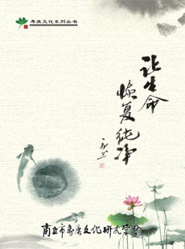

# 封面

封　面 | 目　录 | 下一页 《让生命恢复纯净》
　——改习惯转命运实录  **商丘市寿康文化研究学会 编印** 　　《左传》云：“祸福无门，唯人所召。”这话是说，灾祸和幸福不是上天注定的，而是人们自己造成的。《左传》问世时，虽然佛法尚未传入中国，但此话的宗旨却与佛法自作自受之因缘果报规律，若合符契。民谚也说，种瓜得瓜，种豆得豆。这一切都揭示了一个真理：**人的思想言行，时时刻刻创造、改变着自己的未来；命运是由自己创造的，也是由自己改变的。**

**目　　录** **前言**
**一、财运篇**
　　戒淫一年来的福报
　　邪淫与运气
　　佛菩萨给了我第二次生命
　　我是这样戒除邪淫的
　　我成功地戒除邪淫
　　淫欲损财福 戒淫得万报
　　命由自造福由自求 (出自《戒淫修福保命》)
　　（古代）仁医何澄
**二、考运功名篇**
　　发生在我身上的事
　　戒与不戒两个样
　　戒除邪淫转考运
　　戒手淫转考运
　　出乎预料的结果
　　戒手淫，你我都能！
　　戒淫后，我长到了一米八零——一个留学生的戒淫经历
　　戒手淫一月后成绩提高了
　　戒手淫一年了
　　（古代）不可不可
　　（古代）浙某士
**三、转弱为强篇**
　　快半年了，很轻松！
　　戒邪淫后福慧双增
　　戒淫半年来的感受经验总结
　　我戒邪淫的体会
　　（古代）养生故事五则（编者推荐细读第一则）
**四、逢凶化吉篇**
　　戒邪淫救了我的命
　　偶尔的一次抗拒淫欲，救了我的命
　　（古代）慈悲正直 后福无穷
**五、情缘篇**
　　戒邪淫一年的体会
　　我是如何摆脱同性恋的
**六、心境篇**
　　走出性幻想魔窟的摧残
　　从黑暗到光明
　　一位高材生的沦落和重生
　　我戒邪淫两个月后的体会
　　回归清净本性！
**七、体会篇**
　　戒邪淫报告
　　致发心戒邪淫的同修的一封信
　　戒邪淫心得
　　写在成功戒邪淫半年后
　　四十六年的人生，我的戒邪淫体会
　　我如何成功戒邪淫
**八、综合篇**
　　戒烟酒邪淫五年的真实感受
　　戒邪淫后的成果
　　戒除手淫后我的福报
　　我取得了很好的效果
　　戒除邪淫后的五个变化
　　我以我的生命轨迹实证袁了凡所言真实不虚
　　戒淫邪后的感受
　　戒淫后的“好感”
　　佛菩萨不会抛弃真忏悔弟子
　　断手淫力忏悔，诸佛菩萨加持不可思议亲遇记
**附录：**印光大师话寿康
　　总论
　　少年须知
　　求子之道
　　保养与康复
　　生产·育儿
　　居家之道
　　劝从医者
　　远色之道 　　
封　面 | 目　录 | 下一页
