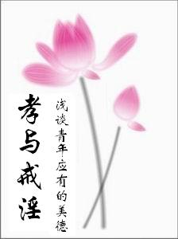

# 封面

 封　面 | 目　录 | 下一页 　　孝与戒淫

**　简　介**

    钟茂森博士敬述
　　古人说‘百善孝为先，万恶淫为首’。各位朋友，我们今天相聚，也就是研讨了这两个问题：孝与戒淫。孝是立身之本，戒淫是守身之要。人在天地之间，是需要有这样的德行才能站得住，一生才能吉祥如意。让我们共同努力，使自己成为一个高尚的人，一个脱离低级趣味的人，一个有益于国家和人民的人。

**目　录**     前言
　　一、孝─立身之本
　　二、戒淫—守身之要
　　结束语
封　面 | 目　录 | 下一页

如果您喜欢本书，请推荐给您身边的朋友 (如有指正请mmpa88@163.com联系，谢谢)
